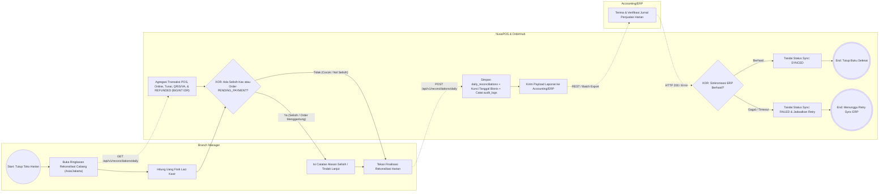

# Kunci Jawaban & Pembahasan Bernalar: Bab 01–04

> **Cara Menggunakan Kunci Ini:** Jangan hanya mencocokkan hasil akhir. Perhatikan **alasan di balik keputusan**, **analisis *trade-off***, dan **kesalahan umum** yang dihindari pada setiap skenario. Di dunia kerja nyata, seorang Senior System Analyst dinilai bukan dari hafalan definisi, melainkan dari ketajaman menimbang risiko bisnis, data, dan implementasi.

**Navigasi Cepat:**
- [Kunci Bab 01 — Fundamental System Analyst](#bab-01--fundamental-system-analyst) ([Buka Bab 01](../materi/01-fundamental-system-analyst.md))
- [Kunci Bab 02 — SDLC: Waterfall, Agile/Scrum, & Hybrid](#bab-02--sdlc-waterfall-agilescrum--hybrid) ([Buka Bab 02](../materi/02-sdlc-waterfall-agile.md))
- [Kunci Bab 03 — Requirement Elicitation, Stakeholder, & Komunikasi](#bab-03--requirement-elicitation-stakeholder--komunikasi) ([Buka Bab 03](../materi/03-requirement-elicitation-stakeholder.md))
- [Kunci Bab 04 — Process Modeling: Flowchart & BPMN 2.0](#bab-04--process-modeling-flowchart--bpmn-20) ([Buka Bab 04](../materi/04-process-modeling-flowchart-bpmn.md))
- [Kamus Domain Kanonik & Peta Kurikulum](../README.md)

---

## Bab 01 — Fundamental System Analyst

*(Tautan soal: [Bab 01 §7 Latihan Praktik](../materi/01-fundamental-system-analyst.md#7-latihan-praktik))*

### Pembahasan Skenario 1: Batas Peran (PM vs SA vs Tech Lead)

| Situasi | Pengambil Keputusan Utama | Peran & Kontribusi Spesifik SA | Mengapa Ini Benar & *Trade-off* |
| :--- | :--- | :--- | :--- |
| **(a) Cetak ulang struk vs kontrol Finance** | **SA** (merumuskan aturan kontrol sistem) dengan persetujuan akhir **Business/Finance Owner** (*Accountable* di RACI) | Mengusulkan solusi tengah berbasis aturan sistem: cetak ulang struk diperbolehkan, tetapi struk kedua wajib tercetak tanda air **"COPY / REPRINT"** dan aksinya tercatat di `audit_logs` (termasuk ID `Cashier`). | Melarang cetak ulang sama sekali menyulitkan operasional jika printer kertas macet; membebaskan tanpa jejak membuka celah manipulasi kas. SA menyelesaikan konflik operasional vs audit lewat desain perilaku sistem. |
| **(b) Diskon per item vs subtotal & aturan pembulatan** | **SA** bersama **Finance Lead** (aturan bisnis finansial) | Mengunci aturan kanonik di SRS: perhitungan diskon/pajak dilakukan di tingkat **subtotal** menggunakan bilangan bulat Rupiah (`BIGINT`) dan pembulatan eksplisit **`HALF_UP`** (`README.md §5`). | Jika keputusan diserahkan ke masing-masing *Backend Engineer*, hasil di layar kasir bisa berselisih Rp1–Rp2 dengan `daily_reconciliations`. Ini murni aturan domain & akurasi finansial, bukan preferensi *framework* kode. |
| **(c) Menunda rilis 2 bulan demi *loyalty tier*** | **Product Manager (PM)** / **Business Sponsor** | Memberikan masukan **dampak ruang lingkup & dependensi** (*"Menambah loyalty butuh tabel poin baru dan menggeser integrasi rekonsiliasi 4–5 minggu"*). | Menunda *go-to-market* adalah keputusan prioritas bisnis dan nilai pasar (ranah PM). SA dilarang memutuskan menunda rilis sendirian, tetapi wajib menyuplai estimasi kompleksitas agar keputusan PM berbasis fakta. |

**Kesalahan Umum Junior SA:** Langsung menjawab *"Iya saya buatkan fitur loyalty dan reprint bebas"* tanpa memisahkan keputusan bisnis/prioritas (PM) dari keputusan aturan konsistensi sistem (SA).

---

### Pembahasan Skenario 2: *System Thinking* Modul Void/Refund Pasca-Bayar (`FR-07`)

Pemetaan 6 elemen *system thinking* untuk `FR-07` mengacu pada [`../README.md`](../README.md):

1. **Input:** Permintaan pengajuan void/refund dari `Cashier` melalui `POST /api/v1/orders/{orderId}/refunds` berisi `order_id`, alasan pembatalan, nominal pengembalian, serta keputusan persetujuan/penolakan dari `Branch Manager`.
2. **Process:** Validasi status pesanan saat ini (harus sudah melewati `PAID`, bukan `PENDING_PAYMENT` atau `EXPIRED`), verifikasi RBAC cabang (`store_id`), pembuatan baris pada `refunds` (`PENDING_APPROVAL`), proses otorisasi `Branch Manager` (`APPROVED` atau `REJECTED`), pemanggilan API pengembalian dana ke `Payment Gateway (QRIS/VA)` jika non-tunai, pembaruan status `orders` menjadi `REFUNDED`, serta pencatatan mutasi `REFUND_RETURN` (bila stok dikembalikan) dan `audit_logs`.
3. **Output:** Status terbaru `refunds` & `orders` (`REFUNDED` atau tetap pada status sebelumnya jika ditolak), jejak audit permanen di `audit_logs`, bukti pengembalian dana, dan notifikasi status kepada `Customer` melalui `Notification Service`.
4. **Boundary (*In-Scope* vs *Out-of-Scope*):**
   - *In-Scope:* Pengajuan void/refund penuh untuk transaksi cabang terkait, mekanisme approval `Branch Manager`, serta pembaruan status dan rekonsiliasi.
   - *Out-of-Scope:* Investigasi sengketa *chargeback* bank penerbit kartu di luar API `Payment Gateway`, atau pengembalian dana manual lewat transfer rekening pribadi manajer di luar sistem.
5. **Constraint:** Hanya `Branch Manager` dari cabang (`store_id`) yang berwenang yang dapat menyetujui (`ERR_UNAUTHORIZED_APPROVAL` / `403 Forbidden` jika dicoba oleh `Cashier`); nominal `BIGINT` IDR tanpa selisih pembulatan; `audit_logs` bersifat *immutable* minimal 5 tahun (`NFR-03`); transaksi `REFUNDED` bersifat terminal (tidak dapat bertransisi lagi).
6. **Feedback:** Nominal transaksi `REFUNDED` otomatis mengurangi angka penjualan bersih pada laporan `daily_reconciliations` cabang di hari bisnis terkait (`Asia/Jakarta`), dan jika pembatalan disertai pengembalian barang utuh (`REFUND_RETURN`), stok `inventories` kembali bertambah.

**Kesalahan Umum Junior SA:** Melupakan elemen **Feedback** dan **Boundary**, sehingga tidak menyadari bahwa refund yang disetujui hari ini harus memengaruhi `daily_reconciliations` dan tidak boleh mengubah status kembali ke `PAID`.

---

### Pembahasan Skenario 3: Pemilihan Artefak untuk `POST /api/v1/orders`

**Jawaban Tepat:** Menyerahkan **BRD saja tidak cukup** karena BRD hanya menjelaskan *mengapa* bisnis membutuhkan stok terpusat dan KPI targetnya (`OBJ-01`), bukan aturan teknis atomik yang bisa di-*coding* dan diuji. Paket dokumen minimal yang harus diserahkan SA kepada *Backend* dan *QA* adalah:
1. **SRS (atau bagian `FR-03`, `FR-06`, `NFR-01`, `NFR-02`)** — mengunci aturan validasi stok, TTL 15 menit, pembulatan `HALF_UP`, target latensi `p95 <= 500 ms`, dan pencegahan *overselling*.
2. **Use Case Specification (`UC-02` & `UC-03`)** — menjelaskan langkah sukses serta seluruh jalur alternatif dan kegagalan (stok kurang, kode promo habis kuota).
3. **FSD / API Contract & ERD Relevan** — mengunci kontrak `POST /api/v1/orders`, struktur payload JSON, amplop error (`ERR_INSUFFICIENT_STOCK` / `409 Conflict`), serta skema tabel `orders`, `order_items`, `inventories`, dan `inventory_movements`.

**Trade-off:** Jika SA memaksakan *Backend* membaca BRD mentah untuk mulai *coding*, tim *Backend* akan membuat asumsi sendiri tentang nama kolom (`branch_id` vs `store_id`), tipe data uang (`FLOAT` vs `BIGINT`), dan waktu kedaluwarsa, yang berujung *rework* mahal.

---

### Pembahasan Skenario 4: Risiko *Boundary* Mengubah Harga Menu Langsung di Kasir

Usulan agar `Cashier` bebas mengganti harga menu di layar POS melanggar **3 prinsip kontrol bisnis dan batas sistem** sekaligus:
1. **Pelanggaran Pemisahan Tugas (*Segregation of Duties*) & RBAC:** Sesuai [`../README.md`](../README.md), pengelolaan master `products`, `product_variants`, dan harga per cabang merupakan wewenang **`HQ Admin`** (`FR-02`), bukan `Cashier`. Memberikan hak ubah harga kepada kasir membuka celah *fraud* (kasir menurunkan harga di sistem sementara menagih harga penuh ke pelanggan).
2. **Kekacauan Histori & Rekonsiliasi (`order_items` vs `daily_reconciliations`):** Meskipun `order_items` menyimpan *snapshot* harga saat transaksi, perubahan harga acak antar-shift dalam satu hari di cabang yang sama tanpa jejak persetujuan terpusat akan membuat `daily_reconciliations` sulit diaudit oleh tim Finance.
3. **Inkonsistensi Kanal `POS` vs `ONLINE_PICKUP`:** Jika kasir mengubah harga di POS lokal tanpa persetujuan master, harga di konter bisa berbeda dengan harga aplikasi pemesanan online pada jam yang sama, memicu komplain pelanggan.

**Solusi Rekomendasi SA:** Pertahankan batas wewenang bahwa perubahan harga hanya dilakukan `HQ Admin` di master `product_variants` (dan dicatat di `audit_logs`). Jika cabang butuh penyesuaian darurat, ajukan melalui mekanisme permintaan perubahan harga ke `HQ Admin` atau gunakan kode promo darurat dari `promotions`—bukan edit harga bebas oleh kasir.

---

## Bab 02 — SDLC: Waterfall, Agile/Scrum, & Hybrid

*(Tautan soal: [Bab 02 §7 Latihan Praktik](../materi/02-sdlc-waterfall-agile.md#7-latihan-praktik))*

### Pembahasan Skenario 1: Pemilihan Model SDLC

1. **Sistem Pelaporan Regulator (OJK) Bank Daerah -> Pilih *Waterfall* (atau *Hybrid* dengan *Blueprint Lock* sangat ketat di depan):**
   - *Alasan:* Ruang lingkup, skema data, dan aturan validasi sudah dikunci secara hukum oleh regulator sejak hari pertama; tenggat waktu tidak bisa dinegosiasikan (*fixed deadline & fixed compliance scope*); setiap perubahan membutuhkan jejak audit formal.
   - *Gaya Kerja SA:* Menyusun **BRD, SRS, Data Mapping/ERD, dan FSD** secara lengkap dan mendapatkan *sign-off* resmi dari unit Kepatuhan (*Compliance*) & Bisnis sebelum fase pengembangan penuh dimulai, lalu mengawal *UAT* formal berbasis *RTM*.
2. **Fitur Promo Poin di Aplikasi Mobile Ritel -> Pilih *Agile / Scrum*:**
   - *Alasan:* Perilaku pengguna terhadap mekanisme poin sering berubah setelah produk diluncurkan; desain UI dan alur penukaran poin perlu diuji cepat lewat prototipe dan rilis bertahap (*MVP* lebih dulu, penyempurnaan di Sprint berikutnya).
   - *Gaya Kerja SA:* Bekerja dengan pola ***Dual-Track Agile*** (1–2 Sprint di depan tim dev), memecah fitur menjadi *User Story* kecil di *Product Backlog*, menyempurnakan *Acceptance Criteria* saat *Backlog Refinement*, dan aktif mengevaluasi umpan balik pengguna pada *Sprint Review*.

**Kesalahan Umum Junior SA:** Memaksakan *Agile* tanpa dokumentasi kontrak data di proyek regulasi bank, atau memaksakan *Waterfall* kaku 6 bulan untuk fitur promo mobile yang seharusnya bisa diuji pasar dalam 2 minggu.

---

### Pembahasan Skenario 2: Krisis *Definition of Ready (DoR)* Menjelang *Sprint Planning*

**Langkah Tegas SA:** Jangan biarkan tiket *"Sistem bisa menerima bayar QRIS dan membatalkan order yang belum dibayar"* masuk ke dalam komitmen **Sprint Planning** besok dalam keadaan mentah. Jika dipaksakan masuk, *developer* akan berhenti kerja di hari ke-2 karena menunggu keputusan aturan bisnis (*blocked*).

**Daftar Item DoR yang Belum Terpenuhi:**
1. Belum ada kontrak integrasi eksternal dari vendor `Payment Gateway (QRIS/VA)` (format payload JSON, header *HMAC signature*, daftar status sukses/gagal).
2. Belum ada spesifikasi aturan **`idempotency_key` / `external_tx_id`** untuk menangani webhook duplikat (`NFR-02`).
3. Belum ada keputusan aturan untuk ***edge case* balapan waktu (*race condition* menit ke-15 detik ke-02)**: jika *scheduler* `FR-06` baru saja mengubah order menjadi `EXPIRED` dan melepas stok, lalu 2 detik kemudian webhook `PAID` dari bank benar-benar masuk karena pelanggan sudah terlanjur membayar di detik terakhir, apa yang harus dilakukan sistem?
   - *Aturan Kanonik (`README.md §7B`):* Transisi `EXPIRED -> PAID` **ditolak** dengan `ERR_INVALID_STATE_TRANSITION` / `ERR_RESERVATION_EXPIRED` (`410 Gone` / `409 Conflict`) agar stok yang sudah dilepas ke pelanggan lain tidak mengalami *overselling*; sistem mencatat pembayaran tersebut ke antrean flag rekonsiliasi/refund otomatis agar dana pelanggan dikembalikan.

**Aksi Konkret SA Hari Ini:** Segera adakan sesi darurat 45 menit bersama PM, Tech Lead, dan Finance untuk mengunci skenario balapan menit ke-15 serta memeriksa dokumen API vendor, atau usulkan ke PM agar tiket dipecah—*Sprint 3* hanya mengambil bagian yang sudah memenuhi DoR (misal *scheduler* `EXPIRED` + kerangka *mock webhook*) sambil menunggu spesifikasi vendor rampung.

---

### Pembahasan Skenario 3: Kolaborasi Lintas Tim pada Kasus Zona Waktu (UTC vs `Asia/Jakarta`)

**Analisis Kegagalan Kolaborasi & Spesifikasi:**
1. SA tidak menuliskan aturan konversi zona waktu secara eksplisit di dalam **API Contract / Screen Spec / FSD** (`NFR-04` dan [`../README.md`](../README.md) §5.6).
2. Akibatnya, *Frontend* menampilkan waktu UTC mentah tanpa konversi ke zona cabang (`Asia/Jakarta`), dan *Backend* mengelompokkan transaksi ke dalam tanggal bisnis `daily_reconciliations` menggunakan tanggal UTC (`2026-11-25 17:30 UTC` padahal di Surabaya/Jakarta itu sudah `2026-11-26 00:30 WIB`—tanggal 26, bukan tanggal 25!).
3. QA juga melewatkan kasus uji lintas batas tengah malam (*midnight boundary* pukul `23:30–00:30 WIB`).

**Aturan Perbaikan untuk Lintas Tim:**
- **Untuk Backend (`BE`):** Seluruh kolom *timestamp* di database (`created_at`, `paid_at`, `expires_at`) **tetap disimpan dalam UTC**. Namun, saat agregasi `daily_reconciliations`, pengelompokan tanggal bisnis wajib dikonversi terlebih dahulu ke zona waktu cabang (`stores.timezone`, misal `Asia/Jakarta` / UTC+7).
- **Untuk Frontend (`FE`):** Seluruh tampilan jam di UI POS, daftar antrean dapur, dan riwayat pelanggan wajib mengonversi string ISO-8601 UTC dari API ke zona waktu cabang (`WIB/WITA/WIT` sesuai `stores.timezone`) beserta label zona waktunya.
- **Untuk QA:** Tambahkan skenario uji batas tengah malam (transaksi `17:05 UTC` = `00:05 WIB` hari berikutnya) ke dalam *regression test suite* dan *UAT Script*.

---

### Pembahasan Skenario 4: Permintaan Tambahan di Hari ke-5 Sprint 2

**Respon Profesional SA:**
1. **Jangan langsung mengiyakan ke chat pribadi maupun menyuruh *Frontend/Backend* menambahkan kolom hari ini juga.** Menyelipkan perubahan di tengah Sprint yang sudah berjalan merusak fokus tim, mengganggu estimasi *velocity*, dan membuat QA harus mengulang pengujian layar POS serta skema tabel `orders`.
2. **Hargai masukan operasional & validasi nilai bisnisnya:** Tanyakan ke kepala operasional seberapa sering kejadian *"titipan ojol"* terjadi saat ini, dan apakah ada *workaround* sementara di Sprint 2 (misal kasir cukup mengisi catatan order di kolom `notes` yang sudah ada pada `order_items` atau catatan pelanggan tanpa menambah skema kolom baru di `orders`).
3. **Salurkan ke Jalur Resmi (PM & Product Backlog):** Catat permintaan tersebut sebagai tiket baru di *Product Backlog*, evaluasi dampaknya bersama UI/UX & BE, lalu serahkan kepada **PM** untuk diprioritaskan di **Sprint 3** (jika memang mendesak dan tidak bisa diakali dengan kolom catatan yang ada).

---

## Bab 03 — Requirement Elicitation, Stakeholder, & Komunikasi

*(Tautan soal: [Bab 03 §7 Latihan Praktik](../materi/03-requirement-elicitation-stakeholder.md#7-latihan-praktik))*

### Pembahasan Skenario 1: Rencana *Elicitation* 3 Langkah untuk `FR-08` (Tutup Buku Harian)

Urutan yang benar selalu bergerak dari **fakta dokumen -> fakta lapangan -> kesepakatan target**:

1. **Langkah 1 — *Document Analysis* (Target: Dokumen Historis & Finance):**
   - *Yang Diperiksa:* Contoh lembar Excel rekonsiliasi manual cabang saat ini, format laporan mutasi settlement dari `Payment Gateway (QRIS/VA)`, dan template/spesifikasi impor data milik sistem `Accounting/ERP`.
   - *Tujuan:* Memahami komponen angka apa saja yang wajib ada (tunai, QRIS/VA, diskon, pajak, refund), aturan pembulatan saat ini, serta penyebab historis munculnya selisih ratusan Rupiah.
2. **Langkah 2 — *Observation / Shadowing* & *Interview* (Target: 2–3 `Branch Manager` & Staf Finance):**
   - *Yang Dilakukan:* Mengamati langsung proses tutup kasir malam di 1–2 cabang (*shadowing* pukul 21.30–23.00 WIB) untuk melihat sumber waktu terbuang (misal memotret struk atau mengecek mutasi satu per satu), dilanjutkan wawancara terstruktur dengan Staf Finance mengenai aturan perlakuan selisih (*variance*) dan batas toleransi.
   - *Tujuan:* Menangkap *tacit knowledge* (misal kebiasaan transaksi lewat tengah malam WIB atau uang kas awal laci / *petty cash*).
3. **Langkah 3 — *Workshop / JAD* (Target: Ops Lead, Finance Lead, Tech Lead, PM):**
   - *Yang Dilakukan:* Memaparkan temuan akar penyebab selisih, lalu menyepakati desain *To-Be* `daily_reconciliations`: penguncian pembulatan `HALF_UP` di subtotal dengan `BIGINT` IDR, konversi zona waktu `Asia/Jakarta`, serta alur finalisasi oleh `Branch Manager` sebelum ekspor ke `Accounting/ERP`.
   - *Output:* MoM resmi, *Decision Log*, dan spesifikasi `FR-08` siap masuk tahap desain.

**Kesalahan Umum Junior SA:** Langsung mengundang 10 orang ke *Workshop* besar tanpa pernah melihat file Excel rekonsiliasi cabang sebelumnya, sehingga rapat habis hanya untuk menanyakan definisi kolom dasar.

---

### Pembahasan Skenario 2: Perbaikan Requirement Kabur & Gherkin (`FR-06`)

**(a) Pernyataan Spesifikasi Fungsional Tegas (`FR-06`):**
> **FR-06 (Pembatalan Otomatis Reservasi Kedaluwarsa):** Sistem *scheduler* **HARUS** memeriksa pesanan berstatus `PENDING_PAYMENT` yang nilai `expires_at` (`created_at + 15 menit` UTC) telah terlampaui, mengubah status pesanan tersebut secara atomik menjadi `EXPIRED`, mengurangi `reserved_qty` pada `inventories` sesuai kuantitas item, dan mencatat entri mutasi bertipe `RELEASE` pada `inventory_movements`. Apabila `Payment Gateway (QRIS/VA)` mengirimkan notifikasi pembayaran setelah pesanan berstatus `EXPIRED`, sistem **HARUS** menolak transisi ke `PAID` dengan mengembalikan kode galat `ERR_RESERVATION_EXPIRED` (HTTP `410 Gone` / `409 Conflict`) serta mencatat peristiwa tersebut untuk penanganan pengembalian dana / rekonsiliasi.

**(b) Acceptance Criteria Format Gherkin:**

```gherkin
Feature: Pelepasan Otomatis Reservasi Kedaluwarsa & Penolakan Bayar Terlambat (FR-06)

  Scenario: Pesanan melewati batas waktu TTL 15 menit diubah menjadi EXPIRED oleh scheduler
    Given pesanan "ORD-1001" pada store_id "STR-JKT-01" berstatus "PENDING_PAYMENT" dengan expires_at "2026-11-25T10:15:00Z"
    And varian "VAR-002" dalam pesanan tersebut berjumlah 2 unit dengan reserved_qty saat ini = 4
    When waktu sistem mencapai "2026-11-25T10:15:05Z" dan scheduler pengecekan kedaluwarsa berjalan
    Then status pesanan "ORD-1001" berubah menjadi "EXPIRED"
    And reserved_qty varian "VAR-002" di store_id "STR-JKT-01" berkurang menjadi 2
    And tercatat entri baru pada inventory_movements dengan tipe "RELEASE" dan qty = 2 untuk "ORD-1001"

  Scenario: Webhook pembayaran terlambat ditolak saat pesanan sudah berstatus EXPIRED
    Given pesanan "ORD-1001" sudah berstatus "EXPIRED" dan stok reservasi telah dilepas
    When Payment Gateway (QRIS/VA) mengirim POST /api/v1/webhooks/payments/qris ber-signature valid dengan status sukses untuk "ORD-1001"
    Then sistem menolak perubahan status pesanan ke "PAID" dan tidak mengurangi on_hand_qty pada inventories
    And sistem mengembalikan respons error dengan kode "ERR_RESERVATION_EXPIRED" (HTTP 410 atau 409)
    And peristiwa pembayaran terlambat tercatat di audit_logs untuk tindak lanjut rekonsiliasi
```

---

### Pembahasan Skenario 3: Resolusi Konflik Promo Bertumpuk & *Decision Log*

**Cara Memimpin Diskusi Kompromi:**
1. **Validasi tujuan masing-masing:** Marketing ingin menaikkan *Average Order Value (AOV)*, sedangkan Finance ingin melindungi margin bersih dan mencegah selisih pembulatan bertingkat yang mengacaukan laporan pajak.
2. **Evaluasi dampak teknis & finansial:** Mengizinkan 3 promo bertumpuk membutuhkan aturan urutan penghitungan yang sangat kompleks (promo A dulu baru promo B, apakah persentase dihitung dari harga awal atau sisa setelah promo A?), yang memperbesar risiko *bug* kalkulasi dan menunda rilis Fase 1.
3. **Ajukan opsi kompromi berbasis data:** Alih-alih menumpuk 3 kode promo secara acak, gunakan **1 kode promo terbaik per transaksi** (*single promo code per order*), tetapi Marketing diberi keleluasaan membuat promo **bundling atau berjenjang (*tiered minimum spend*)** di tabel `promotions` (misal *"Belanja min Rp100.000 diskon Rp20.000"*). Nilai AOV tetap naik tanpa merusak struktur pembulatan subtotal!

**Contoh 1 Baris Decision Log:**

| ID Keputusan | Tanggal | Konteks Masalah | Keputusan Final | Alasan & Trade-off | Pemutus (`A`) |
| :--- | :--- | :--- | :--- | :--- | :--- |
| `DEC-006` | `2026-11-12` | Marketing meminta tumpuk maksimal 3 kode promo per keranjang; Finance menolak karena risiko margin bocor dan kompleksitas pembulatan pajak. | Fase 1 membatasi **maksimal 1 kode promo (`promotions`) per pesanan (`orders`)**, pembulatan `HALF_UP` di level subtotal; peningkatan AOV difasilitasi lewat syarat `min_spend` lebih tinggi pada master promo. | Menjaga keakuratan 0 selisih (`NFR-04`) dan ketepatan jadwal Fase 1; *trade-off* Marketing perlu mengemas kampanye dalam 1 kode voucher bernilai lebih besar daripada banyak kode digabung. | Business Sponsor / PM & Finance Lead |

---

### Pembahasan Skenario 4: Menolak *Scope Creep* Menjelang UAT & Menjaga Integritas RTM

1. **Respons Komunikasi ke Pemilik Cabang Waralaba:** Sampaikan apresiasi atas masukannya untuk meningkatkan penjualan, lalu jelaskan secara transparan namun tegas bahwa pengiriman kurir pihak ketiga (`OUT_FOR_DELIVERY` / `DELIVERED`) secara resmi masuk kategori **Out-of-Scope Fase 1** yang sudah disepakati pada BRD. Memasukkan integrasi kurir 2 minggu sebelum UAT akan memaksa perubahan skema database (`deliveries`, `customer_addresses`), status pesanan, kontrak API baru, dan mengancam penundaan peluncuran POS seluruh cabang. Tawarkan agar kebutuhan ini dicatat resmi sebagai **Change Request (CR) Fase 2**.
2. **Dokumen yang Diperbarui:** Catat usulan tersebut ke dalam **Backlog / Daftar Change Request (CR)** untuk dievaluasi pada siklus pasca-rilis Fase 1 (gunakan [`../templates/template-cr-impact-analysis.md`](../templates/template-cr-impact-analysis.md) saat siap dianalisis), dan dokumentasikan penolakan penundaan jadwal di *MoM / Decision Log*.
3. **Mengapa Tidak Boleh Langsung Diselipkan ke RTM Fase 1:** Fungsi utama *RTM* adalah menjaga keterlacakan **ruang lingkup yang disetujui** dari `BR -> FR -> UC -> Endpoint -> DB -> UAT`. Memasukkan fitur liar langsung ke RTM tanpa persetujuan BRD/CR dan tanpa kode desain berarti menambahkan pekerjaan tak terverifikasi yang membuat status UAT tidak akan pernah bisa selesai (*Sign-Off* gagal).

---

## Bab 04 — Process Modeling: Flowchart & BPMN 2.0

*(Tautan soal: [Bab 04 §7 Latihan Praktik](../materi/04-process-modeling-flowchart-bpmn.md#7-latihan-praktik))*

### Pembahasan Skenario 1: Mengkritisi & Memperbaiki Diagram BPMN `UC-02` (POS In-Store)

**Dampak 3 Kesalahan pada Diagram Junior SA:**
- **(a) Tanpa *Swimlane*:** Tim tidak dapat membedakan mana aksi fisik kasir (`Cashier`), mana validasi atomik server (`Sistem NusaPOS`), mana verifikasi eksternal (`Payment Gateway (QRIS/VA)`), dan mana tugas dapur (`Kitchen/Barista`).
- **(b) Memakai `AND` Gateway untuk Tunai dan QRIS:** Kesalahan fatal logika proses! Gateway `AND` memerintahkan kasir menerima uang tunai **DAN sekaligus** memproses QRIS untuk satu pesanan yang sama, serta alur tidak akan berlanjut sebelum keduanya selesai. Seharusnya memakai **Exclusive Gateway (`XOR`)** karena pelanggan memilih salah satu metode pembayaran.
- **(c) Langsung ke `PREPARING` Tanpa Verifikasi Webhook & Jalur Batal:** Untuk pembayaran QRIS di kasir, jika dapur langsung meracik sebelum webhook valid (`PAID`) diterima, pelanggan bisa membatalkan transfer atau jaringan gagal sementara minuman sudah terlanjur dibuat (kerugian bahan baku). Selain itu, tidak adanya jalur batal (`CANCELLED`) membuat *End Event* gagal tidak terpetakan.

**Perbaikan Alur Terstruktur (Ringkasan Swimlane):**
1. *Swimlane `Cashier`:* Input pesanan pelanggan -> pilih metode bayar -> terima uang tunai *(jika Tunai)* atau tampilkan QRIS di layar kasir *(jika QRIS)* -> batalkan pesanan jika pelanggan mengurungkan niat sebelum lunas.
2. *Swimlane `Sistem NusaPOS`:* Validasi & kunci stok (`PENDING_PAYMENT`) -> `XOR Gateway (Tunai vs QRIS)`:
   - Jalur `CASH`: kasir konfirmasi terima uang -> sistem potong stok (`DEDUCT`) & ubah status `PAID`.
   - Jalur `QRIS`: minta QRIS ke `Payment Gateway` -> tunggu *signed webhook* (`PAID`) atau pembatalan kasir (`CANCELLED` + `RELEASE` stok).
3. *Swimlane `Kitchen/Barista`:* Hanya menerima tiket pesanan **setelah** status resmi `PAID`, lalu memproses `PREPARING -> READY -> COMPLETED`.

---

### Pembahasan Skenario 2: Diagram BPMN Mermaid Rekonsiliasi Harian (`FR-08`)

Berikut solusi referensi diagram Mermaid `flowchart LR` + `subgraph` swimlane untuk **Rekonsiliasi Penjualan Harian Cabang (`FR-08`)**:



**Poin Penilaian Penting pada Diagram Anda:**
- Semua label yang memakai tanda kurung `()` atau tanda tanya `?` dikutip aman dengan `["..."]` / `{"..."}`.
- Ada pemisahan tegas antara tanggal bisnis `Asia/Jakarta`, perhitungan `BIGINT`, pencatatan `audit_logs`, dan penanganan skenario gagal kirim ke `Accounting/ERP` (tidak berhenti di *happy path*).

---

### Pembahasan Skenario 3: Memilih Jenis *Gateway* (`XOR`, `AND`, `OR`)

| Kondisi | Jenis Gateway | Alasan Tepat |
| :--- | :---: | :--- |
| **(a) Status `READY` -> perbarui layar antrean konter DAN kirim WA via `Notification Service`** | **`AND` (Parallel Gateway)** | Kedua aksi harus dijalankan bersamaan secara independen begitu status berubah menjadi `READY`, tanpa memilih salah satu saja. |
| **(b) Pelanggan memilih jenis pesanan: `POS` atau `ONLINE_PICKUP`** | **`XOR` (Exclusive Gateway)** | Satu pesanan hanya boleh berasal dari tepat satu kanal (`POS` atau `ONLINE_PICKUP`), bersifat saling meniadakan (*mutually exclusive*). |
| **(c) Pemeriksaan promo: diskon reguler saja, poin loyalitas saja, atau keduanya sekaligus** | **`OR` (Inclusive Gateway)** | Satu atau lebih cabang kondisi dapat aktif bersamaan (hanya A, hanya B, atau A dan B sekaligus). *(Catatan praktis: dalam desain produk, sering kali tetap lebih mudah dipahami jika dimodelkan sebagai dua `XOR` berurutan, namun secara teori BPMN ini adalah contoh klasik `OR` Gateway).* |
| **(d) Keputusan `Branch Manager` atas `refunds`: `APPROVED` atau `REJECTED`** | **`XOR` (Exclusive Gateway)** | Pengajuan refund hanya bisa berakhir disetujui atau ditolak—mustahil disetujui dan ditolak secara bersamaan. |

**Kesalahan Umum Junior SA:** Sering tertukar antara `OR` dan `XOR` pada kasus pilihan biner seperti metode pembayaran atau hasil *approval*. Ingat: jika jawabannya **"hanya satu dari beberapa pilihan"**, gunakan **`XOR`**.

---

### Pembahasan Skenario 4: Analisis *As-Is* ke *To-Be* Klinik Gigi

**3 Masalah Utama pada Proses *As-Is*:**
1. *Single Point of Failure & Rawan Bentrok Jadwal:* Buku tulis resepsionis tidak mendukung validasi slot bentrok secara otomatis dan tidak bisa diakses bersamaan dari beberapa meja atau oleh dokter di ruang periksa.
2. *Kehilangan Pendapatan akibat Pasien Batal Tanpa Kabar (No-Show):* Tidak ada mekanisme pengingat otomatis sebelum jadwal kedatangan.
3. *Antrean Kacau & Privasi Terganggu:* Memanggil pasien dengan berteriak dari meja depan tidak terdengar jika ruang tunggu ramai, tidak terekam waktu tunggunya, dan mengganggu kenyamanan ruang klinik.

**3 Perubahan Spesifik yang Harus Muncul pada Diagram *To-Be*:**
1. *Swimlane `Sistem Klinik` + Validasi Slot Atomik:* Pendaftaran melalui web/WhatsApp bot atau resepsionis langsung memeriksa ketersediaan jadwal dokter secara *real-time* sebelum mengunci janji temu (`BOOKED`).
2. ***Intermediate Timer Event* (Misal H-24 Jam / H-2 Jam) + *Message Event* Pengingat:** Sistem secara otomatis memicu pengiriman pesan konfirmasi kedatangan via WhatsApp/SMS; jika pasien memilih batal lewat tautan konfirmasi, `XOR Gateway` langsung melepaskan slot dokter agar bisa diisi pasien daftar tunggu (*waiting list*).
3. *Antrean Digital Ruang Tunggu (`CHECKED_IN -> IN_CONSULTATION -> COMPLETED`):* Resepsionis atau kios melakukan *check-in* saat pasien tiba, lalu dokter menekan tombol panggil di layar ruang periksa yang otomatis memicu tampilan nomor antrean di layar TV ruang tunggu dan notifikasi ke ponsel pasien.

---

**Langkah Berikutnya:** Setelah memeriksa seluruh jawaban Bab 01–04 dan memastikan tidak ada miskonsepsi di fondasi, lanjutkan mempelajari pemodelan perilaku tingkat *Use Case* dan *Activity Diagram* pada Bab 05 (lihat peta kurikulum di [`../README.md`](../README.md)).
