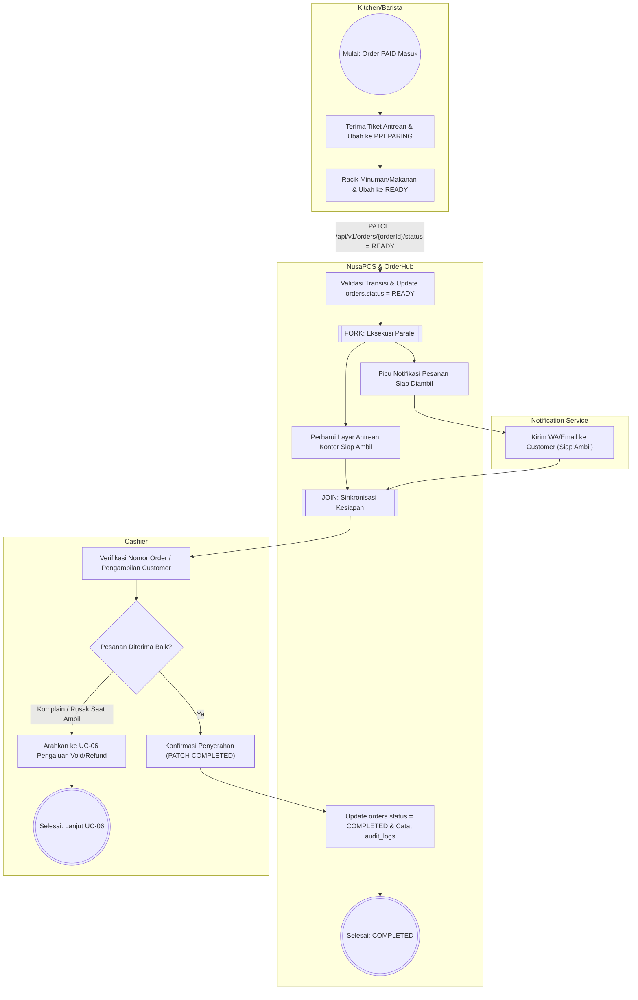
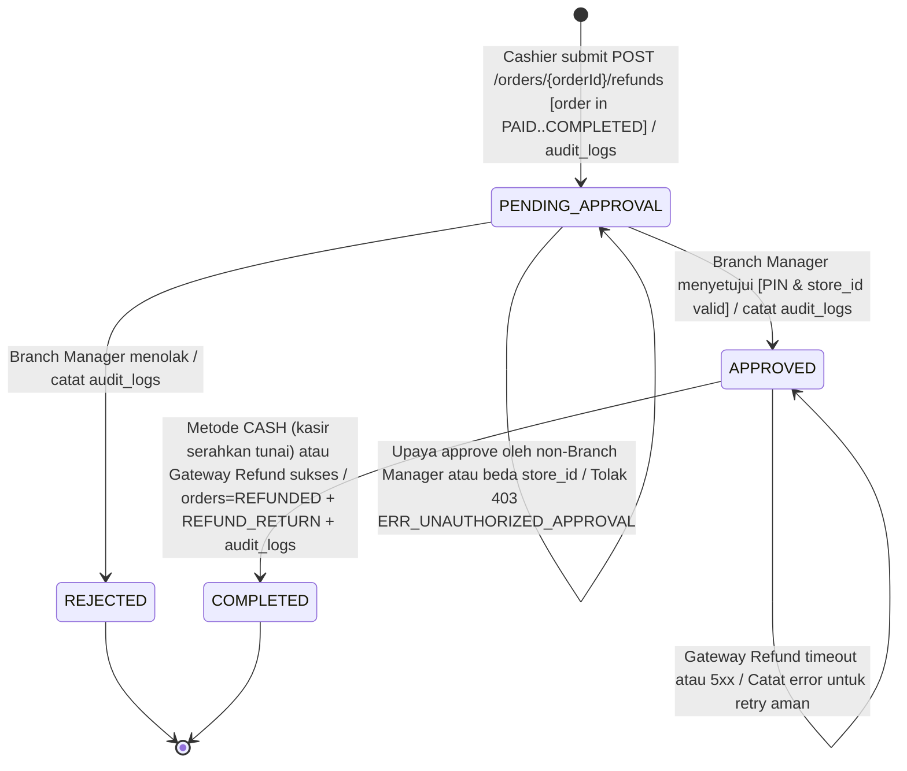
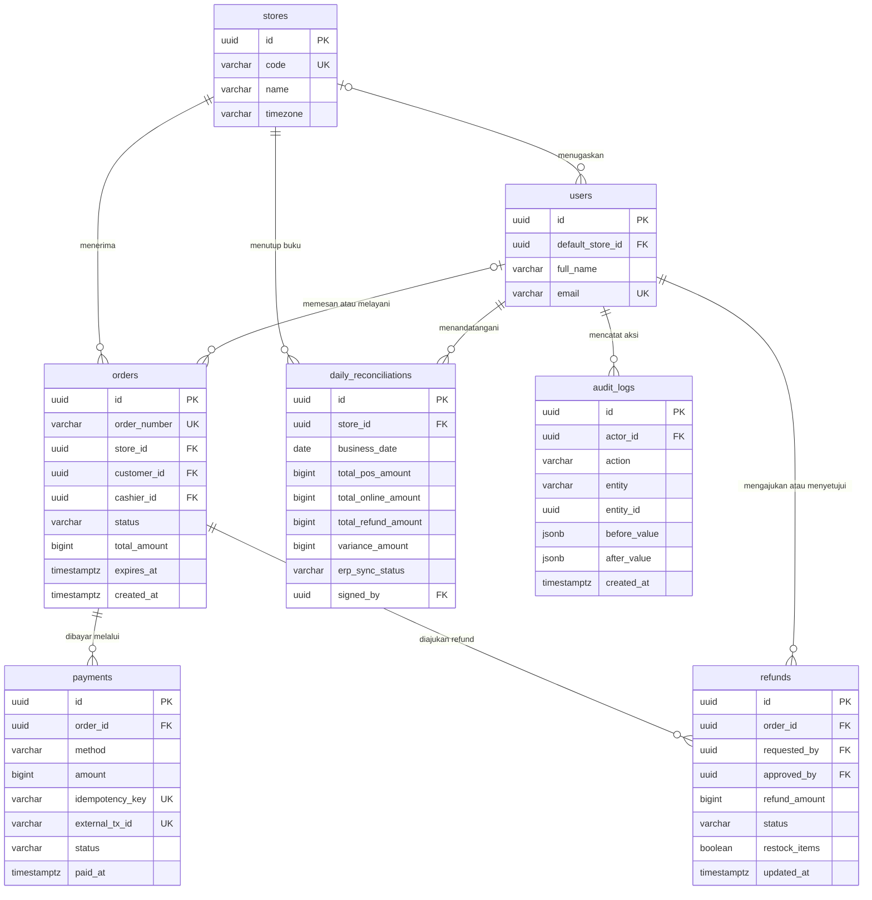

# Kunci Jawaban & Pembahasan Bernalar: Bab 05–08

> **Cara Menggunakan Kunci Ini:** Sama seperti bagian sebelumnya, fokuslah pada **alasan teknis dan bisnis di balik setiap keputusan**. Perhatikan bagaimana satu detail di Use Case Specification (Bab 05) berdampak langsung ke Sequence & State Machine (Bab 06), Field Mapping UI (Bab 07), serta skema SQL & query investigasi (Bab 08).

**Navigasi Cepat:**
- [Kunci Bab 05 — UML Behavioral Part 1: Use Case & Activity Diagram](#bab-05--uml-behavioral-part-1-use-case--activity-diagram) ([Buka Bab 05](../materi/05-uml-use-case-activity.md))
- [Kunci Bab 06 — UML Behavioral Part 2 & Structural: Sequence, State Machine, & Class](#bab-06--uml-behavioral-part-2--structural-sequence-state-machine--class) ([Buka Bab 06](../materi/06-uml-sequence-state-class.md))
- [Kunci Bab 07 — UI/Screen Specification & Field-Level Mapping](#bab-07--uiscreen-specification--field-level-mapping) ([Buka Bab 07](../materi/07-ui-screen-spec-field-mapping.md))
- [Kunci Bab 08 — Data Modeling (ERD) & SQL Wajib SA](#bab-08--data-modeling-erd--sql-wajib-sa) ([Buka Bab 08](../materi/08-data-modeling-erd-sql.md))
- [Kamus Domain Kanonik & Peta Kurikulum](../README.md)

---

## Bab 05 — UML Behavioral Part 1: Use Case & Activity Diagram

*(Tautan soal: [Bab 05 §7 Latihan Praktik](../materi/05-uml-use-case-activity.md#7-latihan-praktik))*

### Pembahasan Skenario 1: Audit Use Case Diagram

| Butir Temuan | Alasan Kesalahan | Perbaikan Kanonik (`README.md`) |
| :--- | :--- | :--- |
| **(a) Oval `"Ketik PIN Branch Manager"`** | Terjebak *functional decomposition* menjadi aksi antarmuka mikro (tidak lulus *Coffee Break Test*). Mengetik PIN bukan tujuan bisnis utuh; itu hanyalah satu langkah validasi di dalam proses persetujuan refund. | Hapus oval tersebut dan masukkan langkah verifikasi PIN ke dalam *Main Success Scenario* milik **`UC-06: Pengajuan Void/Refund & Rekonsiliasi Harian`**. |
| **(b) `UC-03 -.->\|"<<extend>>"\| Terapkan Kode Promo`** | **Arah panah `<<extend>>` terbalik!** Panah dari `UC-03` ke `Promo` seolah-olah mengatakan `Promo` adalah base dan `UC-03` opsional. Padahal `UC-03` adalah Use Case dasar, sedangkan promo bersifat opsional. | Balik arah panah menjadi **`Terapkan Kode Promo -.->\|"<<extend>>"\| UC03`** (dari *Extension* mengarah ke *Base*). |
| **(c) `Customer` terhubung langsung ke `UC-06`** | Pelanggaran kontrol RBAC & batas aktor. `Customer` tidak memiliki akses langsung ke layar pengajuan atau approval internal `refunds` (`POST /api/v1/orders/{orderId}/refunds`). | Putuskan garis `Customer --- UC-06`. Aktor primer `UC-06` adalah **`Cashier`** (pengaju) dan **`Branch Manager`** (penyetuju). `Customer` hanya menerima notifikasi hasil via `Notification Service`. |
| **(d) Tidak ada aktor sistem eksternal** | Menyembunyikan ketergantungan integrasi eksternal membuat tim *Backend* dan *Infra* tidak menyadari perlunya kontrak *webhook* QRIS (`UC-04`) dan integrasi WA/Email (`Notification Service`). | Tambahkan aktor sekunder di sisi kanan *System Boundary*: **`Payment Gateway (QRIS/VA)`**, **`Notification Service`**, dan **`Accounting/ERP`** sesuai interaksi masing-masing Use Case. |

**Kesalahan Umum Junior SA:** Menganggap semua orang yang menerima dampak Use Case (termasuk `Customer` yang menerima pengembalian dana) sebagai *Primary Actor* yang berhak menekan tombol di sistem internal.

---

### Pembahasan Skenario 2: Use Case Specification Lengkap `UC-02` (POS In-Store)

Berikut solusi referensi sesuai struktur [`../templates/template-use-case.md`](../templates/template-use-case.md):

#### 1. Identitas & Metadata Use Case

| Atribut | Detail |
| :--- | :--- |
| **Use Case ID** | `UC-02` |
| **Nama Use Case** | Pembuatan & Pembayaran Pesanan Kasir di Toko (POS In-Store) |
| **Modul / Fitur** | Point of Sale (POS) & Order Management |
| **Referensi FR / BR** | `FR-02`, `FR-03`, `FR-04`, `NFR-01`, `NFR-02`, `NFR-04` |
| **Prioritas** | Must Have / Critical |

#### 2. Aktor & Pemangku Kepentingan

- **Aktor Primer:** `Cashier`
- **Aktor Sekunder:** `Payment Gateway (QRIS/VA)` (hanya jika pelanggan memilih bayar QRIS/VA di kasir), `Notification Service` (opsional jika pelanggan minta struk digital)
- **Stakeholders:** Pelanggan *walk-in* (layanan cepat di konter), `Kitchen/Barista` (antrean akurat), Finance (pencatatan kas laci presisi).

#### 3. Kondisi Awal & Pemicu

- **Preconditions:**
  1. `Cashier` telah login (`UC-01`) dan terikat pada `store_id` aktif yang sedang beroperasi.
  2. Katalog produk dan stok cabang (`on_hand_qty - reserved_qty`) telah termuat melalui `GET /api/v1/stores/{storeId}/menu`.
- **Trigger:** `Cashier` selesai memasukkan item pesanan pelanggan ke keranjang POS, memilih metode `CASH` (atau `QRIS`), dan menekan tombol **"Proses Pembayaran"**.

#### 4. Alur Sukses Utama (*Main Success Scenario — Pembayaran Tunai / `CASH`*)

| Langkah | Aktor / Sistem | Deskripsi Aksi |
| :---: | :--- | :--- |
| `1` | **Cashier** | Mengisi item (`variant_id`, `qty`, `notes`), kode promo opsional, memilih metode **`CASH`**, memasukkan nominal uang tunai yang diterima (`>= total_amount`), lalu mengirim `POST /api/v1/orders` (`channel = 'POS'`). |
| `2` | **Sistem** | Memvalidasi sesi `Cashier`, kecocokan `store_id`, validitas promo (jika ada), serta menghitung subtotal, diskon, pajak, dan total dalam `BIGINT` Rupiah (`HALF_UP`). |
| `3` | **Sistem** | Membuka transaksi DB dan mengunci baris `inventories` untuk setiap `(store_id, variant_id)` (`SELECT ... FOR UPDATE`), memastikan `on_hand_qty - reserved_qty >= qty`. |
| `4` | **Sistem** | Karena pembayaran **`CASH`** langsung lunas di tempat, sistem langsung mengurangi `inventories.on_hand_qty` dan mencatat mutasi `DEDUCT` di `inventory_movements`. |
| `5` | **Sistem** | Menyimpan header `orders` (`channel = 'POS'`, `status = 'PAID'`, `cashier_id`), menyimpan *snapshot* harga & nama di `order_items`, serta menyimpan record `payments` (`method = 'CASH'`, status `PAID`, `paid_at = NOW()` UTC). |
| `6` | **Sistem** | Mengirim pesanan berstatus `PAID` ke antrean dapur `Kitchen/Barista` dan mengembalikan data transaksi ke layar POS untuk mencetak struk fisik. |

#### 5. Alur Alternatif (*Alternative Flows*)

- **`1a.` Pelanggan memilih pembayaran non-tunai (`QRIS`) di meja kasir:**
  1. `Cashier` memilih metode `QRIS` pada `POST /api/v1/orders`.
  2. Sistem mengunci stok dan menambah `reserved_qty` (`RESERVE`), menyimpan `orders` dengan status **`PENDING_PAYMENT`** (`expires_at = NOW() + 15 minutes` UTC), lalu meminta QRIS dinamis ke `Payment Gateway (QRIS/VA)`.
  3. Kode QRIS tampil di layar kasir/pelanggan; ketika webhook `UC-04` masuk sah, status berubah menjadi `PAID`, `reserved_qty` & `on_hand_qty` dipotong (`DEDUCT`), dan pesanan masuk ke dapur.

#### 6. Alur Pengecualian (*Exception Flows*)

- **`E1` (pada Langkah 3) — Stok Cabang Tidak Mencukupi:**
  1. Sistem mendeteksi `on_hand_qty - reserved_qty < qty` (misal sisa stok baru saja direservasi pelanggan *online* 1 detik sebelumnya).
  2. Sistem melakukan **`ROLLBACK`** penuh tanpa memotong satu pun item, lalu mengembalikan `ERR_INSUFFICIENT_STOCK` (`409 Conflict`).
  3. `Cashier` menginformasikan ke pelanggan untuk mengganti varian atau mengurangi kuantitas.
- **`E2` (pada Langkah `1a`, saat status `PENDING_PAYMENT`) — Pelanggan Membatalkan di Meja Kasir Sebelum Membayar QRIS:**
  1. `Cashier` menekan `"Batalkan Pesanan"` (`PATCH /api/v1/orders/{orderId}/status` -> `CANCELLED`).
  2. Sistem melepas `reserved_qty`, mencatat `RELEASE` di `inventory_movements`, dan mengubah `orders.status` menjadi `CANCELLED`.
- **`E3` (pada Langkah 1) — Nominal Uang Tunai Kurang dari Total Tagihan:**
  1. Validasi UI dan backend menolak submit dan meminta `Cashier` memasukkan nominal tunai `>= total_amount`.

#### 7. Kondisi Akhir (*Postconditions*)

- **Success Postcondition:** `orders.status = 'PAID'`, `payments` tercatat lunas, `inventories.on_hand_qty` berkurang disertai mutasi `DEDUCT`, dan pesanan muncul di layar dapur.
- **Minimal / Failure Guarantee:** Tidak ada stok terpotong atau tereservasi jika transaksi gagal (`0% overselling`).

#### 8. Aturan Bisnis & Referensi Terkait

- **Aturan Bisnis:** Pembulatan `HALF_UP` `BIGINT`; kasir tidak dapat mengubah harga master; `store_id` mengikuti cabang penugasan kasir.
- **Referensi NFR:** `NFR-01` (`<= 500 ms`), `NFR-02` (row-level locking).

---

### Pembahasan Skenario 3: Activity Diagram `UC-05` (`flowchart TD` dengan Swimlane & Fork/Join)



**Mengapa Pola Ini Tepat:** `FORK` memodelkan pembaruan UI konter dan pengiriman WA terjadi serentak (tidak saling menunggu), lalu `JOIN` menyatukan kesiapan konfirmasi sebelum kasir menyerahkan barang dan menutup transaksi ke `COMPLETED` (atau mengalir ke `UC-06` tanpa *dead-end*).

---

### Pembahasan Skenario 4: Mengapa TTL 15 Menit, Bukan 24 Jam?

Membiarkan status `PENDING_PAYMENT` dan reservasi stok selama 24 jam akan menghancurkan operasional kedai kopi ritel karena **3 alasan utama**:
1. **Stok Terkunci oleh Pelanggan "Batal Diam-Diam" (*Ghost Carts*):** Di ritel minuman cepat saji, banyak pelanggan batal membayar atau lupa menyelesaikan QRIS. Jika stok *Kopi Susu Aren* ditahan 24 jam, sisa stok di cabang terlihat "Habis" bagi pelanggan *walk-in* yang sudah berdiri di depan kasir membawa uang tunai!
2. **Ketidakcocokan Siklus Tutup Buku Harian (`daily_reconciliations`):** Kedai kopi tutup buku setiap hari operasional (`06.00–23.00 WIB` sesuai `NFR-04`). Pesanan `PENDING_PAYMENT` yang menggantung melintasi tengah malam mengotori laporan tutup buku dan rekonsiliasi stok harian.
3. **Sifat Produk F&B (*Perishable & Impulse*):** Pemesanan *self-pickup* kopi membutuhkan pemenuhan segera dalam menit, bukan hari. Batas **15 menit** cukup panjang untuk membuka aplikasi e-wallet/m-banking namun cukup pendek untuk menjaga perputaran `inventories` tetap sehat bagi pelanggan lain.

---

## Bab 06 — UML Behavioral Part 2 & Structural: Sequence, State Machine, & Class

*(Tautan soal: [Bab 06 §7 Latihan Praktik](../materi/06-uml-sequence-state-class.md#7-latihan-praktik))*

### Pembahasan Skenario 1: Perbaikan 4 Celah pada Sequence Diagram Webhook

**Empat Celah Kritis pada Sequence Junior SA:**
1. **Tidak Ada Verifikasi *HMAC Signature*:** Siapa pun di internet yang menebak URL endpoint dapat mengirim JSON palsu `"status": "PAID"` untuk mendapatkan kopi gratis (`NFR-03`).
2. **Tidak Ada Pemeriksaan *Idempotency* (`idempotency_key` / `external_tx_id`):** Jika gateway mengirim ulang webhook yang sama 2 kali karena masalah jaringan, `on_hand_qty` terpotong 2 kali (`NFR-02`).
3. **Tidak Ada Penguncian Baris & Penjagaan State (`EXPIRED` / `CANCELLED`):** Langsung menjalankan `UPDATE orders SET status = 'PAID'` tanpa memeriksa apakah status saat ini masih `PENDING_PAYMENT` membuat order `EXPIRED` hidup kembali menjadi `PAID` padahal stoknya sudah dilepas ke orang lain!
4. **Tidak Ada Atomicity Transaksi (`BEGIN TX ... COMMIT`) & Mutasi `inventory_movements`:** Memperbarui `orders` lalu mengurangi `inventories` tanpa satu transaksi atomik berisiko order berubah `PAID` sementara stok gagal terpotong bila terjadi crash di tengah, serta kehilangan jejak `DEDUCT`.

**Urutan Perbaikan yang Benar:**
`1. Terima POST /api/v1/webhooks/payments/qris` -> `2. Verifikasi HMAC Signature (tolak 401/403 + audit_logs jika invalid)` -> `3. Cek payments.external_tx_id / idempotency_key (jika sudah sukses, balas 200 OK idempotent ack tanpa proses ulang)` -> `4. BEGIN TX & SELECT orders FOR UPDATE` -> `5. Validasi status == PENDING_PAYMENT & now <= expires_at (jika EXPIRED/CANCELLED, ROLLBACK + catat flag rekonsiliasi + balas ERR_INVALID_STATE_TRANSITION / ERR_RESERVATION_EXPIRED)` -> `6. Update payments=PAID, orders=PAID, inventories (on_hand_qty -= qty, reserved_qty -= qty), insert inventory_movements (DEDUCT)` -> `7. COMMIT TX` -> `8. Async trigger Notification Service` -> `9. Balas 200 OK`.

---

### Pembahasan Skenario 2: State Machine Diagram (`stateDiagram-v2`) untuk Entitas `refunds`



**Trade-off Penting:** Status `APPROVED` dipisahkan dari `COMPLETED` secara sengaja! Alasannya: jika `Branch Manager` menyetujui refund pesanan `QRIS`, lalu API `Payment Gateway (QRIS/VA)` tiba-tiba mengalami *timeout*, sistem tidak boleh langsung menandai `orders.status = 'REFUNDED'` sebelum uang benar-benar dikonfirmasi kembali oleh gateway. Pemisahan `APPROVED -> COMPLETED` memberi ruang *retry* aman tanpa merusak laporan `daily_reconciliations`.

---

### Pembahasan Skenario 3: Uji Ketahanan Transisi Status Order

| Transisi | Sah / Ilegal? | Alasan & Kode Error Kanonik |
| :--- | :---: | :--- |
| **(a) `PENDING_PAYMENT -> EXPIRED`** | **SAH** | Dijalankan oleh *scheduler* saat `NOW() > expires_at` (TTL 15 menit terlampaui) sambil melepas `reserved_qty` (`RELEASE`). |
| **(b) `EXPIRED -> PENDING_PAYMENT`** | **ILEGAL** | `EXPIRED` adalah status terminal (stok sudah dilepas kembali ke publik). Tolak dengan **`422 Unprocessable Entity` (`ERR_INVALID_STATE_TRANSITION`)** atau **`410 Gone` (`ERR_RESERVATION_EXPIRED`)**; pelanggan wajib membuat pesanan baru. |
| **(c) `READY -> REFUNDED`** | **SAH** | Termasuk status pasca-bayar; sah jika diajukan dan disetujui secara eksplisit oleh `Branch Manager` lewat `refunds` + `audit_logs`. |
| **(d) `COMPLETED -> REFUNDED`** | **SAH** | Sah secara kondisional untuk kasus komplain pelanggan pasca-ambil dengan persetujuan `Branch Manager` + `audit_logs`. |
| **(e) `PAID -> COMPLETED`** | **ILEGAL** | Melompati alur pemenuhan dapur (`PREPARING` dan `READY`). Tolak dengan **`422 Unprocessable Entity` (`ERR_INVALID_STATE_TRANSITION`)**. |
| **(f) `READY -> OUT_FOR_DELIVERY`** | **ILEGAL (Fase 1)** | Status `OUT_FOR_DELIVERY` tidak ada di Fase 1 (*Out-of-Scope* kurir 3PL sebelum CR Bab 11). Tolak dengan **`422 Unprocessable Entity` (`ERR_INVALID_STATE_TRANSITION`)**. |

---

### Pembahasan Skenario 4: Relasi & Multiplicity Domain Class Diagram

| Pasangan Kelas | Jenis Relasi & Multiplicity | Alasan Desain |
| :--- | :--- | :--- |
| **(a) `Order` — `OrderItem`** | **Composition (`*--`)**, `Order "1" *-- "1..*" OrderItem` | `OrderItem` tidak bermakna tanpa induk `Order`; satu pesanan wajib memiliki minimal 1 item. |
| **(b) `Product` — `ProductVariant`** | **Composition (`*--`)**, `Product "1" *-- "1..*" ProductVariant` | Varian SKU (misal Regular/Large) milik eksklusif satu produk induk dan setiap produk yang dijual minimal punya 1 varian. |
| **(c) `Order` — `Promotion`** | **Association (`-->`)**, `Promotion "0..1" <-- "0..*" Order` | Pesanan bersifat opsional menggunakan promo (`0..1`), dan satu kode promo yang sama dapat digunakan oleh banyak pesanan (`0..*`) selama kuota masih ada. |
| **(d) `Order` — `Payment`** | **Composition (`*--`)**, `Order "1" *-- "0..*" Payment` | Memakai `0..*` (bukan tepat `1`) karena saat pesanan dibatalkan sebelum memanggil gateway atau gagal sebelum record bayar terbentuk, jumlah `Payment` sukses bisa `0`; dan jika percobaan bayar pertama gagal/kedaluwarsa lalu dibuat ulang (atau pencatatan percobaan terpisah), bisa ada lebih dari 1 record `Payment` historis (dengan aturan hanya maksimal 1 yang berstatus `PAID`). |

---

## Bab 07 — UI/Screen Specification & Field-Level Mapping

*(Tautan soal: [Bab 07 §7 Latihan Praktik](../materi/07-ui-screen-spec-field-mapping.md#7-latihan-praktik))*

### Pembahasan Skenario 1: Audit Wireframe & Celah Keamanan `SCR-POS-002`

| Temuan Desain | Risiko Bisnis & Teknis | Perbaikan di Screen Specification |
| :--- | :--- | :--- |
| **(a) Tanpa indikator sisa stok** | Kasir terus menerima pesanan dari pelanggan antre padahal sisa 1 item sudah direservasi pelanggan *online*, berujung gagal saat submit (`409`) dan mempermalukan kasir di depan pelanggan. | Tampilkan badge stok tersedia (`available_qty = on_hand_qty - reserved_qty`) dari `GET /api/v1/stores/{storeId}/menu`; varian dengan `available_qty == 0` masuk ke *Partial/Disabled State* (abu-abu, tidak bisa ditambah). |
| **(b) Mengirim `unit_price` & `discount_amount` dari klien** | Celah keamanan kritis (*price tampering*): penyerang yang memodifikasi request HTTP tablet/browser bisa membayar Rp 1 untuk produk Rp 50.000. | Klien **dilarang** mengirim harga/diskon sebagai sumber kebenaran. Request `POST /api/v1/orders` hanya mengirim `store_id`, `channel`, `items[{variant_id, qty, notes}]`, `promo_code`, dan `payment_method`. Backend menghitung ulang seluruh angka dengan `BIGINT` `HALF_UP`. |
| **(c) Tombol "Bayar Tunai" tidak di-disable saat Loading** | Kasir yang mengklik dua kali akibat koneksi lambat akan memicu 2 transaksi identik atau memotong stok dua kali bila tanpa kunci idempotensi. | Terapkan *Loading State* (tombol menjadi `disabled` + *spinner* segera saat klik pertama) **serta** kirim header `Idempotency-Key` UUID v4 yang sama pada upaya *retry*. |
| **(d) Menampilkan UTC mentah (`16:30:00Z`) di struk** | `16:30 UTC` sebenarnya adalah **`23:30 WIB`** (`Asia/Jakarta`). Kasir dan pelanggan bingung, dan klaim garansi jam transaksi salah tanggal. | API tetap menyimpan dan mengirim ISO-8601 UTC, namun spesifikasi UI wajib mewajibkan konversi ke zona waktu cabang (`stores.timezone`, misal `Asia/Jakarta` / WIB) sebelum dirender di layar dan struk. |

---

### Pembahasan Skenario 2: Tabel 5 State Layar Kitchen Display System (`SCR-KDS-001`)

| State Layar | Kondisi Pemicu | Tampilan & Perilaku UI | Aksi yang Tersedia |
| :--- | :--- | :--- | :--- |
| **1. Initial** | Layar dibuka `Kitchen/Barista` setelah login (`UC-01`) untuk cabang miliknya (`store_id`) dan ada antrean `PAID` / `PREPARING`. | Tampilkan kartu pesanan urut waktu masuk tertua (*FIFO*) lengkap dengan daftar item, varian, `notes` (*Less sugar*), dan waktu masuk dalam `Asia/Jakarta` (WIB). | Klik `"Mulai Siapkan"` (`PAID -> PREPARING`) atau `"Tandai Siap"` (`PREPARING -> READY`). |
| **2. Loading** | Saat pertama memuat antrean atau menunggu respons `PATCH /api/v1/orders/{orderId}/status`. | Saat muat awal: tampilkan *skeleton cards*. Saat klik ubah status satu kartu: tombol kartu tersebut menampilkan *spinner* dan `disabled` agar tidak terklik dua kali. | Tombol pada kartu lain tetap bisa dioperasikan; kartu yang sedang diproses terkunci sementara. |
| **3. Empty** | Tidak ada pesanan berstatus `PAID` maupun `PREPARING` di cabang tersebut saat ini. | Tampilkan ilustrasi layar dapur bersih dengan teks *"Semua pesanan telah disiapkan. Menunggu pesanan masuk..."* dan indikator status koneksi *auto-refresh/polling* aktif. | Klik `"Muat Ulang Manual"` jika perlu. |
| **4. Error** | Koneksi terputus atau API mengembalikan `422 ERR_INVALID_STATE_TRANSITION` (misal pesanan barusan dibatalkan/direfund `Branch Manager` 1 detik sebelum barista klik). | Tampilkan *toast/banner* merah informatif (*"Status pesanan #ORD-042 baru saja berubah menjadi REFUNDED oleh Manajer"*) lalu sinkronkan ulang antrean. | Klik `"Muat Ulang Antrean"` atau tutup notifikasi. |
| **5. Partial / Disabled** | Pengguna berstatus selain `Kitchen/Barista` / `Branch Manager` membuka layar dalam mode *read-only*, atau kartu pesanan berstatus `READY` (sudah selesai diracik). | Pada mode *read-only* atau kartu `READY`, tombol transisi dapur disembunyikan atau `disabled` dengan label status `"Menunggu Diambil di Konter"`. | Hanya lihat detail pesanan atau pindah tab filter status. |

---

### Pembahasan Skenario 3: Matriks Traceability Layar Tutup Buku Harian (`SCR-REC-001`)

Mengacu pada `FR-08`, endpoint `POST /api/v1/reconciliations/daily`, dan tabel `daily_reconciliations`:

| UI Field (`Label`) | Aturan Validasi Ringkas | API Endpoint & JSON Path | Tipe API | Target Tabel & Kolom DB | Tipe DB & Transformasi |
| :--- | :--- | :--- | :--- | :--- | :--- |
| `Cabang` | Wajib `store_id` milik `Branch Manager` aktif | `POST /api/v1/reconciliations/daily` -> `$.store_id` | `string (uuid)` | `daily_reconciliations.store_id` | `UUID` (FK ke `stores.id`) |
| `Tanggal Bisnis` | Format `YYYY-MM-DD`, maks hari ini (`Asia/Jakarta`), belum difinalisasi | `POST .../reconciliations/daily` -> `$.business_date` | `string (date)` | `daily_reconciliations.business_date` | `DATE` (zona `Asia/Jakarta`) |
| `Total POS & Online Sistem` | Read-only di UI; dihitung ulang server dari `orders`/`payments` | Response -> `$.data.total_pos_amount`, `$.data.total_online_amount` | `integer` | `daily_reconciliations.total_pos_amount`, `total_online_amount` | `BIGINT` (Rupiah utuh) |
| `Total Refund Sistem` | Read-only di UI; agregasi `refunds` berstatus `COMPLETED` | Response -> `$.data.total_refund_amount` | `integer` | `daily_reconciliations.total_refund_amount` | `BIGINT` (Rupiah utuh) |
| `Kas Tunai Fisik Laci` | Wajib diisi `Branch Manager`, bilangan bulat `>= 0` | `POST .../reconciliations/daily` -> `$.actual_cash_amount` | `integer` | Dipakai server menghitung `daily_reconciliations.variance_amount` | `BIGINT` (`actual_cash_amount - expected_cash_amount`) |
| `Catatan Selisih` | **Wajib** min 10–300 char jika `variance_amount != 0`; opsional jika `0` | `POST .../reconciliations/daily` -> `$.notes` | `string \| null` | Disimpan di `audit_logs.after_value` (atau kolom catatan `daily_reconciliations`) | `JSONB` / `VARCHAR(300)` + `audit_logs` |
| `Penanda Tangan & Status ERP` | Diambil dari JWT `Branch Manager`; status sinkronisasi awal `PENDING` / `SYNCED` | Header `Authorization` & Response -> `$.data.erp_sync_status` | `string (enum)` | `daily_reconciliations.signed_by`, `erp_sync_status` | `UUID` (FK `users.id`) & `VARCHAR(20)` |

---

### Pembahasan Skenario 4: Spesifikasi *Error State* untuk `409 ERR_INSUFFICIENT_STOCK`

- **Kondisi Pemicu:** Server membalas HTTP `409 Conflict` dengan `error.code = "ERR_INSUFFICIENT_STOCK"` dan `error.details = { "variant_id": "VAR-002", "requested_qty": 2, "available_qty": 0 }`.
- **Tampilan Banner Atas:** Banner peringatan merah yang ramah manusia (bukan kode mentah): *"Maaf, stok beberapa item di cabang baru saja berubah sebelum pesanan Anda diproses."*
- **Penyorotan Per Item:** Sistem mencocokkan `details.variant_id` pada daftar item di `SCR-ORD-002`, memberi bingkai merah pada baris **Kopi Susu Aren (Large)**, dan menampilkan teks persis di bawah item: *"Diminta: 2 — Tersisa di cabang: 0 (Habis)"*.
- **Tombol Aksi Pemulihan (*Recovery CTA*):**
  1. Tombol primer **`"Sesuaikan Keranjang"`** -> mengarahkan kembali ke `SCR-ORD-001` (atau langsung menyediakan tombol `"Hapus Item Habis"` / kurangi kuantitas jika `available_qty > 0`), dan
  2. Jika setelah dihapus keranjang masih memiliki item lain yang stoknya cukup, klien menghasilkan **`Idempotency-Key` baru** saat pengguna menekan submit ulang (karena isi keranjang berubah!).

---

## Bab 08 — Data Modeling (ERD) & SQL Wajib SA

*(Tautan soal: [Bab 08 §7 Latihan Praktik](../materi/08-data-modeling-erd-sql.md#7-latihan-praktik))*

### Pembahasan Skenario 1: Audit 6 Cacat Desain Data & Perbaikannya

| Cacat Desain pada Usulan | Pelanggaran Prinsip | Perbaikan Kanonik (`README.md`) |
| :--- | :--- | :--- |
| **1. `branch_id`** | Inkonsistensi penamaan kanonik lintas dokumen. | Gunakan **`orders.store_id`** yang merujuk ke `stores(id)`. |
| **2. `store_name` disimpan di `orders`** | Melanggar **3NF** (*transitive dependency*): nama cabang bergantung pada `store_id`, bukan `order_id`; menyulitkan pembaruan nama cabang. | Hapus `store_name` dari `orders`; cukup `JOIN stores` lewat `store_id`. |
| **3. `items_text` berisi daftar item dalam 1 kolom** | Melanggar **1NF** (tidak atomik): mustahil menghitung item terlaris, memvalidasi stok per `variant_id`, atau menyimpan harga historis per item. | Pecah ke tabel **`order_items`** (`1:N` terhadap `orders`), lengkap dengan `variant_id`, `qty`, `product_name_snapshot`, `variant_name_snapshot`, dan `unit_price_snapshot` (denormalisasi *snapshot* yang disengaja!). |
| **4. `total_amount_float`** | Galat presisi biner (*floating-point rounding error*) pada perhitungan keuangan. | Gunakan **`BIGINT`** (Rupiah utuh) dengan aturan pembulatan **`HALF_UP`**. |
| **5. `created_at_local_wib`** | Menyimpan waktu lokal rawan kekacauan saat ekspansi multi-zona waktu (WITA/WIT) dan pergeseran DST/offset. | Simpan seluruh timestamp sebagai **`TIMESTAMPTZ` dalam UTC** (`created_at`, `updated_at`, `expires_at`), lalu konversi ke `Asia/Jakarta` saat ditampilkan atau direkonsiliasi. |
| **6. `DELETE FROM orders` + tanpa `inventory_movements`** | Menghapus jejak transaksi & memutus audit stok (*Hard Delete* pada tabel transaksional dilarang keras). | Pertahankan baris `orders` dengan mengubah `status = 'CANCELLED'` dan catat mutasi pelepasan (`RELEASE`) di **`inventory_movements`**. |

---

### Pembahasan Skenario 2: Sub-ERD Mermaid Modul Pembayaran, Refund, & Rekonsiliasi



---

### Pembahasan Skenario 3: SQL Investigasi Selisih `daily_reconciliations` vs Penjualan Online

```sql
WITH online_orders_wib AS (
    SELECT
        o.store_id,
        (o.created_at AT TIME ZONE 'Asia/Jakarta')::DATE AS business_date,
        SUM(o.total_amount) AS expected_online_amount,
        COUNT(*) AS online_order_count
    FROM orders o
    WHERE o.channel = 'ONLINE_PICKUP'
      AND o.status IN ('PAID', 'PREPARING', 'READY', 'COMPLETED')
      AND (o.created_at AT TIME ZONE 'Asia/Jakarta')::DATE = DATE '2026-11-24'
    GROUP BY
        o.store_id,
        (o.created_at AT TIME ZONE 'Asia/Jakarta')::DATE
)
SELECT
    s.code AS store_code,
    dr.business_date,
    COALESCE(oo.online_order_count, 0) AS valid_online_orders,
    COALESCE(oo.expected_online_amount, 0) AS expected_online_idr,
    dr.total_online_amount AS reported_online_idr,
    (COALESCE(oo.expected_online_amount, 0) - dr.total_online_amount) AS discrepancy_idr
FROM daily_reconciliations dr
JOIN stores s ON s.id = dr.store_id
LEFT JOIN online_orders_wib oo
    ON oo.store_id = dr.store_id
   AND oo.business_date = dr.business_date
WHERE dr.business_date = DATE '2026-11-24'
  AND s.code = 'STR-JKT-01'
GROUP BY
    s.code,
    dr.business_date,
    oo.online_order_count,
    oo.expected_online_amount,
    dr.total_online_amount
HAVING COALESCE(oo.expected_online_amount, 0) <> dr.total_online_amount;
```

**Penjelasan Logika Kueri:**
- CTE `online_orders_wib` mengonversi `orders.created_at` (UTC) ke `Asia/Jakarta` sebelum memfilter `DATE '2026-11-24'`, sehingga pesanan pukul `00:30 WIB` tanggal 24 November (yang di UTC masih `17:30 UTC` tanggal 23 November) ikut terhitung dengan benar.
- Status `PENDING_PAYMENT`, `CANCELLED`, `EXPIRED`, dan `REFUNDED` dikecualikan sesuai aturan soal agar hanya omzet online bersih non-refund yang dibandingkan (catatan: bila Finance juga ingin mengaudit pesanan `REFUNDED`, kueri dapat diperluas dengan mengecek `total_refund_amount` sebagaimana pada contoh kueri Bab 08 §4.3).
- `HAVING` menyaring hanya baris yang memiliki ketidakcocokan angka (`expected_online_idr <> reported_online_idr`).

---

### Pembahasan Skenario 4: Analisis Index & Konversi Zona Waktu UTC -> WIB

- **(a) Dua Indeks Spesifik pada Tabel `orders`:**
  1. **Partial Composite Index `(status, expires_at) WHERE status = 'PENDING_PAYMENT'`:** Membantu *scheduler* menemukan pesanan kedaluwarsa secara instan tanpa memindai jutaan baris pesanan lama yang sudah `COMPLETED` atau `EXPIRED`. Indeks tetap kecil dan sangat cepat (`O(log N)`).
  2. **Composite Index `(store_id, status, created_at)`:** Mempercepat layar antrean dapur cabang (`WHERE store_id = ? AND status IN ('PAID', 'PREPARING') ORDER BY created_at ASC`) serta laporan rekonsiliasi per cabang sehingga memenuhi target `NFR-01`.
- **(b) Konversi Waktu `2026-11-25T17:15:00Z` (UTC) ke Tanggal Bisnis `Asia/Jakarta`:**
  - Zona `Asia/Jakarta` (WIB) adalah **UTC +7 jam**.
  - `17:15 UTC + 7 jam = 00:15 WIB` pada hari berikutnya, yaitu tanggal **`2026-11-26`**.
  - Oleh karena itu, transaksi tersebut **wajib masuk ke `daily_reconciliations` tanggal bisnis `2026-11-26`**, bukan `2026-11-25`. Jika query laporan lupa melakukan `AT TIME ZONE 'Asia/Jakarta'`, tutup buku tanggal 25 dan 26 November akan mengalami selisih (*variance*) yang selalu berulang di jam-jam setelah tengah malam!
