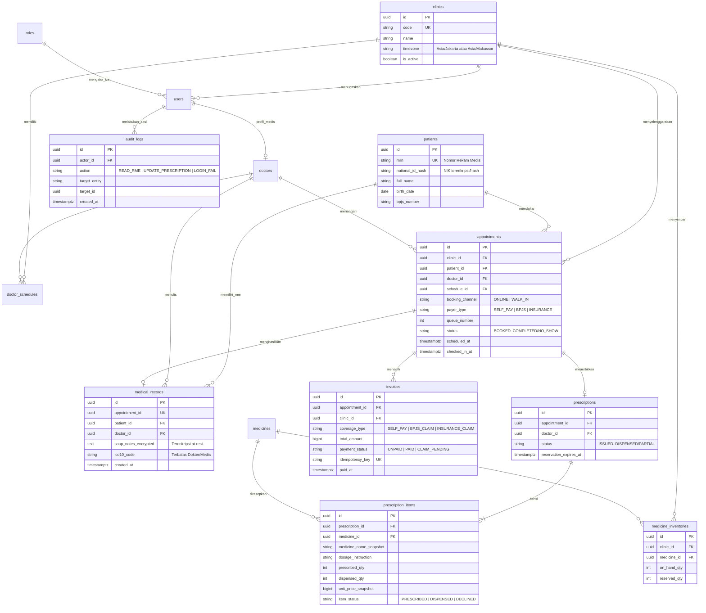
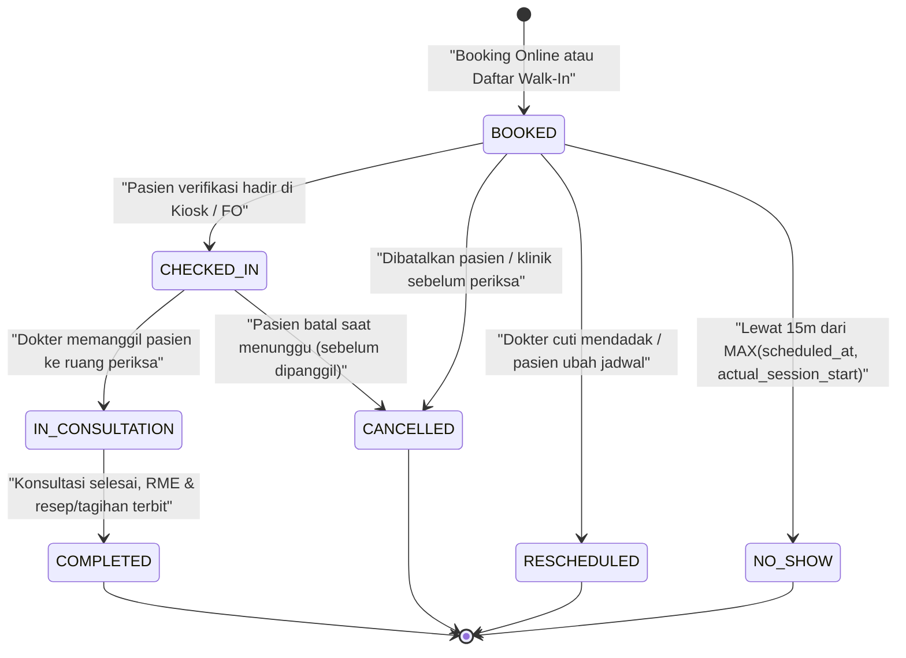

# Kunci Jawaban & Pembahasan Referensi Capstone: MedikaLink

> **Cara Menggunakan Kunci Ini:** Dokumen ini bukan naskah mentah untuk disalin ke portofolio Anda, melainkan **kunci pembahasan bernalar** untuk memeriksa apakah analisis Anda pada [**Bab 14 — Capstone Project Mandiri: MedikaLink**](../materi/14-capstone-project.md) sudah menangkap seluruh konflik tersembunyi, kasus tepi (*edge cases*), dan standar arsitektur level Mid System Analyst.

**Navigasi Cepat:**
- [1. Pembedahan Kontradiksi Stakeholder & Conflict Resolution Matrix](#1-pembedahan-kontradiksi-stakeholder--conflict-resolution-matrix)
- [2. Daftar 8 Kasus Tepi Tersembunyi (*Hidden Edge Cases*) & Solusi](#2-daftar-8-kasus-tepi-tersembunyi-hidden-edge-cases--solusi)
- [3. Rancangan Entitas Inti ERD (`erDiagram`)](#3-rancangan-entitas-inti-erd-erdiagram)
- [4. State Machine Janji Temu & Resep (`stateDiagram-v2`)](#4-state-machine-janji-temu--resep-statediagram-v2)
- [5. Poin Kritis Privasi & Keamanan Data Medis (RBAC & Audit)](#5-poin-kritis-privasi--keamanan-data-medis-rbac--audit)
- [6. Poin Penilaian Wajib per Deliverable (1–8)](#6-poin-penilaian-wajib-per-deliverable-18)

---

## 1. Pembedahan Kontradiksi Stakeholder & Conflict Resolution Matrix

Seorang System Analyst tidak boleh memilih solusi hanya karena jabatan pemohon paling tinggi (misalnya langsung mengiyakan Pemilik Klinik). Setiap konflik harus diputus berdasarkan **kepatuhan hukum/regulasi, integritas operasional, dan nilai bisnis terukur**:

| No | Isu Kontradiktif | Pihak yang Berselisih | Keputusan Desain Final (*Resolution*) | Alasan Bisnis, Hukum, & Teknis |
| :---: | :--- | :--- | :--- | :--- |
| **1** | **Akses Rekam Medis & Diagnosis ICD-10 oleh Staf Front-Office/Kasir** | **Pemilik Klinik** (ingin semua staf bisa lihat demi kecepatan) **vs** **Kepala Medis** (melarang keras demi rahasia medis) | **Menolak akses RME bagi Front-Office/Kasir.** Terapkan *RBAC Field-Level Isolation*: Front-Office/Kasir hanya melihat identitas kunjungan, poli, daftar tindakan yang ditagihkan, dan nominal tagihan—**tanpa keluhan klinis, catatan SOAP, maupun kode ICD-10**. | Kepatuhan terhadap **UU PDP** dan **Permenkes RME** bersifat mutlak (*non-negotiable regulatory constraint*). Kebocoran data kesehatan adalah risiko hukum dan reputasi fatal bagi pemilik klinik sendiri. Kecepatan layanan depan dicapai lewat nomor antrean & rincian tagihan terstruktur, bukan membuka diagnosis. |
| **2** | **Aturan Hangus (*No-Show*) 15 Menit** | **Pemilik Klinik** (hangus ketat 15 menit setelah jam jadwal) **vs** **Kepala Medis & FO** (dokter sering terlambat masuk ruang praktik) | **Grace period 15 menit dihitung dari titik yang lebih lambat (*MAX*) antara `scheduled_start_at` dan `actual_session_start_at`** (atau status praktik dokter sudah dibuka). Selama dokter belum memulai sesi poli, pasien yang terlambat dari jam awal tidak boleh otomatis dihanguskan. | Jika sistem tetap menghanguskan pasien saat dokternya belum datang, tingkat komplain dan *churn* pasien akan melonjak. Dengan *dynamic grace period*, slot tetap terlindungi saat dokter siap, namun adil saat dokter terlambat. |
| **3** | **Penggantian Obat Saat Stok Resep Kosong** | **Pemilik/Farmasi** (ingin langsung ganti agar tidak antre) **vs** **Kepala Medis** (melarang ganti zat aktif/dosis tanpa persetujuan dokter) | **Pisahkan dua skenario:** (a) **Real-time stock alert** tampil di layar dokter saat menulis resep agar sejak awal memilih obat tersedia; (b) jika stok habis setelah resep terbit, apoteker hanya boleh mengusulkan **substitusi ekivalen generik** (zat aktif & dosis sama, beda merek) atau **permintaan penggantian ke dokter** via status `PENDING_SUBSTITUTION` dengan persetujuan digital satu klik dari dokter. | Melindungi keselamatan pasien (*patient safety*) dan akuntabilitas hukum dokter, sekaligus memutus ketergantungan pada telepon/lari ke poli secara manual. |
| **4** | **Prioritas Slot *Online Booking* vs *Walk-In* Pagi (Lansia/BPJS)** | **Pemilik Klinik** (utamakan *online* berjadwal) **vs** **Admin FO** (pasien BPJS/lansia datang sejak 06.30) | **Pemisahan Kuota Slot (*Quota Split*) & Pemanggilan Berbasis Sesi:** Misal setiap sesi praktik dokter (20 slot) dibagi menjadi **Kuota Online (60%)** dan **Kuota Walk-In (40%)** dengan nomor slot berurutan (*interleaved* atau blok terpisah yang jelas), serta fitur *auto-release* kuota *online* yang belum terisi `H-2 jam` menjadi kuota *walk-in*. | Pasien *online* mendapat kepastian jam layanan tanpa diserobot pasien datang subuh, sementara pasien lansia/*walk-in* tetap memiliki kuota resmi dan bisa menyerap sisa slot yang tidak terjual. |

---

## 2. Daftar 8 Kasus Tepi Tersembunyi (*Hidden Edge Cases*) & Solusi

Jika Anda hanya merancang alur normal, kedelapan kasus nyata berikut akan meledak di minggu pertama *Go-Live*:

1. **Dokter Terlambat Masuk Praktik (`doctor_delay_minutes`):**
   - *Masalah:* Jadwal pukul `09:00`, dokter baru mulai klik *"Buka Sesi Poli"* pukul `09:30`.
   - *Solusi:* Catat `actual_start_at` pada tabel sesi praktik dokter (`doctor_sessions`). Timer *no-show* 15 menit bagi pasien slot `09:00` baru berjalan dari `MAX(slot_time, actual_start_at)`. Sistem mengirim notifikasi otomatis ke pasien yang belum datang tentang estimasi pergeseran jadwal.
2. **Dokter Cuti / Darurat Mendadak (*Sudden Leave*):**
   - *Masalah:* Dokter membatalkan praktik pukul `07:30` padahal 15 pasien sudah berstatus `BOOKED`.
   - *Solusi:* Fitur **Mass Reschedule / Reassignment** khusus Admin Medis/FO: seluruh janji temu aktif dipindahkan massal ke dokter pengganti di poli sama (jika pasien setuju) atau diubah ke status `RESCHEDULED` / `CANCELLED_BY_CLINIC` dengan notifikasi otomatis (WA/Push) dan pengembalian penuh uang muka jika ada.
3. **Pasien Datang Terlalu Awal (*Early Arrival Walk-In*):**
   - *Masalah:* Pasien datang pukul `06:30` untuk poli pukul `08:00`.
   - *Solusi:* Pendaftaran pukul `06:30` tetap tercatat sebagai `BOOKED` / `CHECKED_IN` pada nomor slot `walk-in` sesi `08:00`, **bukan** dimasukkan ke antrean aktif sebelum sesi dibuka atau melangkahi pasien *online* slot pertama.
4. **Konkurensi Perebutan Unit Obat Terakhir Antar-Poli:**
   - *Masalah:* Poli Umum dan Poli Anak meresepkan `Sirup X` secara bersamaan saat stok tersisa `2` botol.
   - *Solusi:* Saat dokter klik **"Terbitkan Resep (`ISSUED`)"**, sistem menjalankan transaksi database atomik dengan **`SELECT ... FOR UPDATE`** pada `medicine_inventories` berdasarkan `(clinic_id, medicine_id)`. Resep yang berhasil mengunci akan menaikkan `reserved_qty` selama TTL resep (misal 60 menit untuk rawat jalan hari itu), sehingga layar dokter kedua langsung mendapat respons `409 Conflict` / peringatan stok kurang untuk memilih alternatif sebelum pasien meninggalkan ruangan!
5. **Penebusan Resep Parsial (*Partial Dispense*) & *Copy Resep*:**
   - *Masalah:* Dokter meresepkan 3 jenis obat, namun di apotek pasien hanya sanggup/mau menebus 2 item.
   - *Solusi:* Gunakan level granularitas status pada `prescription_items` (`PRESCRIBED`, `DISPENSED`, `DECLINED_BY_PATIENT`, `OUT_OF_STOCK`). Untuk item yang ditolak/tidak ditebus pasien (`DECLINED_BY_PATIENT`), sistem melepaskan `reserved_qty` (`RELEASE`) kembali ke stok apotek, hanya menagih 2 item yang ditebus ke `invoices`, dan menerbitkan dokumen digital **`Copy Resep (Iter/Sisa)`** untuk 1 item tersisa.
6. **Split Billing (Penjamin BPJS/Asuransi + *Out-of-Pocket* Pasien):**
   - *Masalah:* Satu kunjungan pasien BPJS mencakup jasa poli + 2 obat formularium (ditanggung BPJS) ditambah 1 vitamin non-formularium (bayar sendiri via QRIS).
   - *Solusi:* Satu `appointment_id` dapat terhubung ke **header tagihan dengan rincian penanggung per baris item (`coverage_type`: `BPJS`, `INSURANCE`, `SELF_PAY`)** atau dua sub-invoice: tagihan pasien (`SELF_PAY`) langsung ditagihkan di kasir/QRIS saat itu juga, sedangkan tagihan `BPJS/INSURANCE` masuk ke antrean klaim penjamin (*pending claim reconciliation*) sehingga kasir tetap bisa menutup kas harian tunai/QRIS tanpa tertahan!
7. **Klinik Lintas Zona Waktu (`Asia/Jakarta` vs `Asia/Makassar`):**
   - *Masalah:* Transaksi pukul `21:30 WITA` di Denpasar terhitung sebagai hari yang salah pada laporan harian jika server memakai UTC mentah atau memaksakan WIB.
   - *Solusi:* Simpan **seluruh timestamp di database dalam UTC (`TIMESTAMPTZ`)**, simpan atribut `timezone` IANA di tabel `clinics` (`Asia/Jakarta`, `Asia/Makassar`), dan wajibkan query tutup buku harian (`daily_clinic_reconciliations`) mengelompokkan transaksi memakai `created_at AT TIME ZONE clinics.timezone`.
8. **Kebocoran Data Medis via Log, URL, atau Notifikasi WhatsApp:**
   - *Masalah:* Notifikasi pengingat atau struk memuat nama penyakit atau nama obat sensitif (misal obat HIV/psikiatri) yang bisa terbaca di layar kunci ponsel orang lain.
   - *Solusi:* Notifikasi WA/Push hanya memuat informasi generik (*"Pengingat jadwal Poli Penyakit Dalam di Klinik Menteng pukul 10:00 WIB"*), dan struk kasir umum memisahkan rincian obat ke lembar lampiran farmasi tertutup bila diminta atau menampilkan deskripsi standar sesuai aturan kerahasiaan.

---

## 3. Rancangan Entitas Inti ERD (`erDiagram`)

Perhatikan bagaimana **`medical_records` dipisahkan secara tegas** dari `appointments` dan `invoices` agar pengamanan akses tingkat tabel/endpoint mudah diaudit, serta adanya **`clinic_id`** dan **kolom *snapshot*** pada item resep/tagihan.



---

## 4. State Machine Janji Temu & Resep (`stateDiagram-v2`)

### 4.1 Siklus Hidup Janji Temu & Antrean Pasien (`appointments.status`)



### 4.2 Siklus Hidup Resep Farmasi (`prescriptions.status`)

```mermaid
stateDiagram-v2
    [*] --> ISSUED : "Dokter terbitkan resep & stok di-RESERVE (TTL 60m)"
    ISSUED --> PENDING_SUBSTITUTION : "Stok fisik kurang / apoteker usul ganti merek"
    PENDING_SUBSTITUTION --> ISSUED : "Dokter menyetujui usulan substitusi"
    PENDING_SUBSTITUTION --> CANCELLED : "Dokter membatalkan resep"

    ISSUED --> DISPENSING : "Pasien konfirmasi item di apotek & bayar tagihan"
    DISPENSING --> DISPENSED : "Seluruh item diserahkan & stok di-DEDUCT"
    DISPENSING --> PARTIAL_DISPENSED : "Sebagian item dibeli, sisa di-RELEASE + Copy Resep"
    ISSUED --> EXPIRED : "Resep tidak ditebus hingga lewat TTL; stok di-RELEASE"

    DISPENSED --> [*]
    PARTIAL_DISPENSED --> [*]
    EXPIRED --> [*]
    CANCELLED --> [*]
```

---

## 5. Poin Kritis Privasi & Keamanan Data Medis (RBAC & Audit)

Setiap kandidat Mid SA wajib menyertakan aturan keamanan spesifik domain kesehatan berikut:

1. **Matriks Visibilitas Data Berbasis Peran (*RBAC Field Visibility*):**

| Data / Modul | `Doctor` | `Pharmacist` | `Front-Office / Cashier` | `Clinic Owner / HQ` | `Patient` |
| :--- | :---: | :---: | :---: | :---: | :---: |
| Identitas Pasien & Antrean Poli | Lihat (Klinik Tugas) | Lihat (Pasien Resep) | Lihat (Klinik Tugas) | Agregat / Terbatas | Milik Sendiri |
| Keluhan Klinis (SOAP) & Kode ICD-10 | **Baca & Tulis** | **Terblokir** *(kecuali catatan alergi obat yang relevan)* | **TERBLOKIR (`403` / Field Dihilangkan)** | **TERBLOKIR** | Ringkasan Kunjungan Sendiri |
| Daftar Obat & Dosis Resep | **Tulis & Lihat** | **Baca & Proses Tebus** | Hanya Nama Item Tagihan / Total | Agregat Pemakaian | Resep & Copy Resep Sendiri |
| Tagihan, *Split Billing*, & Rekonsiliasi | Lihat Status Saja | Lihat Status Lunas Obat | **Baca & Proses Bayar** | Dashboard Finansial Lintas Klinik | Invoice Milik Sendiri |

2. **Immutable Read-Access Audit (`READ_RME`):** Berbeda dari aplikasi ritel biasa yang hanya mencatat aksi ubah/hapus (`WRITE`), pada sistem medis **setiap aksi membaca rekam medis pasien (`GET /api/v1/medical-records/{patientId}`)** wajib dicatat ke `audit_logs` (`actor_id`, `patient_id`, `clinic_id`, `ip_address`, `timestamp_utc`) agar setiap akses tidak sah dapat dilacak secara forensik.
3. **Perlindungan IDOR & Enkripsi:** Akses dokter dibatasi hanya pada pasien yang memiliki janji temu aktif di kliniknya (atau riwayat perawatan sah) sehingga dokter cabang A tidak bisa mengintip RME pasien cabang B tanpa rujukan resmi; kolom sensitif (`soap_notes`, NIK) dienkripsi *at-rest* dan seluruh transfer memakai TLS 1.2+.

---

## 6. Poin Penilaian Wajib per Deliverable (1–8)

Gunakan daftar periksa cepat ini untuk mengaudit delapan deliverable Anda sebelum memasukkannya ke portofolio:

1. **Deliverable 1 (BRD & Conflict Log):** Terdapat minimal 4 konflik terselesaikan beserta alasan regulasi/bisnis, pembagian kuota *online vs walk-in*, dan KPI terukur (*misal: waktu tunggu apotek turun dari 40 menit menjadi <= 15 menit*).
2. **Deliverable 2 (BPMN To-Be):** Memuat 5 *swimlane* lengkap, percabangan resep tersedia vs substitusi dokter, dan percabangan pembayaran tunai/QRIS vs klaim BPJS.
3. **Deliverable 3 (SRS, Use Case, & State Machine):** Nol kata kabur (*"cepat, fleksibel, aman"*) pada FR/NFR; kedua Use Case memuat *Exception Flow* (stok obat kalah cepat, dokter telat/cuti, timeout payment); State Machine memuat seluruh status transisi sah beserta *guard condition*.
4. **Deliverable 4 (ERD & Screen Spec):** `medical_records` terpisah dari tabel operasional kasir; `prescription_items` menyimpan *snapshot* harga & dosis; kedua Screen Spec lengkap dengan **5 State** (`Initial, Loading, Empty, Error, Partial/Disabled`) dan *field mapping* UI–API–DB.
5. **Deliverable 5 (API & Privasi RME):** Endpoint memisahkan `/appointments`, `/medical-records`, `/prescriptions`, dan `/invoices`; mencantumkan `Idempotency-Key` pada pembayaran/penerbitan resep; menyertakan matriks blokir ICD-10 bagi kasir.
6. **Deliverable 6 (FSD Modul Kritis):** Sequence Diagram menunjukkan transaksi DB atomik + `SELECT ... FOR UPDATE` pada `medicine_inventories`, mekanisme pelepasan sisa reservasi saat penebusan parsial, dan pembentukan tagihan *split billing*.
7. **Deliverable 7 (CR Impact & Batch Multi-Timezone):** Analisis 6 lapisan lengkap dengan strategi *backward compatibility* & *rollback*; rumus batch rekonsiliasi harian menggunakan konversi `AT TIME ZONE clinics.timezone` sehingga klinik Bali/Makassar (WITA) dan Jakarta (WIB) tutup buku sesuai tanggal lokal masing-masing.
8. **Deliverable 8 (UAT & EP/BVA):** Terdapat skenario uji batas presisi untuk: (a) 14m59s vs 15m01s *no-show* saat dokter tepat waktu vs dokter telat 30m, (b) stok obat = `1` diperebutkan 2 poli, (c) kasir memanggil API RME (`403 Forbidden`), dan (d) transaksi `23:55 WITA` masuk ke laporan hari pertama.

---

**Langkah Berikutnya:**
- Kemas proyek *MedikaLink* Anda menjadi portofolio profesional siap lamar di [**Panduan Menyusun Portofolio System Analyst Siap Lamar**](../kesiapan-kerja/panduan-portofolio-sa.md).
- Uji kesiapan wawancara Anda melalui [**Bank Soal Interview & Simulasi Live-Case System Analyst**](../kesiapan-kerja/bank-soal-interview-live-case.md).
- Kembali ke [Bab 14 — Capstone Project Mandiri: MedikaLink](../materi/14-capstone-project.md) atau [Peta Kurikulum (`README.md`)](../README.md).
