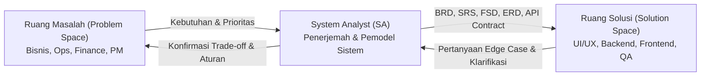
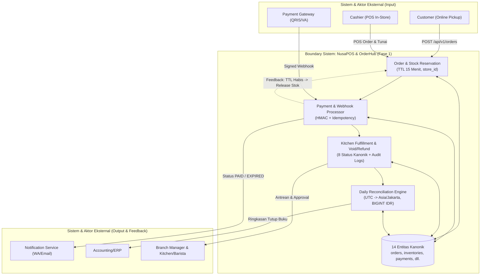

# Bab 01 — Fundamental System Analyst

> **Ringkasan Posisi Bab:** Bab ini membekali Anda dengan *mental model* dasar tentang apa yang sebenarnya dikerjakan seorang **System Analyst (SA)** di dunia kerja nyata, bagaimana posisinya di antara peran bisnis dan teknik, serta cara berpikir sistem (*system thinking*) sebelum menyentuh diagram atau spesifikasi teknis apa pun.

---

## 1. Tujuan Belajar & Posisi di Alur Kerja SA

Setelah mempelajari bab ini, Anda diharapkan mampu:

1. Membedakan peran, tanggung jawab, dan batas kewenangan antara **System Analyst (SA)**, **Business Analyst (BA)**, **Product Manager (PM)**, dan **Tech Lead / System Architect**.
2. Membedah suatu sistem bisnis menggunakan 6 elemen ***system thinking***: *input*, *process*, *output*, *boundary*, *constraint*, dan *feedback*.
3. Memetakan artefak kerja SA dari hulu (kebutuhan bisnis) hingga hilir (pengujian dan rilis produksi).
4. Mengukur kesenjangan kompetensi Anda saat ini terhadap standar **Junior SA** dan **Mid-level SA**.

Di dalam alur kerja proyek perangkat lunak, SA berdiri tepat di **jembatan antara ruang masalah (*problem space*) dan ruang solusi (*solution space*)**. Pemilik bisnis dan PM membawa pertanyaan *"masalah apa yang harus diselesaikan dan mengapa itu bernilai?"*, sementara tim pengembang (*Backend*, *Frontend*, *QA*) membutuhkan jawaban terstruktur *"bagaimana aturan persisnya, data apa yang berubah, dan apa yang terjadi jika gagal?"*. SA bertugas menerjemahkan visi yang masih kabur menjadi spesifikasi sistem yang presisi, konsisten, dan siap dibangun tanpa mengasumsikan detail implementasi kode tingkat rendah.

---

## 2. Konsep Inti & Mental Model

### 2.1 Analogi Jembatan: Arsitek Bangunan vs Kontraktor vs Pemilik Rumah

Bayangkan Anda ingin membangun sebuah gedung kedai kopi dua lantai lengkap dengan dapur komersial.
- **Pemilik Bisnis / Product Manager (PM)** adalah *pemilik gedung*: ia menentukan tujuan bisnis (*"Saya ingin melayani 300 pelanggan per jam, ada konter pickup online terpisah, dan pembukuan tidak bocor"*), anggaran, serta jadwal pembukaan.
- **Business Analyst (BA)** adalah *konsultan operasional awal*: ia menghitung kelayakan bisnis, alur kasir saat ini, dan target ROI.
- **System Analyst (SA)** adalah *arsitek teknis & perancang denah fungsional*: ia menerjemahkan keinginan pemilik menjadi cetak biru terukur—lebar pintu dapur agar dua barista tidak bertabrakan, kapasitas listrik maksimal, jalur pipa air bersih dan limbah terpisah, hingga prosedur darurat jika listrik padam. Arsitek tidak mengaduk semen sendiri, tetapi jika gambarnya salah atau ambigu, kontraktor akan membangun tembok yang keliru.
- **Tech Lead / System Architect** adalah *insinyur struktur*: ia menentukan jenis baja, ketebalan beton, atau pola arsitektur perangkat lunak (*monolith vs microservices*, *message broker*, pemilihan basis data) agar rancangan SA kokoh di dunia nyata.
- **Software Engineer (BE/FE)** adalah *kontraktor pelaksana*: mereka membangun sistem berdasarkan denah fungsional (SRS/FSD/API Contract) dan standar struktur.

### 2.2 Perbandingan Peran: SA vs BA vs PM vs Tech Lead

Di perusahaan kecil atau *startup*, peran-peran ini kadang digabung. Namun di organisasi menengah hingga *enterprise* (perbankan, *fintech*, *e-commerce*, ritel multi-cabang), batas tanggung jawabnya jelas:

| Dimensi | Product Manager (PM) | Business Analyst (BA) | System Analyst (SA) | Tech Lead / System Architect |
| :--- | :--- | :--- | :--- | :--- |
| **Fokus Pertanyaan** | **Mengapa & Apa** yang memberi nilai bisnis tertinggi? | **Bagaimana proses bisnis** bekerja & di mana kebocorannya? | **Bagaimana sistem perangkat lunak** harus berperilaku secara tepat? | **Bagaimana teknologi & kode** dirancang agar skalabel dan stabil? |
| **Orientasi Utama** | Pasar, pelanggan, *roadmap*, metrik produk | Efisiensi proses bisnis, kebijakan, analisis ROI | Spesifikasi fungsional, data, integrasi, *edge case*, NFR | Arsitektur kode, *stack* teknologi, pola infrastruktur |
| **Artefak Utama** | *Product Roadmap*, *PRD*, *OKR* | *Business Case*, *As-Is Process*, *BRD* | *SRS*, *FSD*, *Use Case*, *BPMN*, *ERD*, *API Contract* | *System Architecture Diagram*, *Technical ADR*, *Infra Spec* |
| **Kepemilikan Keputusan** | Prioritas fitur & *go-to-market* | Validasi kebutuhan unit bisnis | Konsistensi aturan sistem, data, & integrasi | Keputusan *framework*, *database engine*, & kualitas kode |

> **Catatan Penting:** Jangan terjebak menganggap SA sebagai "sekretaris rapat yang hanya mencatat permintaan klien". Tugas SA bukan menyalin mentah-mentah kalimat *stakeholder*, melainkan **menguji logika di balik permintaan tersebut**, menemukan lubang (*gap*), lalu merumuskan solusi sistem yang utuh.

### 2.3 Berpikir Sistem (*System Thinking*)

***System thinking*** adalah pola pikir memandang aplikasi bukan sebagai kumpulan layar terpisah, melainkan sebagai satu kesatuan komponen yang saling terhubung untuk mencapai tujuan tertentu. Setiap sistem selalu memiliki 6 unsur inti:

1. **Input:** Data, permintaan pengguna, atau sinyal eksternal yang masuk ke sistem (contoh: daftar pesanan, kode promo, *webhook* pembayaran).
2. **Process:** Transformasi atau aturan bisnis yang mengolah *input* (contoh: validasi stok, penguncian baris stok, perhitungan diskon/pajak, transisi status).
3. **Output:** Hasil keluaran yang bernilai bagi aktor atau sistem lain (contoh: struk digital, tiket antrean dapur, jurnal rekonsiliasi harian).
4. **Boundary (Batas Sistem):** Garis tegas yang memisahkan apa yang dikendalikan sistem (**In-Scope**) dan apa yang berada di luar kendali sistem (**Out-of-Scope** atau sistem eksternal). Tanpa *boundary* yang jelas, proyek mudah mengalami *scope creep* (pembengkakan fitur tak terkendali).
5. **Constraint (Batasan):** Aturan keras atau limitasi yang mengikat cara sistem bekerja—bisa berupa regulasi pajak, batas waktu (*Time To Live / TTL*), kapasitas server, anggaran, atau standar keamanan.
6. **Feedback (Umpan Balik):** Mekanisme di mana keluaran atau kejadian di hilir kembali memengaruhi perilaku sistem di hulu (contoh: pesanan yang gagal dibayar melewati batas waktu memicu pelepasan stok kembali agar tersedia bagi pelanggan lain; selisih laporan rekonsiliasi memicu investigasi audit).

### 2.4 Peta Artefak Kerja System Analyst

Seorang SA menghasilkan artefak secara bertahap. Setiap artefak memiliki fungsi yang berbeda agar satu dokumen tidak membengkak menjadi "dokumen raksasa yang tidak dibaca siapa pun":

1. **BRD (*Business Requirements Document*):** Mengunci *mengapa* proyek dijalankan, KPI bisnis, dan batas ruang lingkup (*In-Scope* vs *Out-of-Scope*). Lihat [`template-brd.md`](../templates/template-brd.md).
2. **Process Model (Flowchart / BPMN 2.0):** Memetakan alur kerja *As-Is* (saat ini) dan *To-Be* (target) lintas aktor dan sistem.
3. **SRS (*Software Requirements Specification*):** Mengunci kebutuhan fungsional (`FR`) dan non-fungsional (`NFR`) secara atomik, tidak ambigu, dan dapat diuji. Lihat [`template-srs.md`](../templates/template-srs.md).
4. **Use Case Specification & Diagram Perilaku (UML):** Menjelaskan interaksi langkah demi langkah antara aktor dan sistem, termasuk jalur alternatif dan kegagalan. Lihat [`template-use-case.md`](../templates/template-use-case.md).
5. **UI/Screen Specification & Field Mapping:** Menghubungkan komponen antarmuka (5 state layar) dengan aturan validasi, *endpoint* API, dan kolom database. Lihat [`template-screen-spec.md`](../templates/template-screen-spec.md).
6. **FSD (*Functional Specification Document*), ERD, & API Contract:** Panduan teknis rinci per modul—mencakup skema tabel, kontrak JSON, kode galat, dan alur *sequence* sinkron/asinkron. Lihat [`template-fsd.md`](../templates/template-fsd.md).
7. **Change Request (CR) Impact Analysis:** Analisis dampak 6 lapis setiap kali ada permintaan perubahan di tengah jalan. Lihat [`template-cr-impact-analysis.md`](../templates/template-cr-impact-analysis.md).
8. **UAT Script (*User Acceptance Testing*):** Skenario pengujian berbasis aturan bisnis untuk membuktikan sistem layak dirilis bersama pengguna akhir. Lihat [`template-uat.md`](../templates/template-uat.md).

---

## 3. Standar Industri & Aturan Praktis

1. **Single Source of Truth (SSOT) & Traceability:** Setiap kebutuhan bisnis wajib memiliki kode unik (`BR-XX`, `FR-XX`, `UC-XX`) yang konsisten dari BRD hingga UAT. Jangan pernah mendefinisikan ulang aturan pembulatan uang atau nama status pesanan secara berbeda di dokumen API dan dokumen UI.
2. **Prinsip "What & Rules" sebelum "How in Code":** SA bertanggung jawab menentukan *apa* aturan bisnis dan *kontrak antarmuka* (misal: *"Pembayaran via webhook wajib idempotent menggunakan `idempotency_key`"*), sedangkan *Tech Lead/Backend* menentukan pustaka atau struktur kelas kode untuk mengimplementasikannya.
3. **Fokus pada Jalur Gagal (*Unhappy Path*):** Pemula biasanya hanya memodelkan *happy path* (kasir input -> bayar -> selesai). Standar industri menuntut SA memetakan **minimal 60% upayanya pada *edge case***: stok tinggal 1 diperebutkan 2 pembeli, koneksi terputus setelah bayar, *webhook* datang 2 kali, atau pembayaran datang setelah batas waktu habis.
4. **Tangga Kompetensi Junior SA vs Mid-level SA:**

| Area Kompetensi | Junior System Analyst (0–2 Tahun) | Mid-level System Analyst (2–5 Tahun) |
| :--- | :--- | :--- |
| **Elicitation** | Mencatat kebutuhan dari wawancara terpandu; menerjemahkan daftar fitur dasar. | Menggali *root cause* masalah, menantang asumsi *stakeholder*, dan menengahi konflik kepentingan. |
| **Pemodelan** | Mampu membuat Flowchart, Use Case dasar, dan ERD sederhana untuk *happy path*. | Menguasai BPMN swimlane, State Machine, Sequence async, normalisasi 3NF, dan memetakan *race condition*. |
| **Spesifikasi & API** | Menulis User Story dan deskripsi layar standar; memahami konsep REST dasar. | Merancang kontrak API lengkap (error codes, idempotency, pagination), NFR terukur, dan SQL investigasi. |
| **Manajemen Perubahan** | Mengakomodasi permintaan perubahan fitur tanpa menghitung dampak penuh. | Menjalankan *Impact Analysis* menyeluruh (UI, API, DB, migrasi, backward compatibility) sebelum menyetujui CR. |

---

## 4. Praktik Studi Kasus *NusaPOS & OrderHub*

Mari kita terapkan *system thinking* pada proyek kanonik modul ini: **NusaPOS & OrderHub** milik jaringan kedai kopi **NusaKopi** (detail lengkap lihat [`README.md`](../README.md)).

**Masalah Bisnis Utama:** NusaKopi sebelumnya mengoperasikan mesin kasir lokal yang terpisah dari pemesanan daring. Akibatnya, pelanggan sering memesan kopi daring padahal stok di cabang sudah habis terjual oleh kasir (*overselling*), dan manajer cabang menghabiskan waktu 2 jam setiap malam untuk mencocokkan laporan penjualan tunai dengan mutasi QRIS secara manual.

### 4.1 Bedah *System Thinking* NusaPOS & OrderHub (Fase 1)

| Elemen System Thinking | Penerapan Konkret pada *NusaPOS & OrderHub* |
| :--- | :--- |
| **Input** | Pesanan *in-store* oleh `Cashier`, pesanan *Online Self-Pickup* oleh `Customer`, pembaruan menu/promo oleh `HQ Admin`, konfirmasi status pengerjaan oleh `Kitchen/Barista`, persetujuan void/refund oleh `Branch Manager`, serta notifikasi status bayar asinkron dari `Payment Gateway (QRIS/VA)`. |
| **Process** | Autentikasi & otorisasi berbasis peran (`RBAC`), validasi serta penguncian stok per cabang (`orders.store_id` & `inventories`), reservasi stok dengan *Time To Live (TTL)* 15 menit, pemrosesan *webhook* secara *idempotent*, pemotongan stok saat `PAID`, pengelolaan antrean dapur (`PREPARING` -> `READY` -> `COMPLETED`), dan kalkulasi tutup buku harian (`daily_reconciliations`). |
| **Output** | Status pesanan *real-time* (dibatasi pada 8 status kanonik: `PENDING_PAYMENT`, `PAID`, `PREPARING`, `READY`, `COMPLETED`, `CANCELLED`, `EXPIRED`, `REFUNDED`), mutasi buku besar stok (`inventory_movements`), notifikasi WA/Email melalui `Notification Service`, jejak audit permanen (`audit_logs`), serta ekspor data penjualan ke `Accounting/ERP`. |
| **Boundary (*In-Scope* vs *Out-of-Scope*)** | **In-Scope Fase 1:** Transaksi kasir *online-first*, pemesanan *Online Self-Pickup*, manajemen master/promo dasar, void/refund terotorisasi, dan rekonsiliasi harian. **Out-of-Scope Fase 1:** Pengiriman kurir pihak ketiga (3PL) beserta status `OUT_FOR_DELIVERY`/`DELIVERED` (disimpan sebagai *Change Request* Fase 2) dan *POS Offline Mode* penuh. |
| **Constraint** | Stok tersedia (`on_hand_qty - reserved_qty`) tidak boleh negatif; presisi uang menggunakan bilangan bulat Rupiah (`BIGINT`) dengan pembulatan *HALF_UP* di level subtotal; seluruh *timestamp* disimpan dalam **UTC** dan dikonversi ke zona waktu cabang (`Asia/Jakarta`); latensi pembuatan pesanan *p95* `<= 500 ms` pada beban 150 RPS. |
| **Feedback** | (1) Pesanan `PENDING_PAYMENT` yang melewati TTL 15 menit memicu *scheduler* untuk mengubah status menjadi `EXPIRED` dan melepas `reserved_qty` agar stok kembali tersedia; (2) Permintaan `refunds` yang disetujui `Branch Manager` mengubah status menjadi `REFUNDED` dan memperbarui angka rekonsiliasi harian serta `audit_logs`. |

### 4.2 Contoh Interaksi Lintas Peran di Hari Pertama Proyek

Ketika tim NusaKopi meminta *"tambahkan fitur kirim kurir Gojek/Grab sekalian agar penjualan naik"*, inilah respons khas yang membedakan peran-peran di tim:
- **PM** mengevaluasi apakah fitur kurir mendesak untuk target Q3 atau menunda peluncuran POS cabang yang sudah kritis.
- **SA** langsung memetakan dampaknya ke batas sistem (*boundary*): pengiriman 3PL membutuhkan entitas alamat pelanggan, integrasi API tarif/pelacakan kurir, serta dua status baru (`OUT_FOR_DELIVERY`, `DELIVERED`) di luar 8 status transaksi konter. SA menyarankan pengeluaran fitur 3PL ke Fase 2 (CR) agar Fase 1 tidak terlambat dan risiko operasional cabang terkendali.
- **Tech Lead** mengonfirmasi bahwa arsitektur `orders` cukup disiapkan agar ekstensibel untuk Fase 2 tanpa membangun integrasi 3PL sekarang.

---

## 5. Jebakan Umum (*Anti-Patterns*) Junior SA

1. **Langsung Menggambar UI atau Tabel Database Sebelum Memahami Batas Masalah:** Junior SA sering membuka Figma atau langsung menulis `CREATE TABLE` sebelum menyepakati siapa aktornya dan apa yang *Out-of-Scope*. Akibatnya, desain harus dibongkar ulang ketika tim Finance baru bersuara di minggu ke-4.
2. **Menulis Spesifikasi yang "Mengatur Cara Coding" Bukan "Aturan Perilaku":** Menulis *"Backend harus memakai Redis Mutex dengan library X"* di dokumen SRS adalah kekeliruan batas peran. Yang seharusnya ditulis SA adalah *"Sistem harus menjamin nol overselling saat dua transaksi bersamaan memperebutkan sisa stok 1 unit (`NFR-02`)"*, lalu mendiskusikan mekanisme penguncian bersama *Tech Lead*.
3. **Menjadi "Yes-Man" Terhadap Semua Permintaan Stakeholder:** Mengiyakan setiap tambahan fitur kecil tanpa mencatat dampak jadwal, kompleksitas status, dan dependensi ke `daily_reconciliations` hanya menumpuk utang teknis dan kegagalan saat UAT.
4. **Melupakan Aktor Non-Manusia dan *Scheduler*:** Banyak pemula hanya mendaftar aktor manusia (`Customer`, `Cashier`), padahal sistem seperti `Payment Gateway (QRIS/VA)`, `Accounting/ERP`, `Notification Service`, serta *background job* pembersih reservasi kedaluwarsa (`EXPIRED`) adalah penggerak utama keandalan sistem modern.

---

## 6. Checklist Verifikasi Mandiri

Sebelum melangkah ke Bab 02, pastikan Anda dapat menjawab **"Ya"** untuk setiap butir berikut:

- [ ] Saya dapat menjelaskan perbedaan tanggung jawab utama antara PM, BA, SA, dan Tech Lead tanpa tumpang tindih.
- [ ] Saya mampu mengidentifikasi 6 elemen *system thinking* (*input, process, output, boundary, constraint, feedback*) dari aplikasi apa pun yang saya pakai sehari-hari.
- [ ] Saya memahami fungsi masing-masing artefak di folder `templates/` dan tahu kapan memakai BRD vs SRS vs FSD.
- [ ] Saya hafal ruang lingkup Fase 1 *NusaPOS & OrderHub* beserta alasan mengapa pengiriman 3PL dan POS Offline penuh dikeluarkan dari batas Fase 1.

---

## 7. Latihan Praktik

Kerjakan keempat skenario berikut secara mandiri sebelum membuka pembahasan lengkap di [`../kunci-latihan/kunci-bab-01-04.md`](../kunci-latihan/kunci-bab-01-04.md).

1. **Skenario 1 (Batas Peran):** Dalam rapat *kick-off* NusaPOS & OrderHub, terjadi tiga situasi berikut:
   - (a) *Branch Manager* meminta tombol cetak ulang struk, sedangkan tim *Finance* khawatir fitur itu disalahgunakan untuk memanipulasi laporan kas.
   - (b) *Backend Engineer* bertanya apakah perhitungan diskon voucher dilakukan per item atau di subtotal sebelum pajak, dan bagaimana pembulatannya.
   - (c) *Marketing* mengusulkan agar *NusaPOS & OrderHub* ditunda 2 bulan supaya fitur poin loyalitas (*loyalty tier*) masuk di rilis pertama.
   Tentukan **siapa pengambil keputusan utama** (PM, SA, atau Tech Lead) pada tiap situasi dan jelaskan alasan serta kontribusi spesifik SA di dalamnya.
2. **Skenario 2 (*System Thinking*):** Pilih satu subsistem spesifik dari *NusaPOS & OrderHub*, yaitu **Modul Void/Refund Pasca-Bayar (`FR-07`)**. Petakan keenam unsur *system thinking* (*Input, Process, Output, Boundary, Constraint, Feedback*) untuk subsistem tersebut dengan mengacu pada aktor dan entitas kanonik di [`../README.md`](../README.md).
3. **Skenario 3 (Pemilihan Artefak):** Seorang manajer proyek meminta Anda segera mengirim "satu dokumen lengkap" kepada tim *Backend* dan *QA* agar mereka bisa mulai membuat *endpoint* `POST /api/v1/orders` dan *test case* validasi stok minggu depan. Dokumen mana saja dari peta artefak SA yang paling tepat Anda serahkan, dan mengapa menyerahkan BRD saja tidak cukup?
4. **Skenario 4 (Identifikasi Masalah *Boundary*):** Di tengah pengembangan Fase 1, kepala operasional cabang meminta agar kasir bisa mengubah harga jual menu secara langsung di layar POS saat ada bahan baku yang mendadak mahal di pasar lokal. Analisis risiko usulan ini dari sisi *boundary*, kontrol bisnis, dan dampaknya terhadap entitas `products`/`product_variants`/`audit_logs`/`daily_reconciliations`.

---

**Langkah Berikutnya:** Lanjutkan ke [**Bab 02 — SDLC: Waterfall, Agile/Scrum, & Hybrid**](./02-sdlc-waterfall-agile.md) untuk memahami bagaimana seluruh peran dan artefak di atas bergerak seiring fase proyek.
