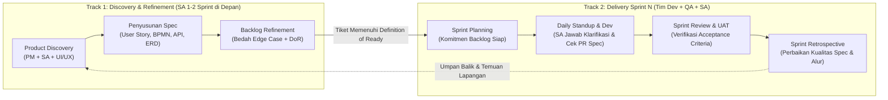

# Bab 02 — SDLC: Waterfall, Agile/Scrum, & Hybrid

> **Ringkasan Posisi Bab:** Setelah memahami *apa* peran dan artefak System Analyst pada Bab 01, bab ini menjawab pertanyaan ***kapan* dan *bagaimana*** seorang SA bekerja di dalam siklus hidup pengembangan perangkat lunak (*Software Development Life Cycle / SDLC*), baik di lingkungan Waterfall, Agile/Scrum, maupun model Hybrid yang paling banyak dipakai perusahaan modern.

---

## 1. Tujuan Belajar & Posisi di Alur Kerja SA

Setelah mempelajari bab ini, Anda diharapkan mampu:

1. Menjelaskan alur **SDLC *end-to-end*** dari tahap *Discovery* hingga *Post-Implementation Review*.
2. Membandingkan karakteristik, kekuatan, dan risiko **Waterfall**, **Agile/Scrum**, dan **Hybrid** dari sudut pandang seorang SA.
3. Menjalankan peran dan menyiapkan artefak SA yang tepat di setiap fase serta ritual Scrum (*Product Discovery*, *Backlog Refinement*, *Sprint Planning*, *Daily Standup*, *Sprint Review*, *Retrospective*).
4. Membangun pola kolaborasi harian yang efektif dengan **PM**, **UI/UX Designer**, **Backend/Frontend Engineer**, dan **QA Engineer**, termasuk menerapkan *Definition of Ready (DoR)*.

Dalam praktik kerja nyata, banyak Junior SA gagal bukan karena tidak bisa menggambar diagram, melainkan karena **ritme kerjanya tidak selaras dengan ritme tim pengembang**. Misalnya, menyerahkan spesifikasi FSD baru di hari pertama *Sprint* saat *engineer* seharusnya sudah mulai *coding*, atau menulis dokumentasi 100 halaman di lingkungan *startup* yang menuntut rilis per dua minggu.

---

## 2. Konsep Inti & Mental Model

### 2.1 Peta Besar SDLC *End-to-End*

***Software Development Life Cycle (SDLC)*** adalah kerangka kerja terstruktur yang mengatur proses lahirnya perangkat lunak dari ide hingga pemeliharaan. Secara universal, siklus ini terdiri atas tujuh fase:

1. **Inisiasi & *Product Discovery*:** Memahami masalah bisnis, menilai kelayakan (*feasibility*), menetapkan KPI, dan mengunci ruang lingkup awal.
2. **Analisis Kebutuhan (*Requirements Analysis*):** Menggali kebutuhan detail dari *stakeholder*, memodelkan proses *As-Is* & *To-Be*, lalu menyusun *BRD/SRS*.
3. **Perancangan Sistem (*System Design*):** Merancang antarmuka (*UI/UX*), model data (*ERD*), kontrak integrasi (*API Contract*), dan arsitektur teknis.
4. **Pengembangan (*Development / Implementation*):** Penulisan kode *Backend*, *Frontend*, dan konfigurasi infrastruktur; SA berperan sebagai narasumber klarifikasi *edge case*.
5. **Pengujian (*Testing & UAT*):** Verifikasi teknis oleh QA (*functional, integration, performance*) serta validasi bisnis oleh pengguna melalui *User Acceptance Testing (UAT)*.
6. **Rilis & Penerapan (*Deployment / Go-Live*):** Migrasi data awal, pelatihan operasional, pemantauan transaksi perdana, dan keputusan *Go / No-Go*.
7. **Operasional, Pemeliharaan, & Evaluasi (*Maintenance & PIR*):** Menangani insiden produksi, mengukur KPI pasca-rilis (*Post-Implementation Review*), dan mengelola *Change Request (CR)* untuk iterasi berikutnya.

### 2.2 Waterfall vs Agile/Scrum vs Hybrid

Analogi sederhananya adalah membangun jembatan layang dibanding merancang aplikasi layanan pelanggan:
- **Waterfall (Air Terjun):** Seluruh cetak biru harus selesai dan disetujui 100% di awal sebelum pengecoran dimulai. Mengubah posisi tiang di tengah jalan sangat mahal.
- **Agile / Scrum:** Tim membangun fitur dalam potongan kecil berdurasi tetap (**Sprint**, biasanya 1–2 minggu) yang langsung dapat diuji dan dipakai bertahap, sambil terus menyesuaikan prioritas berdasarkan umpan balik.
- **Hybrid (Kenyataan Terbanyak di Industri):** Arsitektur inti, kontrak finansial, dan kepatuhan regulasi dikunci di fase awal yang terstruktur (*Discovery / Blueprint*), lalu eksekusi fitur berjalan secara iteratif dalam *Sprint*.

| Aspek | Waterfall | Agile / Scrum | Hybrid (Discovery Lock + Agile Delivery) |
| :--- | :--- | :--- | :--- |
| **Kapan Cocok Dipakai** | Proyek regulasi ketat, kontrak *fixed-price/scope*, migrasi *core banking* atau ERP berskala besar. | Produk digital yang kebutuhan pasarnya cepat berubah, eksplorasi UI/UX, fitur bertahap. | Sistem transaksi bisnis serius (*POS, fintech, e-commerce, B2B SaaS*) dengan integrasi pihak ketiga. |
| **Waktu Kerja SA** | Mayoritas di awal proyek (menyusun BRD, SRS, FSD menyeluruh sebelum *coding*). | Berjalan **1–2 Sprint di depan tim dev** (*Dual-Track*: Discovery/Refinement sambil mendampingi Sprint aktif). | Fase awal mengunci *domain model*, status inti, dan integrasi kritis; tiap Sprint merinci FSD/API per modul. |
| **Penanganan Perubahan** | Ketat melalui prosedur formal *Change Request (CR)* dan persetujuan komite. | Masuk ke *Product Backlog*, diprioritaskan ulang oleh PM/PO untuk Sprint mendatang. | Perubahan ruang lingkup inti/kontrak data lewat *CR*; penyesuaian detail UI/alur minor lewat *Backlog*. |
| **Risiko Utama bagi SA** | *Analysis paralysis* & ketidaksesuaian produk saat baru terlihat di akhir bulan ke-6. | *"Agile = tanpa dokumentasi"* -> memicu inkonsistensi status database, *bug* berulang, & hilang jejak audit. | Salah menakar mana yang harus dikunci di awal vs mana yang boleh berevolusi per Sprint. |

> **Membongkar Mitos Berbahaya:** Prinsip Agile Manifesto berbunyi *"Working software over comprehensive documentation"* — artinya perangkat lunak yang berfungsi lebih diutamakan daripada dokumentasi tebal yang birokratis, **BUKAN berarti nol dokumentasi**. Tanpa SRS/API Contract/ERD yang ringkas namun akurat, tim Agile hanya bergerak cepat menuju kekacauan (*technical debt* dan *bug* finansial).

### 2.3 Peran SA di Setiap Ritual Agile/Scrum

Di tim Agile/Scrum, SA bukan anggota pasif. SA bekerja menggunakan pola ***Dual-Track Agile***: saat tim *Engineering* sedang mengeksekusi Sprint N, SA sudah mematangkan spesifikasi Sprint N+1 dan N+2 agar tidak ada *developer* yang menganggur menunggu kejelasan aturan bisnis.

| Ritual / Fase | Frekuensi | Peran Konkret SA | Output / Artefak SA |
| :--- | :--- | :--- | :--- |
| **Product Discovery** | Awal inisiatif / pra-Sprint | Memvalidasi kelayakan proses bisnis, risiko data, dan batas sistem (*In-Scope/Out-of-Scope*). | *BRD*, *As-Is/To-Be Process*, daftar risiko integrasi. |
| **Backlog Refinement (Grooming)** | Mingguan (tengah Sprint) | Memaparkan alur bisnis, *Acceptance Criteria*, aturan validasi, & *edge case* ke Tech Lead, BE, FE, QA, UI/UX. | Tiket *User Story* + lampiran *Flow*, *Field Mapping*, & *API Contract* yang lolos **DoR**. |
| **Sprint Planning** | Awal Sprint | Mengonfirmasi prioritas dependensi teknis (misal: migrasi tabel & webhook harus sebelum layar monitoring) dan menjawab keraguan estimasi (*story points*). | Kesepakatan *Sprint Backlog* bebas asumsi liar. |
| **Daily Standup & Eksekusi** | Harian (15 menit) | Mendeteksi hambatan terkait aturan bisnis/API pihak ketiga; menjawab cepat pertanyaan *developer* dan QA (*unblocking*). | Keputusan tercatat di tiket Jira/Linear atau *Decision Log*. |
| **Sprint Review (Demo)** | Akhir Sprint | Menguji apakah hasil build benar-benar memenuhi *Acceptance Criteria* dan aturan bisnis (bukan sekadar jalan di *happy path*). | Catatan kesesuaian fitur & daftar perbaikan sebelum rilis. |
| **Sprint Retrospective** | Akhir Sprint | Mengevaluasi apakah ada *bug* atau keterlambatan yang berasal dari spesifikasi SA yang kurang jelas, lalu memperbaiki template/proses. | *Action items* peningkatan kualitas dokumen & koordinasi. |

---

## 3. Standar Industri & Aturan Praktis

### 3.1 *Definition of Ready (DoR)* untuk Spesifikasi SA

Standar industri menetapkan bahwa sebuah fitur **tidak boleh masuk ke *Sprint Planning*** sebelum memenuhi **Definition of Ready (DoR)** berikut:
1. Aktor, tujuan bisnis, dan referensi ID kebutuhan (`FR-XX` / `UC-XX`) sudah jelas.
2. *Acceptance Criteria* ditulis terukur (idealnya format Gherkin *Given-When-Then*), mencakup *happy path* maupun skenario gagal (*error code* standar).
3. Desain UI/UX (termasuk state *loading, empty, error*) dan kontrak API/skema tabel yang terdampak sudah disepakati bersama *UI/UX* dan *Tech Lead*.
4. Dependensi eksternal (misal akses *sandbox* pihak ketiga atau data master) sudah tersedia atau memiliki *mock contract*.

### 3.2 Matriks Kolaborasi SA Lintas Peran

| Rekan Kolaborasi | Apa yang Diberikan SA ke Mereka | Apa yang Dibutuhkan SA dari Mereka |
| :--- | :--- | :--- |
| **Product Manager (PM)** | Analisis dampak teknis/data atas suatu ide fitur, pemetaan dependensi, dan alternatif solusi bertahap. | Prioritas bisnis (*MoSCoW*), KPI keberhasilan, dan keputusan final saat terjadi konflik antar-*stakeholder*. |
| **UI/UX Designer** | Alur proses, daftar field wajib/opsional, aturan validasi, daftar status/error, dan *5 UI states*. | *Wireframe/prototype* yang ergonomis, kejelasan pengalaman pengguna, serta penangkapan skenario interaksi yang terlewat. |
| **Backend Engineer (BE)** | Aturan bisnis atomik, model data (*ERD*), *state transition*, kontrak JSON API, *idempotency*, dan aturan konkurensi. | Masukan kelayakan performa, desain skema indeks/transaksi DB, serta kejelasan struktur respons galat. |
| **Frontend Engineer (FE)** | Kontrak payload request/response, aturan pemformatan (mata uang, zona waktu UTC->lokal), dan pesan error untuk pengguna. | Validasi konsistensi kontrak API dengan kebutuhan render komponen di web/mobile. |
| **QA Engineer** | Matriks skenario uji (normal, alternatif, batas nilai), *RTM*, dan daftar data uji (*test fixtures*). | Temuan celah logika (*edge case*) selama penulisan *test plan* sebelum kode selesai dibuat. |

---

## 4. Praktik Studi Kasus *NusaPOS & OrderHub*

Bagaimana seharusnya proyek **NusaPOS & OrderHub** dijalankan? Mengingat proyek ini melibatkan transaksi keuangan nyata, sinkronisasi stok *real-time* lintas kanal (`POS` dan `ONLINE_PICKUP`), serta integrasi ke `Payment Gateway (QRIS/VA)` dan `Accounting/ERP`, pendekatan **Waterfall murni** terlalu lambat (cabang butuh solusi segera), sementara **Agile tanpa fondasi** sangat berisiko merusak integritas skema database dan pembukuan.

Oleh karena itu, NusaKopi menerapkan **Model Hybrid (2 Minggu *Architecture & Domain Lock* + 4 Sprint *Iterative Delivery* berdurasi 2 minggu/Sprint)**:

### 4.1 Peta Fase & Deliverable SA pada Proyek *NusaPOS & OrderHub*

| Fase / Sprint | Fokus Pekerjaan | Peran & Artefak Utama SA | Kolaborasi Kritis |
| :--- | :--- | :--- | :--- |
| **Fase 0: Discovery & Domain Lock (2 Minggu)** | Mengunci pondasi bisnis dan kontrak data inti agar tidak bongkar pasang di tengah jalan. | Menyusun **BRD** (`In-Scope` vs `Out-of-Scope` 3PL), memetakan **14 Entitas Kanonik** (termasuk `orders.store_id` & `inventory_movements`), mengunci **8 Status Order**, dan daftar **FR-01..08 / NFR-01..04**. | PM, Finance, Ops Lead, Tech Lead (menghasilkan BRD Sign-Off & Baseline SRS awal). |
| **Sprint 1: Fondasi Akses & Katalog** | `FR-01` (RBAC), `FR-02` (Katalog Cabang & Stok). | Merinci *FSD Auth/RBAC* (`users`, `roles`), spesifikasi layar login & menu cabang, serta kontrak `POST /api/v1/auth/login` dan `GET /api/v1/stores/{storeId}/menu`. | UI/UX (layar katalog), BE/FE, QA. |
| **Sprint 2: Order Engine & POS In-Store** | `FR-03` (Order + Reservasi Stok), `FR-04` (Pembayaran Tunai POS). | Merinci *Use Case* `UC-02` & `UC-03`, aturan atomik `on_hand_qty - reserved_qty`, TTL 15 menit, pembulatan `BIGINT` Rupiah, dan kontrak `POST /api/v1/orders`. | BE (locking DB), FE (layar kasir & checkout), QA (uji konkurensi). |
| **Sprint 3: Payment Webhook & Dapur** | `FR-04` (QRIS/VA Webhook), `FR-05` (Antrean Dapur), `FR-06` (Scheduler `EXPIRED`). | Merinci *Sequence Diagram* asinkron `UC-04`, aturan *HMAC signature* & *idempotency* pada `POST /api/v1/webhooks/payments/qris`, *State Machine* dapur (`PAID -> PREPARING -> READY -> COMPLETED`), dan notifikasi ke `Notification Service`. | BE, QA (simulasi webhook ganda & kedaluwarsa), Vendor Payment Gateway. |
| **Sprint 4: Void/Refund, Rekonsiliasi, & UAT** | `FR-07` (Void/Refund Approval), `FR-08` (Rekonsiliasi Harian & ERP). | Merinci alur approval `Branch Manager` + `audit_logs`, kalkulasi `daily_reconciliations` zona waktu `Asia/Jakarta`, menyiapkan **UAT Script**, dan mendampingi pilot di 2 cabang. | Finance, `Branch Manager`, tim `Accounting/ERP`, QA. |

> **Pelajaran Strategis dari Model Hybrid Ini:** Pada akhir Sprint 2, manajemen NusaKopi sebenarnya sudah bisa melihat dan menguji alur kasir *in-store* secara nyata di lingkungan *staging*, sementara integrasi webhook QRIS dan tutup buku Finance dikerjakan berurutan di atas struktur 14 entitas yang sudah stabil sejak Fase 0.

---

## 5. Jebakan Umum (*Anti-Patterns*) Junior SA

1. **Menganggap Agile Berarti Spesifikasi Cukup Satu Kalimat di Tiket Jira:** Menulis tiket *"Buat fitur checkout online"* tanpa aturan TTL 15 menit, tanpa aturan pembulatan diskon, dan tanpa daftar kode error akan membuat *Backend*, *Frontend*, dan *QA* masing-masing mengarang asumsi sendiri. Hasilnya: *rework* berlipat ganda saat *Sprint Review*.
2. **Terlambat Menyiapkan Spesifikasi (*Just-In-Time* yang Terlambat):** Baru mulai mewawancarai tim Finance tentang format ekspor rekonsiliasi pada hari ke-1 Sprint 4. Akibatnya, separuh Sprint habis untuk menunggu klarifikasi (*blocked*). SA wajib bekerja minimal 1–2 Sprint di depan tim pengembang.
3. **Menerima Semua Perubahan di Tengah Sprint Aktif:** Jika *stakeholder* meminta perubahan alur promo di tengah Sprint yang sudah berjalan, Junior SA sering langsung menyampaikannya ke *developer* lewat pesan chat pribadi tanpa koordinasi dengan PM dan QA. Ini merusak komitmen Sprint dan mengacaukan cakupan pengujian.
4. **Menghilang Setelah Dokumen Ditandatangani (*Throw Over the Wall*):** Dalam model Waterfall maupun Hybrid, menyerahkan SRS/FSD lalu tidak mau ikut berdiskusi saat *developer* menemukan inkonsistensi teknis adalah sikap tidak profesional. Dokumen adalah alat komunikasi hidup, bukan tembok pemisah.

---

## 6. Checklist Verifikasi Mandiri

Pastikan Anda menguasai seluruh poin berikut sebelum melanjutkan ke Bab 03:

- [ ] Saya dapat menjelaskan 7 fase SDLC dan peran SA di masing-masing fase.
- [ ] Saya dapat membedakan kapan organisasi tepat memakai Waterfall, Agile/Scrum, atau Hybrid serta menepis mitos bahwa Agile tidak butuh dokumentasi.
- [ ] Saya memahami pola kerja *Dual-Track Agile* dan minimal 4 kriteria *Definition of Ready (DoR)* sebelum sebuah fitur masuk *Sprint Planning*.
- [ ] Saya mengetahui apa saja kebutuhan informasi yang harus saya berikan kepada PM, UI/UX, BE, FE, dan QA dalam satu siklus Sprint.

---

## 7. Latihan Praktik

Kerjakan keempat skenario berikut terlebih dahulu, lalu periksa penalaran Anda pada [`../kunci-latihan/kunci-bab-01-04.md`](../kunci-latihan/kunci-bab-01-04.md).

1. **Skenario 1 (Pemilihan Model SDLC):** Sebuah bank daerah ingin mengganti sistem pelaporan wajib ke regulator (OJK) dengan tenggat waktu hukum yang kaku (tidak bisa ditawar), skema data yang sudah ditetapkan regulator, serta kewajiban audit menyeluruh sebelum *Go-Live*. Sementara itu, divisi ritel mereka ingin meluncurkan fitur promo poin di aplikasi mobile yang desainnya perlu diuji cepat ke pengguna. Model SDLC apa yang paling tepat untuk masing-masing proyek, dan bagaimana perbedaan gaya kerja SA di kedua proyek tersebut?
2. **Skenario 2 (Krisis *Definition of Ready* pada Sprint 3 *NusaPOS & OrderHub*):** Besok pagi adalah *Sprint Planning* untuk menggarap `FR-04` (Webhook QRIS/VA) dan `FR-06` (Otomatisasi `EXPIRED` 15 menit). Anda melihat tiket di *backlog* baru berisi deskripsi: *"Sistem bisa menerima bayar QRIS dan membatalkan order yang belum dibayar"*. Belum ada spesifikasi `idempotency_key`, belum ada format payload webhook dari vendor, dan belum ada keputusan soal apa yang terjadi jika webhook `PAID` datang tepat pada menit ke-15 detik ke-02 setelah *scheduler* menandai order `EXPIRED`. Jelaskan langkah apa yang harus Anda lakukan sebagai SA terhadap *Sprint Planning* besok, dan item DoR apa saja yang belum terpenuhi.
3. **Skenario 3 (Kolaborasi Lintas Tim):** Saat *Daily Standup*, *Frontend Engineer* melaporkan bahwa ia menebak-nebak cara menampilkan jam transaksi di halaman riwayat order karena API mengembalikan format UTC (`2026-11-25T17:30:00Z`), sementara *Branch Manager* di Surabaya komplain bahwa transaksi pukul 00:30 WIB malah masuk ke laporan hari kemarin. Identifikasi kegagalan kolaborasi & spesifikasi apa yang terjadi, lalu jelaskan aturan perbaikan yang harus ditulis SA untuk BE, FE, dan QA.
4. **Skenario 4 (Mengelola Perubahan di Tengah Sprint):** Pada hari ke-5 dari Sprint 2 (yang berdurasi 10 hari), kepala operasional cabang mengirim pesan langsung ke Anda meminta tambahan kolom "Nama Pelanggan Titipan Ojol" di layar POS sekarang juga karena sering dibutuhkan kasir. Bagaimana Anda menyikapi permintaan tersebut sesuai disiplin Agile/Scrum tanpa merusak hubungan baik dengan operasional?

---

**Langkah Berikutnya:** Lanjutkan ke [**Bab 03 — Requirement Elicitation, Stakeholder, & Komunikasi**](./03-requirement-elicitation-stakeholder.md) untuk menguasai teknik menggali kebutuhan yang akurat, memprioritaskan fitur, dan menangani konflik antar-*stakeholder*.
