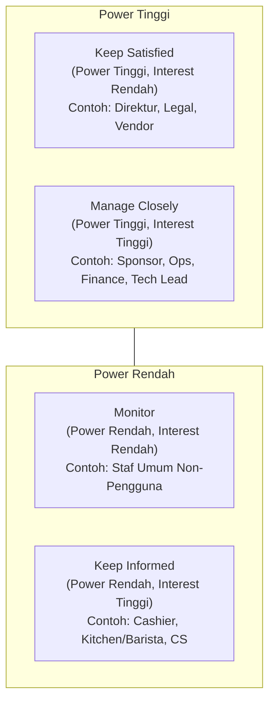

# Bab 03 — Requirement Elicitation, Stakeholder, & Komunikasi

> **Ringkasan Posisi Bab:** Setelah memahami posisi SA dan ritme SDLC pada Bab 01–02, Anda kini memasuki tahap paling krusial di hulu proyek: **menggali kebutuhan yang sesungguhnya (*elicitation*)** dari para pemangku kepentingan yang sering memiliki sudut pandang bertolak belakang, menyaring prioritas, menulis *User Story* yang teruji, serta mendokumentasikan setiap kesepakatan agar tidak memicu konflik di kemudian hari.

---

## 1. Tujuan Belajar & Posisi di Alur Kerja SA

Setelah mempelajari bab ini, Anda diharapkan mampu:

1. Memetakan pemangku kepentingan menggunakan **Power/Interest Grid** dan memilih strategi komunikasi yang tepat untuk setiap kuadran.
2. Memilih dan mengeksekusi teknik **requirement elicitation** (*Interview*, *Workshop*, *Observation/Shadowing*, *Document Analysis*) sesuai konteks masalah.
3. Membedakan dan merumuskan **Functional Requirements (`FR`)** dan **Non-Functional Requirements (`NFR`)** secara terukur serta memprioritaskannya dengan **MoSCoW**.
4. Menulis **User Story** berstandar *INVEST* lengkap dengan **Acceptance Criteria** berformat **Gherkin** (*Given-When-Then*).
5. Menangani **konflik antar-*stakeholder*** dan ***scope creep*** secara objektif, serta menyusun **Minutes of Meeting (MoM)**, **Decision Log (ADR Bisnis)**, dan **Requirement Traceability Matrix (RTM)**.

Di alur kerja SA, kesalahan pada tahap *elicitation* adalah kesalahan termahal: menurut standar rekayasa perangkat lunak, memperbaiki kesalahan kebutuhan yang baru ditemukan saat tahap pengujian atau produksi biayanya puluhan kali lipat lebih mahal daripada mengklarifikasinya saat rapat penemuan kebutuhan.

---

## 2. Konsep Inti & Mental Model

### 2.1 *Elicitation* Bukan Sekadar "Mencatat Permintaan"

Banyak pemula mengira tugas menggali kebutuhan sama seperti pelayan restoran yang mencatat pesanan: *"Mau fitur apa saja? Baik, saya catat."* Padahal dalam kenyataannya, *stakeholder* sering:
- Menyampaikan **gejala** atau **solusi tebakan**, bukan **akar masalah** (*"Buatkan tombol ekspor Excel 20 kolom!"* padahal masalah sebenarnya adalah mereka butuh rekonsiliasi otomatis karena format sistem akuntansi tidak cocok).
- Menganggap aturan rutin sebagai hal yang *"sudah pasti begitu"* sehingga tidak diucapkan (*tacit knowledge*), misalnya aturan pembulatan diskon atau jam tutup buku cabang.

Analogi yang tepat adalah **dokter mendiagnosis pasien**: pasien boleh mengeluh *"kepala pusing, beri obat sakit kepala paling keras"*, tetapi dokter yang baik tetap memeriksa tekanan darah, riwayat makan, dan pola tidur sebelum meresepkan obat. SA menggali *mengapa* di balik setiap *apa*.

### 2.2 Pemetaan *Stakeholder* (Power/Interest Grid)

Sebelum menjadwalkan wawancara, petakan siapa saja pemangku kepentingan berdasarkan dua sumbu: **Power** (sebesar apa kewenangan mereka menyetujui anggaran, aturan, atau membatalkan rilis) dan **Interest** (seberapa besar kepentingan operasional mereka terhadap sistem sehari-hari).



*(Sumbu vertikal: tingkat pengaruh/wewenang keputusan; sisi kiri ke kanan: tingkat kepentingan operasional harian terhadap sistem.)*

| Kuadran | Tingkat Power & Interest | Strategi Komunikasi SA | Contoh Peran di Perusahaan Ritel |
| :--- | :--- | :--- | :--- |
| **Manage Closely** | Power Tinggi, Interest Tinggi | Libatkan aktif di *workshop*, validasi aturan bisnis, dan mintai tanda tangan *sign-off*. | Sponsor Proyek, Ops Lead, Finance Lead, Tech Lead |
| **Keep Satisfied** | Power Tinggi, Interest Rendah | Beri laporan ringkas pencapaian, risiko, dan keputusan besar tanpa membebani detail teknis harian. | Direktur Utama, Tim Legal/Kepatuhan, Vendor Payment Gateway |
| **Keep Informed** | Power Rendah, Interest Tinggi | Ajak dalam *shadowing*, uji coba *prototype*, dan *UAT* karena mereka merasakan langsung dampak layar/alur kerja. | `Cashier`, `Kitchen/Barista`, Staf CS |
| **Monitor** | Power Rendah, Interest Rendah | Cukup beri pengumuman umum saat mendekati jadwal rilis (*Go-Live*). | Staf administrasi umum divisi lain yang tidak memakai sistem |

### 2.3 Empat Teknik Utama *Requirement Elicitation*

| Teknik | Kapan Paling Efektif Dipakai | Kelebihan | Risiko / Jebakan |
| :--- | :--- | :--- | :--- |
| **1. Interview (Wawancara 1-on-1 / Kelompok Kecil)** | Menggali kebijakan mendalam dari pengambil keputusan (Finance, Manager) atau membahas topik sensitif (kecurangan void). | Fokus tinggi, narasumber bicara jujur tanpa takut tekanan atasan/rekan. | Terlalu lama jika narasumber banyak; sudut pandang bisa bias satu divisi. |
| **2. Workshop / JAD (*Joint Application Design*)** | Menyelaraskan alur lintas departemen yang saling bergantung dan menyelesaikan perbedaan pendapat dalam satu meja. | Keputusan cepat diambil secara kolektif; membangun kesepahaman lintas tim. | Mudah dikuasai satu orang paling vokal jika fasilitator (SA) pasif. |
| **3. Observation / *Job Shadowing*** | Memahami pekerjaan kasir, dapur, atau gudang saat jam sibuk untuk menemukan *tacit knowledge* & hambatan fisik. | Mengungkap fakta lapangan yang tidak pernah muncul di SOP tertulis (misal kasir menaruh catatan di kertas tempel). | Efek *Hawthorne* (pekerja bertingkah terlalu patuh saat diamati) & butuh waktu khusus di lokasi. |
| **4. Document Analysis** | Sebelum rapat pertama—membaca SOP lama, laporan Excel rekonsiliasi, struk fisik, dan dokumentasi API pihak ketiga. | Menghemat waktu wawancara karena SA tidak menanyakan hal dasar yang sudah ada di dokumen. | SOP tertulis sering sudah usang dan berbeda dengan praktik aktual di toko. |

> **Aturan Emas Urutan Elicitation:** Selalu mulai dengan **Document Analysis**, lanjutkan ke **Observation/Shadowing** atau **Interview** untuk mengonfirmasi kenyataan lapangan, baru tutup dengan **Workshop** untuk menyepakati alur target (*To-Be*) dan menyelesaikan konflik lintas divisi.

### 2.4 Functional vs Non-Functional Requirements & MoSCoW

- **Functional Requirement (`FR`):** Apa yang harus *dilakukan* sistem (fitur, perhitungan, validasi, transisi status, laporan). Contoh: *"Sistem harus mereservasi stok selama 15 menit saat checkout online."*
- **Non-Functional Requirement (`NFR`):** Seberapa *baik* sistem bekerja dalam menjalankan fungsi tersebut (performa/latensi, konkurensi, keamanan, auditabilitas, ketersediaan, retensi). NFR wajib berangka terukur—hindari kata kabur seperti *"cepat"*, *"aman"*, atau *"tahan lama"*.

Agar proyek tidak tenggelam oleh puluhan keinginan, gunakan prioritas **MoSCoW**:
- **M — Must Have:** Wajib ada di rilis ini; tanpa fitur ini sistem tidak layak jalan atau melanggar hukum/keuangan.
- **S — Should Have:** Penting dan bernilai tinggi, tetapi masih ada *workaround* sementara jika terpaksa mundur sedikit.
- **C — Could Have:** *Nice-to-have* (pemanis pengalaman pengguna); dikerjakan hanya jika seluruh *Must* dan *Should* sudah aman.
- **W — Won't Have (this time):** Secara eksplisit dikeluarkan dari fase ini (masuk *Out-of-Scope* / kandidat Fase 2).

### 2.5 Menulis User Story (INVEST) & Acceptance Criteria (Gherkin)

Di tim Agile, kebutuhan fungsional dipecah menjadi **User Story** dengan format:
> **Sebagai** `[Aktor/Peran]`, **saya ingin** `[melakukan aksi/tujuan]`, **agar** `[manfaat bisnis yang terukur]`.

Setiap User Story yang sehat memenuhi kriteria **INVEST**: *Independent* (mandiri), *Negotiable* (bisa didiskusikan detailnya), *Valuable* (bernilai bagi pengguna/bisnis), *Estimable* (bisa diestimasi tim dev), *Small* (cukup kecil untuk 1 Sprint), dan *Testable* (dapat diuji).

Agar *Testable* tanpa tafsir ganda, lengkapi User Story dengan **Acceptance Criteria** berformat **Gherkin**:
- `Given` (Prasyarat awal: kondisi data, peran aktor, posisi stok)
- `When` (Aksi pemicu yang dilakukan aktor atau sistem)
- `Then` (Hasil terukur: perubahan status di database, respons API/UI, notifikasi, atau kode galat)

---

## 3. Standar Industri & Aturan Praktis

### 3.1 Mengelola Konflik Antar-*Stakeholder* & *Scope Creep*

Konflik antar-divisi itu wajar karena tiap divisi diukur oleh KPI yang berbeda (Marketing mengejar jumlah pesanan/promo, Finance mengejar 0 selisih uang & pencegahan kecurangan, Operasional Cabang mengejar kecepatan layanan konter). Ketika konflik terjadi, SA tidak memihak berdasarkan jabatan terkuat, melainkan:

1. **Kembalikan ke Objektif Bisnis & KPI Proyek:** Uji setiap opsi terhadap KPI di BRD (misal: *"Apakah opsi ini tetap menjaga selisih rekonsiliasi = 0 dan antrean kasir di bawah target?"*).
2. **Sajikan Dampak Nyata (Biaya, Waktu, Risiko) secara Netral:** Tunjukkan ke *Business Sponsor* / PM menggunakan angka atau *trade-off* konkrit (misal: *"Opsi A menambah 5 hari kerja dan membuka celah audit; Opsi B selesai tepat waktu dan aman secara audit"*).
3. **Gunakan Matriks RACI untuk Penentu Akhir:** Jika diskusi buntu, serahkan keputusan kepada pemegang peran **`A` (Accountable)** sesuai matriks RACI di BRD (lihat [`template-brd.md`](../templates/template-brd.md)).
4. **Tangkal *Scope Creep* dengan Protokol "Ya, Lewat Jalur CR / Backlog":** Jangan langsung berkata *"Tidak bisa"* secara mentah, tetapi katakan *"Ide ini bagus; karena saat ini belum ada di ruang lingkup Fase 1, mari kita catat di Backlog/CR untuk dievaluasi prioritas dan dampak jadwalnya bersama PM"*.

### 3.2 Tiga Artefak Wajib Penjaga Ingatan Tim

1. **Minutes of Meeting (MoM):** Dikirim maksimal **24 jam setelah rapat**. Jangan menulis transkrip obrolan; cukup muat: Tanggal & Peserta, Poin Diskusi Utama, **Keputusan yang Disepakati**, **Daftar Pertanyaan Terbuka (*Open Questions*)**, serta **Action Items (PIC + Tenggat Waktu)**.
2. **Decision Log (ADR Bisnis — *Architecture/Business Decision Record*):** Catatan permanen setiap kali ada keputusan aturan penting yang sebelumnya diperdebatkan (misal: *"Mengapa TTL reservasi dikunci 15 menit, bukan 30 menit"* atau *"Mengapa diskon dibulatkan di subtotal, bukan per item"*). Ini mencegah pertanyaan yang sama diulang 3 bulan kemudian saat ada anggota tim baru.
3. **Requirement Traceability Matrix (RTM):** Tabel penghubung dua arah yang melacak setiap kebutuhan bisnis (`BR`) -> kebutuhan sistem (`FR`/`NFR`) -> `Use Case` -> `API/Screen` -> `Entitas DB` -> `Test Case UAT` (lihat bagian 7 di [`template-srs.md`](../templates/template-srs.md)).

---

## 4. Praktik Studi Kasus *NusaPOS & OrderHub*

### 4.1 Power/Interest Grid Pemangku Kepentingan NusaKopi

| Stakeholder / Aktor | Kuadran | Kepentingan Utama dalam *NusaPOS & OrderHub* |
| :--- | :--- | :--- |
| **HQ Management / Business Sponsor** | *Manage Closely* | Peluncuran tepat waktu di seluruh cabang, peningkatan omzet *online pickup*, kontrol biaya. |
| **Finance & Accounting Lead** | *Manage Closely* | Presisi nominal Rupiah (`BIGINT`), pembulatan `HALF_UP`, kontrol void/refund (`audit_logs`), rekonsiliasi 0 selisih ke `Accounting/ERP`. |
| **Ops Lead / Perwakilan `Branch Manager`** | *Manage Closely* | Kelancaran operasional harian cabang, mekanisme approval void/refund praktis, pencocokan tutup buku harian. |
| **Tech Lead & Tim Engineering** | *Manage Closely* | Atomisitas stok (`NFR-02`), keandalan *webhook idempotency*, performa 150 RPS (`NFR-01`). |
| **HQ Marketing (`HQ Admin`)** | *Keep Satisfied / Manage Closely (saat bahas promo)* | Fleksibilitas pengaturan voucher promo (`promotions`) dan kampanye penjualan online. |
| **`Cashier` & `Kitchen/Barista`** | *Keep Informed* | Layar POS & antrean dapur yang cepat dipakai saat jam ramai tanpa langkah bertele-tele. |
| **Vendor `Payment Gateway (QRIS/VA)`** | *Keep Satisfied* | Kepatuhan standar keamanan *HMAC signature*, format *webhook*, dan prosedur pengujian *sandbox*. |
| **`Customer` (Sampel Pelanggan Uji)** | *Keep Informed / Monitor* | Kemudahan memesan *Online Self-Pickup*, kejelasan hitungan mundur pembayaran 15 menit, dan notifikasi status akurat. |

### 4.2 Pemetaan Lengkap `FR-01..08` dan `NFR-01..04` (*NusaPOS & OrderHub*)

Mengacu pada Kamus Domain Kanonik di [`../README.md`](../README.md), berikut pemetaan terstruktur seluruh kebutuhan Fase 1 beserta prioritas MoSCoW-nya:

| ID | Kebutuhan Sistem (Ringkasan Spesifikasi) | Prioritas MoSCoW | Aktor & Entitas Kunci |
| :--- | :--- | :---: | :--- |
| `FR-01` | Autentikasi & Otorisasi Berbasis Peran (RBAC) terikat cabang (`store_id`). | **Must Have** | Semua Aktor Manusia · `users`, `roles`, `audit_logs` |
| `FR-02` | Pengelolaan & tampilan katalog menu cabang beserta stok tersedia (*real-time*) & promo aktif. | **Must Have** | `HQ Admin`, `Cashier`, `Customer` · `stores`, `products`, `product_variants`, `inventories`, `promotions` |
| `FR-03` | Pembuatan pesanan `POS` & `ONLINE_PICKUP` dengan validasi promo, penguncian stok (`store_id` + `variant_id`), dan reservasi TTL 15 menit. | **Must Have** | `Cashier`, `Customer` · `orders`, `order_items`, `inventories`, `inventory_movements`, `promotions` |
| `FR-04` | Pembayaran tunai (`POS`) & pembayaran asinkron QRIS/VA via *signed webhook* yang *idempotent*. | **Must Have** | `Cashier`, `Customer`, `Payment Gateway (QRIS/VA)` · `payments`, `orders`, `inventories`, `inventory_movements` |
| `FR-05` | Pengelolaan antrean dapur (`PAID` -> `PREPARING` -> `READY` -> `COMPLETED`) dan pengiriman notifikasi ke pelanggan. | **Must Have** | `Kitchen/Barista`, `Cashier`, `Notification Service` · `orders`, `audit_logs` |
| `FR-06` | Pembatalan pra-bayar (`CANCELLED`) & *scheduler* pelepasan otomatis reservasi kedaluwarsa (`EXPIRED` > 15 menit). | **Must Have** | `Customer`, `Cashier`, Sistem Scheduler · `orders`, `inventories`, `inventory_movements` |
| `FR-07` | Pengajuan & persetujuan void/refund pasca-bayar dengan otorisasi eksklusif `Branch Manager` dan jejak audit. | **Must Have** | `Cashier`, `Branch Manager`, `Payment Gateway (QRIS/VA)` · `refunds`, `orders`, `payments`, `inventories`, `audit_logs` |
| `FR-08` | Rekonsiliasi penjualan harian per cabang (`Asia/Jakarta`) & ekspor tutup buku ke `Accounting/ERP`. | **Should Have** *(atau Must Have untuk rilis operasional penuh)* | `Branch Manager`, `Accounting/ERP` · `daily_reconciliations`, `orders`, `payments`, `refunds`, `audit_logs` |

**Kebutuhan Non-Fungsional (`NFR-01..04`) yang Wajib Terukur:**
- `NFR-01` (**Performa**): Waktu respons *p95* `GET /api/v1/stores/{storeId}/menu` `<= 300 ms` dan `POST /api/v1/orders` `<= 500 ms` pada beban puncak **150 RPS** nasional.
- `NFR-02` (**Konkurensi & Konsistensi**): Reservasi dan pemotongan stok menggunakan transaksi atomik + *row-level locking* (`0% overselling`); pemrosesan webhook pembayaran bersifat *idempotent*.
- `NFR-03` (**Keamanan & Auditabilitas**): HTTPS/TLS 1.2+, validasi RBAC per `store_id`, verifikasi *HMAC signature* webhook, *rate limiting* endpoint publik, dan `audit_logs` *immutable* minimal **5 tahun**.
- `NFR-04` (**Ketersediaan, Waktu, & Akurasi**): Ketersediaan `>= 99,5%` jam operasional (06.00–23.00 WIB); penyimpanan database **UTC** dengan konversi **Asia/Jakarta** untuk tampilan dan tutup buku; kalkulasi Rupiah `BIGINT` (`0 discrepancy`).

### 4.3 Contoh User Story & Gherkin Acceptance Criteria (`FR-03` / `UC-03`)

**User Story US-03: Checkout Online Self-Pickup dengan Reservasi Stok TTL 15 Menit**
> **Sebagai** `Customer`, **saya ingin** melakukan *checkout* pesanan *Online Self-Pickup* pada cabang pilihan saya dan mendapatkan kode bayar QRIS, **agar** stok minuman saya diamankan selama saya menyelesaikan pembayaran tanpa khawatir kehabisan oleh pembeli di toko.

**Acceptance Criteria (Gherkin):**

```gherkin
Feature: Checkout Online Self-Pickup & Reservasi Stok (FR-03 / UC-03)

  Scenario: Checkout berhasil saat stok cabang mencukupi dan promo valid
    Given cabang dengan store_id "STR-JKT-01" berstatus aktif dan jam operasional buka
    And varian "VAR-002" (Kopi Susu Aren Large) memiliki on_hand_qty = 5 dan reserved_qty = 1
    And kode promo "HEMAT10" aktif dengan diskon 10% dan kuota tersisa 20
    When Customer mengirim POST /api/v1/orders untuk store_id "STR-JKT-01" dengan 2 unit "VAR-002" dan kode promo "HEMAT10"
    Then sistem mengunci baris inventories cabang terkait secara atomik
    And reserved_qty bertambah menjadi 3 serta tercatat mutasi RESERVE sebesar 2 pada inventory_movements
    And orders baru tersimpan dengan status "PENDING_PAYMENT", store_id "STR-JKT-01", dan expires_at = created_at + 15 menit (UTC)
    And perhitungan diskon dan total dibulatkan HALF_UP ke bilangan bulat Rupiah (BIGINT) di tingkat subtotal
    And Customer menerima kode QRIS dinamis beserta batas waktu pembayaran 15 menit

  Scenario: Checkout ditolak karena sisa stok tersedia tidak mencukupi
    Given varian "VAR-002" di store_id "STR-JKT-01" memiliki on_hand_qty = 3 dan reserved_qty = 2 (available = 1)
    When Customer mengirim POST /api/v1/orders dengan kuantitas 2 unit "VAR-002"
    Then transaksi database di-rollback tanpa mengubah reserved_qty
    And sistem mengembalikan HTTP 409 Conflict dengan kode error "ERR_INSUFFICIENT_STOCK"
```

### 4.4 Studi Kasus Resolusi Konflik, MoM, Decision Log, & RTM

**Skenario Konflik Nyata di Workshop NusaKopi:**
- **HQ Marketing** menuntut agar `Cashier` di toko bisa langsung menekan tombol *"Promo Spesial Manajer / Void Cepat"* tanpa persetujuan siapa pun jika ada pelanggan komplain atau agar target transaksi harian cabang cepat tercapai.
- **Finance & `Branch Manager`** menolak keras karena pada sistem kasir lama, kebebasan kasir melakukan void/diskon sepihak menjadi celah utama selisih kas tunai dan penggelapan struk.

**Cara SA Menengahi & Menyelesaikan Konflik:**
SA memisahkan dua masalah yang tercampur: *(1) kecepatan promo resmi* vs *(2) kontrol pembatalan transaksi berbayar*.
- Untuk kebutuhan promo cepat, `HQ Admin` cukup menerbitkan voucher terstruktur di tabel `promotions` dengan kuota dan tanggal berlaku sehingga kasir tinggal memilih promo sah tanpa mengarang harga.
- Untuk pembatalan setelah pesanan berstatus `PAID`, aturan kontrol keuangan tidak bisa ditawar: wajib masuk alur `refunds` dengan *approval* `Branch Manager` dan tercatat di `audit_logs` (`FR-07`). Agar tidak memperlambat antrean konter, persetujuan `Branch Manager` bisa dilakukan langsung lewat notifikasi/PIN otorisasi di perangkat cabang dalam hitungan detik.

**Contoh Cuplikan Minutes of Meeting (MoM):**
- **Rapat:** Workshop Penyelarasan Aturan Promo & Void/Refund NusaPOS (`2026-11-10`)
- **Peserta:** HQ Marketing, Finance Lead, Perwakilan Branch Manager, PM, System Analyst.
- **Keputusan Disepakati:**
  1. Pembatalan pesanan sebelum dibayar (`PENDING_PAYMENT` -> `CANCELLED`) boleh dilakukan oleh `Cashier` atau `Customer`.
  2. Pembatalan/pengembalian dana setelah berstatus `PAID` (`FR-07`) **wajib** melalui tabel `refunds` dan disetujui oleh `Branch Manager` (mencatat `audit_logs`).
  3. Diskon tidak diketik bebas oleh kasir; seluruh diskon berasal dari master `promotions` yang dikelola `HQ Admin`.
- **Action Items:** SA memperbarui `SRS FR-07` dan membuat Decision Log `DEC-004` (tenggat: `2026-11-11`); UI/UX menyiapkan dialog input PIN `Branch Manager` pada layar POS (tenggat: `2026-11-13`).

**Contoh Decision Log (ADR Bisnis):**

| ID Keputusan | Tanggal | Konteks Masalah | Keputusan Final | Alasan & Trade-off | Pemutus (`A`) |
| :--- | :--- | :--- | :--- | :--- | :--- |
| `DEC-004` | `2026-11-10` | Konflik kecepatan kasir vs kontrol fraud pada pembatalan transaksi lunas & pemberian diskon. | Void pasca-`PAID` wajib approval `Branch Manager` (bisa via PIN cepat di konter); diskon hanya dari master `promotions`. | Menjaga nol celah manipulasi kas dan akurasi `daily_reconciliations`, sambil memberi opsi otorisasi cepat di konter agar antrean tidak macet. | Finance Lead & Ops Lead |
| `DEC-005` | `2026-11-11` | Penentuan durasi TTL reservasi stok pesanan *Online Self-Pickup*. | TTL dikunci **15 menit** (`expires_at = created_at + 15m`). | 5 menit terlalu singkat untuk pengguna berpindah aplikasi e-wallet; 60 menit menahan stok terlalu lama dan merugikan pembeli konter. | PM & Ops Lead |

**Contoh Cuplikan Requirement Traceability Matrix (RTM):**

| Business Req | System Req (`FR/NFR`) | Use Case | Endpoint / Screen | Entitas Database | Test / UAT ID |
| :--- | :--- | :--- | :--- | :--- | :--- |
| `BR-01` (Stok terpadu & anti-oversell) | `FR-03`, `FR-06`, `NFR-02` | `UC-03` | `POST /api/v1/orders` · Layar Checkout Online | `orders`, `order_items`, `inventories`, `inventory_movements` | `UAT-03-POS`, `UAT-03-CONC` |
| `BR-03` (Kontrol Void/Refund) | `FR-07`, `NFR-03` | `UC-06` | `POST /api/v1/orders/{orderId}/refunds` · Modal Approval Manager | `refunds`, `orders`, `payments`, `audit_logs` | `UAT-06-AUTH`, `UAT-06-APP` |

---

## 5. Jebakan Umum (*Anti-Patterns*) Junior SA

1. **Hanya Mewawancarai Manajer Kantor Pusat Tanpa Mengamati Pengguna Lapangan:** `HQ Admin` sering menggambarkan alur ideal di atas kertas, sementara `Cashier` dan `Kitchen/Barista` punya trik operasional nyata saat jam makan siang. Tanpa *shadowing*, UI yang dirancang akan lambat dipakai di toko.
2. **Menulis Kebutuhan Kabur Tanpa Angka:** Menulis *"Halaman menu harus terbuka dengan cepat dan aman"* di SRS membuat QA tidak bisa menentukan apakah 2 detik itu lulus atau gagal. Selalu kunci angka seperti `p95 <= 300 ms` (`NFR-01`) dan `HTTPS + RBAC per store_id` (`NFR-03`).
3. **Membuat User Story Terlalu Besar (*Epic* Menyamar Jadi Story):** Satu tiket bertuliskan *"Sebagai Customer, saya ingin memesan, membayar QRIS, melacak pesanan, dan mengajukan refund"* melanggar prinsip *Small* pada INVEST dan mustahil diselesaikan bersih dalam satu siklus pengujian.
4. **Kesepakatan Lisan Tanpa MoM & Decision Log:** Kesepakatan rapat yang tidak ditulis akan menguap dalam dua minggu. Ketika tim Finance bertanya *"Siapa yang menyetujui kasir boleh cancel order?"*, ketiadaan MoM dan Decision Log akan memaksa seluruh tim berdebat ulang dari nol.

---

## 6. Checklist Verifikasi Mandiri

Pastikan seluruh poin berikut sudah Anda kuasai sebelum masuk ke Bab 04:

- [ ] Saya dapat menempatkan seluruh pemangku kepentingan proyek ke dalam 4 kuadran *Power/Interest Grid* beserta strategi pendekatannya.
- [ ] Saya tahu kapan menggunakan *Document Analysis*, *Shadowing*, *Interview*, dan *Workshop* secara berurutan.
- [ ] Saya bisa menulis *User Story* berstandar INVEST dan *Acceptance Criteria* Gherkin yang menguji *happy path* maupun jalur error (`ERR_...`).
- [ ] Saya mampu menyusun MoM berorientasi keputusan, *Decision Log*, dan baris *RTM* yang menghubungkan kebutuhan bisnis hingga skenario UAT.

---

## 7. Latihan Praktik

Kerjakan keempat skenario berikut terlebih dahulu, lalu bandingkan dengan pembahasan bernalar di [`../kunci-latihan/kunci-bab-01-04.md`](../kunci-latihan/kunci-bab-01-04.md).

1. **Skenario 1 (Strategi *Elicitation*):** Anda ditugaskan merancang ulang modul tutup buku harian (`FR-08`) untuk 35 cabang NusaKopi. Anda menerima keluhan bahwa manajer cabang butuh 2 jam tiap malam untuk mencocokkan laporan POS, mutasi QRIS bank, dan catatan refund kertas, sementara tim Finance sering menemukan selisih ratusan Rupiah antar-cabang. Susun rencana *elicitation* 3 langkah berurutan (teknik apa saja, siapa targetnya, dan artefak/informasi apa yang ingin Anda tangkap di tiap langkah).
2. **Skenario 2 (Memperbaiki Requirement Kabur & Menulis Gherkin):** Seorang PM menulis draf kebutuhan berikut di catatan rapat:
   > *"Pokoknya kalau pelanggan pesan online dan bayarnya telat, sistem harus otomatis membatalkan pesanannya dengan aman supaya stok tidak nyangkut, dan kalau pelanggan telanjur bayar ya ditolak dengan baik."*
   Ubah kalimat kabur tersebut menjadi:
   - (a) Satu spesifikasi aturan fungsional yang tegas mengacu pada [`../README.md`](../README.md) (`FR-06`, status kanonik, TTL 15 menit, `inventory_movements`, dan kode galat kanonik);
   - (b) Dua skenario *Acceptance Criteria* berformat **Gherkin** (*Scenario 1: Pembatalan otomatis saat melewati TTL 15 menit*; *Scenario 2: Penolakan pembayaran terlambat setelah pesanan berstatus `EXPIRED`*).
3. **Skenario 3 (Menengahi Konflik & Membuat Decision Log):** Pada rapat peninjauan `FR-02` dan `FR-03`, tim *Marketing* meminta agar pelanggan *Online Self-Pickup* boleh menggabungkan hingga 3 kode promo sekaligus dalam satu keranjang belanja agar nilai rata-rata transaksi naik. Sebaliknya, tim *Finance* khawatir margin rugi dan kompleksitas pembulatan `HALF_UP` per promo memicu selisih laporan pajak. Rumuskan bagaimana Anda memimpin diskusi kompromi di rapat tersebut, lalu tulis **1 baris Decision Log** lengkapnya (Konteks, Keputusan, Alasan/Trade-off, Pemutus).
4. **Skenario 4 (Pelacakan *Scope Creep* & RTM):** Dua minggu menjelang UAT Fase 1, salah satu pemilik cabang waralaba meminta agar struk pesanan langsung memicu pemesanan driver GoSend otomatis (`OUT_FOR_DELIVERY`) untuk pelanggan yang malas datang ke toko. Jelaskan respons komunikasi yang tepat kepada peminta, dokumen apa yang harus Anda perbarui, dan mengapa permintaan ini tidak boleh langsung diselipkan ke dalam *RTM* Fase 1.

---

**Langkah Berikutnya:** Lanjutkan ke [**Bab 04 — Process Modeling: Flowchart & BPMN 2.0**](./04-process-modeling-flowchart-bpmn.md) untuk memvisualisasikan seluruh alur kebutuhan tersebut menjadi diagram proses *As-Is* dan *To-Be* yang bebas tafsir ganda.
