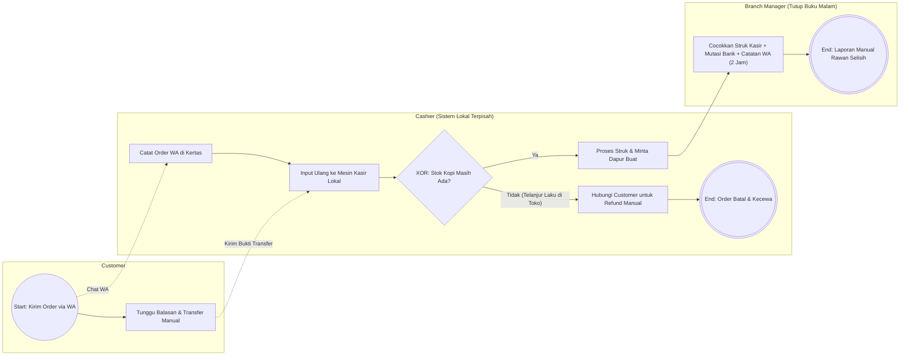
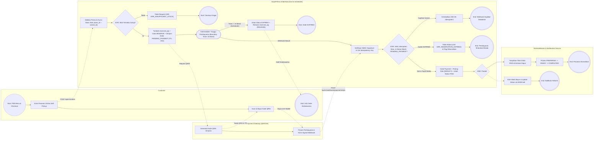
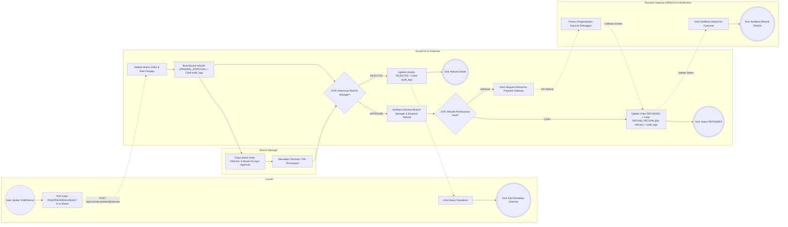

# Bab 04 — Process Modeling: Flowchart & BPMN 2.0

> **Ringkasan Posisi Bab:** Setelah mengumpulkan kebutuhan dan menyepakati aturan bisnis pada Bab 03, tantangan berikutnya adalah memastikan semua pihak—dari kasir, manajer cabang, hingga *Backend Engineer*—melihat **alur proses yang persis sama**. Bab ini melatih Anda membaca dan menggambar model proses *As-Is* dan *To-Be* menggunakan Flowchart serta notasi **BPMN 2.0** yang dipetakan secara bersih ke dalam diagram Mermaid *swimlane*.

---

## 1. Tujuan Belajar & Posisi di Alur Kerja SA

Setelah mempelajari bab ini, Anda diharapkan mampu:

1. Melakukan analisis kesenjangan antara proses saat ini (**As-Is**) dan proses target (**To-Be**) untuk menemukan *bottleneck*, pekerjaan berulang (*rework*), dan celah risiko.
2. Membedakan fungsi dan tingkat ketepatan penggunaan **Flowchart** dibandingkan **BPMN 2.0 (*Business Process Model and Notation*)**.
3. Menggunakan elemen inti BPMN 2.0 secara tepat: *Event* (*Start*, *Intermediate*, *End*), *Task/Activity*, *Gateway* (*Exclusive `XOR`*, *Parallel `AND`*, *Inclusive `OR`*), *Pool & Swimlane*, *Message Flow*, serta *Timer/Error Boundary Event*.
4. Menerjemahkan proses bisnis nyata **NusaPOS & OrderHub**—mulai dari *As-Is* kasir manual hingga *To-Be* Checkout Online QRIS (TTL 15 menit -> `EXPIRED`) dan Void/Refund Approval—ke dalam diagram Mermaid `flowchart` + `subgraph` swimlane yang valid.

Di dalam alur kerja SA, **Process Modeling adalah langkah jembatan antara teks kebutuhan (`FR`) dan pemodelan sistem rinci (`Use Case`, `Sequence`, `ERD`)**. Tanpa peta proses lintas aktor yang jelas, tim pengembang sering membangun fitur yang berjalan baik di satu layar tetapi putus ketika berpindah tangan dari `Customer` ke `Payment Gateway (QRIS/VA)`, lalu ke `Kitchen/Barista`, dan berakhir di `Branch Manager`.

---

## 2. Konsep Inti & Mental Model

### 2.1 Analisis Proses *As-Is* vs *To-Be*

Jangan pernah mendesain sistem baru (*To-Be*) sebelum benar-benar memahami cara kerja sistem atau kebiasaan saat ini (*As-Is*). Analogi sederhananya: seorang perancang lalu lintas tidak bisa memutus kemacetan hanya dengan membangun jalan layang baru tanpa memetakan dulu di persimpangan mana kendaraan menumpuk.

Saat membedah proses *As-Is*, SA berburu empat penyakit operasional utama:
1. **Manual Handoff & Double Entry:** Data diketik ulang oleh manusia dari satu aplikasi ke aplikasi lain (misal kasir menyalin nominal dari mesin EDC/QRIS ke aplikasi kasir).
2. **Bottleneck (Penumpukan Antrean):** Satu titik persetujuan atau proses lambat yang menahan seluruh alur di hilir.
3. **Lack of Feedback / Blind Spot:** Aktor tidak tahu status proses terkini sehingga harus bertanya manual (misal pelanggan terus menghubungi admin menanyakan apakah pesanannya sudah dibuat).
4. **Missing Exception Path:** Alur berjalan lancar saat normal, tetapi kacau ketika ada pembatalan, stok habis, atau pembayaran gagal.

### 2.2 Flowchart vs BPMN 2.0: Kapan Memakai yang Mana?

| Aspek | Flowchart Klasik | BPMN 2.0 (*Business Process Model and Notation*) |
| :--- | :--- | :--- |
| **Fokus Utama** | Urutan langkah logika atau algoritma di dalam satu alur/program. | Orkestrasi proses bisnis **lintas aktor, lintas departemen, dan lintas sistem eksternal** (*event-driven*). |
| **Kejelasan Tanggung Jawab** | Lemah—sulit melihat siapa mengerjakan apa tanpa modifikasi kolom manual. | Sangat kuat—menggunakan **Pool** (batas organisasi/sistem) dan **Lane / Swimlane** (peran di dalam Pool). |
| **Penanganan Waktu & Pesan Asinkron** | Terbatas pada percabangan ya/tidak biasa. | Memiliki simbol khusus untuk *Timer Event* (misal batas 15 menit), *Message Event* (webhook/notifikasi), dan *Error Boundary*. |
| **Kapan SA Memakainya?** | Menjelaskan logika perhitungan internal (misal rumus diskon/pajak) atau ringkasan tingkat tinggi di BRD. | Memodelkan proses bisnis *end-to-end* di SRS/FSD yang melibatkan banyak aktor dan sistem eksternal. |

### 2.3 Elemen Inti BPMN 2.0

Untuk menjadi Junior–Mid SA yang andal, Anda tidak perlu menghafal ratusan simbol BPMN 2.0; kuasai **6 kelompok elemen inti** berikut:

1. **Events (Lingkaran — Sesuatu yang Terjadi):**
   - **Start Event:** Pemicu dimulainya proses (misal: *Customer menekan Checkout*).
   - **Intermediate Event (Timer / Message):** Kejadian di tengah alur, misalnya menunggu *webhook* pembayaran masuk atau menunggu batas waktu **Timer 15 menit**.
   - **End Event:** Titik akhir proses yang jelas (misal: *Pesanan Selesai*, *Pesanan Kedaluwarsa*, atau *Pesanan Dibatalkan*).
2. **Activities / Tasks (Persegi Panjang Membulat — Pekerjaan yang Dilakukan):**
   - Gunakan frasa **Kata Kerja + Objek** yang konkret (contoh: *"Reservasi Stok Cabang"*, bukan hanya *"Stok"*).
3. **Gateways (Belah Ketupat — Pengendali Percabangan & Penggabungan Alur):**
   - **Exclusive Gateway (`XOR`):** Memilih **tepat satu** jalur berdasarkan kondisi (contoh: *Apakah pembayaran lunas sebelum 15 menit? Ya / Tidak*).
   - **Parallel Gateway (`AND`):** Memecah alur menjadi beberapa pekerjaan yang berjalan **bersamaan secara paralel**, atau menunggu semua cabang selesai sebelum lanjut (contoh: setelah `PAID`, sistem *sekaligus* mengirim pesanan ke antrean dapur **dan** mengirim notifikasi ke pelanggan).
   - **Inclusive Gateway (`OR`):** Satu atau lebih jalur dapat aktif sekaligus tergantung kondisi (jarang diperlukan dibanding `XOR`/`AND`; gunakan hati-hati agar tidak membingungkan).
4. **Pool & Swimlane (Wadah Tanggung Jawab):**
   - **Pool:** Mewakili satu entitas/sistem independen (contoh: Pool *NusaPOS & OrderHub* vs Pool eksternal *Payment Gateway (QRIS/VA)*).
   - **Lane (Swimlane):** Jalur di dalam Pool untuk memisahkan tanggung jawab aktor (`Customer`, `Cashier`, `Kitchen/Barista`, `Branch Manager`, `Sistem/Scheduler`).
5. **Sequence Flow vs Message Flow:**
   - **Sequence Flow (garis panah utuh `-->`):** Urutan eksekusi di dalam **satu Pool yang sama** (boleh menyeberangi antar-*Lane* internal).
   - **Message Flow (garis panah putus-putus `-.->`):** Pertukaran pesan atau API/Webhook **antar-Pool berbeda** (misal dari sistem kita ke `Payment Gateway (QRIS/VA)` atau `Notification Service`).
6. **Boundary Event (Timer / Error yang Menempel di Tugas):**
   - Menangkap kejadian pengecualian saat sebuah *Task* sedang berlangsung—contoh paling klasik adalah **Timer Boundary Event 15 menit** pada tahap *"Menunggu Pembayaran QRIS"* yang otomatis mengalihkan alur ke pembatalan reservasi jika waktu habis.

---

## 3. Standar Industri & Aturan Praktis

### 3.1 Konvensi Simbol BPMN 2.0 dalam Mermaid (`flowchart` + `subgraph`)

Karena Mermaid standar di GitHub, VS Code, dan Obsidian tidak memiliki tipe diagram `bpmn` bawaan, industri dan modul ini menggunakan tipe **`flowchart LR` / `flowchart TD`** dengan **`subgraph` sebagai Swimlane/Pool** dan konvensi bentuk node berikut secara konsisten:

| Elemen BPMN 2.0 | Sintaks Mermaid yang Dipakai | Konvensi Visual & Penjelasan |
| :--- | :--- | :--- |
| **Start Event** | `S(("Start: ..."))` | Lingkaran untuk penanda awal proses. |
| **End Event** | `E((("End: ...")))` | Lingkaran ganda untuk penanda akhir proses (sukses atau terminal gagal). |
| **Task / Activity** | `T["Kata Kerja + Objek"]` | Persegi panjang standar untuk aktivitas aktor atau sistem. |
| **Timer / Message Intermediate Event** | `TM(["Timer 15m / Event"])` | Bentuk kapsul/stadium untuk kejadian waktu atau pesan asinkron. |
| **Exclusive Gateway (`XOR`)** | `G{"XOR: Kondisi?"}` | Belah ketupat dengan awalan `XOR:` untuk percabangan eksklusif satu jalur. |
| **Parallel Gateway (`AND`)** | `P{"AND: Paralel"}` | Belah ketupat dengan awalan `AND:` untuk pemecahan/penggabungan jalur paralel. |
| **Swimlane / Pool** | `subgraph LANE_ID ["Nama Aktor / Sistem"]` | Mengelompokkan seluruh node milik aktor/sistem terkait agar alur lintasan jelas. |
| **Sequence Flow vs Message Flow** | `-->` vs `-.->` | Panah utuh untuk alur internal; panah putus-putus untuk komunikasi API/Webhook ke sistem eksternal. |

> **Aturan Teknis Mermaid Anti-Error:** Selalu bungkus teks label yang mengandung tanda kurung `()`, tanda garis miring `/`, titik dua `:`, atau simbol khusus ke dalam tanda kutip ganda, misalnya `T1["Validasi Stok (store_id)"]` atau `G1{"XOR: Stok Cukup?"}`. Jangan pernah mencampur nama node tanpa kutip jika label mengandung kurung!

### 3.2 Aturan Kualitas Diagram BPMN

1. **Setiap Gateway Pembuka yang Bercabang Harus Jelas Keluarannya:** Setiap cabang dari `XOR` wajib memiliki label kondisi yang saling meniadakan (*mutually exclusive*), misalnya `Ya` vs `Tidak`, atau `Sukses` vs `Timeout`.
2. **Tidak Ada *Dead End* (Jalan Buntu):** Setiap aktivitas selain *End Event* harus memiliki jalur keluar. Jika sebuah jalur berhenti karena ditolak atau kedaluwarsa, akhiri dengan *End Event* eksplisit (misal `End: EXPIRED`).
3. **Nama Task Konsisten dengan Entitas & Status Kanonik:** Sebutkan perubahan status kanonik secara eksplisit (`PENDING_PAYMENT`, `PAID`, `EXPIRED`, `REFUNDED`) pada task atau end event terkait agar pembaca mudah melacaknya ke State Diagram dan Database.

---

## 4. Praktik Studi Kasus *NusaPOS & OrderHub*

Mari kita modelkan tiga proses nyata dari proyek **NusaPOS & OrderHub** untuk melihat secara langsung lompatan kualitas dari *As-Is* menuju *To-Be*.

### 4.1 Proses *As-Is*: Kasir Manual & Pesanan Chat (Sumber Masalah Sebelum Sistem Baru)

Sebelum *NusaPOS & OrderHub* dibangun, pesanan daring pelanggan diterima lewat WhatsApp admin cabang, sementara kasir menginput pesanan *in-store* ke mesin kasir lokal yang tidak tersambung secara *real-time*.

**Temuan Analisis *As-Is*:**
- Terdapat *manual handoff* & *double entry* dari chat WA ke mesin kasir.
- Tidak ada reservasi stok terpusat per `orders.store_id`, sehingga sering terjadi *overselling* dan pembatalan memalukan setelah pelanggan mentransfer uang.
- Rekonsiliasi harian memakan waktu 2 jam per malam dan rentan selisih pembulatan.

---

### 4.2 Proses *To-Be* 1: Checkout Online Self-Pickup & Pembayaran QRIS (`UC-03`, `UC-04`, `FR-03`, `FR-04`, `FR-06`)

Pada proses *To-Be* di bawah ini, perhatikan bagaimana BPMN swimlane memisahkan tanggung jawab antara `Customer`, inti sistem `NusaPOS & OrderHub` (termasuk *Scheduler*), `Payment Gateway (QRIS/VA)`, `Notification Service`, dan `Kitchen/Barista`.

**Mengapa Model *To-Be* Ini Kuat?**
- *Boundary Timer 15 Menit* secara eksplisit memodelkan aturan `FR-06`: stok yang direservasi tidak pernah tertahan selamanya jika pelanggan batal membayar.
- Percabangan `XOR` pasca-webhook menangani tiga kasus nyata di produksi: (1) pembayaran sah tepat waktu (`PAID`), (2) *webhook* terkirim ulang dua kali (mengembalikan `200 OK` *idempotent* tanpa memotong stok lagi), dan (3) pembayaran datang terlambat setelah status berubah menjadi `EXPIRED`.
- *Parallel Gateway (`AND`)* memastikan pesanan masuk ke antrean `Kitchen/Barista` bersamaan dengan pengiriman notifikasi oleh `Notification Service`.

---

### 4.3 Proses *To-Be* 2: Pengajuan & Approval Void/Refund Pasca-Bayar (`FR-07`, `UC-06`)

Sesuai aturan kanonik, pembatalan setelah status `PAID` tidak boleh dieksekusi sepihak oleh `Cashier`; wajib melewati tabel `refunds`, otorisasi `Branch Manager`, dan pencatatan `audit_logs`.

---

## 5. Jebakan Umum (*Anti-Patterns*) Junior SA

1. **Menggambar Diagram Tanpa *Swimlane* untuk Proses Lintas Aktor:** Diagram kotak-kotak lurus tanpa pembagian aktor membuat *Backend*, *Frontend*, dan operasional kebingungan menentukan bagian mana yang dijalankan di perangkat kasir, mana yang dijalankan *scheduler* server, dan mana yang ditangani *Payment Gateway*.
2. **Menyembunyikan Jalur Waktu Habis (*Timeout*) dan Penolakan:** Diagram yang hanya memperlihatkan `Checkout -> Bayar -> Selesai` tidak berguna bagi tim rekayasa. Justru jalur `Timer 15 Menit -> EXPIRED` dan `Ditolak Branch Manager -> REJECTED` yang menentukan keandalan sistem.
3. **Salah Memakai `AND` vs `XOR` Gateway:** Memakai *Parallel Gateway* untuk pilihan `Tunai` atau `QRIS` berarti sistem mewajibkan satu pesanan dibayar pakai tunai DAN QRIS secara bersamaan. Pilihan metode bayar adalah `XOR`, sedangkan mengirim perintah ke dapur dan mengirim notifikasi ke WA setelah lunas adalah `AND`.
4. **Menggabungkan Alur Proses Bisnis dengan Query SQL di dalam Kotak BPMN:** Kotak BPMN harus berbunyi *"Kunci Baris Stok & Reservasi (`orders.store_id`)"*, bukan *"Jalankan `SELECT * FROM inventories FOR UPDATE`"*. Detail kueri atau kolom spesifik dibahas pada pemodelan data dan FSD.

---

## 6. Checklist Verifikasi Mandiri

Pastikan setiap butir di bawah ini terjawab **"Ya"** sebelum melangkah ke Bab 05:

- [ ] Saya dapat menjelaskan minimal 3 temuan penyakit proses dari analisis *As-Is* sebelum merancang diagram *To-Be*.
- [ ] Saya mengerti kapan cukup memakai Flowchart sederhana dan kapan wajib memodelkan dengan BPMN 2.0 *swimlane*.
- [ ] Saya bisa membedakan fungsi `XOR` Gateway, `AND` Gateway, *Sequence Flow*, *Message Flow*, dan *Timer Boundary Event*.
- [ ] Semua diagram Mermaid yang saya buat memakai `flowchart` + `subgraph`, memiliki label terquotasi aman (`["..."]`), tidak memiliki *dead end*, dan menggunakan nama status serta entitas kanonik yang benar.

---

## 7. Latihan Praktik

Kerjakan keempat skenario berikut terlebih dahulu, lalu periksa kunci jawaban dan pembahasan lengkapnya di [`../kunci-latihan/kunci-bab-01-04.md`](../kunci-latihan/kunci-bab-01-04.md).

1. **Skenario 1 (Membaca & Mengkritisi Diagram BPMN):** Seorang Junior SA membuat alur proses *To-Be* untuk `UC-02` (**POS In-Store**, pembayaran tunai maupun QRIS di kasir) dengan kesalahan berikut:
   - (a) Tidak memisahkan *swimlane* `Cashier`, `Sistem NusaPOS`, dan `Kitchen/Barista`.
   - (b) Menggunakan *Parallel Gateway (`AND`)* untuk cabang `Pembayaran Tunai` dan `Pembayaran QRIS`.
   - (c) Dari kotak *"Pelanggan Membayar QRIS"* langsung menuju *"Dapur Meracik (`PREPARING`)"* tanpa melewati verifikasi webhook dan tanpa jalur jika pelanggan ternyata batal di depan kasir.
   Identifikasi dan jelaskan dampak kesalahan (a), (b), dan (c), lalu tuliskan perbaikan alurnya secara terstruktur.
2. **Skenario 2 (Pemodelan BPMN Mermaid — Rekonsiliasi Harian `FR-08`):** Buatlah diagram **Mermaid `flowchart LR` + `subgraph` swimlane** untuk proses *To-Be* **Rekonsiliasi Penjualan Harian Cabang (`FR-08`)** dengan aturan kanonik berikut:
   - Melibatkan 3 *swimlane*: `Branch Manager`, `Sistem NusaPOS & OrderHub`, dan `Accounting/ERP`.
   - Proses dimulai saat `Branch Manager` membuka ringkasan tutup buku harian cabang berdasarkan tanggal bisnis `Asia/Jakarta` (`GET /api/v1/reconciliations/daily`).
   - Sistem menghitung total transaksi `POS` vs `ONLINE_PICKUP`, tunai vs QRIS/VA, serta total `REFUNDED` menggunakan `BIGINT` Rupiah.
   - Ada percabangan `XOR`: apakah ada selisih kas fisik (*variance*) atau transaksi menggantung (`PENDING_PAYMENT` yang belum diproses)? Jika ada selisih kas fisik, `Branch Manager` wajib mengisi catatan alasan selisih sebelum finalisasi; jika bersih, langsung finalisasi (`POST /api/v1/reconciliations/daily`).
   - Setelah difinalisasi, sistem mencatat `audit_logs`, mengunci tanggal bisnis tersebut, dan mengirim data ke `Accounting/ERP` (jika gagal kirim, sistem menandai status gagal sinkronisasi agar bisa dicoba ulang).
3. **Skenario 3 (Memilih Jenis Gateway):** Tentukan jenis *Gateway* BPMN 2.0 paling tepat (`XOR`, `AND`, atau `OR`) untuk keempat kondisi di *NusaPOS & OrderHub* berikut beserta alasannya:
   - (a) Setelah `Kitchen/Barista` mengubah status pesanan online menjadi `READY`, sistem memperbarui layar antrean konter **dan sekaligus** memicu `Notification Service` mengirim pesan WhatsApp ke `Customer`.
   - (b) Pelanggan memilih jenis pesanan saat membuka menu: `POS` (pesan di tempat) atau `ONLINE_PICKUP`.
   - (c) Pada pemeriksaan promo di keranjang belanja, sistem mengecek apakah pelanggan hanya memakai potongan harga reguler, atau poin loyalitas (jika ada di fase lanjut), atau keduanya sekaligus.
   - (d) Saat `Branch Manager` memproses pengajuan `refunds`, ia memilih menyetujui (`APPROVED`) atau menolak (`REJECTED`).
4. **Skenario 4 (Analisis *As-Is* ke *To-Be* di Luar Studi Kasus Utama):** Sebuah klinik gigi masih menerima pendaftaran pasien melalui telepon dan mencatat janji temu di buku tulis resepsionis, lalu memanggil pasien ke ruang dokter dengan berteriak dari meja depan. Identifikasi 3 masalah *As-Is* utamanya dan sebutkan 3 perubahan spesifik yang harus muncul pada diagram *To-Be* (termasuk *Intermediate Timer/Message Event* apa yang paling relevan untuk mengurangi pasien batal datang tanpa kabar).

---

**Langkah Berikutnya:** Setelah menguasai pemodelan proses lintas aktor, lanjutkan ke Bab 05 (*UML Behavioral Part 1: Use Case & Activity Diagram*, sebagaimana dipetakan di [`../README.md`](../README.md)) untuk memperdalam spesifikasi interaksi aktor-sistem dan cabang kegagalan di tingkat Use Case.
