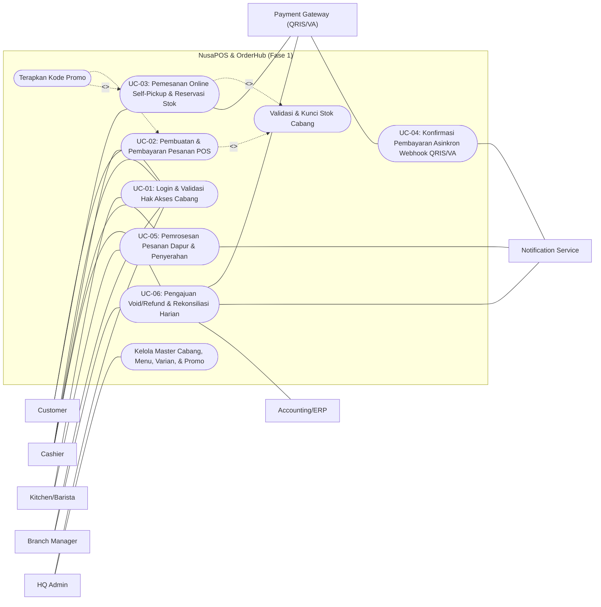
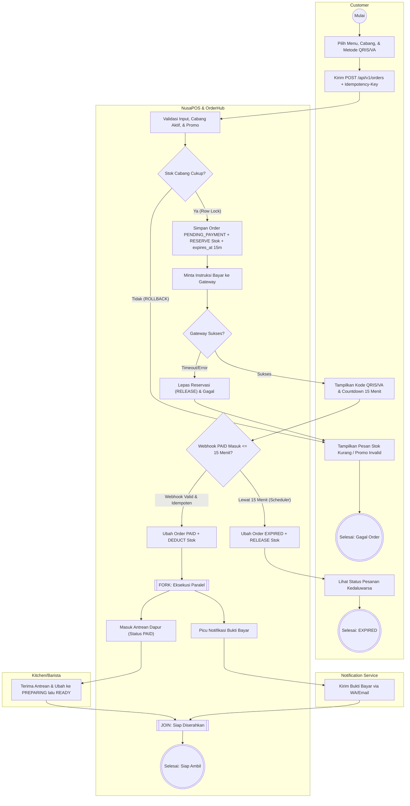

# Bab 05 — UML Behavioral Part 1: Use Case & Activity Diagram

> **Ringkasan Posisi Bab:** Pada Bab 04, Anda telah memetakan aliran proses bisnis lintas aktor menggunakan BPMN 2.0. Sekarang kita masuk ke dalam batas sistem (*system boundary*) untuk mendefinisikan **apa saja kapabilitas yang harus disediakan oleh perangkat lunak**, siapa saja aktor yang berinteraksi dengannya, serta bagaimana skenario sukses, alternatif, dan kegagalan ditangani langkah demi langkah melalui **Use Case Diagram**, **Use Case Specification**, dan **Activity Diagram**.

---

## 1. Tujuan Belajar & Posisi di Alur Kerja SA

Setelah mempelajari bab ini, Anda diharapkan mampu:

1. Menjelaskan perbedaan fokus antara **Process Modeling (BPMN 2.0)** dan **Use Case Modeling (UML)** sehingga tidak tertukar saat menyusun dokumentasi proyek.
2. Membaca dan merancang **Use Case Diagram** secara tepat: menentukan *system boundary*, membedakan *primary actor* vs *supporting actor*, serta menggunakan relasi **`<<include>>`**, **`<<extend>>`**, dan **Generalization** tanpa arah panah yang terbalik.
3. Menyusun **Use Case Specification** berstandar industri (mengacu pada [`../templates/template-use-case.md`](../templates/template-use-case.md)) yang mengunci *Preconditions*, *Trigger*, *Main Success Scenario*, *Alternative Flows*, *Exception Flows*, dan *Postconditions*.
4. Memetakan alur kendali operasional suatu proses menggunakan **Activity Diagram** (*swimlane*, *decision/merge*, dan *fork/join* paralel) di dalam Mermaid `flowchart TD`.

Di dalam alur kerja System Analyst (SA), **Bab 05 adalah titik pengunci perilaku fungsional sistem**. Jika pada Bab 03 Anda menulis daftar kebutuhan tingkat tinggi (`FR-01` s.d. `FR-08`) dan pada Bab 04 Anda menggambar alur bisnisnya, maka di Bab 05 Anda menerjemahkan kebutuhan tersebut menjadi kontrak interaksi konkret antara pengguna dan sistem yang kelak diuji oleh QA serta dijabarkan menjadi *Sequence Diagram* (Bab 06) dan *Screen Specification* (Bab 07).

---

## 2. Konsep Inti & Mental Model

### 2.1 BPMN 2.0 vs Use Case: Mengapa Keduanya Dibutuhkan?

Analogi sederhananya: **BPMN 2.0 adalah peta rute perjalanan kereta antar-kota**, sedangkan **Use Case adalah manual prosedur di dalam satu stasiun saat penumpang membeli tiket atau petugas mengesahkan pembatalan**.

| Dimensi | BPMN 2.0 (Bab 04) | Use Case & Specification (Bab 05) |
| :--- | :--- | :--- |
| **Pertanyaan yang Dijawab** | *"Bagaimana urutan pekerjaan mengalir dari satu peran/organisasi ke peran lain?"* | *"Layanan spesifik apa yang disediakan sistem bagi aktor, dan bagaimana reaksi sistem atas setiap aksi & kegagalan?"* |
| **Fokus Batas** | Lintas aktor manusia, proses manual, dan berbagai sistem eksternal. | Terpusat pada **System Boundary** (apa yang ada di dalam sistem vs di luar sistem). |
| **Kekuatan Utama** | Memperlihatkan *handoff*, antrean, *timer*, dan pemisahan tanggung jawab. | Mengunci *edge cases*, *exception recovery*, serta jaminan integritas data (*postconditions*). |

### 2.2 Anatomi Use Case Diagram

Sebuah Use Case Diagram terdiri dari empat komponen utama:

1. **System Boundary (Batas Sistem):** Kotak persegi yang membungkus seluruh kapabilitas milik perangkat lunak (misalnya sistem **NusaPOS & OrderHub**). Semua yang berada di luar kotak adalah aktor.
2. **Actors (Aktor):** Peran manusia atau sistem eksternal yang berinteraksi langsung dengan sistem:
   - **Primary Actor (Aktor Primer):** Pihak yang *memicu* Use Case untuk mencapai tujuan bisnisnya (ditempatkan di sisi kiri *system boundary*, contoh: `Customer`, `Cashier`, `Kitchen/Barista`, `Branch Manager`, `HQ Admin`).
   - **Supporting / Secondary Actor (Aktor Sekunder):** Sistem atau peran eksternal yang *dimintai layanan/notifikasi* oleh sistem agar Use Case tuntas (ditempatkan di sisi kanan *system boundary*, contoh: `Payment Gateway (QRIS/VA)`, `Accounting/ERP`, `Notification Service`). Catatan: untuk `UC-04` (webhook masuk), `Payment Gateway (QRIS/VA)` bertindak sebagai pemicu eksternal (*primary trigger*).
3. **Use Case (Oval):** Tujuan fungsional bernilai bisnis yang utuh bagi aktor (disebut *User Goal / Sea-Level* menurut Alistair Cockburn), ditulis dengan frasa **Kata Kerja + Objek**.
4. **Relasi Antar Elemen:**
   - **Association (Garis utuh):** Menghubungkan Aktor dengan Use Case yang dijalankannya.
   - **`<<include>>` (Wajib / Sub-fungsi bersama):** Use Case dasar (*Base*) **selalu dan wajib** memanggil Use Case yang di-*include* setiap kali dijalankan. Contoh: baik transaksi kasir (`UC-02`) maupun pemesanan online (`UC-03`) wajib menjalankan proses pemeriksaan & reservasi/potong stok atau validasi autentikasi sesi (`UC-01`). **Arah panah: dari Base -> ke Included.**
   - **`<<extend>>` (Opsional / Kondisional):** Use Case tambahan (*Extension*) hanya berjalan **jika kondisi tertentu terpenuhi** pada *Extension Point* milik Use Case dasar, sehingga Use Case dasar tetap utuh meskipun ekstensi tidak dijalankan. Contoh: *Terapkan Kode Promo* pada saat pembuatan pesanan (`UC-03`), atau *Pengajuan Void/Refund (`UC-06`)* yang hanya terjadi jika pesanan bermasalah pasca-bayar. **Arah panah: dari Extension -> ke Base** (kebalikan dari `<<include>>`!).
   - **Generalization (Pewarisan):** Aktor atau Use Case khusus mewarisi perilaku aktor/Use Case umum (misal `Cashier` dan `Branch Manager` sama-sama merupakan `Internal Staff` yang membutuhkan akses login `UC-01`).

### 2.3 Mengapa "Diagram Oval" Saja Tidak Pernah Cukup: Use Case Specification

Diagram Use Case hanya berfungsi sebagai **daftar isi visual**. Menyerahkan diagram berisi 6 oval kepada *Backend Engineer* tanpa **Use Case Specification** sama seperti menyerahkan daftar isi buku kepada penerjemah tanpa isi babnya.

Use Case Specification memaksa SA menjawab pertanyaan krusial:
- Apa syarat agar aksi boleh dimulai (**Preconditions**)?
- Apa pemicunya (**Trigger**)?
- Bagaimana alur normal langkah demi langkah (**Main Success Scenario**)?
- Apa jalur alternatif yang masih sah secara bisnis (**Alternative Flows**), misalnya pelanggan tidak memakai kode promo atau membatalkan sebelum bayar (`CANCELLED`)?
- Bagaimana sistem memulihkan data saat terjadi kegagalan (**Exception Flows**), misalnya stok kurang (`ERR_INSUFFICIENT_STOCK`), `Payment Gateway (QRIS/VA)` *timeout*, atau batas waktu 15 menit terlampaui (`EXPIRED`)?
- Apa jaminan kondisi database setelah alur selesai, baik saat sukses maupun gagal (**Success Postcondition & Minimal/Failure Guarantee**)?

### 2.4 Activity Diagram: Flowchart Berdisiplin Tinggi untuk Logika & Paralelisme

Jika Use Case Specification adalah narasi terstruktur, **Activity Diagram** adalah peta visual alur aktivitas di dalam satu atau beberapa Use Case—khususnya ketika terdapat:
- Percabangan kompleks (*Decision* dan *Merge*),
- Aktivitas paralel sejati (**Fork** untuk memecah alur menjadi beberapa cabang bersamaan, dan **Join** untuk menunggu seluruh cabang paralel selesai sebelum melanjutkannya), serta
- Tanggung jawab lintas peran (*Swimlane / Activity Partition*).

---

## 3. Standar Industri & Aturan Praktis

### 3.1 Konvensi Simbol UML Use Case & Activity dalam Mermaid

Mermaid standar (GitHub, VS Code, Obsidian) tidak menyediakan tipe `usecaseDiagram` atau `activityDiagram` khusus. Standar praktis pada modul ini menggunakan **`flowchart LR`** untuk Use Case Diagram dan **`flowchart TD`** untuk Activity Diagram dengan konvensi berikut:

| Diagram | Elemen UML | Sintaks Mermaid Standar | Aturan Visual |
| :--- | :--- | :--- | :--- |
| **Use Case** | *System Boundary* | `subgraph SYS ["NusaPOS & OrderHub"] ... end` | Membungkus semua oval Use Case; aktor berada di luar `subgraph`. |
| **Use Case** | *Use Case* | `UC03(["UC-03: Pemesanan Online Self-Pickup"])` | Bentuk stadium/oval (`([...])`) dengan label `"Kode: Kata Kerja + Objek"`. |
| **Use Case** | *Actor* | `ACT_CUST["Customer"]` | Kotak persegi dengan label nama aktor kanonik. |
| **Use Case** | *Association* | `ACT_CUST --- UC03` | Garis tanpa panah (atau panah arah inisiasi) dari aktor ke Use Case. |
| **Use Case** | `<<include>>` | `UC_BASE -.->|"<<include>>"| UC_INC` | Panah putus-putus dari **Base ke Included**. |
| **Use Case** | `<<extend>>` | `UC_EXT -.->|"<<extend>>"| UC_BASE` | Panah putus-putus dari **Extension ke Base**. |
| **Activity** | *Initial & Final Node* | `START(("Mulai"))` / `END((("Selesai")))` | Lingkaran untuk awal dan lingkaran ganda untuk akhir aktivitas. |
| **Activity** | *Action State* | `A1["Kunci Baris Stok Cabang"]` | Persegi dengan frasa kata kerja aktif. |
| **Activity** | *Decision / Merge* | `D1{"Stok Cukup?"}` | Belah ketupat dengan kondisi *mutually exclusive* di label panah keluar. |
| **Activity** | *Fork / Join Bar* | `FORK[["FORK: Paralel"]]` / `JOIN[["JOIN: Sinkron"]]` | Subrutin/persegi bergaris ganda untuk menandai pemecahan dan penggabungan jalur paralel. |

> **Peringatan Teknis Mermaid:** Selalu apit teks label node atau relasi yang memuat tanda kurung `()`, tanda kutip sudut `<< >>`, atau garis miring `/` dengan tanda kutip ganda, misalnya `UC03(["UC-03: Pesan Online (Pickup)"])` dan `|"<<include>>"|`.

### 3.2 Aturan Emas Penulisan Use Case & Activity Diagram

1. **Uji "Jam Istirahat Kopi" (*Coffee Break Test*):** Satu Use Case harus menghasilkan sesuatu yang bernilai bisnis sebelum aktor beristirahat. *"Memasukkan Password"* bukan Use Case; *"UC-01: Login Pengguna & Validasi Hak Akses Cabang"* adalah Use Case. *"Memilih Metode QRIS"* bukan Use Case; *"UC-03: Pemesanan Online Self-Pickup & Reservasi Stok"* adalah Use Case.
2. **Jangan Sampai Arah `<<include>>` vs `<<extend>>` Terbalik:** Ingat mantra: *"Base includes Sub; Extension extends Base"*. Jika `UC-03` butuh `Validasi & Reservasi Stok`, panahnya `UC-03 --> Validasi Stok`. Jika `Terapkan Kode Promo` opsional memperluas `UC-03`, panahnya `Terapkan Kode Promo --> UC-03`.
3. **Setiap Fork Harus Memiliki Join atau Akhir yang Jelas:** Jangan pernah memecah dua alur paralel dengan `FORK` lalu membiarkan salah satu cabangnya menggantung tanpa *End Node* atau *Join*.
4. **Minimal Guarantee Tidak Boleh Dilupakan:** Setiap skenario kegagalan (*Exception Flow*) pada transaksi yang menyentuh uang atau stok wajib menyatakan bagaimana sistem menjaga konsistensi data (`ROLLBACK`, `RELEASE` stok, pencatatan `audit_logs`).

---

## 4. Praktik Studi Kasus *NusaPOS & OrderHub*

### 4.1 Use Case Diagram Fase 1 (`UC-01` s.d. `UC-06`)

Diagram berikut memetakan ruang lingkup lengkap **NusaPOS & OrderHub Fase 1** sesuai daftar aktor dan Use Case kanonik di [`../README.md`](../README.md), termasuk pemisahan aktor primer (kiri) dan aktor sekunder (kanan) serta hubungan `<<include>>` dan `<<extend>>`.

**Penjelasan Keputusan Desain Diagram:**
- `UC-01` menjadi Use Case akses terpisah bagi seluruh aktor manusia (`FR-01`) karena sesi autentikasi dan token RBAC per cabang (`store_id`) mendahului operasional transaksi.
- `Validasi & Kunci Stok Cabang` diekstrak sebagai sub-fungsi `<<include>>` karena baik `UC-02` (POS) maupun `UC-03` (Online Self-Pickup) **wajib** mengunci baris `inventories` untuk mencegah *overselling* (`NFR-02`).
- `Terapkan Kode Promo` dimodelkan sebagai `<<extend>>` terhadap `UC-02` dan `UC-03` (panah mengarah ke `UC-02` dan `UC-03`) karena tidak semua transaksi menggunakan kode promo.
- `Delivery Kurir 3PL` tidak digambarkan di dalam *System Boundary* karena berada di luar ruang lingkup Fase 1 (*Out-of-Scope* — akan menjadi *Change Request* di Bab 11).

---

### 4.2 Use Case Specification Penuh: `UC-03` (Checkout Online Self-Pickup & Reservasi Stok)

Spesifikasi berikut disusun mengikuti 100% struktur [`../templates/template-use-case.md`](../templates/template-use-case.md):

#### 1. Identitas & Metadata Use Case

| Atribut | Detail |
| :--- | :--- |
| **Use Case ID** | `UC-03` |
| **Nama Use Case** | Pemesanan Online Self-Pickup & Reservasi Stok (TTL 15 Menit) |
| **Modul / Fitur** | Order Management & Inventory Reservation |
| **Referensi FR / BR** | `FR-02`, `FR-03`, `FR-06`, `NFR-01`, `NFR-02`, `NFR-04` |
| **Prioritas** | Must Have / Critical |
| **Versi & Tanggal** | v1.0 — 2026-11-25 |

#### 2. Aktor & Pemangku Kepentingan (*Actors & Stakeholders*)

- **Aktor Primer (*Primary Actor*):** `Customer`
- **Aktor Sekunder (*Supporting Actors*):** `Payment Gateway (QRIS/VA)`
- **Stakeholders & Kepentingan:**
  - `Customer`: Ingin memesan minuman dari jauh, mendapat kepastian stok tersedia saat datang, serta menerima informasi total bayar yang transparan.
  - `Branch Manager` / Operasional Cabang: Ingin memastikan pesanan yang belum dibayar tidak menahan stok selamanya (maksimal 15 menit) sehingga tidak merugikan pelanggan *in-store*.

#### 3. Kondisi Awal & Pemicu (*Preconditions & Trigger*)

- **Preconditions:**
  1. `Customer` telah terautentikasi (`UC-01`) atau memiliki sesi pelanggan valid dan telah memilih cabang aktif (`stores.is_active = true`) dalam jam operasional cabang (`Asia/Jakarta`).
  2. Katalog menu beserta stok tersedia (`on_hand_qty - reserved_qty`) cabang tersebut telah dimuat melalui `GET /api/v1/stores/{storeId}/menu`.
  3. Keranjang belanja berisi minimal 1 item varian (`product_variants`) yang aktif.
- **Trigger:**
  `Customer` memilih metode pembayaran daring (`QRIS` atau `VA`), opsional mengisi kode promo, lalu menekan tombol **"Buat Pesanan & Bayar"** yang memicu `POST /api/v1/orders` disertai header `Idempotency-Key`.

#### 4. Alur Sukses Utama (*Main Success Scenario / Happy Path*)

| Langkah | Aktor / Sistem | Deskripsi Aksi |
| :---: | :--- | :--- |
| `1` | **Customer** | Mengirim permintaan pembuatan pesanan `ONLINE_PICKUP` untuk `store_id` terpilih beserta daftar `{variant_id, qty, notes}`, `payment_method` (`QRIS` atau `VA`), dan `promo_code` opsional. |
| `2` | **Sistem** | Memvalidasi keaktifan cabang (`stores`), validitas `Idempotency-Key`, keaktifan setiap `product_variants`, dan mengabaikan harga yang dikirim klien (jika ada). |
| `3` | **Sistem** | Memvalidasi `promo_code` pada tabel `promotions` (periode aktif UTC, kuota tersisa, minimum belanja) serta menghitung subtotal, diskon, pajak, dan total akhir dalam bilangan bulat Rupiah (`BIGINT`) dengan pembulatan **`HALF_UP`** di tingkat subtotal. |
| `4` | **Sistem** | Membuka transaksi basis data atomik dan melakukan **row-level locking** pada baris `inventories` berdasarkan pasangan `(store_id, variant_id)`, lalu memastikan `on_hand_qty - reserved_qty >= qty` untuk seluruh item. |
| `5` | **Sistem** | Menambah `reserved_qty` pada `inventories`, mencatat mutasi bertipe `RESERVE` pada `inventory_movements`, menyimpan header pesanan di `orders` dengan `channel = 'ONLINE_PICKUP'`, `status = 'PENDING_PAYMENT'`, dan `expires_at = NOW() + 15 minutes` (UTC), serta menyimpan *snapshot* nama produk, nama varian, dan harga satuan saat itu ke `order_items`. |
| `6` | **Sistem** | Memanggil API `Payment Gateway (QRIS/VA)` untuk membuat instruksi pembayaran dinamis sebesar `orders.total_amount` dengan masa berlaku sinkron terhadap `expires_at`. |
| `7` | **Payment Gateway (QRIS/VA)** | Mengembalikan payload instruksi bayar (kode QRIS string/image URL atau nomor Virtual Account) beserta `external_tx_id`. |
| `8` | **Sistem** | Menyimpan record awal di `payments` (status menunggu bayar, `idempotency_key`, `external_tx_id`), mengonfirmasi transaksi DB, dan mengirimkan respons sukses ke layar `Customer` (menampilkan kode QRIS/VA serta hitung mundur 15 menit dalam zona waktu cabang `Asia/Jakarta`). |

#### 5. Alur Alternatif (*Alternative Flows*)

- **`3a.` Pelanggan tidak memasukkan kode promo (`promo_code` kosong/null):**
  1. Sistem melewati lookup tabel `promotions` dan menetapkan `discount_amount = 0` serta `promotion_id = NULL`.
  2. Alur berlanjut ke langkah 4 pada *Main Success Scenario*.
- **`8a.` Pelanggan membatalkan pesanan secara manual sebelum membayar:**
  1. Saat pesanan masih berstatus `PENDING_PAYMENT` (dan belum melewati `expires_at`), `Customer` memicu `PATCH /api/v1/orders/{orderId}/status` ke `CANCELLED`.
  2. Sistem memverifikasi kepemilikan pesanan, mengunci baris `inventories`, mengurangi `reserved_qty`, mencatat mutasi `RELEASE` pada `inventory_movements`, dan mengubah `orders.status` menjadi `CANCELLED`.
  3. Use Case berakhir dalam kondisi batal terkelola.

#### 6. Alur Pengecualian (*Exception Flows*)

- **`E1` (pada Langkah 2) — Request Duplikat dengan `Idempotency-Key` Sama:**
  1. Sistem mendeteksi `Idempotency-Key` sudah tercatat untuk request sebelumnya.
  2. Jika payload identik dan pesanan sudah terbentuk, sistem mengembalikan respons hasil pesanan yang sama tanpa membuat pesanan baru atau mereservasi stok dua kali.
  3. Jika `Idempotency-Key` dipakai ulang dengan payload berbeda, sistem mengembalikan `ERR_DUPLICATE_IDEMPOTENCY` (`409 Conflict`).
- **`E2` (pada Langkah 3) — Kode Promo Tidak Valid / Kedaluwarsa / Kuota Habis:**
  1. Sistem menolak transaksi sebelum mereservasi stok dan mengembalikan pesan error validasi promo agar pelanggan dapat menghapus atau mengganti kode promo.
- **`E3` (pada Langkah 4) — Stok Cabang Tidak Mencukupi (`Oversell Guard`):**
  1. Salah satu varian memiliki `on_hand_qty - reserved_qty < qty`.
  2. Sistem melakukan **`ROLLBACK`** penuh transaksi database sehingga **tidak ada satu pun item** dalam keranjang yang tereservasi sebagian (*all-or-nothing*).
  3. Sistem mengembalikan error `ERR_INSUFFICIENT_STOCK` (`409 Conflict`) berisi daftar `variant_id`, `requested_qty`, dan `available_qty`.
- **`E4` (pada Langkah 6) — `Payment Gateway (QRIS/VA)` Timeout atau Error `5xx`:**
  1. Permintaan instruksi bayar gagal setelah batas waktu/retry habis.
  2. Sistem melakukan **`ROLLBACK`** (atau kompensasi pelepasan `reserved_qty` + `RELEASE` pada `inventory_movements`) agar stok tidak terkunci menjadi reservasi yatim.
  3. Sistem mengembalikan pesan error sementara agar `Customer` dapat mencoba ulang.
- **`E5` (Pasca Langkah 8) — Batas Waktu Pembayaran 15 Menit Terlampaui (`FR-06`):**
  1. *Scheduler* mendeteksi `orders.status = 'PENDING_PAYMENT'` dengan `NOW() > expires_at`.
  2. Sistem mengunci baris `orders` & `inventories`, mengubah status menjadi `EXPIRED`, mengurangi `reserved_qty`, dan mencatat entri `RELEASE` pada `inventory_movements`.

#### 7. Kondisi Akhir (*Postconditions*)

- **Success Postcondition:**
  1. Satu record `orders` tersimpan dengan `store_id` valid, `status = 'PENDING_PAYMENT'`, `expires_at` dalam UTC, dan rincian *snapshot* harga di `order_items`.
  2. `inventories.reserved_qty` bertambah sesuai jumlah item pesanan dan tercatat sebagai `RESERVE` di `inventory_movements`.
  3. Satu record `payments` tersimpan menautkan `order_id` dengan `external_tx_id` dari gateway.
- **Minimal / Failure Guarantee:**
  1. Jika gagal di langkah mana pun sebelum selesai, `reserved_qty` tetap utuh seperti sebelum request dimulai (*0% kebocoran stok / zero orphan reservation*).

#### 8. Aturan Bisnis & Referensi Terkait

- **Aturan Bisnis:** `on_hand_qty - reserved_qty >= 0`; TTL reservasi = 15 menit (UTC); uang `BIGINT` Rupiah pembulatan `HALF_UP`.
- **Referensi Layar UI:** Screen Spec `SCR-ORD-002` (Bab 07).
- **Referensi NFR:** `NFR-01` (p95 pembuatan pesanan `<= 500 ms`), `NFR-02` (row-level locking atomik), `NFR-04` (UTC ke `Asia/Jakarta`).

---

### 4.3 Use Case Specification Penuh: `UC-06` (Void/Refund Approval & Rekonsiliasi Harian)

#### 1. Identitas & Metadata Use Case

| Atribut | Detail |
| :--- | :--- |
| **Use Case ID** | `UC-06` |
| **Nama Use Case** | Pengajuan Void/Refund dengan Approval Branch Manager & Rekonsiliasi Harian |
| **Modul / Fitur** | Refund Governance & Daily Reconciliation |
| **Referensi FR / BR** | `FR-07`, `FR-08`, `NFR-03`, `NFR-04` |
| **Prioritas** | Must Have / High |
| **Versi & Tanggal** | v1.0 — 2026-11-25 |

#### 2. Aktor & Pemangku Kepentingan

- **Aktor Primer:** `Cashier` (mengajukan refund), `Branch Manager` (menyetujui/menolak refund & memfinalisasi rekonsiliasi harian).
- **Aktor Sekunder:** `Payment Gateway (QRIS/VA)`, `Notification Service`, `Accounting/ERP`.
- **Stakeholders:** Tim Finance Pusat (akurasi laporan kas & bebas kecurangan), Pelanggan (pengembalian dana jelas dan cepat).

#### 3. Kondisi Awal & Pemicu

- **Preconditions:**
  1. Pengguna telah terautentikasi (`UC-01`) dan terikat pada `store_id` yang sama dengan pesanan terkait.
  2. Pesanan target berada pada salah satu status pasca-bayar yang sah untuk direfund (`PAID`, `PREPARING`, `READY`, atau `COMPLETED`).
- **Trigger:**
  `Cashier` mengajukan permintaan void/refund via `POST /api/v1/orders/{orderId}/refunds`, atau `Branch Manager` membuka daftar antrean persetujuan refund & penutupan `daily_reconciliations`.

#### 4. Alur Sukses Utama (*Main Success Scenario*)

| Langkah | Aktor / Sistem | Deskripsi Aksi |
| :---: | :--- | :--- |
| `1` | **Cashier** | Memilih pesanan pasca-bayar pada cabang miliknya, mengisi alasan void/refund, menentukan apakah item utuh dikembalikan ke stok (`restock_items`), dan mengirim pengajuan ke `POST /api/v1/orders/{orderId}/refunds`. |
| `2` | **Sistem** | Memvalidasi bahwa pesanan berstatus sah (`PAID`, `PREPARING`, `READY`, atau `COMPLETED`), belum memiliki refund aktif/selesai, dan menyimpan record `refunds` berstatus `PENDING_APPROVAL` serta mencatat pengajuan di `audit_logs`. |
| `3` | **Branch Manager** | Meninjau detail pesanan, nominal `BIGINT` Rupiah, dan alasan pengajuan pada layar approval, lalu menyetujui (`APPROVED`) dengan verifikasi kredensial/PIN cabang. |
| `4` | **Sistem** | Memverifikasi peran `Branch Manager` dan kecocokan `store_id`, mengubah status `refunds` menjadi `APPROVED`, serta mencatat keputusan pada `audit_logs`. |
| `5` | **Sistem** | Jika metode bayar awal adalah `QRIS` atau `VA`, sistem memanggil API refund ke `Payment Gateway (QRIS/VA)` menggunakan `external_tx_id` (jika `CASH`, pengembalian tunai dilakukan di laci kasir). |
| `6` | **Payment Gateway (QRIS/VA)** | Mengonfirmasi eksekusi pengembalian dana berhasil. |
| `7` | **Sistem** | Mengubah `refunds.status` menjadi `COMPLETED`, mengubah `orders.status` menjadi `REFUNDED`, menambah kembali `on_hand_qty` pada `inventories` + mencatat `REFUND_RETURN` di `inventory_movements` (jika item dikembalikan utuh), serta merekam entri akhir di `audit_logs`. |
| `8` | **Sistem** | Memicu `Notification Service` mengirim bukti pembatalan/refund ke `Customer`, dan memperhitungkan nominal refund tersebut saat `Branch Manager` menjalankan tutup buku `POST /api/v1/reconciliations/daily` untuk dikirim ke `Accounting/ERP`. |

#### 5. Alur Alternatif (*Alternative Flows*)

- **`3a.` `Branch Manager` menolak pengajuan void/refund (`REJECTED`):**
  1. `Branch Manager` memilih aksi Tolak beserta catatan alasan penolakan.
  2. Sistem mengubah `refunds.status` menjadi `REJECTED`, mencatat ke `audit_logs`, dan mempertahankan `orders.status` pada status semula tanpa pengembalian dana atau mutasi stok.
- **`5a.` Pembayaran awal menggunakan metode `CASH` di kasir POS:**
  1. Sistem melewati pemanggilan API `Payment Gateway (QRIS/VA)` dan langsung melanjutkan ke langkah 7 sambil menandai pengurangan saldo kas tunai pada perhitungan `daily_reconciliations`.

#### 6. Alur Pengecualian (*Exception Flows*)

- **`E1` (pada Langkah 2) — Status Pesanan Tidak Memenuhi Syarat Refund:**
  1. Pesanan ternyata masih `PENDING_PAYMENT`, atau sudah `CANCELLED`, `EXPIRED`, atau `REFUNDED`.
  2. Sistem menolak pengajuan dengan `ERR_INVALID_STATE_TRANSITION` (`422 Unprocessable Entity`).
- **`E2` (pada Langkah 4) — Pelanggaran Wewenang / Lintas Cabang:**
  1. Pengguna berstatus `Cashier` (atau `Branch Manager` dari `store_id` berbeda) mencoba mengeksekusi approval.
  2. Sistem menolak request dengan `ERR_UNAUTHORIZED_APPROVAL` (`403 Forbidden`) dan mencatat percobaan pelanggaran otorisasi ke `audit_logs` (`NFR-03`).
- **`E3` (pada Langkah 5–6) — Kegagalan / Timeout Refund pada `Payment Gateway (QRIS/VA)`:**
  1. Gateway gagal merespons atau menolak pengembalian dana otomatis.
  2. Sistem mempertahankan `orders.status` pada status sebelumnya (tidak langsung menandai `REFUNDED`), mencatat status error di `refunds` & `audit_logs` untuk eskalasi manual/retry aman, sehingga angka penjualan dan uang keluar tetap sinkron.

#### 7. Kondisi Akhir (*Postconditions*)

- **Success Postcondition:**
  1. `orders.status = 'REFUNDED'` (status terminal), `refunds.status = 'COMPLETED'`.
  2. Seluruh jejak pengajuan dan persetujuan tersimpan permanen (*immutable*) di `audit_logs` (retensi minimal 5 tahun).
  3. Nominal refund masuk dalam pengurangan pendapatan bersih pada `daily_reconciliations` cabang di tanggal bisnis `Asia/Jakarta` terkait.
- **Minimal / Failure Guarantee:**
  1. Tidak ada uang yang ditandai `REFUNDED` tanpa approval `Branch Manager` dan tanpa catatan `audit_logs`.

#### 8. Aturan Bisnis & Referensi Terkait

- **Aturan Bisnis:** Void/refund pasca-bayar wajib approval `Branch Manager`; `REFUNDED` bersifat terminal; `audit_logs` bersifat *immutable*.
- **Referensi Layar UI:** Screen Spec `SCR-REF-001` (Bab 07).
- **Referensi NFR:** `NFR-03` (RBAC cabang & retensi audit 5 tahun), `NFR-04` (akurasi finansial `0 discrepancy` pada `daily_reconciliations`).

---

### 4.4 Activity Diagram (`flowchart TD` dengan Swimlane & Fork/Join)

Activity diagram berikut memodelkan alur kendali gabungan dari **Checkout Online hingga Pelunasan & Pemenuhan Paralel (`UC-03` -> `UC-04` -> `UC-05` awal)** untuk memperlihatkan cara kerja *Decision*, *Timer/Expiration*, *Fork*, dan *Join*.

Perhatikan betapa bersihnya diagram di atas: tidak ada satu pun *dead-end*, setiap cabang gagal berakhir di *End Node* eksplisit, dan `FORK` selalu bertemu kembali di `JOIN` sebelum mencapai terminal sukses.

---

## 5. Jebakan Umum (*Anti-Patterns*) Junior SA

1. **Menganggap Use Case = Daftar Tombol atau Layar UI:** Menulis 25 Use Case seperti *"Klik Tombol Login"*, *"Isi Input Promo"*, *"Tekan Tombol Cetak"* adalah kesalahan klasik (*functional decomposition*). Use Case harus merepresentasikan tujuan utuh bernilai bisnis (`UC-03`, `UC-06`).
2. **Arah Panah `<<include>>` dan `<<extend>>` Terbalik:** Kesalahan ini muncul di hampir 60% wawancara Junior SA. Ingat: pada `<<extend>>`, Use Case tambahan (`Terapkan Kode Promo`) mengarah **ke** Use Case dasar (`UC-03`), bukan sebaliknya. Jika panah dibalik, artinya `UC-03` bergantung wajib pada promo dan tidak bisa berjalan tanpa promo.
3. **Menulis Use Case Specification Tanpa *Exception Flows* & *Minimal Guarantee*:** Jika spesifikasi hanya berisi *Happy Path* 5 langkah, pengembang akan membuat asumsi sendiri saat `Payment Gateway` *timeout* atau stok habis di detik yang sama—dan asumsi itulah yang melahirkan bug *overselling* di produksi.
4. **Melupakan Aktor Non-Manusia (Sistem Eksternal & Scheduler):** Pada aplikasi modern, `Payment Gateway (QRIS/VA)`, `Accounting/ERP`, `Notification Service`, dan *Scheduler TTL 15 menit* adalah aktor penting yang memicu atau menyelesaikan Use Case.

---

## 6. Checklist Verifikasi Mandiri

Pastikan setiap butir di bawah ini terjawab **"Ya"** sebelum melangkah ke Bab 06:

- [ ] Saya bisa menjelaskan perbedaan ruang lingkup antara BPMN 2.0 (Bab 04) dan Use Case + Activity Diagram (Bab 05).
- [ ] Seluruh relasi `<<include>>` dan `<<extend>>` pada diagram Use Case saya memiliki arah panah yang benar dan tidak membagi Use Case menjadi aksi tingkat klik tombol.
- [ ] Setiap Use Case Specification yang saya buat mencantumkan *Preconditions*, *Main Success Scenario*, *Alternative Flows*, *Exception Flows*, dan *Minimal/Failure Guarantee* untuk melindungi konsistensi data.
- [ ] Activity Diagram saya menggunakan `flowchart TD` + `subgraph` swimlane yang valid, tidak memiliki *dead-end*, dan menutup setiap `FORK` dengan `JOIN` yang sesuai.

---

## 7. Latihan Praktik

Kerjakan keempat skenario berikut menggunakan [`../templates/template-use-case.md`](../templates/template-use-case.md), lalu periksa pembahasan lengkapnya di [`../kunci-latihan/kunci-bab-05-08.md`](../kunci-latihan/kunci-bab-05-08.md).

1. **Skenario 1 (Audit Use Case Diagram):** Seorang Junior SA membuat Use Case Diagram untuk *NusaPOS & OrderHub* dan memasukkan 4 hal berikut ke dalamnya:
   - (a) Oval Use Case bernama `"Ketik PIN Branch Manager"`.
   - (b) Panah `UC-03 (Checkout Online)` `-.->|"<<extend>>"|` `Terapkan Kode Promo`.
   - (c) Aktor `Customer` dihubungkan langsung ke `UC-06 (Approval Void/Refund)`.
   - (d) Tidak ada aktor `Payment Gateway (QRIS/VA)` dan `Notification Service` di luar *System Boundary*.
   Identifikasi mengapa keempat butir tersebut salah dan jelaskan perbaikannya mengacu pada [`../README.md`](../README.md).
2. **Skenario 2 (Menulis Use Case Specification `UC-02` — POS In-Store):** Susun **Use Case Specification lengkap** (8 bagian sesuai `template-use-case.md`) untuk `UC-02` (**Pembuatan & Pembayaran Pesanan Kasir di Toko (POS In-Store)**) dengan aturan kanonik:
   - Aktor primer adalah `Cashier`; aktor sekunder `Payment Gateway (QRIS/VA)` (jika pelanggan memilih bayar QRIS di meja kasir).
   - Main Success Scenario mencakup pembayaran **Tunai (`CASH`)** yang langsung memotong `on_hand_qty` di `inventories` (`DEDUCT`) dan menetapkan status `PAID` serta mencetak struk.
   - Alternative Flow mencakup pembayaran **QRIS di kasir** (`PENDING_PAYMENT` -> menunggu konfirmasi webhook `PAID`).
   - Exception Flow mencakup minimal 2 kondisi gagal: `ERR_INSUFFICIENT_STOCK` (`409`) dan pembatalan oleh pelanggan di meja kasir sebelum membayar (`CANCELLED`).
3. **Skenario 3 (Merancang Activity Diagram `UC-05` dengan Swimlane & Fork/Join):** Gambarlah **Activity Diagram Mermaid (`flowchart TD`)** untuk `UC-05` (**Pemrosesan Pesanan oleh Dapur hingga Penyerahan Pelanggan**):
   - Melibatkan 3 *swimlane*: `Kitchen/Barista`, `Sistem NusaPOS & OrderHub`, dan `Cashier` (beserta interaksi ke `Notification Service`).
   - Pesanan masuk dalam status `PAID` -> `Kitchen/Barista` memindahkan ke `PREPARING` -> selesai diracik menjadi `READY`.
   - Saat status menjadi `READY`, sistem melakukan **`FORK`** paralel: (1) memperbarui layar antrean siap ambil di konter `Cashier`, dan (2) mengirim notifikasi "Pesanan Siap Diambil" via `Notification Service` ke `Customer`.
   - Setelah kedua cabang bertemu di **`JOIN`**, `Cashier` memverifikasi pengambilan oleh pelanggan dan mengubah status ke `COMPLETED` (atau bila ternyata ada masalah kualitas saat pengambilan, diarahkan ke jalur ajukan `UC-06` Refund).
4. **Skenario 4 (Analisis *Exception Flow* Menit ke-15):** Pada `UC-03`, seorang *Product Owner* bertanya: *"Kenapa di Exception Flow `E5` kita harus membatalkan reservasi setelah 15 menit? Kenapa tidak dibiarkan `PENDING_PAYMENT` saja selama 24 jam agar konversi penjualan tinggi?"* Berikan analisis argumen SA berbasis risiko bisnis, stok (`inventories`), dan operasional kedai kopi multi-cabang.

---

**Langkah Berikutnya:** Setelah mendalami perilaku sistem pada tingkat Use Case dan Activity Diagram, lanjutkan ke [**Bab 06 — UML Behavioral Part 2 & Structural: Sequence, State Machine, & Class Diagram**](06-uml-sequence-state-class.md) untuk mengunci pertukaran pesan antar-komponen, mesin status 8 order Fase 1, dan struktur objek domainnya.
