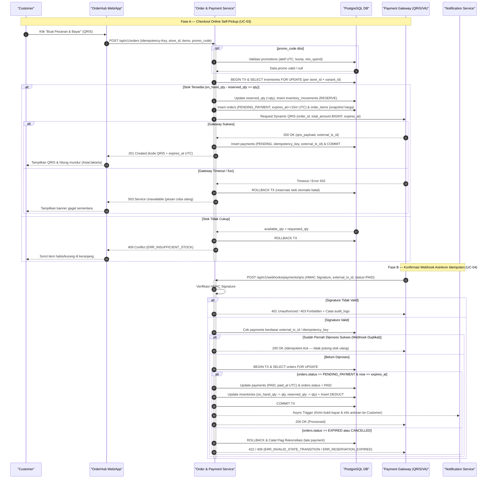
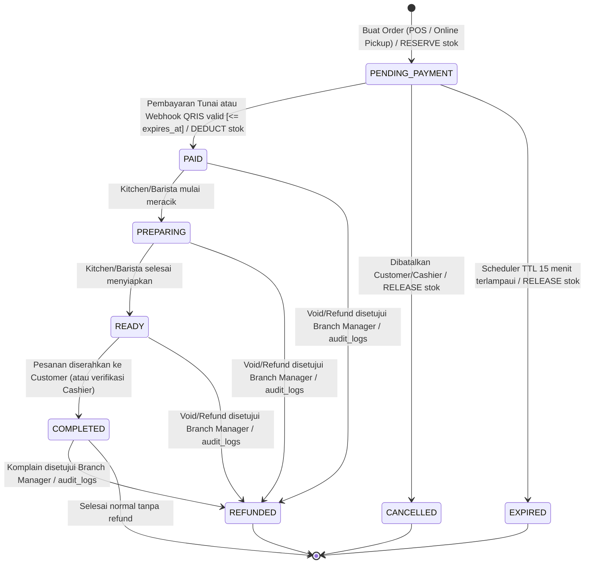
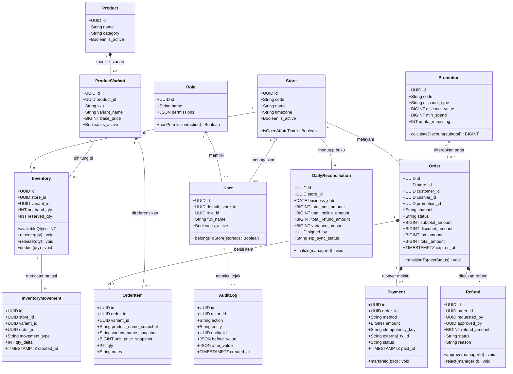

# Bab 06 — UML Behavioral Part 2 & Structural: Sequence, State Machine, & Class Diagram

> **Ringkasan Posisi Bab:** Use Case Diagram dan Use Case Specification (Bab 05) menjelaskan *apa* yang dilakukan aktor dan sistem secara naratif. Namun untuk membangun perangkat lunak yang tahan terhadap *race condition*, pengiriman ulang *webhook*, dan transisi status ilegal, tim pengembang membutuhkan cetak biru yang jauh lebih presisi. Bab ini membekali Anda tiga diagram pengunci arsitektur: **Sequence Diagram** (dimensi waktu & pesan API/DB), **State Machine Diagram** (siklus hidup 8 status order Fase 1), dan **Domain Class Diagram** (struktur objek domain sebelum menjadi tabel SQL).

---

## 1. Tujuan Belajar & Posisi di Alur Kerja SA

Setelah mempelajari bab ini, Anda diharapkan mampu:

1. Membaca dan merancang **Sequence Diagram** yang membedakan panggilan sinkron, panggilan asinkron/*webhook*, serta blok percabangan (`alt`/`else`), kondisi opsional (`opt`), dan pengulangan (`loop`).
2. Memodelkan mekanisme keandalan sistem nyata seperti *row-level locking*, *idempotency check*, dan penanganan *timeout* di dalam Sequence Diagram.
3. Membangun **State Machine Diagram (`stateDiagram-v2`)** yang mengunci **seluruh transisi status yang sah**, kondisi penjaga (*guard*), serta penolakan transisi ilegal (`ERR_INVALID_STATE_TRANSITION`).
4. Menyusun **Domain Class Diagram (`classDiagram`)** beserta atribut kunci, method konseptual, *multiplicity*, dan relasi komposisi/asosiasi sebagai jembatan langsung menuju *Entity Relationship Diagram (ERD)* pada Bab 08.

Dalam alur kerja SA, **Bab 06 adalah fase verifikasi logika teknis sebelum UI dan basis data dikunci**. Kesalahan di tingkat Sequence atau State Machine hampir selalu muncul sebagai *bug* paling mahal di produksi—seperti stok terpotong dua kali akibat *webhook* ganda atau pesanan yang sudah kedaluwarsa (`EXPIRED`) tiba-tiba berubah menjadi `PAID`.

---

## 2. Konsep Inti & Mental Model

### 2.1 Trio Pengunci Arsitektur: Waktu, Status, dan Struktur

Bayangkan sebuah bandara internasional:
- **Sequence Diagram** adalah **rekaman percakapan menara kontrol (*ATC*) dengan pilot detik demi detik**: siapa mengirim sinyal ke siapa, kapan menunggu balasan (*sync*), dan kapan cukup melepas pesan tanpa menahan jalur (*async*).
- **State Machine Diagram** adalah **papan aturan status penerbangan**: pesawat tidak boleh melompat dari *Scheduled* langsung ke *Landed* tanpa melewati *Boarding* dan *In-Flight*; begitu pula pesanan yang sudah *Cancelled* tidak boleh tiba-tiba berubah menjadi *Preparing*.
- **Domain Class Diagram** adalah **cetak biru komponen utama** (Pesawat, Tiket, Penumpang, Gerbang) beserta sifat dan aturan kepemilikannya (*satu pesanan memiliki satu atau banyak item pesanan*).

### 2.2 Sequence Diagram: Mengawal Dimensi Waktu & Interaksi Antar-Lapisan

Sequence Diagram dibaca **dari kiri ke kanan** (daftar komponen/aktor) dan **dari atas ke bawah** (urutan waktu). Elemen intinya meliputi:

1. **Lifeline & Activation Box:** Garis putus-putus vertikal menunjukkan rentang hidup objek/layanan, sedangkan kotak tipis di atasnya (`activate`/`deactivate`) menunjukkan kapan layanan tersebut sedang sibuk bekerja memproses pesan.
2. **Jenis Pesan:**
   - **Synchronous Call (`->>`):** Pengirim mengirim permintaan dan *menunggu* hingga penerima selesai memproses atau mengembalikan jawaban (contoh: UI memanggil `POST /api/v1/orders`).
   - **Return / Asynchronous Response (`-->>`):** Pengembalian hasil ke pemanggil atau pemberitahuan balik (contoh: respons JSON `201 Created`, atau *callback/webhook* terpisah dari `Payment Gateway (QRIS/VA)`).
3. **Combined Fragments (Blok Logika):**
   - **`alt` / `else`:** Percabangan eksklusif (if/else), misal stok cukup vs tidak cukup, atau *idempotency_key* sudah ada vs belum ada.
   - **`opt`:** Blok opsional (if tanpa else), misal hanya dijalankan jika pelanggan mengisi kode promo.
   - **`loop`:** Pengulangan, misal iterasi mengunci dan memvalidasi setiap item di keranjang belanja.

### 2.3 State Machine Diagram: Penjaga Integritas Siklus Hidup Entitas

Tidak semua tabel membutuhkan State Machine. Tabel referensi statis seperti `stores` atau `products` cukup memakai flag `is_active`. Sebaliknya, entitas transaksional yang melewati banyak aktor dan sistem eksternal—seperti **`orders`**, **`payments`**, dan **`refunds`**—**wajib** memiliki State Machine Diagram.

Format standar penulisan label pada panah transisi State Machine adalah:
`Event Trigger [Guard Condition] / Action`
- **Event Trigger:** Kejadian pemicu (misal *Webhook `PAID` diterima*).
- **[Guard Condition]:** Syarat yang harus bernilai benar saat kejadian berlangsung (misal `[status == PENDING_PAYMENT && now <= expires_at]`).
- **/ Action:** Efek samping yang langsung dijalankan sistem saat transisi terjadi (misal `/ deduct stock & log DEDUCT`).

### 2.4 Domain Class Diagram: Jembatan Pemodelan Objek ke Database

Domain Class Diagram memodelkan benda nyata di domain bisnis sebagai **Class** yang memiliki **Atribut** (data yang disimpan) dan **Operations/Methods** (perilaku atau tanggung jawab bisnisnya), lalu menghubungkannya lewat relasi:
- **Association (`-->` / `--`):** Hubungan umum antar-kelas (misal `Order` merujuk ke `Store`).
- **Composition (`*--`):** Kepemilikan kuat (*whole-part*). Jika induk dihancurkan, bagiannya tidak bermakna berdiri sendiri (contoh: `Order "1" *-- "1..*" OrderItem` — item pesanan tidak mungkin hidup tanpa header pesanan).
- **Aggregation (`o--`):** Kumpulan longgar; anggota tetap bisa hidup meski wadahnya dihapus (contoh: `Store "1" o-- "0..*" User` — akun staf tetap ada sebagai entitas meski dipindah cabang).

---

## 3. Standar Industri & Aturan Praktis

### 3.1 Konvensi Mermaid untuk Sequence, State Machine, dan Class Diagram

| Jenis Diagram | Deklarasi Mermaid | Praktik Penulisan Aman |
| :--- | :--- | :--- |
| **Sequence Diagram** | `sequenceDiagram` | Gunakan `autonumber` agar langkah mudah dirujuk saat review; deklarasikan `participant` dengan alias pendek lalu nama lengkap dalam tanda kutip (`participant PG as "Payment Gateway (QRIS/VA)"`). |
| **State Machine** | `stateDiagram-v2` | Gunakan `[*]` untuk *Initial State* dan *Final Terminal State*. Jangan mencampur simbol ilegal di nama state—pakai persis nama status kanonik (`PENDING_PAYMENT`, `PAID`, dst.). |
| **Class Diagram** | `classDiagram` | Definisikan atribut beserta visibilitas (`+` public / `-` private) dan tipe kanonik (`BIGINT`, `TIMESTAMPTZ`), serta tulis *multiplicity* eksplisit di kedua ujung garis (`"1"`, `"0..*"`, `"1..*"`). |

### 3.2 Aturan Emas Pencegahan Bug Konkurensi & State

1. **Sequence Harus Memperlihatkan Batas Transaksi & Idempotency:** Jangan menyembunyikan baris `BEGIN TX / Row Lock` atau pemeriksaan `idempotency_key` di balik kotak umum *"Proses Pembayaran"*. Justru bagian itulah yang mencegah dua kasir atau dua *webhook* memotong stok yang sama.
2. **State Machine Wajib Tertutup & Lengkap:** Untuk setiap status non-terminal, SA wajib dapat menjawab: *"Apa yang terjadi jika event yang tidak seharusnya datang di status ini?"* Jawabannya adalah **penolakan eksplisit (`ERR_INVALID_STATE_TRANSITION` / HTTP `422`)**, bukan membiarkan *developer* menimpa kolom `orders.status` secara membabi-buta.
3. **Konsistensi Mutlak 8 Status Fase 1:** Seluruh dokumentasi Fase 1 **dilarang** mencantumkan status pengiriman kurir (`OUT_FOR_DELIVERY` dan `DELIVERED`) di dalam State Machine Fase 1, karena kedua status tersebut adalah ruang lingkup *Change Request* Fase 2 pada Bab 11.

---

## 4. Praktik Studi Kasus *NusaPOS & OrderHub*

### 4.1 Sequence Diagram: Checkout Online Self-Pickup (`UC-03`) & Webhook QRIS Idempoten (`UC-04`)

Diagram di bawah menggambarkan dua fase waktu nyata: **(1) Pembuatan pesanan & reservasi stok 15 menit (`POST /api/v1/orders`)**, dan **(2) Kedatangan *signed webhook* asinkron dari `Payment Gateway (QRIS/VA)` (`POST /api/v1/webhooks/payments/qris`)** lengkap dengan perlindungan duplikat (*idempotency*) dan pencegahan kondisi balapan terhadap status `EXPIRED`.

**Mengapa Detail Ini Krusial:**
- Perhatikan pada langkah `5` (`SELECT inventories FOR UPDATE`) dan `26` (`SELECT orders FOR UPDATE`): penguncian baris mencegah dua *request* bersamaan membaca `available_stock = 1` secara paralel.
- Perhatikan pada langkah `24–25`: jika jaringan membuat `Payment Gateway (QRIS/VA)` mengirim webhook yang sama 3 kali, sistem memeriksa `external_tx_id` / `idempotency_key` (langkah `24`), memproses satu kali saja, dan membalas `200 OK` *idempotent acknowledgement* pada kiriman ke-2 dan ke-3 (langkah `25`, sesuai `NFR-02` dan `README.md §7B`).
- Perhatikan pada langkah `32–33`: jika pelanggan membayar di detik ke-15:05 setelah *scheduler* menandai order menjadi `EXPIRED`, sistem **tidak boleh** memaksakan status menjadi `PAID` (karena stok sudah dilepas ke pelanggan lain), melainkan melakukan *rollback*, mencatat flag rekonsiliasi (langkah `32`), dan menolak transisi dengan `ERR_INVALID_STATE_TRANSITION` / `ERR_RESERVATION_EXPIRED` (langkah `33`).

---

### 4.2 State Machine Diagram (`stateDiagram-v2`): 8 Status Order Fase 1

Sesuai [`../README.md`](../README.md), siklus hidup `orders.status` pada Fase 1 dikunci ketat pada **tepat 8 status kanonik**: `PENDING_PAYMENT`, `PAID`, `PREPARING`, `READY`, `COMPLETED`, `CANCELLED`, `EXPIRED`, dan `REFUNDED`.

#### Matriks Validasi Transisi & Penolakan Transisi Ilegal

Untuk memastikan tim *Backend* dan *QA* memiliki panduan uji yang tidak ambigu, lengkapi *State Machine Diagram* dengan tabel penolakan transisi ilegal berikut:

| Upaya Transisi Ilegal | Skenario Pemicu di Dunia Nyata | Respons Sistem Wajib |
| :--- | :--- | :--- |
| `EXPIRED -> PAID` | Pelanggan mengirim transfer tepat setelah batas 15 menit habis dan scheduler sudah melepaskan reservasi stok. | Tolak transisi dengan **`ERR_RESERVATION_EXPIRED`** (`410 Gone` / `409 Conflict`) atau **`ERR_INVALID_STATE_TRANSITION`** (`422`); catat ke antrean rekonsiliasi dana. |
| `CANCELLED -> PAID` | Webhook terlambat masuk untuk pesanan yang sudah dibatalkan manual oleh kasir/pelanggan. | Tolak dengan **`ERR_INVALID_STATE_TRANSITION`** (`422`) + flag rekonsiliasi. |
| `PENDING_PAYMENT -> PREPARING` | `Kitchen/Barista` mencoba memproses pesanan yang belum lunas. | Tolak dengan **`ERR_INVALID_STATE_TRANSITION`** (`422`); antrean dapur hanya boleh menampilkan status `PAID`. |
| `PENDING_PAYMENT -> REFUNDED` | `Cashier` mencoba mengajukan refund pada order yang belum dibayar. | Tolak dengan **`ERR_INVALID_STATE_TRANSITION`** (`422`); seharusnya gunakan pembatalan pra-bayar (`CANCELLED`). |
| `COMPLETED -> PREPARING` | Staf menekan ulang status kembali ke dapur setelah pesanan selesai diserahkan. | Tolak dengan **`ERR_INVALID_STATE_TRANSITION`** (`422`). |
| `REFUNDED -> *` | Upaya apa pun mengubah pesanan yang sudah berstatus terminal `REFUNDED`. | Tolak dengan **`ERR_INVALID_STATE_TRANSITION`** (`422`). |

---

### 4.3 Domain Class Diagram (`classDiagram`): Model Objek Inti NusaPOS & OrderHub

Domain Class Diagram berikut memetakan seluruh **14 entitas inti kanonik** beserta atribut kunci, method bisnis konseptual, dan kardinalitasnya sebelum diterjemahkan ke skema tabel fisik di Bab 08.

Perhatikan bagaimana relasi **`*--` (*Composition*)** digunakan pada `Order *-- OrderItem` dan `Product *-- ProductVariant`, sementara seluruh nama kolom dan entitas selaras tepat dengan [`../README.md`](../README.md) (misalnya `Order.store_id`, bukan `branch_id`).

---

## 5. Jebakan Umum (*Anti-Patterns*) Junior SA

1. **Sequence Diagram Tanpa Blok `alt` untuk Error & Timeout:** Sequence yang hanya menggambar skenario mulus (*happy path*) seolah `Payment Gateway (QRIS/VA)` selalu membalas 0,1 detik dan stok selalu cukup adalah bom waktu. Pastikan selalu memodelkan jalur gagal dan *rollback*.
2. **Meninggalkan Status Tanpa Transisi Keluar yang Jelas pada State Diagram:** Jika status `PENDING_PAYMENT` hanya memiliki panah ke `PAID` dan lupa panah ke `CANCELLED` dan `EXPIRED`, stok yang tereservasi akan terkunci permanen (*orphan reservation*) setiap kali pelanggan menutup halaman pembayaran.
3. **Menambahkan Status di Luar Ruang Lingkup (*Scope Creep*) ke State Machine:** Memasukkan `OUT_FOR_DELIVERY` ke dalam State Diagram Fase 1 padahal fitur kurir 3PL belum dikerjakan membuat *Backend* menanyakan tabel pengiriman yang belum ada di skema database.
4. **Melupakan *Snapshot* di Class `OrderItem`:** Jika `OrderItem` hanya menyimpan `variant_id` tanpa `unit_price_snapshot` dan `product_name_snapshot`, ketika `HQ Admin` menaikkan harga kopi bulan depan, laporan nota lama ikut berubah angka.

---

## 6. Checklist Verifikasi Mandiri

Pastikan setiap butir di bawah ini terjawab **"Ya"** sebelum melangkah ke Bab 07:

- [ ] Sequence Diagram yang saya buat menggunakan blok `alt`/`opt` untuk menangani *idempotency*, kegagalan jaringan/gateway, dan kekurangan stok.
- [ ] `stateDiagram-v2` saya memetakan tepat 8 status kanonik Fase 1 tanpa ada transisi buntu, lengkap dengan daftar penolakan transisi ilegal (`ERR_INVALID_STATE_TRANSITION`).
- [ ] Domain Class Diagram saya mencantumkan seluruh 14 entitas inti beserta *multiplicity* yang benar serta membedakan *Composition* dan *Association*.
- [ ] Tidak ada istilah kolom melenceng (tetap menggunakan `orders.store_id`, uang dalam `BIGINT`, dan timestamp UTC).

---

## 7. Latihan Praktik

Kerjakan keempat skenario berikut terlebih dahulu, lalu periksa pembahasan lengkapnya di [`../kunci-latihan/kunci-bab-05-08.md`](../kunci-latihan/kunci-bab-05-08.md).

1. **Skenario 1 (Investigasi Celah *Sequence Diagram*):** Seorang Junior SA membuat Sequence Diagram untuk *webhook* `POST /api/v1/webhooks/payments/qris` dengan urutan:
   - `Payment Gateway` mengirim webhook -> `API` langsung menjalankan `UPDATE orders SET status = 'PAID'` -> `API` mengurangi `on_hand_qty` -> `API` membalas `200 OK`.
   Temukan **4 celah keamanan/integritas data kritis** pada Sequence tersebut dan perbaiki urutannya sesuai aturan kanonik (`NFR-02`, `NFR-03`, `README.md`).
2. **Skenario 2 (Audit & Penambahan *State Machine* untuk Entitas `refunds`):** Pada [`../README.md`](../README.md), entitas `refunds` memiliki 4 status kanonik: `PENDING_APPROVAL`, `APPROVED`, `REJECTED`, dan `COMPLETED`. Buatlah **`stateDiagram-v2`** untuk siklus hidup entitas `refunds` lengkap dengan *trigger*, *guard* otorisasi `Branch Manager`, jalur alternatif metode `CASH` vs `QRIS/VA`, serta kondisi penolakan jika `Cashier` mencoba menyetujui pengajuannya sendiri (`ERR_UNAUTHORIZED_APPROVAL`).
3. **Skenario 3 (Uji Ketahanan Transisi Status Order):** Tentukan apakah keenam transisi berikut **SAH** atau **ILEGAL** pada Fase 1 *NusaPOS & OrderHub*, dan tuliskan *HTTP Status* + *Kode Error Kanonik* jika ilegal:
   - (a) `PENDING_PAYMENT` -> `EXPIRED`
   - (b) `EXPIRED` -> `PENDING_PAYMENT` (pelanggan minta perpanjang timer di order yang sama)
   - (c) `READY` -> `REFUNDED`
   - (d) `COMPLETED` -> `REFUNDED`
   - (e) `PAID` -> `COMPLETED` (kasir langsung klik selesai tanpa melalui `PREPARING` dan `READY`)
   - (f) `READY` -> `OUT_FOR_DELIVERY`
4. **Skenario 4 (Relasi & Multiplicity Domain Class Diagram):** Tentukan jenis relasi (`Composition *--`, `Aggregation o--`, atau `Association -->`) dan *multiplicity* yang paling tepat antara pasangan kelas berikut beserta alasannya:
   - (a) `Order` dengan `OrderItem`
   - (b) `Product` dengan `ProductVariant`
   - (c) `Order` dengan `Promotion`
   - (d) `Order` dengan `Payment` (mengapa `0..*` atau `1..*`, bukan mutlak `1`?)

---

**Langkah Berikutnya:** Setelah mengunci interaksi API, siklus hidup status, dan model objek domain, lanjutkan ke [**Bab 07 — UI/Screen Specification & Field-Level Mapping**](07-ui-screen-spec-field-mapping.md) untuk menghubungkan spesifikasi layar UI hingga ke kolom JSON API dan kolom database.
