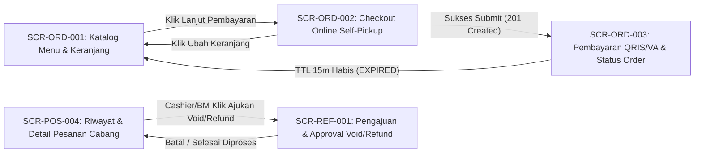

# Bab 07 — UI/Screen Specification & Field-Level Mapping

> **Ringkasan Posisi Bab:** Banyak proyek gagal bukan karena desain visualnya jelek, melainkan karena tim *Frontend*, *Backend*, dan *QA* menafsirkan satu layar secara berbeda. UI/UX menggambar tampilan sempurna ketika data tersedia, tetapi lupa menentukan apa yang terjadi saat stok habis sebagian, jaringan melambat, atau kasir menekan tombol submit dua kali. Bab ini melatih Anda menyusun **UI/Screen Specification** beserta **5 State Layar** dan **Matriks Traceability UI–API–DB** agar setiap elemen layar terkunci rapat hingga ke kolom basis data.

---

## 1. Tujuan Belajar & Posisi di Alur Kerja SA

Setelah mempelajari bab ini, Anda diharapkan mampu:

1. Mengaudit *wireframe* atau *mockup* dari tim UI/UX untuk menemukan celah navigasi (*entry/exit point*), kasus batas, dan pelanggaran aturan bisnis sebelum kode antarmuka ditulis.
2. Mendefinisikan **5 State Layar Wajib** (*Initial*, *Loading*, *Empty*, *Error*, *Partial/Disabled*) agar tidak pernah ada *blank screen* atau tombol menggantung di aplikasi.
3. Menyusun tabel aturan validasi input per kolom (*field validation*) lengkap dengan tipe, batas nilai, pemicu validasi, dan pesan error yang ramah bagi manusia.
4. Membangun **Matriks Traceability `UI Field <-> Validation Rule <-> API JSON Field <-> DB Column`** menggunakan [`../templates/template-screen-spec.md`](../templates/template-screen-spec.md) agar tim *Frontend*, *Backend*, dan *QA* berbicara dalam satu kontrak data yang sama.

Dalam alur kerja SA, **Bab 07 menjembatani logika perilaku (Bab 05–06) dengan desain basis data (Bab 08) dan kontrak API (Bab 09)**. Ketika seorang SA menuntaskan dokumen *Screen Specification*, *Frontend Engineer* langsung tahu validasi mana yang dijalankan di browser, *Backend Engineer* tahu persis field JSON mana yang harus divalidasi ulang di server, dan *QA* langsung memperoleh daftar skenario uji batas (*boundary test cases*).

---

## 2. Konsep Inti & Mental Model

### 2.1 Mengapa *Mockup* Visual Saja Tidak Cukup?

Analogi sederhananya: **mockup Figma adalah foto rumah yang sudah jadi di katalog properti**, sedangkan **Screen Specification adalah gambar kerja kelistrikan, pipa air, dan batas beban dindingnya**.

Jika tim SA hanya menyerahkan *mockup* bergambar daftar menu dan tombol *"Bayar Rp 56.000"* tanpa spesifikasi perilaku:
- *Frontend* bingung saat API `POST /api/v1/orders` lambat 3 detik: apakah tombol bayar tetap bisa diklik berkali-kali (*double submit*)?
- *Frontend* mungkin mengirim angka `total_amount` hasil hitungan JavaScript ke server—membuka celah keamanan manipulasi harga oleh peretas!
- Tim UI lupa mendesain tampilan jika cabang sedang tutup atau keranjang tiba-tiba kosong, sehingga pengguna melihat layar putih kosong.
- Tim *Backend* menamai JSON `branch_id`, sementara *Frontend* mengirim `storeId`, dan database menyimpan `orders.store_id`.

### 2.2 Cara SA Membaca *Wireframe* & Mengaudit Kelengkapan Alur UI

Saat menerima *wireframe* atau desain UI, SA wajib melakukan **4 pemeriksaan cepat**:
1. **Audit Navigasi (*Entry & Exit Points*):** Dari layar mana pengguna bisa masuk? Jika pengguna menekan tombol *"Kembali"* atau waktu pembayaran 15 menit habis (`EXPIRED`), ke layar mana pengguna dialihkan?
2. **Audit Peran (*RBAC Visibility*):** Apakah tombol sensitif seperti *"Setujui Void/Refund"* hanya muncul bagi `Branch Manager` dan tersembunyi dari `Cashier`?
3. **Audit Kalkulasi & Waktu (*Server Authority & Timezone*):** Apakah nominal subtotal, diskon, dan pajak dihitung ulang di server dalam `BIGINT` Rupiah (`HALF_UP`), dan apakah seluruh timestamp UTC dikonversi ke zona cabang (`Asia/Jakarta`) saat ditampilkan?
4. **Audit 5 State Layar:** Apakah setiap layar sudah menjawab kondisi *Initial*, *Loading*, *Empty*, *Error*, dan *Partial/Disabled*?

### 2.3 Lima State Layar Wajib (*The 5 Screen States*)

| State Layar | Makna & Pemicu | Risiko Jika Diabaikan |
| :--- | :--- | :--- |
| **1. Initial** | Layar baru dibuka dalam kondisi awal normal sebelum pengguna berinteraksi atau saat data awal berhasil dimuat. | Pengguna tidak tahu nilai default (misal metode bayar atau cabang aktif). |
| **2. Loading** | Sistem sedang menunggu respons API asinkron (mengambil menu atau mengirim order/refund). | Pengguna mengklik tombol berkali-kali, menyebabkan request ganda jika tidak ada *spinner* dan *disable button*. |
| **3. Empty** | Data tidak tersedia (misal keranjang kosong, tidak ada antrean refund yang menunggu approval). | Layar putih kosong membuat pengguna mengira aplikasi error atau rusak (*freeze*). |
| **4. Error** | Terjadi kegagalan teknis (`5xx`, jaringan putus) atau pelanggaran bisnis (`ERR_INSUFFICIENT_STOCK`, `ERR_UNAUTHORIZED_APPROVAL`). | Pengguna hanya melihat kode mentah `"HTTP 409"` atau layar diam tanpa panduan pemulihan (*recovery CTA*). |
| **5. Partial / Disabled** | Data tampil sebagian atau ada syarat bisnis yang belum terpenuhi (stok salah satu item habis, cabang tutup, alasan refund belum diisi). | Tombol aksi tetap aktif padahal pasti ditolak server, membuang kuota server dan membingungkan pengguna. |

### 2.4 End-to-End Field-Level Mapping (`UI <-> API <-> DB`)

Matriks pemetaan per field memastikan **satu fakta hanya punya satu nama dan tipe yang saling terhubung**. Jika di UI ada kolom **"Catatan Item"** dengan batas `120 karakter`, maka API `POST /api/v1/orders` menerima `$.items[].notes` bertipe `string | null` maksimal `120` karakter, dan database menyimpannya ke `order_items.notes` (`VARCHAR(120)`). Jika ada perubahan di salah satu lapisan, SA langsung tahu dua lapisan lainnya yang ikut terdampak.

---

## 3. Standar Industri & Aturan Praktis

### 3.1 Empat Aturan Emas Keamanan & Akurasi Antar-Lapisan

1. **Zero-Trust terhadap Kalkulasi Harga di Klien:** UI boleh menampilkan estimasi harga untuk kenyamanan pelanggan, tetapi API `POST /api/v1/orders` **hanya menerima `store_id`, `channel`, daftar `{variant_id, qty, notes}`, `payment_method`, dan `promo_code`**. Server selalu menghitung ulang `subtotal_amount`, `discount_amount`, `tax_amount`, dan `total_amount` dari database menggunakan bilangan bulat Rupiah (`BIGINT`) serta pembulatan `HALF_UP`.
2. **Idempotency di Level UI (*Double-Submit Guard*):** Setiap kali layar *checkout* atau *refund* dibuka untuk satu intent baru, klien menghasilkan UUID v4 sebagai header `Idempotency-Key`. Selama pengguna menekan *"Coba Lagi"* akibat jaringan terputus pada transaksi yang sama, kunci tersebut dipertahankan (tidak diganti baru) agar server tidak menciptakan dua pesanan berbeda.
3. **Konversi Waktu UTC <-> `Asia/Jakarta`:** Seluruh field timestamp pada payload API dikirim dalam format ISO-8601 UTC (`2026-11-25T05:30:00Z`). Lapisan UI bertugas memformatnya ke zona waktu cabang (misal `12:30 WIB` / `Asia/Jakarta`) untuk tampilan manusia, termasuk pada timer hitung mundur `expires_at` 15 menit.
4. **RBAC di UI adalah Kenyamanan, RBAC di Server adalah Keamanan:** Menyembunyikan tombol *"Setujui Refund"* dari `Cashier` di UI adalah keharusan UX, namun endpoint `POST /api/v1/orders/{orderId}/refunds` tetap wajib memverifikasi peran dan `store_id` di server serta mengembalikan `ERR_UNAUTHORIZED_APPROVAL` (`403 Forbidden`) bila dipanggil secara langsung di luar UI resmi.

---

## 4. Praktik Studi Kasus *NusaPOS & OrderHub*

Diagram berikut memetakan alur navigasi antar-layar untuk dua perjalanan utama yang akan kita buat spesifikasi penuhnya: **Checkout Online Self-Pickup (`SCR-ORD-002`)** dan **Pengajuan & Approval Void/Refund (`SCR-REF-001`)**.



---

### 4.1 Screen Specification Lengkap 1: Checkout Online Self-Pickup (`SCR-ORD-002`)

Spesifikasi berikut mengikuti 100% struktur [`../templates/template-screen-spec.md`](../templates/template-screen-spec.md) untuk `UC-03` dan endpoint `POST /api/v1/orders`.

#### 1. Identitas Layar (*Screen Identity*)

| Atribut | Detail |
| :--- | :--- |
| **Screen ID** | `SCR-ORD-002` |
| **Nama Layar** | Layar Checkout Online Self-Pickup |
| **Platform / Target** | Web Responsive & Mobile App Pelanggan (`OrderHub`) |
| **Peran yang Berhak Mengakses (*RBAC*)** | `Customer` (terautentikasi / sesi valid untuk `ONLINE_PICKUP`) |
| **Referensi Use Case / FR** | `UC-03` / `FR-03`, `FR-06`, `NFR-01`, `NFR-02`, `NFR-04` |
| **Tautan Desain Visual (Figma)** | `[Placeholder: Figma/OrderHub/SCR-ORD-002-Checkout]` |

#### 2. Alur Navigasi (*Entry & Exit Points*)

- **Titik Masuk (*Entry Points*):**
  - Dari `SCR-ORD-001` (Katalog & Keranjang) setelah `Customer` menekan tombol `"Lanjut ke Checkout"` dengan minimal 1 item aktif.
- **Titik Keluar (*Exit Points*):**
  - **Sukses Membuat Pesanan (`201 Created`):** Arahkan ke `SCR-ORD-003` yang menampilkan kode QRIS/VA dinamis serta hitung mundur 15 menit (`expires_at` dalam `Asia/Jakarta`).
  - **Klik Kembali / Ubah Item:** Kembali ke `SCR-ORD-001` sambil mempertahankan isi keranjang dan `notes`.
  - **Cabang Baru Saja Tutup / Stok Habis:** Jika `Customer` menekan `"Lihat Menu Cabang"`, kembali ke `SCR-ORD-001` dengan stok terbaru.

#### 3. Sketsa Wireframe & Daftar Komponen UI

```text
+---------------------------------------------------------------+
| [< Kembali]   Checkout Self-Pickup — Cabang Sudirman (WIB)    |
+---------------------------------------------------------------+
| Ambil Sendiri di: NusaKopi Sudirman (Buka s.d. 22:00 WIB)     |
|---------------------------------------------------------------|
| Ringkasan Pesanan:                                            |
|  1. Kopi Susu Aren (Regular) x2                    Rp 56.000  |
|     Catatan: [Less sugar, es sedikit............] (21/120)    |
|  2. Croissant Butter (Regular) x1                  Rp 24.000  |
|     Catatan: [Hangatkan sebentar................] (18/120)    |
|---------------------------------------------------------------|
| Kode Promo: [ KOPIPAGI10        ]  [ Terapkan ]               |
| (i) Promo KOPIPAGI10 aktif (-Rp 8.000)             [Hapus]    |
|---------------------------------------------------------------|
| Subtotal                                           Rp 80.000  |
| Diskon Promo                                      -Rp  8.000  |
| Pajak (11% - Pembulatan HALF_UP)                   Rp  7.920  |
| TOTAL BAYAR                                        Rp 79.920  |
|---------------------------------------------------------------|
| Pilih Metode Pembayaran Online:                               |
|   (o) QRIS (Semua e-Wallet & M-Banking)                       |
|   ( ) Virtual Account (BCA / Mandiri / BRI)                   |
|---------------------------------------------------------------|
| [          Buat Pesanan & Bayar (Rp 79.920)                 ] |
+---------------------------------------------------------------+
```

| ID Komponen | Tipe Komponen | Perilaku / Aturan Tampilan |
| :--- | :--- | :--- |
| `CMP-01` | Header Cabang & Jam Operasional | Menampilkan nama cabang dari `stores.name` dan jam operasional dalam `Asia/Jakarta` (WIB). |
| `CMP-02` | Daftar Item & Input Catatan | Menampilkan nama produk, varian, qty, subtotal item, serta input catatan per item dengan penghitung karakter `0/120`. |
| `CMP-03` | Input & Tombol Kode Promo | Auto-uppercase, *trim whitespace*; tombol `"Terapkan"` nonaktif jika input kosong atau sedang *loading*. |
| `CMP-04` | Selector Metode Bayar | Untuk `ONLINE_PICKUP`, hanya menampilkan `QRIS` dan `VA`. Opsi `CASH` **tidak boleh dirender** di layar pelanggan. |
| `CMP-05` | Tombol Submit Order | Menampilkan total tagihan terhitung; terkunci (`disabled`) saat request berlangsung dan membawa `Idempotency-Key` pada header HTTP. |

#### 4. Spesifikasi 5 State Layar (*Screen States*)

| State Layar | Kondisi Pemicu | Tampilan & Perilaku UI | Aksi yang Tersedia |
| :--- | :--- | :--- | :--- |
| **1. Initial** | Layar dibuka dari keranjang valid dengan cabang aktif dan stok tersedia. | Menampilkan daftar item, `CMP-04` terpilih default ke `QRIS`, rincian estimasi harga, dan tombol submit aktif. | Isi/ubah catatan item, terapkan kode promo, pilih metode bayar, atau klik Submit. |
| **2. Loading** | Menunggu respons API validasi promo atau `POST /api/v1/orders`. | Tombol submit menampilkan *spinner* `"Memproses Pesanan..."`; seluruh input dan tombol ubah item berstatus `disabled` untuk mencegah *double submit*. | Tidak ada (tombol kembali nonaktif sementara selama transaksi kritis berjalan). |
| **3. Empty** | `Customer` mengakses URL `SCR-ORD-002` secara langsung saat keranjang kosong atau sesi keranjang sudah kedaluwarsa. | Tampilkan ilustrasi cangkir kosong dengan teks *"Keranjang belanja Anda masih kosong"* dan tombol CTA primer. | Klik `"Pilih Menu Cabang"` -> pindah ke `SCR-ORD-001`. |
| **4. Error** | API mengembalikan `409 ERR_INSUFFICIENT_STOCK`, `409 ERR_DUPLICATE_IDEMPOTENCY`, `503` gateway gagal, atau jaringan terputus. | Tampilkan *inline alert* merah di atas daftar item (menyorot `variant_id` yang stoknya kurang beserta `available_qty` sisa), atau banner jaringan terputus. | Klik `"Sesuaikan Keranjang"` (ke `SCR-ORD-001`) atau `"Coba Lagi"` (mengirim ulang dengan `Idempotency-Key` yang sama). |
| **5. Partial / Disabled** | Salah satu varian di keranjang stoknya menjadi `0` atau cabang melewati jam tutup sebelum klik submit, atau promo belum memenuhi `min_spend`. | Varian habis ditandai abu-abu + badge `"Stok Habis"`; tombol submit utama `disabled` dengan teks penjelas tepat di bawah tombol; promo invalid menampilkan *helper text* merah tanpa memblokir pesanan jika promo dihapus. | Hapus item habis, ganti cabang, atau hapus kode promo agar tombol submit aktif kembali. |

#### 5. Tabel Validasi Input per Field (`SCR-ORD-002`)

| Field ID | Label UI | Tipe Input | Wajib? | Format / Batasan Nilai | Kapan Divalidasi | Pesan Error ke Pengguna |
| :--- | :--- | :--- | :---: | :--- | :--- | :--- |
| `FLD-01` | Cabang Terpilih | Context / Hidden | Wajib | UUID valid milik `stores` dengan `is_active = true` | `On Load` & `On Submit` | `"Cabang sedang tidak melayani pemesanan online saat ini."` |
| `FLD-02` | Kuantitas Item | Stepper / Number | Wajib | Bilangan bulat `>= 1` dan `<= 50` per varian | `On Change` & `On Submit` | `"Jumlah per varian harus antara 1 hingga 50 item."` |
| `FLD-03` | Catatan Item | Text Input | Opsional | Maksimal 120 karakter, *trim*, sanitasi tag HTML/script | `On Change` & `On Submit` | `"Catatan item maksimal 120 karakter."` |
| `FLD-04` | Kode Promo | Text Input | Opsional | Alfanumerik (A–Z, 0–9, `_`, `-`), panjang 4–20 karakter, tanpa spasi | `On Click Terapkan` & `On Submit` | `"Format kode promo 4–20 karakter alfanumerik tanpa spasi."` |
| `FLD-05` | Metode Pembayaran | Radio Group | Wajib | Enum: `QRIS` atau `VA` (untuk `ONLINE_PICKUP`) | `On Submit` | `"Silakan pilih metode pembayaran QRIS atau Virtual Account."` |

#### 6. Matriks Traceability (`UI Field <-> Validation <-> API Field <-> DB Column`)

| UI Field (`Label`) | Aturan Validasi Ringkas | API Endpoint & JSON Path | Tipe API | Target Tabel & Kolom DB | Tipe DB & Transformasi |
| :--- | :--- | :--- | :--- | :--- | :--- |
| `Cabang Terpilih` | Wajib cabang aktif & buka | `POST /api/v1/orders` -> `$.store_id` | `string (uuid)` | `orders.store_id` | `UUID` (FK ke `stores.id`) |
| `Kanal Pesanan` | Tetap `ONLINE_PICKUP` dari aplikasi pelanggan | `POST /api/v1/orders` -> `$.channel` | `string (enum)` | `orders.channel` | `VARCHAR(20)` (`'ONLINE_PICKUP'`) |
| `Varian Produk` | Wajib varian aktif di cabang | `POST /api/v1/orders` -> `$.items[].variant_id` | `string (uuid)` | `order_items.variant_id` | `UUID` (FK ke `product_variants.id`) |
| `Kuantitas Item` | Integer `1..50`, cek `available >= qty` | `POST /api/v1/orders` -> `$.items[].qty` | `integer` | `order_items.qty` | `INT` (juga menambah `inventories.reserved_qty`) |
| `Catatan Item` | Opsional, maks 120 char, trim | `POST /api/v1/orders` -> `$.items[].notes` | `string \| null` | `order_items.notes` | `VARCHAR(120)` |
| `Kode Promo` | Opsional, 4–20 alfanumerik uppercase | `POST /api/v1/orders` -> `$.promo_code` | `string \| null` | `orders.promotion_id` | Lookup `promotions.code` -> simpan FK `promotion_id` |
| `Metode Bayar` | Wajib `QRIS` atau `VA` (online) | `POST /api/v1/orders` -> `$.payment_method` | `string (enum)` | `payments.method` | `VARCHAR(10)` (`'QRIS'` / `'VA'`) |
| `Kunci Idempotensi` | UUID v4 otomatis per intent checkout | Header `Idempotency-Key` | `string (uuid)` | `payments.idempotency_key` | `VARCHAR(64)` (`UNIQUE`) |
| `Total Bayar` | Read-only; dihitung ulang server | Response -> `$.data.total_amount` | `integer` | `orders.total_amount` | `BIGINT` (Rupiah utuh, pembulatan `HALF_UP`) |
| `Batas Waktu Bayar` | Tampil sebagai countdown WIB | Response -> `$.data.expires_at` | `string (ISO-8601 UTC)` | `orders.expires_at` | `TIMESTAMPTZ` (UTC `NOW() + 15m` -> UI `Asia/Jakarta`) |

---

### 4.2 Screen Specification Lengkap 2: Pengajuan & Approval Void/Refund (`SCR-REF-001`)

Spesifikasi berikut mengunci layar operasional cabang untuk `UC-06` dan endpoint `POST /api/v1/orders/{orderId}/refunds` (pengajuan oleh `Cashier` serta eksekusi persetujuan/penolakan oleh `Branch Manager`).

#### 1. Identitas Layar (*Screen Identity*)

| Atribut | Detail |
| :--- | :--- |
| **Screen ID** | `SCR-REF-001` |
| **Nama Layar** | Layar Pengajuan & Approval Void/Refund Pesanan |
| **Platform / Target** | Web Dashboard & Tablet POS Cabang (`NusaPOS`) |
| **Peran yang Berhak Mengakses (*RBAC*)** | `Cashier` (hanya mengajukan untuk cabang miliknya), `Branch Manager` (mengajukan + menyetujui/menolak untuk cabang miliknya) |
| **Referensi Use Case / FR** | `UC-06` / `FR-07`, `NFR-03`, `NFR-04` |
| **Tautan Desain Visual (Figma)** | `[Placeholder: Figma/NusaPOS/SCR-REF-001-VoidRefund]` |

#### 2. Alur Navigasi (*Entry & Exit Points*)

- **Titik Masuk (*Entry Points*):**
  - Dari `SCR-POS-004` (Detail Pesanan) ketika tombol `"Ajukan Void/Refund"` atau `"Tinjau Pengajuan Refund"` diklik pada pesanan berstatus `PAID`, `PREPARING`, `READY`, atau `COMPLETED`.
- **Titik Keluar (*Exit Points*):**
  - **Sukses Pengajuan (`Cashier`) / Sukses Approval (`Branch Manager`):** Kembali ke `SCR-POS-004` dengan banner status terbaru (`PENDING_APPROVAL` atau `REFUNDED` / `REJECTED`).
  - **Klik Batal:** Kembali ke `SCR-POS-004` tanpa membuat record `refunds`.

#### 3. Sketsa Wireframe & Daftar Komponen UI

```text
+---------------------------------------------------------------+
| [< Kembali]   Void / Refund Pesanan #ORD-20261125-0042        |
+---------------------------------------------------------------+
| Cabang: Sudirman | Status Order: PAID | Metode Awal: QRIS     |
| Waktu Order: 25 Nov 2026, 10:15 WIB | Total: Rp 79.920        |
|---------------------------------------------------------------|
| Alasan Void/Refund (*):                                       |
|   [v] Kesalahan Input Kasir / Pelanggan Salah Pesan           |
| Catatan Tambahan (*):                                         |
|   [ Pelanggan ingin ganti varian non-kopi karena alergi     ] |
|   (55/250 karakter)                                           |
| Pengembalian Stok Fisik:                                      |
|   [x] Kembalikan stok item utuh ke inventori (REFUND_RETURN)  |
| Nominal Pengembalian (Full Refund): Rp 79.920 (Read-only)     |
|---------------------------------------------------------------|
| [Area Khusus Branch Manager — Status: PENDING_APPROVAL]       |
|   PIN / Verifikasi Otorisasi Manager: [ ****** ]              |
|   [ Tolak Pengajuan ]          [ Setujui & Proses Refund ]    |
+---------------------------------------------------------------+
```

| ID Komponen | Tipe Komponen | Perilaku / Aturan Tampilan |
| :--- | :--- | :--- |
| `CMP-R01` | Banner Ringkasan Order | Menampilkan nomor order, status order, metode pembayaran awal (`CASH`/`QRIS`/`VA`), waktu lokal cabang (`Asia/Jakarta`), dan total nominal `BIGINT` terformat IDR. |
| `CMP-R02` | Dropdown Alasan & Catatan | Alasan terstandar wajib dipilih; textarea catatan wajib minimal 10 karakter agar `audit_logs` bermakna saat diaudit Finance. |
| `CMP-R03` | Checkbox `restock_items` | Menentukan apakah sistem mencatat mutasi `REFUND_RETURN` ke `inventories` & `inventory_movements` (misal produk kemasan utuh) atau tidak (misal minuman sudah terlanjur diracik/tumpah). |
| `CMP-R04` | Panel Approval `Branch Manager` | Hanya dirender jika role pengguna adalah `Branch Manager` untuk `store_id` yang sama dan status `refunds` adalah `PENDING_APPROVAL`. Tersembunyi bagi `Cashier`. |

#### 4. Spesifikasi 5 State Layar (*Screen States*)

| State Layar | Kondisi Pemicu | Tampilan & Perilaku UI | Aksi yang Tersedia |
| :--- | :--- | :--- | :--- |
| **1. Initial** | Layar dibuka dari pesanan pasca-bayar yang sah (`PAID`..`COMPLETED`). | Untuk `Cashier`, form pengajuan kosong siap diisi. Untuk `Branch Manager` yang meninjau tiket `PENDING_APPROVAL`, form alasan tampil *read-only* dan `CMP-R04` aktif. | Isi alasan & catatan (`Cashier`), atau masukkan PIN & pilih Setujui/Tolak (`Branch Manager`). |
| **2. Loading** | Mengirim `POST /api/v1/orders/{orderId}/refunds` atau mengeksekusi approval ke `Payment Gateway (QRIS/VA)`. | Tampilkan *spinner* `"Memproses Void/Refund..."`; seluruh tombol aksi dan input terkunci (`disabled`). | Tidak ada (mencegah panggilan refund ganda). |
| **3. Empty** | Mengakses halaman daftar/detail refund saat belum ada pengajuan pada filter cabang tersebut, atau `orderId` tidak memiliki record refund saat dibuka di mode tinjauan manager. | Tampilkan pesan *"Belum ada pengajuan void/refund pada pesanan atau periode ini"* beserta tombol kembali. | Klik `"Kembali ke Daftar Pesanan"`. |
| **4. Error** | Server mengembalikan `403 ERR_UNAUTHORIZED_APPROVAL` (bukan `Branch Manager` / beda cabang), `422 ERR_INVALID_STATE_TRANSITION` (order sudah `EXPIRED`/`REFUNDED`), atau gateway refund gagal. | Tampilkan *alert* merah jelas: misal *"Akses ditolak: persetujuan void/refund hanya dapat dilakukan oleh Branch Manager cabang terkait."* | Perbaiki PIN/input, atau tutup modal jika status order tidak lagi valid. |
| **5. Partial / Disabled** | Pesanan berstatus `PENDING_PAYMENT`, `CANCELLED`, `EXPIRED`, atau `REFUNDED`; atau catatan alasan `< 10` karakter; atau PIN manager belum diisi. | Tombol `"Ajukan Refund"` atau `"Setujui & Proses Refund"` berstatus `disabled` dengan catatan alasan tepat di bawah tombol (misal *"Pesanan belum dibayar; gunakan Batalkan Pesanan"*). | Lengkapi field wajib atau kembali ke detail pesanan. |

#### 5. Tabel Validasi Input per Field (`SCR-REF-001`)

| Field ID | Label UI | Tipe Input | Wajib? | Format / Batasan Nilai | Kapan Divalidasi | Pesan Error ke Pengguna |
| :--- | :--- | :--- | :---: | :--- | :--- | :--- |
| `FLD-R01` | Alasan Void/Refund | Select / Dropdown | Wajib | Enum terstandar: `CASHIER_ERROR`, `CUSTOMER_CHANGE`, `OUT_OF_STOCK`, `QUALITY_ISSUE` | `On Change` & `On Submit` | `"Pilih kategori alasan void/refund terlebih dahulu."` |
| `FLD-R02` | Catatan Tambahan | Textarea | Wajib | Panjang 10–250 karakter, sanitasi XSS/HTML | `On Blur` & `On Submit` | `"Tuliskan penjelasan alasan minimal 10 karakter (maks. 250)."` |
| `FLD-R03` | Kembalikan Stok | Checkbox | Wajib | Boolean (`true` / `false`) | `On Submit` | *(Selalu bernilai boolean valid)* |
| `FLD-R04` | PIN Otorisasi Manager | Password / PIN | Wajib saat Approve | 6 digit numerik (hanya saat `Branch Manager` menyetujui) | `On Submit Approve` | `"Masukkan 6 digit PIN otorisasi Branch Manager."` |

#### 6. Matriks Traceability (`UI Field <-> Validation <-> API Field <-> DB Column`)

| UI Field (`Label`) | Aturan Validasi Ringkas | API Endpoint & JSON Path | Tipe API | Target Tabel & Kolom DB | Tipe DB & Transformasi |
| :--- | :--- | :--- | :--- | :--- | :--- |
| `ID Pesanan` | Wajib status `PAID`..`COMPLETED` | Path param `{orderId}` | `string (uuid)` | `refunds.order_id` | `UUID` (FK ke `orders.id`) |
| `Alasan Void/Refund` (`FLD-R01`) | Wajib enum terstandar (`CASHIER_ERROR`, `CUSTOMER_CHANGE`, `OUT_OF_STOCK`, `QUALITY_ISSUE`) | `POST /api/v1/orders/{orderId}/refunds` -> `$.reason_code` | `string (enum)` | `refunds.reason` | `VARCHAR(300)` (prefiks kode alasan terstandar) |
| `Catatan Tambahan` (`FLD-R02`) | Wajib panjang 10–250 karakter, sanitasi XSS/HTML | `POST .../refunds` -> `$.reason_notes` | `string` | `refunds.reason` | `VARCHAR(300)` (catatan detail disimpan bersama `reason_code`) |
| `Kembalikan Stok` (`FLD-R03`) | Boolean wajib | `POST .../refunds` -> `$.restock_items` | `boolean` | `refunds.restock_items` & `inventory_movements.movement_type` | Simpan boolean; jika `true` -> insert `'REFUND_RETURN'` & tambah `inventories.on_hand_qty` |
| `PIN Otorisasi Manager` (`FLD-R04`) | Wajib 6 digit numerik saat `action = "APPROVE"` | `POST .../refunds` -> `$.manager_pin` | `string` | `users.pin_hash` (verifikasi auth) | Verifikasi hash PIN `Branch Manager` sebelum eksekusi approval |
| `Nominal Pengembalian` | Read-only di UI; dikunci penuh sebesar `orders.total_amount` | Response -> `$.data.refund_amount` | `integer` | `refunds.refund_amount` | `BIGINT` (Rupiah utuh) |
| `Aksi Keputusan` | `Cashier` hanya `REQUEST`; `Branch Manager` cabang sama (`APPROVE`/`REJECT`) | `POST .../refunds` -> `$.action` (`REQUEST`/`APPROVE`/`REJECT`) | `string (enum)` | `refunds.status` & `orders.status` | `refunds.status` -> `PENDING_APPROVAL`/`COMPLETED`/`REJECTED`; jika selesai `orders.status` -> `'REFUNDED'` |
| `Pengaju & Penyetuju` | Diambil dari token JWT sesi terverifikasi (bukan input bebas) | Header `Authorization: Bearer ...` | `JWT Claims` | `refunds.requested_by`, `refunds.approved_by` | `UUID` (FK ke `users.id`) + tercatat di `audit_logs.actor_id` |

---

## 5. Jebakan Umum (*Anti-Patterns*) Junior SA

1. **Hanya Menyerahkan *Happy Path* tanpa 5 State Layar:** Jika SA lupa mendefinisikan *Loading* dan *Error State*, tombol bayar bisa diklik 3 kali oleh pelanggan yang tidak sabar dan membuat 3 pesanan berbeda di database.
2. **Mengizinkan Frontend Mengirim Harga atau Diskon di JSON Request:** Mengirim `"total_amount": 56000` dari browser ke `POST /api/v1/orders` dan langsung menyimpannya ke database adalah celah keamanan fatal (*price tampering*). UI hanya mengirim `variant_id`, `qty`, dan `promo_code`.
3. **Menulis Validasi UI Tanpa Penyebutan Pemicu & Pesan Manusiawi:** Menulis *"Validasi: max 120"* tidak jelas bagi *Frontend*—apakah dicek saat mengetik (`On Change`), saat keluar kotak (`On Blur`), atau saat submit, dan apa bunyi pesan merahnya?
4. **Menggunakan `branch_id` di UI/API Sementara Database Memakai `store_id`:** Ketidakkonsistenan penamaan antar-lapisan memaksa *developer* menulis pemetaan tambal sulam dan sering menimbulkan error `undefined` saat integrasi. Gunakan `store_id` secara seragam di API dan DB.

---

## 6. Checklist Verifikasi Mandiri

Pastikan setiap butir di bawah ini terjawab **"Ya"** sebelum melangkah ke Bab 08:

- [ ] Setiap Screen Specification yang saya buat memiliki identitas RBAC, *Entry/Exit Points*, *wireframe*/komponen, dan **seluruh 5 State Layar** (*Initial*, *Loading*, *Empty*, *Error*, *Partial/Disabled*).
- [ ] Seluruh input pada layar memiliki tipe data, batas panjang/nilai, waktu validasi, dan pesan error ramah pengguna.
- [ ] Matriks Traceability menghubungkan setiap kolom UI ke path JSON API dan kolom DB kanonik tanpa inkonsistensi nama (`store_id`, `BIGINT`, timestamp UTC -> `Asia/Jakarta`).
- [ ] Tidak ada nilai finansial atau identitas aktor kritis (`requested_by`, `approved_by`) yang dipercayakan begitu saja dari input klien tanpa verifikasi server.

---

## 7. Latihan Praktik

Kerjakan keempat skenario berikut menggunakan [`../templates/template-screen-spec.md`](../templates/template-screen-spec.md), lalu periksa pembahasannya di [`../kunci-latihan/kunci-bab-05-08.md`](../kunci-latihan/kunci-bab-05-08.md).

1. **Skenario 1 (Audit Wireframe & Celah Keamanan):** Pada review desain layar *Checkout POS In-Store (`SCR-POS-002`)*, tim UI/UX membuat keputusan berikut:
   - (a) Menampilkan daftar menu tanpa indikator sisa stok (`available stock`).
   - (b) Mengirim field JSON `"unit_price": 28000` dan `"discount_amount": 5000` langsung dari aplikasi tablet kasir ke `POST /api/v1/orders`.
   - (c) Tidak menonaktifkan tombol *"Bayar Tunai"* saat request sedang dikirim ke server.
   - (d) Menampilkan jam transaksi langsung dalam format string mentah UTC (`2026-11-25T16:30:00Z`) di layar struk kasir.
   Jelaskan risiko setiap butir (a–d) dan bagaimana SA harus memperbaikinya pada *Screen Specification*.
2. **Skenario 2 (Menyusun Tabel 5 State Layar Antrean Dapur — `SCR-KDS-001`):** Buatlah tabel **5 State Layar** (*Initial*, *Loading*, *Empty*, *Error*, *Partial/Disabled*) untuk layar **Kitchen Display System (`SCR-KDS-001`)** yang digunakan oleh `Kitchen/Barista` pada `UC-05` (`PATCH /api/v1/orders/{orderId}/status` untuk mengubah status `PAID -> PREPARING -> READY`).
3. **Skenario 3 (Matriks Traceability Layar Tutup Buku Harian — `SCR-REC-001`):** Buatlah **Matriks Traceability (`UI Field <-> Validation Rule <-> API JSON Field <-> DB Column`)** untuk minimal 6 field pada layar **Rekonsiliasi Penjualan Harian Cabang (`SCR-REC-001`, `FR-08`, `POST /api/v1/reconciliations/daily`)** yang dioperasikan `Branch Manager` (mencakup tanggal bisnis `Asia/Jakarta`, total tunai sistem vs kas fisik yang dihitung kasir, selisih/`variance`, catatan selisih wajib bila `variance != 0`, dan status sinkronisasi ke `Accounting/ERP`).
4. **Skenario 4 (Penentuan *Error Message* & *Recovery CTA*):** Suatu sore, `Customer` menekan `"Buat Pesanan & Bayar"` pada `SCR-ORD-002`, tetapi 2 detik sebelumnya stok terakhir *Kopi Susu Aren (Large)* dibeli oleh pelanggan *in-store* di meja kasir, sehingga server membalas `409 Conflict` (`ERR_INSUFFICIENT_STOCK`). Tuliskan spesifikasi perilaku layar *Error State* yang ideal (pesan ramah pengguna yang memanfaatkan payload `details`, penyorotan komponen, dan tombol aksi pemulihan).

---

**Langkah Berikutnya:** Setelah mengunci kontrak layar antarmuka hingga ke level field, lanjutkan ke [**Bab 08 — Data Modeling (ERD) & SQL Wajib System Analyst**](08-data-modeling-erd-sql.md) untuk merancang skema basis data 14 entitas inti yang ternormalisasi dan melatih kueri SQL investigasi bug serta rekonsiliasi.
