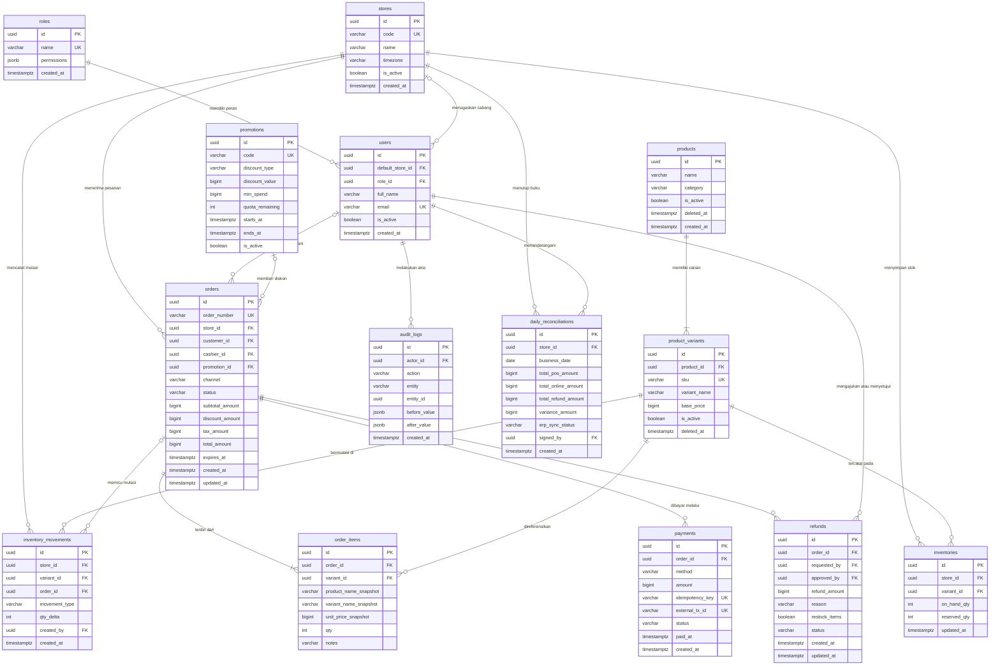

# Bab 08 — Data Modeling (ERD) & SQL Wajib System Analyst

> **Ringkasan Posisi Bab:** Antarmuka dan API bisa diperbarui dalam hitungan hari, tetapi struktur tabel basis data yang keliru akan menghantui proyek bertahun-tahun. Seorang System Analyst tingkat Junior–Mid tidak cukup hanya bisa membaca diagram kotak-garis; ia wajib mampu merancang **Entity Relationship Diagram (ERD)** yang seimbang antara normalisasi dan kebutuhan audit bisnis, memahami aturan kunci integritas data finansial, serta menulis kueri **SQL** untuk menyelidiki bug selisih uang dan stok di produksi.

---

## 1. Tujuan Belajar & Posisi di Alur Kerja SA

Setelah mempelajari bab ini, Anda diharapkan mampu:

1. Membedakan tingkat pemodelan data (**Conceptual**, **Logical**, dan **Physical Data Model**) serta membaca notasi **Crow's Foot** (`||`, `o|`, `|{`, `o{`) secara akurat.
2. Menerapkan normalisasi **1NF, 2NF, dan 3NF** untuk mencegah duplikasi data, sekaligus memahami kapan **denormalisasi yang disengaja** (*intentional denormalization*) wajib dilakukan—khususnya pola *snapshot* harga dan nama produk pada `order_items`.
3. Menerapkan praktik standar industri pada skema tabel: **Audit Fields** (`created_at`, `updated_at`, `created_by`), **Soft Delete vs Hard Delete**, presisi uang `BIGINT` Rupiah, timestamp UTC, serta penentuan **Index dasar** untuk mendukung target performa (`NFR-01` & `NFR-02`).
4. Merancang **ERD Crow's Foot lengkap 14 entitas inti** *NusaPOS & OrderHub* dan menulis kueri **SQL investigasi (`SELECT`, `JOIN`, `GROUP BY`, `HAVING`, `CTE`)** untuk melacak selisih pembayaran serta rekonsiliasi stok.

Di dalam alur kerja SA, **Bab 08 adalah fondasi penyimpanan permanen (*source of truth*)**. Semua *Use Case* (Bab 05), *Sequence & State Machine* (Bab 06), dan *Field-Level Mapping* (Bab 07) bermuara pada kolom-kolom tabel yang dirancang di bab ini.

---

## 2. Konsep Inti & Mental Model

### 2.1 Dari Domain Class (Bab 06) ke Entity Relationship Diagram (ERD)

Jika **Domain Class Diagram** memikirkan perilaku objek (*method* seperti `reserve()` dan `transitionTo()`), maka **ERD** berfokus mutlak pada **bagaimana data disimpan secara relasional, bagaimana kunci primer (*Primary Key / PK*) dan kunci asing (*Foreign Key / FK*) menjaga integritas referensial, serta bagaimana kardinalitasnya**.

Secara praktis di proyek, SA berperan penuh pada dua tahap awal dan berkolaborasi dengan *Tech Lead/DBA* di tahap ketiga:
- **Conceptual Data Model:** Peta entitas besar dan relasinya untuk menyamakan bahasa dengan pemilik bisnis (contoh: *"Satu Cabang memiliki banyak Pesanan"*).
- **Logical Data Model (LDM):** Menjabarkan seluruh atribut kunci, PK/FK, tipe data logis, dan normalisasi tanpa terikat sintaks spesifik mesin database tertentu.
- **Physical Data Model (PDM):** Menetapkan tipe data fisik spesifik mesin database (misal PostgreSQL `UUID`, `BIGINT`, `TIMESTAMPTZ`), constraint `CHECK`, dan daftar `INDEX`.

### 2.2 Membaca Notasi Crow's Foot pada Mermaid `erDiagram`

| Simbol Kiri–Kanan | Arti Kardinalitas | Contoh Nyata di *NusaPOS & OrderHub* |
| :--- | :--- | :--- |
| `A \|\|--o{ B` | Satu `A` berhubungan dengan **nol atau banyak** `B` (`1` ke `0..*`). | `stores \|\|--o{ orders` (Satu cabang bisa punya 0 saat baru buka, atau ribuan pesanan). |
| `A \|\|--\|{ B` | Satu `A` wajib memiliki **satu atau banyak** `B` (`1` ke `1..*`). | `orders \|\|--\|{ order_items` (Tidak ada pesanan sah tanpa minimal 1 item). |
| `A \|o--o{ B` | `A` bersifat **opsional (0 atau 1)** bagi banyak `B` (`0..1` ke `0..*`). | `promotions \|o--o{ orders` (Pesanan boleh tidak memakai promo, atau memakai 1 promo). |
| `A \|\|--\|\| B` | Hubungan tepat satu ke satu (`1` ke `1`). | Umumnya dipakai saat memisahkan ekstensi profil atau rekonsiliasi tunggal. |

### 2.3 Normalisasi (1NF–3NF) vs Denormalisasi yang Disengaja (*Snapshot Pattern*)

Tujuan **Normalisasi** adalah menghilangkan anomali penyimpanan (*insert*, *update*, *delete anomaly*) dengan membagi data ke tempat semestinya:
1. **1NF (First Normal Form):** Setiap sel bernilai atomik (tidak boleh menyimpan daftar `"Kopi Aren x2, Croissant x1"` dalam satu kolom teks di tabel `orders`; harus dipecah ke baris-baris di `order_items`).
2. **2NF (Second Normal Form):** Seluruh kolom non-kunci bergantung penuh pada keseluruhan Primary Key (tidak ada ketergantungan parsial).
3. **3NF (Third Normal Form):** Tidak ada ketergantungan transitif antar kolom non-kunci (misalnya tabel `orders` tidak boleh menyimpan alamat cabang `store_address` karena alamat cabang bergantung pada `store_id`, bukan pada `order_id`; alamat cabang cukup disimpan sekali di `stores`).

**Pengecualian Kritis — Denormalisasi yang Disengaja (*Snapshot* di `order_items`):**
Sekilas, menyimpan `product_name_snapshot`, `variant_name_snapshot`, dan `unit_price_snapshot` di `order_items` tampak melanggar 3NF karena nama produk dan harga sudah ada di `products` dan `product_variants`. Namun, dalam sistem POS dan transaksi keuangan, **ini wajib dilakukan!** Jika `order_items` hanya mengacu FK `variant_id` tanpa menyimpan *snapshot* harga saat transaksi, maka ketika `HQ Admin` menaikkan harga *Kopi Susu Aren* dari Rp 28.000 menjadi Rp 30.000 bulan depan, seluruh nota transaksi tahun lalu akan ikut berubah totalnya dan merusak laporan keuangan historis!

### 2.4 State Table vs Append-Only Ledger Table (`inventories` vs `inventory_movements`)

Pola arsitektur penting lainnya adalah memisahkan **tabel posisi terkini** dari **tabel buku besar (*ledger*)**:
- `inventories` menyimpan saldo saat ini per pasangan unik `(store_id, variant_id)`: `on_hand_qty` dan `reserved_qty`. Mudah dibaca cepat dalam `< 10 ms`.
- `inventory_movements` bersifat ***append-only* (hanya tambah, tidak pernah di-edit/hapus)**: mencatat setiap perubahan (`RESERVE`, `RELEASE`, `DEDUCT`, `RESTOCK`, `ADJUSTMENT`, `REFUND_RETURN`) lengkap dengan referensi transaksi. Ketika terjadi komplain *"Mengapa stok sisa 3 padahal pagi tadi 10?"*, SA cukup mengaudit `inventory_movements`.

---

## 3. Standar Industri & Aturan Praktis

### 3.1 Audit Fields, Soft Delete vs Hard Delete, & Aturan Finansial

1. **Audit Fields Standar:** Setiap tabel inti memiliki `created_at TIMESTAMPTZ NOT NULL DEFAULT NOW()` dan `updated_at TIMESTAMPTZ NOT NULL DEFAULT NOW()` dalam **UTC**, serta `created_by` / `updated_by` (`UUID` FK ke `users`) pada tabel yang dimodifikasi oleh aktor manusia.
2. **Soft Delete vs Hard Delete:**
   - **Data Master (`stores`, `users`, `products`, `product_variants`, `promotions`):** Gunakan **Soft Delete** (`is_active BOOLEAN` dan/atau `deleted_at TIMESTAMPTZ NULL`). Menghapus fisik (`DELETE FROM products`) akan memicu error *Foreign Key* atau memutus histori pesanan lama.
   - **Data Transaksi & Kepatuhan (`orders`, `order_items`, `payments`, `refunds`, `inventory_movements`, `audit_logs`, `daily_reconciliations`):** **DILARANG KERAS** melakukan *Hard Delete* maupun *Soft Delete*! Pembatalan transaksi direpresentasikan lewat perubahan `status` (`CANCELLED`, `EXPIRED`, `REFUNDED`) atau entri jurnal pembalik (`RELEASE`, `REFUND_RETURN`). Khusus `audit_logs`, baris bersifat *immutable* (tidak boleh di-`UPDATE` maupun di-`DELETE`, retensi minimal 5 tahun sesuai `NFR-03`).
3. **Tipe Data Uang:** Gunakan `BIGINT` Rupiah utuh (tanpa angka di belakang koma) untuk mencegah galat presisi biner (*floating-point rounding error*) yang sering muncul jika memakai `FLOAT` atau `DOUBLE`.

### 3.2 Indexing Dasar yang Wajib Dikawal SA

SA tidak perlu menjadi DBA, tetapi wajib memastikan indeks berikut tercantum pada spesifikasi teknis demi memenuhi `NFR-01` (`p95 <= 300–500 ms`) dan `NFR-02`:
- `UNIQUE (store_id, variant_id)` pada `inventories` -> mencegah duplikasi baris stok per cabang-varian dan mempercepat `SELECT ... FOR UPDATE`.
- `UNIQUE (idempotency_key)` dan `UNIQUE (external_tx_id)` pada `payments` -> menjamin pencarian webhook duplikat berjalan dalam hitungan milidetik (`O(log N)`).
- `INDEX (store_id, status, created_at)` pada `orders` -> mempercepat tampilan antrean dapur (`status = 'PAID'`) dan laporan harian per cabang.
- `INDEX (status, expires_at)` pada `orders` -> mencegah *full table scan* saat *scheduler* setiap menit mencari pesanan `PENDING_PAYMENT` yang kedaluwarsa (`FR-06`).

---

## 4. Praktik Studi Kasus *NusaPOS & OrderHub*

### 4.1 ERD Crow's Foot Lengkap (14 Entitas Inti Kanonik)

Diagram berikut memetakan **seluruh 14 entitas inti kanonik** dari [`../README.md`](../README.md) tanpa terkecuali, lengkap dengan PK, FK, atribut kunci, dan relasi Crow's Foot. Perhatikan bahwa tabel `orders` menggunakan **`store_id`** (bukan `branch_id`).



### 4.2 Contoh DDL Kunci Fisik (PostgreSQL) untuk Menegakkan Aturan Bisnis

SA dapat menyertakan contoh DDL kunci untuk tabel krusial seperti `inventories` dan `orders` agar constraint bisnis tidak hanya hidup di kode aplikasi:

```sql
CREATE TABLE inventories (
    id           UUID PRIMARY KEY,
    store_id     UUID NOT NULL REFERENCES stores(id),
    variant_id   UUID NOT NULL REFERENCES product_variants(id),
    on_hand_qty  INT  NOT NULL DEFAULT 0,
    reserved_qty INT  NOT NULL DEFAULT 0,
    updated_at   TIMESTAMPTZ NOT NULL DEFAULT NOW(),
    CONSTRAINT uq_inventories_store_variant UNIQUE (store_id, variant_id),
    CONSTRAINT chk_inventories_non_negative CHECK (on_hand_qty >= 0 AND reserved_qty >= 0),
    CONSTRAINT chk_inventories_available CHECK (on_hand_qty >= reserved_qty)
);

CREATE INDEX idx_orders_store_status_created ON orders (store_id, status, created_at);
CREATE INDEX idx_orders_pending_expires ON orders (status, expires_at)
    WHERE status = 'PENDING_PAYMENT';
```

Dengan `chk_inventories_available`, sekalipun terjadi bug di kode aplikasi, database sendiri menolak kondisi *overselling* (`on_hand_qty - reserved_qty < 0`).

---

### 4.3 SQL Wajib SA untuk Investigasi Bug & Rekonsiliasi

Di dunia kerja, SA sering diminta menyelidiki laporan operasional seperti *"Mengapa total QRIS di laporan harian berbeda dengan uang masuk?"* atau *"Mengapa stok varian tertentu tidak sesuai dengan pesanan?"*. Berikut 3 pola kueri wajib (`SELECT`, `JOIN`, `GROUP BY`, `HAVING`, `CTE`) yang harus Anda kuasai.

#### Kueri 1: Investigasi Selisih Pembayaran (`orders` vs `payments`) per Cabang & Tanggal Bisnis WIB

Kueri ini menggunakan **CTE (`WITH`)**, `JOIN`, `GROUP BY`, `HAVING`, dan konversi UTC ke `Asia/Jakarta` untuk mendeteksi pesanan yang berstatus `PAID` (atau pasca-bayar) tetapi total pembayaran sukses di tabel `payments` tidak sama dengan `orders.total_amount`:

```sql
WITH settled_payments AS (
    SELECT
        p.order_id,
        SUM(p.amount) AS total_paid_amount,
        COUNT(*)      AS payment_count
    FROM payments p
    WHERE p.status = 'PAID'
    GROUP BY p.order_id
)
SELECT
    s.code AS store_code,
    o.id   AS order_id,
    o.order_number,
    o.status AS order_status,
    (o.created_at AT TIME ZONE 'Asia/Jakarta')::DATE AS business_date_wib,
    o.total_amount AS order_total_idr,
    COALESCE(sp.total_paid_amount, 0) AS paid_total_idr,
    (o.total_amount - COALESCE(sp.total_paid_amount, 0)) AS discrepancy_idr
FROM orders o
JOIN stores s ON s.id = o.store_id
LEFT JOIN settled_payments sp ON sp.order_id = o.id
WHERE o.status IN ('PAID', 'PREPARING', 'READY', 'COMPLETED')
GROUP BY
    s.code,
    o.id,
    o.order_number,
    o.status,
    (o.created_at AT TIME ZONE 'Asia/Jakarta')::DATE,
    o.total_amount,
    sp.total_paid_amount,
    sp.payment_count
HAVING o.total_amount <> COALESCE(sp.total_paid_amount, 0)
    OR COALESCE(sp.payment_count, 0) <> 1
ORDER BY business_date_wib DESC, discrepancy_idr DESC;
```

**Mengapa Kueri Ini Ampuh:** Ia langsung menangkap dua jenis bug sekaligus: (1) order sudah `PAID` tetapi belum punya record `payments` (`discrepancy > 0`), atau (2) webhook terproses ganda sehingga ada 2 pembayaran sukses (`payment_count = 2` dan `discrepancy < 0`).

#### Kueri 2: Rekonsiliasi Saldo Stok & Deteksi Reservasi Yatim (*Orphan Reservation*)

Kueri ini membandingkan angka `on_hand_qty` pada `inventories` terhadap hasil penjumlahan seluruh buku besar `inventory_movements`, sekaligus mengecek adanya pesanan `PENDING_PAYMENT` yang sudah melewati `expires_at`:

```sql
WITH reserved_orders AS (
    SELECT DISTINCT im_res.order_id
    FROM inventory_movements im_res
    WHERE im_res.movement_type = 'RESERVE'
      AND im_res.order_id IS NOT NULL
),
movement_ledger AS (
    SELECT
        im.store_id,
        im.variant_id,
        SUM(CASE WHEN im.movement_type IN ('RESTOCK', 'ADJUSTMENT', 'REFUND_RETURN') THEN im.qty_delta
                 WHEN im.movement_type = 'DEDUCT' THEN -ABS(im.qty_delta)
                 ELSE 0 END) AS net_on_hand_from_ledger,
        -- DEDUCT hanya mengurangi reserved_qty bila order terkait melewati fase RESERVE
        -- (ONLINE_PICKUP atau POS non-tunai); POS CASH langsung memotong on_hand_qty tanpa RESERVE.
        SUM(CASE WHEN im.movement_type = 'RESERVE' THEN im.qty_delta
                 WHEN im.movement_type = 'RELEASE' THEN -ABS(im.qty_delta)
                 WHEN im.movement_type = 'DEDUCT' AND ro.order_id IS NOT NULL THEN -ABS(im.qty_delta)
                 ELSE 0 END) AS net_reserved_from_ledger
    FROM inventory_movements im
    LEFT JOIN reserved_orders ro ON ro.order_id = im.order_id
    GROUP BY im.store_id, im.variant_id
)
SELECT
    s.code AS store_code,
    pv.sku,
    inv.on_hand_qty,
    COALESCE(ml.net_on_hand_from_ledger, 0) AS ledger_on_hand,
    inv.reserved_qty,
    COALESCE(ml.net_reserved_from_ledger, 0) AS ledger_reserved
FROM inventories inv
JOIN stores s ON s.id = inv.store_id
JOIN product_variants pv ON pv.id = inv.variant_id
LEFT JOIN movement_ledger ml
    ON ml.store_id = inv.store_id AND ml.variant_id = inv.variant_id
WHERE inv.on_hand_qty <> COALESCE(ml.net_on_hand_from_ledger, 0)
   OR inv.reserved_qty <> COALESCE(ml.net_reserved_from_ledger, 0);
```

Dan untuk mendeteksi *scheduler* TTL 15 menit yang macet (*orphan reservation*):

```sql
SELECT
    o.id AS order_id,
    o.store_id,
    o.status,
    o.expires_at,
    NOW() - o.expires_at AS overdue_duration
FROM orders o
WHERE o.status = 'PENDING_PAYMENT'
  AND o.expires_at < NOW()
ORDER BY o.expires_at ASC;
```

#### Kueri 3: Audit Pengawasan Void/Refund vs `daily_reconciliations`

Kueri ini memeriksa per cabang apakah total `refunds` berstatus `COMPLETED` pada tanggal bisnis tertentu (`Asia/Jakarta`) cocok dengan kolom `total_refund_amount` di `daily_reconciliations`, dan hanya menampilkan cabang yang memiliki selisih:

```sql
WITH daily_refund_actual AS (
    SELECT
        o.store_id,
        (r.updated_at AT TIME ZONE 'Asia/Jakarta')::DATE AS business_date,
        SUM(r.refund_amount) AS actual_refund_idr
    FROM refunds r
    JOIN orders o ON o.id = r.order_id
    WHERE r.status = 'COMPLETED'
    GROUP BY o.store_id, (r.updated_at AT TIME ZONE 'Asia/Jakarta')::DATE
)
SELECT
    s.code AS store_code,
    dr.business_date,
    dr.total_refund_amount AS reported_refund_idr,
    COALESCE(dra.actual_refund_idr, 0) AS actual_refund_idr,
    (dr.total_refund_amount - COALESCE(dra.actual_refund_idr, 0)) AS variance_idr
FROM daily_reconciliations dr
JOIN stores s ON s.id = dr.store_id
LEFT JOIN daily_refund_actual dra
    ON dra.store_id = dr.store_id AND dra.business_date = dr.business_date
WHERE dr.total_refund_amount <> COALESCE(dra.actual_refund_idr, 0);
```

---

## 5. Jebakan Umum (*Anti-Patterns*) Junior SA

1. **Menggunakan `FLOAT` atau `DOUBLE` untuk Kolom Uang:** Tipe bilangan titik mengambang menghasilkan galat pembulatan biner (misal `0.1 + 0.2 = 0.30000000000000004`). Untuk Rupiah pada *NusaPOS & OrderHub*, selalu gunakan `BIGINT`.
2. **Melupakan *Snapshot* di `order_items`:** Tanpa `unit_price_snapshot` dan `product_name_snapshot`, pembaruan harga menu oleh `HQ Admin` akan mengubah angka transaksi bersejarah secara diam-diam.
3. **Menghapus Data Transaksi dengan `DELETE` (*Hard Delete*):** Menghapus pesanan batal dari database membuat laporan stok dan audit hilang jejak. Gunakan status terminal (`CANCELLED`, `EXPIRED`, `REFUNDED`) serta tabel *ledger* (`inventory_movements`, `audit_logs`).
4. **Salah Menempatkan *Foreign Key* pada Relasi `1:N`:** FK selalu berada di sisi **banyak (`N`)**, bukan di sisi satu (`1`). Jadi `store_id` diletakkan di tabel `orders` (`orders.store_id`), bukan `order_id` di tabel `stores`.
5. **Mengelompokkan Tanggal Tutup Buku Memakai UTC Tanpa Konversi Zona Cabang:** Karena UTC lebih lambat 7 jam dari WIB (`Asia/Jakarta`), pesanan pukul `01:00 WIB` tanggal 26 November tercatat sebagai `18:00 UTC` tanggal 25 November. Jika lupa `AT TIME ZONE 'Asia/Jakarta'`, omzet pagi hari masuk ke laporan kemarin!

---

## 6. Checklist Verifikasi Mandiri

Pastikan setiap butir di bawah ini terjawab **"Ya"** sebelum melangkah ke Bab 09:

- [ ] ERD saya mencakup seluruh **14 entitas inti kanonik** dengan notasi Crow's Foot yang tepat, PK/FK di sisi yang benar, dan menggunakan `orders.store_id` (bukan `branch_id`).
- [ ] Saya dapat menjelaskan kapan tabel dinormalisasi hingga 3NF dan mengapa `order_items` sengaja menyimpan *snapshot* nama dan harga saat transaksi.
- [ ] Saya memahami perbedaan kebijakan *Soft Delete* (untuk master data) dan *No Delete / Append-Only* (untuk transaksi, `inventory_movements`, dan `audit_logs`), serta penggunaan `BIGINT` + `TIMESTAMPTZ` UTC.
- [ ] Saya mampu menulis kueri SQL memakai `CTE`, `JOIN`, `GROUP BY`, dan `HAVING` untuk mendeteksi selisih pembayaran dan anomali stok dengan konversi `Asia/Jakarta`.

---

## 7. Latihan Praktik

Kerjakan keempat skenario berikut terlebih dahulu, lalu periksa kunci jawaban dan pembahasan bernalarnya di [`../kunci-latihan/kunci-bab-05-08.md`](../kunci-latihan/kunci-bab-05-08.md).

1. **Skenario 1 (Audit Skema & Normalisasi):** Seorang pengembang junior mengusulkan tabel `orders` tunggal dengan struktur berikut:
   - `orders(id, branch_id, store_name, items_text, total_amount_float, created_at_local_wib)`
   - Tidak ada tabel `order_items`, tidak ada `inventory_movements`, dan ketika pelanggan membatalkan pesanan, barisnya langsung dihapus dengan `DELETE FROM orders WHERE id = ...`.
   Identifikasi **6 cacat desain data** pada usulan di atas dan tuliskan perbaikannya mengacu pada standar kanonik [`../README.md`](../README.md) dan prinsip 1NF–3NF + *snapshot*.
2. **Skenario 2 (Merancang Sub-ERD Mermaid untuk Modul Pembayaran, Refund, & Rekonsiliasi):** Gambarlah diagram **Mermaid `erDiagram`** yang menghubungkan 7 entitas berikut secara lengkap dengan PK, FK, atribut kunci, dan kardinalitas Crow's Foot yang tepat: `stores`, `users`, `orders`, `payments`, `refunds`, `daily_reconciliations`, dan `audit_logs` (7 entitas total).
3. **Skenario 3 (Menulis SQL Investigasi — Selisih `daily_reconciliations` vs Penjualan Bersih):** Manajemen menemukan cabang `STR-JKT-01` melaporkan angka `total_online_amount` pada tabel `daily_reconciliations` lebih kecil daripada penjumlahan transaksi `ONLINE_PICKUP` sebenarnya pada tanggal bisnis `2026-11-24` (`Asia/Jakarta`). Tuliskan sebuah kueri **SQL (menggunakan `CTE`, `JOIN`, `GROUP BY`, `HAVING`)** yang membandingkan:
   - Total `orders.total_amount` untuk `channel = 'ONLINE_PICKUP'` yang sudah lunas (`status IN ('PAID','PREPARING','READY','COMPLETED')`, tidak termasuk `PENDING_PAYMENT`, `CANCELLED`, `EXPIRED`, `REFUNDED`) pada tanggal bisnis `2026-11-24` (`Asia/Jakarta`),
   - Terhadap kolom `daily_reconciliations.total_online_amount`, lalu hanya menampilkan cabang yang memiliki selisih (`HAVING ... <> ...`).
4. **Skenario 4 (Analisis Index & Konversi Waktu):** Pada jam sibuk pagi hari (`08.00–09.30 WIB`), kueri scheduler pencari pesanan kedaluwarsa (`PENDING_PAYMENT` melewati 15 menit) dan kueri antrean dapur melambat hingga `2.400 ms` sehingga melanggar `NFR-01`.
   - (a) Sebutkan 2 indeks spesifik yang harus ditambahkan pada tabel `orders` dan jelaskan cara kerjanya.
   - (b) Jika sebuah transaksi tercipta pada `2026-11-25T17:15:00Z` (UTC), pada tanggal bisnis manakah transaksi tersebut harus masuk ke `daily_reconciliations` untuk cabang Jakarta (`Asia/Jakarta`), dan mengapa?

---

**Langkah Berikutnya:** Setelah struktur data dan kemampuan investigasi SQL dikuasai, lanjutkan ke Bab 09 (*API Contract, Integrasi Sistem, & System Design Dasar*, sebagaimana tercantum pada peta kurikulum [`../README.md`](../README.md)) untuk merancang kontrak REST API, webhook bertanda tangan HMAC, dan ketahanan sistem terdistribusi.
