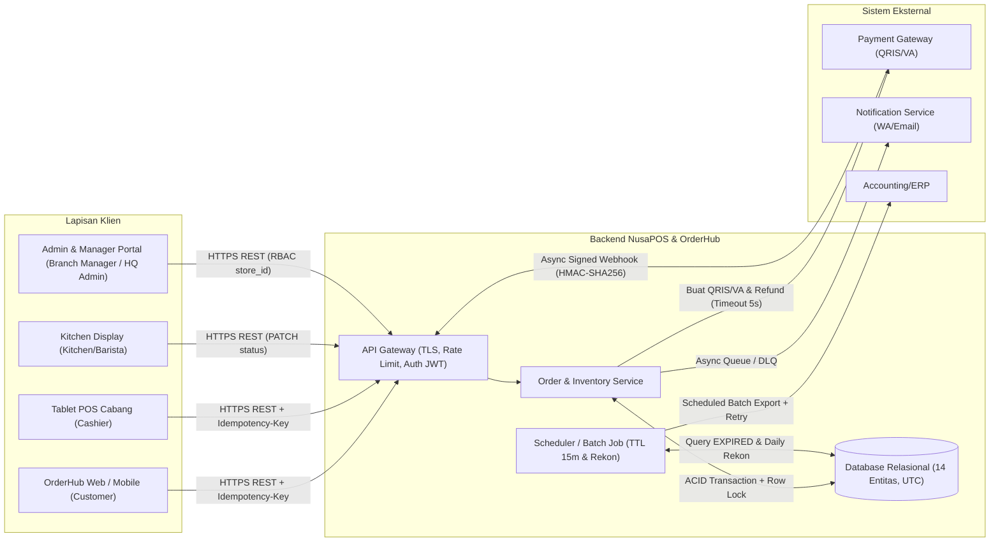
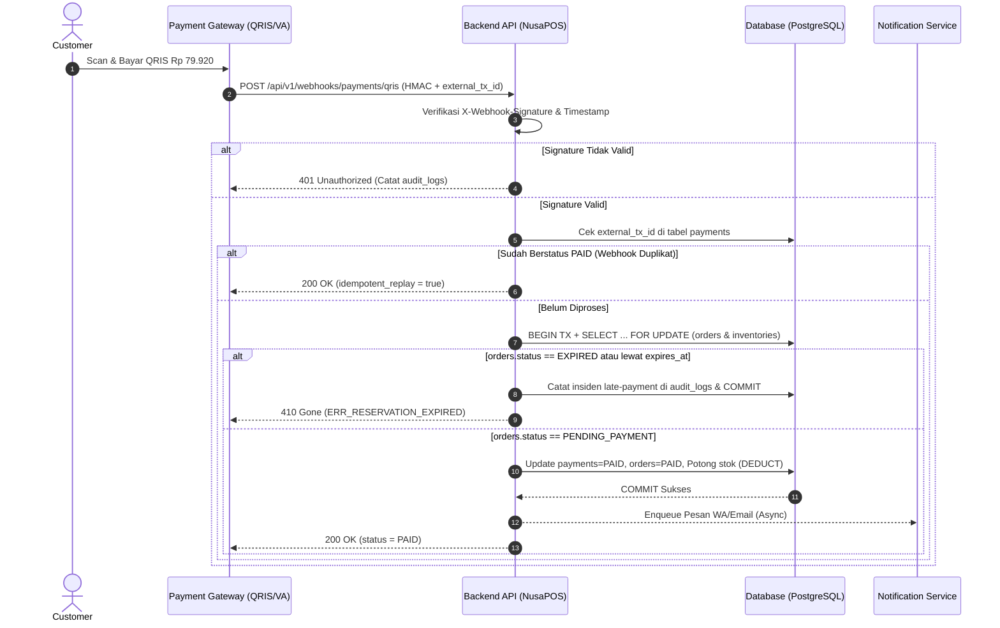

# Bab 09 — API Contract, Integrasi Sistem, & System Design Dasar

> **Ringkasan Posisi Bab:** Jika antarmuka layar (Bab 07) adalah wajah aplikasi dan basis data (Bab 08) adalah ruang brankas penyimpanannya, maka **API (*Application Programming Interface*)** adalah sistem peredaran darah dan saraf yang menghubungkan klien, server inti, hingga layanan pihak ketiga. Seorang System Analyst tingkat Junior–Mid wajib mampu merancang kontrak API yang ketat, mendefinisikan pola integrasi asinkron (*webhook*) yang tahan terhadap pengiriman ulang (*idempotent*), serta membaca risiko arsitektur sistem terdistribusi sebelum tim *Engineering* mulai menulis kode.

---

## 1. Tujuan Belajar & Posisi di Alur Kerja SA

Setelah mempelajari bab ini, Anda diharapkan mampu:

1. Memahami arsitektur **Client-Server**, peran **API Gateway**, batas tanggung jawab *Frontend* vs *Backend*, serta alasan bisnis di balik pemisahan layanan sinkron dan asinkron.
2. Menerapkan semantik **REST API & HTTP** secara tepat (pemilihan *HTTP Method*, *Status Code* `2xx/4xx/5xx`, *Pagination*, *Filtering*, dan format **Error Envelope** standar).
3. Merancang kontrak **Auth & RBAC** berbasis **JWT (*JSON Web Token*)** dan membandingkannya dengan *Session-based Auth* pada skenario multi-cabang (`store_id`).
4. Merancang spesifikasi **Integrasi Pihak Ketiga** secara lengkap: alur **Webhook**, verifikasi tanda tangan digital (**HMAC-SHA256**), **Timeout**, **Retry dengan Exponential Backoff**, **Dead Letter Queue (DLQ)**, serta **Idempotency Key** agar tidak terjadi pemotongan stok atau pembayaran ganda.
5. Menyusun kontrak JSON lengkap untuk alur inti *NusaPOS & OrderHub* (`/api/v1/orders`, `/api/v1/webhooks/payments/qris`, `/api/v1/orders/{orderId}/refunds`) serta mengkaji risiko arsitektur **POS Offline Sync Queue** (*eventual consistency* & konflik stok) tanpa mengubah skema terpusat Fase 1.

Di dalam alur kerja SA, **Bab 09 mengunci perjanjian teknis (*interface contract*)** antara dokumen kebutuhan (`SRS`) dan implementasi teknis (`FSD`). Kontrak API yang jelas memungkinkan tim *Frontend*, *Mobile*, *Backend*, dan *QA* bekerja paralel (*parallel development*) menggunakan *mock server* tanpa saling menunggu.

---

## 2. Konsep Inti & Mental Model

### 2.1 Arsitektur Client-Server, API Gateway, & Komunikasi Sinkron vs Asinkron

Bayangkan sebuah restoran cepat saji modern:
- **Client (Web OrderHub / Tablet Kasir POS)** adalah meja pelanggan dan mesin kasir di depan. Mereka tidak boleh masuk langsung ke gudang bahan baku (`Database`) untuk mengambil stok sendiri.
- **API Gateway / Backend API** adalah loket pemesanan resmi yang memeriksa identitas pemesan (*Authentication*), mengecek hak akses (*Authorization*), memvalidasi pesanan, lalu memprosesnya secara aman ke dapur/gudang.
- **Komunikasi Sinkron (*Request-Response*)**: Pelanggan bertanya *"Apakah Kopi Susu Aren masih ada?"* (`GET /api/v1/stores/{storeId}/menu`) dan berdiri menunggu sampai pelayan menjawab saat itu juga (`200 OK`). Cocok untuk aksi cepat di bawah `500 ms` (`NFR-01`).
- **Komunikasi Asinkron (*Webhook / Message Queue*)**: Ketika pelanggan memindai kode QRIS di aplikasi e-wallet, proses transfer antarbank di pihak `Payment Gateway (QRIS/VA)` bisa memakan waktu 5 detik hingga 10 menit. Server *NusaPOS & OrderHub* tidak boleh "membeku" menunggu respons HTTP selama 10 menit. Sebaliknya, server langsung membalas `201 Created` (`PENDING_PAYMENT`) dan membiarkan `Payment Gateway (QRIS/VA)` mengetuk pintu balik (**Webhook**) secara asinkron begitu dana benar-benar masuk.

### 2.2 Semantik REST API: Method, Resource Naming, & Status Code

Dalam desain RESTful API, URL merepresentasikan **kata benda (*resource*)**, sedangkan HTTP Method merepresentasikan **kata kerja (*action*)**:

| HTTP Method | Makna Semantik | Sifat *Idempotent*? | Contoh Kanonik di *NusaPOS & OrderHub* |
| :--- | :--- | :---: | :--- |
| `GET` | Mengambil/membaca data tanpa mengubah state server. | Ya | `GET /api/v1/stores/{storeId}/menu` |
| `POST` | Membuat resource baru atau memicu aksi pemrosesan/event baru. | Tidak *(kecuali pakai `Idempotency-Key`)* | `POST /api/v1/orders`, `POST /api/v1/webhooks/payments/qris` |
| `PUT` | Mengganti keseluruhan representasi resource yang sudah ada. | Ya | *(Jarang dipakai untuk partial update transaksi)* |
| `PATCH` | Memperbarui sebagian atribut/state resource (misal transisi status). | Ya *(jika aturan transisi dijaga)* | `PATCH /api/v1/orders/{orderId}/status` |
| `DELETE` | Menghapus resource (pada master non-transaksional bila diizinkan). | Ya | *(Tidak dipakai untuk `orders`; pembatalan memakai `PATCH` ke `CANCELLED`)* |

**Klasifikasi HTTP Status Code yang Wajib Dipahami SA:**
- **`2xx` (Sukses):** `200 OK` (baca data / update sukses / *idempotent acknowledgement*), `201 Created` (resource baru tercipta seperti pesanan baru), `202 Accepted` (tugas diterima untuk diproses asinkron di latar belakang).
- **`4xx` (Kesalahan Klien / Pelanggaran Aturan Bisnis):** `400 Bad Request` (format JSON rusak/tipe data salah), `401 Unauthorized` (belum login/token kedaluwarsa), `403 Forbidden` (token valid tapi peran/cabang tidak berhak, misal `ERR_UNAUTHORIZED_APPROVAL`), `404 Not Found` (ID pesanan/cabang tidak ada), `409 Conflict` (konflik stok `ERR_INSUFFICIENT_STOCK` atau konflik idempotensi payload berbeda), `410 Gone` (reservasi sudah kedaluwarsa `ERR_RESERVATION_EXPIRED`), `422 Unprocessable Entity` (sintaks JSON benar tetapi melanggar aturan bisnis/transisi state `ERR_INVALID_STATE_TRANSITION`), `429 Too Many Requests` (melebihi batas *rate limit*).
- **`5xx` (Kesalahan Server / Dependensi Eksternal):** `500 Internal Server Error` (bug tak terduga), `502 Bad Gateway` / `504 Gateway Timeout` (saat memanggil `Payment Gateway` atau `Accounting/ERP` gagal/timeout).

### 2.3 Session-Based Auth vs JWT (OAuth2 / Bearer Token) & RBAC

Bagaimana server tahu bahwa pemanggil API adalah `Cashier` di cabang Sudirman (`STR-001`), bukan `Customer` biasa atau kasir cabang Bandung?

| Dimensi | Session-Based Authentication | JWT (*JSON Web Token* / Stateless Bearer) |
| :--- | :--- | :--- |
| **Cara Kerja** | Server menyimpan data sesi di memori/Redis dan mengirim `session_id` lewat *HTTP-only Cookie*. | Server menandatangani token JSON berisi `user_id`, `role`, `store_id`, `exp`, lalu klien mengirimnya di header `Authorization: Bearer <token>`. |
| **Skalabilitas** | Memerlukan penyimpanan sesi terpusat (Redis) jika server API di-scale ke banyak instance. | *Stateless* — setiap instance API dapat memverifikasi tanda tangan token tanpa query sesi berulang. |
| **Pencabutan Akses (*Revocation*)** | Sangat mudah: hapus `session_id` di Redis, pengguna langsung ter-logout detik itu juga. | Token tetap berlaku sampai waktu `exp` habis, kecuali dikombinasikan dengan *short-lived access token* (15 menit) + *refresh token* di DB/Redis. |
| **Cocok untuk** | Aplikasi web monolitik tradisional berbasis browser. | Ekosistem multi-klien seperti *NusaPOS & OrderHub* (Web Customer, Mobile App, Tablet POS kasir, Layar Dapur KDS). |

Pada *NusaPOS & OrderHub*, sistem menggunakan **Bearer JWT** (`POST /api/v1/auth/login`) dengan klaim wajib `sub` (`user_id`), `role` (`Customer`/`Cashier`/`Kitchen/Barista`/`Branch Manager`/`HQ Admin`), dan `store_id` (cabang penugasan untuk aktor internal).

### 2.4 Lima Pilar Keandalan Integrasi Pihak Ketiga

Saat sistem berbicara dengan dunia luar (`Payment Gateway`, `Notification Service`, `Accounting/ERP`), jaringan internet tidak pernah 100% stabil. SA wajib menspesifikasikan 5 pengaman berikut:

1. **Webhook Signature Verification (HMAC-SHA256):** Siapa saja di internet bisa menembak URL publik `/api/v1/webhooks/payments/qris` dengan JSON palsu seolah-olah transaksi Rp 500.000 sudah lunas. Oleh karena itu, pengirim wajib menyertakan header `X-Webhook-Signature` yang dihitung menggunakan kunci rahasia bersama (*shared secret*) dan timestamp (`X-Webhook-Timestamp` untuk mencegah *replay attack*). Server memverifikasi tanda tangan sebelum memproses satu baris data pun.
2. **Idempotency Key (`Idempotency-Key` / `external_tx_id`):** Jika jaringan putus sesaat setelah klien mengirim `POST /api/v1/orders` atau sesaat setelah `Payment Gateway` mengirim webhook, pengirim akan mengulang (*retry*) permintaan yang sama. Dengan **Idempotency Key**, server mengenali bahwa kunci tersebut sudah pernah diproses dan langsung mengembalikan hasil yang sama tanpa membuat dua pesanan atau memotong stok dua kali.
3. **Timeout Eksplisit:** Jangan pernah membiarkan panggilan HTTP keluar tanpa batas waktu (*infinite hang*). Tetapkan misalnya `connect timeout = 3 detik` dan `read timeout = 5 detik`.
4. **Retry dengan Exponential Backoff + Jitter:** Jika pengiriman data ke `Accounting/ERP` atau `Notification Service` gagal karena gangguan sesaat (`503`/`504`), jangan langsung menyerah dan jangan pula mengulang 100 kali dalam 1 detik (*retry storm*). Gunakan jeda bertingkat, misalnya `2 detik -> 4 detik -> 8 detik -> 16 detik` ditambah sedikit variasi acak (*jitter*).
5. **Dead Letter Queue (DLQ) & Fallback:** Jika setelah maksimal `N` kali *retry* (misal 5 kali) pengiriman tetap gagal, pesan dipindahkan ke **DLQ** untuk diperiksa operator atau dipicu ulang lewat mekanisme rekonsiliasi/polling terjadwal.

---

## 3. Standar Industri & Aturan Praktis

### 3.1 Standar Kontrak JSON, Pagination, & Error Envelope

1. **Penamaan Konsisten (`snake_case` vs `camelCase`):** Pilih satu konvensi di seluruh payload JSON. Dalam *NusaPOS & OrderHub*, seluruh body JSON dan kolom basis data menggunakan **`snake_case`** (`store_id`, `variant_id`, `total_amount`, `expires_at`), sedangkan parameter path mengikuti konvensi URI (`{storeId}`, `{orderId}`).
2. **Pagination & Filtering untuk Endpoint Daftar (`GET`):** Setiap endpoint yang berpotensi mengembalikan ratusan/ribuan baris wajib mendukung query parameter terstandar agar tidak memicu *Out-Of-Memory* atau melanggar latensi `NFR-01`:
   - Contoh: `GET /api/v1/stores/{storeId}/menu?category=COFFEE&in_stock=true&page=1&limit=20`
   - Metadata pagination standar: `meta: { "page": 1, "limit": 20, "total_items": 48, "total_pages": 3 }`.
3. **Standard Error Envelope:** Seluruh respons gagal (`4xx`/`5xx`) wajib menggunakan struktur JSON seragam sesuai [`../README.md`](../README.md) (`success: false`, `error.code`, `error.message`, `error.details`, `error.trace_id`). Jangan pernah mengembalikan *stack trace* bahasa pemrograman atau pesan error mentah database ke klien karena membocorkan celah keamanan!

### 3.2 Aturan Emas Integrasi bagi System Analyst

1. **Pisahkan `Idempotency` untuk Klien vs Webhook:**
   - Pada mutasi dari klien (`POST /api/v1/orders`, `POST /api/v1/orders/{orderId}/refunds`), klien mengirim header `Idempotency-Key: <uuid-v4>`. Jika kunci sama dipakai lagi untuk **payload identik**, server mengembalikan respons awal yang tersimpan; jika kunci sama dipakai untuk **payload berbeda**, server menolak dengan `409 Conflict` (`ERR_DUPLICATE_IDEMPOTENCY`).
   - Pada webhook `POST /api/v1/webhooks/payments/qris`, pengirim menyertakan `external_tx_id` (dan/atau `idempotency_key`). Jika transaksi sudah berstatus `PAID` sebelumnya, server wajib membalas **`200 OK`** (*idempotent acknowledgement*) agar `Payment Gateway` berhenti melakukan *retry*, tanpa memotong stok lagi!
2. **Jangan Percayakan Angka Finansial & Timestamp ke Klien:** Klien hanya mengirim `variant_id`, `qty`, `promo_code`, dan `channel`. Perhitungan subtotal, diskon, pajak (`BIGINT` Rupiah dengan pembulatan `HALF_UP`), serta `created_at`/`expires_at` (`UTC`) sepenuhnya dihitung oleh server.

---

## 4. Praktik Studi Kasus *NusaPOS & OrderHub*

### 4.1 Peta Arsitektur Integrasi Sistem (Mermaid `flowchart LR`)

Diagram berikut memetakan seluruh interaksi antarkomponen pada Fase 1 *NusaPOS & OrderHub*:



### 4.2 Kontrak Lengkap Endpoint Kanonik Inti

Berikut spesifikasi kontrak API siap pakai mengacu pada [`../templates/template-fsd.md`](../templates/template-fsd.md) dan [`../README.md`](../README.md).

#### A. `POST /api/v1/orders` — Pembuatan Pesanan POS & Online Self-Pickup (`FR-03`, `UC-02`, `UC-03`)

- **Otorisasi:** `Authorization: Bearer <JWT>` (`Customer` hanya boleh `channel = "ONLINE_PICKUP"`; `Cashier` boleh `channel = "POS"` pada `store_id` penugasannya).
- **Header Wajib:** `Content-Type: application/json`, `Idempotency-Key: <uuid-v4>`.

**Request Body (`ONLINE_PICKUP` oleh `Customer` via `SCR-ORD-002`):**
```json
{
  "store_id": "STR-001",
  "channel": "ONLINE_PICKUP",
  "payment_method": "QRIS",
  "promo_code": "KOPIPAGI10",
  "items": [
    {
      "variant_id": "VAR-001",
      "qty": 2,
      "notes": "Less sugar, es sedikit"
    },
    {
      "variant_id": "VAR-005",
      "qty": 1,
      "notes": null
    }
  ]
}
```

**Response Sukses (`201 Created`):**
```json
{
  "success": true,
  "data": {
    "order_id": "ORD-20261125-0042",
    "store_id": "STR-001",
    "channel": "ONLINE_PICKUP",
    "status": "PENDING_PAYMENT",
    "currency": "IDR",
    "subtotal_amount": 80000,
    "discount_amount": 8000,
    "tax_amount": 7920,
    "total_amount": 79920,
    "expires_at": "2026-11-25T05:45:00Z",
    "payment": {
      "payment_id": "PAY-20261125-0042",
      "method": "QRIS",
      "status": "PENDING",
      "qris_payload": "00020101021226580016ID.CO.QRIS.WWW..."
    }
  }
}
```

**Response Error Contoh (`409 Conflict` — `ERR_INSUFFICIENT_STOCK`):**
```json
{
  "success": false,
  "error": {
    "code": "ERR_INSUFFICIENT_STOCK",
    "message": "Stok varian Kopi Susu Aren (Large) di cabang tidak mencukupi.",
    "details": {
      "store_id": "STR-001",
      "variant_id": "VAR-002",
      "requested_qty": 3,
      "available_qty": 1
    },
    "trace_id": "req-9f8e7d6c5b4a"
  }
}
```

#### B. `POST /api/v1/webhooks/payments/qris` — Callback Asinkron Pembayaran (`FR-04`, `UC-04`)

- **Autentikasi:** Tanpa JWT pengguna; wajib memverifikasi header `X-Webhook-Signature` (`HMAC-SHA256(secret, timestamp + "." + raw_body)`) dan `X-Webhook-Timestamp` (selisih maksimal 5 menit dari waktu UTC server).
- **Aturan Idempotency:** Berdasarkan `external_tx_id`.

**Request Payload dari `Payment Gateway (QRIS/VA)`:**
```json
{
  "event_id": "EVT-PG-88912",
  "external_tx_id": "PG-QRIS-20261125-9910",
  "order_id": "ORD-20261125-0042",
  "payment_status": "SETTLED",
  "paid_amount": 79920,
  "paid_at": "2026-11-25T05:32:10Z"
}
```

**Skenario Respons Server:**
1. **Valid & Pertama Kali Diproses (`orders.status = PENDING_PAYMENT` dan belum lewat `expires_at`):** Kurangi `inventories.on_hand_qty` & `reserved_qty`, catat `DEDUCT` di `inventory_movements`, ubah `orders.status` ke `PAID`, kirim event asinkron ke `Notification Service`, lalu balas **`200 OK`**:
   ```json
   {
     "success": true,
     "data": {
       "order_id": "ORD-20261125-0042",
       "status": "PAID",
       "idempotent_replay": false
     }
   }
   ```
2. **Webhook Duplikat (`external_tx_id` sudah tercatat `PAID`):** Jangan sentuh stok atau status lagi; langsung balas **`200 OK`** (`"idempotent_replay": true`) agar gateway berhenti me-retry.
3. **Webhook Tiba Setelah TTL 15 Menit Habis (`orders.status = EXPIRED`):** Jangan potong stok yang sudah dilepas; catat flag insiden rekonsiliasi/refund otomatis pada `payments`/`audit_logs` dan kembalikan `410 Gone` / `409 Conflict` dengan kode `ERR_RESERVATION_EXPIRED`.

#### C. `POST /api/v1/orders/{orderId}/refunds` — Pengajuan & Approval Void/Refund (`FR-07`, `UC-06`, `SCR-REF-001`)

- **Otorisasi:** `Cashier` hanya boleh membuat pengajuan (`action = "REQUEST"`). Hanya `Branch Manager` dengan `store_id` yang sama dengan `orders.store_id` yang boleh mengeksekusi keputusan (`action = "APPROVE"` atau `"REJECT"`).
- **Header Wajib:** `Authorization: Bearer <JWT>`, `Idempotency-Key: <uuid-v4>`.

**Request Body (Pengajuan oleh `Cashier` atau Approval oleh `Branch Manager`):**
```json
{
  "action": "APPROVE",
  "reason_code": "CASHIER_ERROR",
  "reason_notes": "Pelanggan ingin ganti varian non-kopi karena alergi.",
  "restock_items": true,
  "manager_pin": "654321"
}
```

**Response Error Jika `Cashier` Mencoba Mengirim `"action": "APPROVE"` (`403 Forbidden`):**
```json
{
  "success": false,
  "error": {
    "code": "ERR_UNAUTHORIZED_APPROVAL",
    "message": "Persetujuan void/refund pasca-bayar hanya dapat dilakukan oleh Branch Manager cabang terkait.",
    "details": {
      "order_id": "ORD-20261125-0042",
      "required_role": "Branch Manager",
      "actual_role": "Cashier"
    },
    "trace_id": "req-3a2b1c4d5e6f"
  }
}
```

#### D. Alur Webhook & Idempotency dalam Mermaid `sequenceDiagram`



### 4.3 Kajian Risiko Arsitektur: *POS Offline Sync Queue* (Tanpa Mengubah Kontrak Fase 1)

Sebagaimana ditetapkan pada [`../README.md`](../README.md), Fase 1 berjalan **online-first**. Namun saat diskusi *system design* dengan *Tech Lead*, pertanyaan ini hampir selalu muncul: *"Bagaimana jika internet di cabang mati total selama 2 jam, apakah kasir boleh menyimpan transaksi di lokal tablet dan menyinkronkannya nanti?"*

Sebagai SA, Anda harus memetakan risiko **POS Offline Sync Queue (*Eventual Consistency*)** sebelum menyetujuinya menjadi fitur di fase mendatang:

| Risiko Arsitektur | Dampak Bisnis & Teknis | Strategi Mitigasi yang Harus Disiapkan |
| :--- | :--- | :--- |
| **1. Duplikasi Order saat Sinkronisasi Ulang** | Koneksi tidak stabil menyebabkan tablet POS mengirim ulang antrean transaksi offline yang sama berkali-kali. | Klien POS wajib mencetak UUID lokal **`client_order_id`** sejak transaksi dibuat offline dan mengirimkannya sebagai `Idempotency-Key` saat sinkronisasi. |
| **2. Konflik Stok (*Overselling* Antar-Kanal)** | Saat internet cabang mati, `Customer` dari luar masih memesan item terakhir lewat aplikasi `OrderHub` (online), sementara di toko `Cashier` menjual item fisik yang sama secara offline. Ketika internet nyala dan antrean disinkronkan, stok fisik sudah minus! | Saat sinkronisasi batch mendeteksi `on_hand_qty < qty`, transaksi offline **tidak boleh ditolak diam-diam** (karena uang tunai sudah diterima kasir). Sistem harus mencatat pesanan dengan flag **`STOCK_CONFLICT_RECONCILE`**, memicu alert ke `Branch Manager`, dan memaksa proses stok opname/penyesuaian (`ADJUSTMENT`). |
| **3. Pembayaran QRIS Tidak Dapat Diverifikasi Offline** | Transaksi offline hanya aman untuk metode **`CASH`**, karena verifikasi dinamis QRIS/VA membutuhkan koneksi *real-time* ke `Payment Gateway (QRIS/VA)`. | Saat mode offline aktif di aplikasi kasir, nonaktifkan opsi pembayaran QRIS/VA dinamis (atau batasi hanya tunai) agar tidak terjadi selisih kas. |
| **4. Manipulasi Jam Perangkat (*Clock Skew*)** | Jam tablet kasir yang melenceng dapat merusak urutan mutasi stok dan pengelompokan tanggal `daily_reconciliations`. | Simpan `client_created_at` untuk referensi kejadian fisik, tetapi tetap catat `server_received_at` (UTC) dan sinkronkan aturan batas tutup buku. |

---

## 5. Jebakan Umum (*Anti-Patterns*) Junior SA

1. **Memakai `200 OK` untuk Semua Respons (Termasuk Error):** Mengembalikan status HTTP `200 OK` dengan isi `{"error": "stok habis"}` membingungkan *API Gateway*, sistem monitoring, dan mekanisme *retry* otomatis klien/webhook. Gunakan kode HTTP semantik (`409`, `422`, `403`, `410`).
2. **Melupakan Idempotency pada Endpoint Transaksi & Webhook:** Akibatnya, satu klik ganda atau satu gangguan jaringan menyebabkan dua pesanan tercatat, dua tagihan kartu/QRIS, atau stok terpotong ganda.
3. **Menyerahkan Webhook tanpa Verifikasi Signature:** Menganggap alamat URL webhook yang "rahasia" sudah cukup aman (*security by obscurity*). Tanpa `HMAC-SHA256`, penyerang dapat memalsukan status `PAID` dan mencuri produk tanpa membayar.
4. **Menjadikan Panggilan ke `Notification Service` Bersifat Sinkron di Jalur Kritis `POST /api/v1/webhooks/payments/qris`:** Jika server WA/Email pihak ketiga sedang lambat 8 detik, webhook pembayaran akan ikut *timeout* sehingga `Payment Gateway` menganggap konfirmasi gagal dan terus mengulang webhook. Selalu letakkan pengiriman notifikasi di **antrean asinkron** setelah transaksi database selesai *commit*.

---

## 6. Checklist Verifikasi Mandiri

Pastikan setiap butir di bawah ini terjawab **"Ya"** sebelum melangkah ke Bab 10:

- [ ] Setiap endpoint API pada spesifikasi saya memiliki HTTP Method, URI kanonik, hak akses RBAC, skema Request/Response JSON, serta pemetaan HTTP Status Code (`2xx/4xx/5xx`) + kode error standar.
- [ ] Seluruh operasi mutasi kritis (`POST /api/v1/orders`, `POST .../refunds`) mewajibkan `Idempotency-Key`, dan webhook pembayaran memverifikasi `HMAC-SHA256` serta bersifat *idempotent*.
- [ ] Integrasi keluar (*outbound*) memiliki spesifikasi *timeout*, kebijakan *retry exponential backoff*, dan penanganan kegagalan akhir (DLQ/rekonsiliasi).
- [ ] Nilai uang dikirim/disimpan dalam `BIGINT` Rupiah (tanpa harga dipercaya dari klien) dan seluruh timestamp API menggunakan ISO-8601 UTC.
- [ ] Risiko *eventual consistency* pada skenario *offline queue* dipahami dan dipisahkan secara tegas dari ruang lingkup *online-first* Fase 1.

---

## 7. Latihan Praktik

Kerjakan keempat skenario berikut, lalu bandingkan jawaban dan penalaran Anda di [`../kunci-latihan/kunci-bab-09-13.md`](../kunci-latihan/kunci-bab-09-13.md).

1. **Skenario 1 (Audit Kontrak API Cacat):** Seorang *Backend Engineer* junior mengusulkan rancangan endpoint pembuatan pesanan sebagai berikut:
   - `GET /api/v1/createOrder?branch_id=1&total=50000`
   - Tidak menggunakan header `Idempotency-Key`.
   - Jika stok habis, server tetap membalas `HTTP 200 OK` dengan body `{"status": "gagal", "msg": "ERROR: duplicate key value violates unique constraint on table inventories"}`.
   Temukan **5 kesalahan fatal** pada desain API tersebut dan perbaiki menggunakan standar kanonik *NusaPOS & OrderHub*.
2. **Skenario 2 (Merancang Kontrak `PATCH /api/v1/orders/{orderId}/status`):** Tuliskan spesifikasi kontrak lengkap untuk endpoint perubahan status dapur & pembatalan (`FR-05` & `FR-06`), mencakup:
   - Siapa aktor yang boleh mengubah ke `PREPARING`, `READY`, `COMPLETED`, dan `CANCELLED`.
   - Contoh *Request Body*, *Response Sukses* (`200 OK`), dan *Response Gagal* (`422 Unprocessable Entity` — `ERR_INVALID_STATE_TRANSITION`) jika seseorang mencoba memindahkan pesanan `EXPIRED` menjadi `PREPARING`.
3. **Skenario 3 (Analisis Skenario Webhook Ganda & Terlambat):** Pada pukul `10:00:00Z`, `Customer` melakukan checkout `ORD-100` (`expires_at = 10:15:00Z`). Jawab dua kasus berikut:
   - (a) Webhook `SETTLED` tiba pertama kali pukul `10:04:00Z`, lalu karena gangguan jaringan pada pihak gateway, webhook identik (`external_tx_id` sama) dikirim ulang pukul `10:04:15Z`. Apa HTTP status code, perilaku stok, dan pesan respons pada pemanggilan kedua?
   - (b) Webhook `SETTLED` baru tiba pukul `10:17:00Z` setelah scheduler mengubah `ORD-100` menjadi `EXPIRED` pada pukul `10:15:30Z`. Mengapa sistem **dilarang** mengubah statusnya menjadi `PAID` dan memotong stok langsung? Apa langkah pengamanan yang harus dilakukan sistem?
4. **Skenario 4 (Kajian *POS Offline Sync Queue*):** Manajer operasional meminta cabang *pop-up booth* di festival musik tetap bisa memakai tablet kasir saat sinyal seluler hilang total selama 3 jam. Jelaskan **3 syarat ketat** (terkait metode bayar, kunci idempotensi lokal `client_order_id`, dan resolusi konflik stok saat online kembali) sebelum usulan ini dapat disetujui masuk ke backlog fase berikutnya.

---

**Langkah Berikutnya:** Setelah merancang kontrak API dan ketahanan integrasinya, lanjutkan ke [**Bab 10 — Non-Functional Requirements (NFR), Security, & Concurrency**](10-nfr-security-concurrency.md) untuk mengunci target performa, pertahanan keamanan OWASP, serta mekanisme penguncian database agar sistem aman dari *overselling* di beban puncak.
