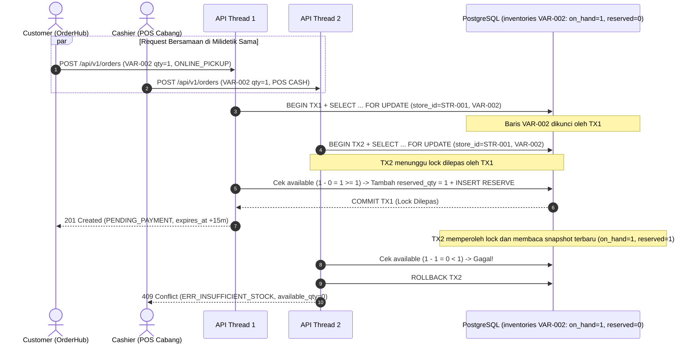

# Bab 10 — Non-Functional Requirements (NFR), Security, & Concurrency

> **Ringkasan Posisi Bab:** Sebuah sistem bisa saja memenuhi 100% fitur fungsional (*Functional Requirements*) di laptop pengembang, tetapi hancur saat *Go-Live* karena lambat saat promo jam makan siang, bocor data antar-cabang akibat celah akses, atau menjual 1 gelas kopi terakhir ke 5 pelanggan sekaligus. Bab ini membekali System Analyst dengan kemampuan menuliskan **NFR yang terukur**, mengawal keamanan dasar **OWASP**, serta merancang kontrol **Concurrency & Data Integrity** pada tingkat spesifikasi.

---

## 1. Tujuan Belajar & Posisi di Alur Kerja SA

Setelah mempelajari bab ini, Anda diharapkan mampu:

1. Mengubah keluhan kualitas yang kabur (*"harus cepat dan aman"*) menjadi **Non-Functional Requirements (NFR)** yang spesifik, terukur, dan dapat diuji oleh QA/DevOps (`NFR-01` s.d. `NFR-04`).
2. Memahami konsep metrik performa inti: **Latency Persentil (`p50`, `p95`, `p99`)**, **Throughput (`RPS`)**, **Availability (`SLA`)**, dan implikasinya terhadap desain sistem.
3. Mengidentifikasi dan mencegah kerentanan keamanan aplikasi web/API paling umum (**OWASP Top 10** relevan bagi SA): **IDOR / Broken Access Control**, **SQL Injection & XSS**, **Sensitive Data Exposure/Masking**, serta **Brute Force / Rate Limiting**.
4. Menganalisis masalah **Concurrency (*Race Condition*)** pada pengurangan stok dan memilih strategi penguncian yang tepat (**Pessimistic Locking `SELECT ... FOR UPDATE`** vs **Optimistic Locking**), **Transaction Atomicity**, serta resolusi konflik sinkronisasi offline POS.

Di dalam alur kerja SA, **Bab 10 adalah sabuk pengaman produksi**. NFR menjadi kriteria langsung bagi *Tech Lead* dalam menentukan arsitektur database/cache (Bab 08–09) dan bagi *QA* dalam menyusun skenario *Load Test* serta *Security Test* (Bab 13).

---

## 2. Konsep Inti & Mental Model

### 2.1 Mengapa Rata-Rata (*Average*) Menipu dan Kita Menggunakan `p95`?

Bayangkan ada 100 pelanggan mengantre di kasir:
- 95 pelanggan dilayani dalam `100 ms` (0,1 detik).
- 5 pelanggan terakhir mengalami gangguan dan menunggu `9.000 ms` (9 detik).
Rata-rata (*average*) waktunya adalah `545 ms` — terlihat "lumayan cepat", padahal 5% pelanggan mengalami sistem hampir macet!

Oleh karena itu, standar industri mengukur performa dengan **Persentil Latensi**:
- **`p50` (Median):** 50% permintaan selesai lebih cepat dari angka ini.
- **`p95`:** **95% dari seluruh permintaan** selesai di bawah batas ini (misal `p95 <= 500 ms` untuk `POST /api/v1/orders` di `NFR-01`). Artinya hanya 5% permintaan terburuk yang boleh melampaui 500 ms.
- **`RPS` (*Requests Per Second*):** Jumlah permintaan yang mampu ditangani sistem setiap detik secara bersamaan (misal target beban puncak `150 RPS` nasional).
- **`Availability / SLA`:** Persentase waktu layanan aktif selama jam operasional (misal `>= 99,5%` antara 06.00–23.00 WIB pada `NFR-04`, yakni `17 jam/hari` atau `1.020 menit/hari`, sehingga kuota *downtime* `0,5%` setara maksimal **~5,1 menit per hari** atau **~35,7 menit per minggu** pada jam buka).

### 2.2 Tiga Lapisan Keamanan yang Wajib Dikawal SA

SA tidak perlu melakukan *penetration testing* manual, tetapi wajib menutup celah desain sejak di dokumen spesifikasi:

1. **Authentication vs Authorization (Broken Access Control / IDOR):**
   *Insecure Direct Object Reference (IDOR)* terjadi ketika pengguna yang sudah login dengan sah mengganti ID pada URL atau payload untuk mengintip atau mengubah data milik orang/cabang lain. Contoh: `Cashier` cabang Jakarta (`STR-001`) memanggil `GET /api/v1/reconciliations/daily?store_id=STR-002` atau `Customer` A memanggil `PATCH /api/v1/orders/ORD-MILIK-B/status`. Jika server hanya memeriksa *"apakah JWT valid?"* tanpa memeriksa *"apakah `user.store_id` atau `order.customer_id` cocok dengan pemilik JWT?"*, terjadilah kebocoran data!
2. **Input Sanitization (SQL Injection & XSS):**
   - **SQL Injection:** Terjadi bila input pengguna (misal `notes` atau `promo_code`) digabung langsung sebagai string ke perintah SQL. Solusi wajib di spesifikasi: gunakan *Parameterized Query / Prepared Statement* secara menyeluruh.
   - **XSS (*Cross-Site Scripting*):** Terjadi bila catatan item seperti `` disimpan dan dirender mentah di layar `Kitchen/Barista` atau admin. Solusi wajib: sanitasi/validasi input di server + *output encoding* otomatis di *Frontend*.
3. **Sensitive Data Masking & Rate Limiting:**
   - Kata sandi/PIN wajib di-hash satu arah (**bcrypt/Argon2**, jangan pernah MD5/plaintext).
   - Data sensitif pada log aplikasi dan `audit_logs` (misal token JWT, nomor telepon penuh, atau kredensial) wajib disamarkan (*masking*).
   - Endpoint publik seperti `POST /api/v1/auth/login` dan `POST /api/v1/orders` wajib memiliki **Rate Limiting** (misal maks. 10 percobaan login gagal per 5 menit per IP/akun) guna menangkal *brute force* dan *spam order* penguras stok reservasi.

### 2.3 Race Condition & Penguncian Database (*Pessimistic vs Optimistic Locking*)

Bayangkan sisa stok *Kopi Susu Aren (Large)* (`VAR-002`) di `STR-001` tinggal **`1` cup** (`on_hand_qty = 1, reserved_qty = 0`). Pada milidetik yang persis sama, `Customer` A dan `Cashier` B mengirim `POST /api/v1/orders` masing-masing memesan `1` cup.

Jika kode backend hanya menjalankan logika naif *"baca dulu, baru update"* tanpa penguncian (*lock*):
1. Transaksi A membaca `available = 1` -> lolos!
2. Transaksi B (1 ms kemudian) juga membaca `available = 1` -> lolos!
3. Transaksi A mengurangi stok menjadi `0`.
4. Transaksi B mengurangi stok menjadi **`-1`** (*overselling* terjadi!).

Untuk mencapai target `NFR-02` (**peluang overselling = 0%**), ada dua pola penguncian utama di database relasional:

| Dimensi | Pessimistic Locking (`SELECT ... FOR UPDATE`) | Optimistic Locking (`version` column) |
| :--- | :--- | :--- |
| **Prinsip Kerja** | Mengunci baris `inventories` sejak dibaca hingga transaksi selesai `COMMIT`/`ROLLBACK`. Transaksi lain yang menyentuh baris sama dipaksa menunggu antre sebentar. | Tidak mengunci baris saat membaca, tetapi menambah kolom `version` (`UPDATE ... SET qty = qty - 1, version = version + 1 WHERE id = ? AND version = ?`). Jika `0 rows affected`, artinya ada pihak lain yang lebih dulu mengubah baris itu. |
| **Kelebihan** | Menjamin kepastian urutan pada data dengan tingkat perebutan tinggi (*high contention*) seperti stok flash-sale atau saldo uang. | Tidak ada antrean lock saat baca; sangat bagus jika konflik jarang terjadi (*low contention*). |
| **Risiko / Kelemahan** | Jika dua transaksi mengunci banyak item dalam urutan terbalik (`VAR-001` lalu `VAR-002` vs `VAR-002` lalu `VAR-001`), bisa memicu **Deadlock**! | Jika konflik sering terjadi (jam sibuk), banyak request gagal dan harus me-*retry* ulang. |
| **Pilihan di *NusaPOS*** | **Wajib dipakai untuk pengurangan & reservasi stok (`inventories`)** dengan syarat urutan penguncian `variant_id` selalu diurutkan menaik (*sorted ascending*) untuk mencegah *deadlock*. | Cocok untuk pembaruan data master jarang konflik seperti edit deskripsi produk oleh `HQ Admin`. |

---

## 3. Standar Industri & Aturan Praktis

### 3.1 Katalog NFR Kanonik (*NusaPOS & OrderHub*)

Setiap pernyataan NFR pada dokumen SRS (Bab 12) wajib memenuhi pola **Kategori + Metrik Angka + Kondisi Pengukuran + Metode Verifikasi**:

| ID NFR | Kategori | Spesifikasi Terukur (`README.md`) | Cara Verifikasi Teknis |
| :--- | :--- | :--- | :--- |
| `NFR-01` | **Performa & Latensi** | Latensi *p95* `GET /menu <= 300 ms` dan `POST /api/v1/orders <= 500 ms` pada beban puncak **150 RPS** nasional. | *Load Test* via k6/JMeter dengan data uji realistis dan simulasi 150 RPS selama 15 menit. |
| `NFR-02` | **Konkurensi & Konsistensi** | Reservasi & pemotongan stok berjalan dalam **1 transaksi ACID** dengan *row-level locking* (`SELECT ... FOR UPDATE`), **0% overselling**, dan webhook pembayaran 100% *idempotent*. | *Concurrency Test* menembakkan 50 request paralel ke 1 item bersisa stok 5; verifikasi stok akhir = 0 dan hanya 5 order berhasil. |
| `NFR-03` | **Keamanan & Auditabilitas** | Wajib **HTTPS/TLS 1.2+**, verifikasi **RBAC per `store_id`**, validasi **HMAC-SHA256** pada webhook, *rate limiting* endpoint publik, serta `audit_logs` *immutable* retensi minimal **5 tahun**. | *Security Review*, pengujian akses lintas-`store_id` (harus `403`), uji pemalsuan signature (harus `401`). |
| `NFR-04` | **Ketersediaan, Waktu, & Akurasi** | *Availability* `>= 99,5%` pada jam buka **06.00–23.00 WIB**, penyimpanan waktu **UTC**, rekonsiliasi zona cabang (`Asia/Jakarta`), pembulatan `BIGINT` `HALF_UP` (**0 discrepancy**). | Pemantauan *uptime/healthcheck*, uji batas tengah malam `23:59 WIB`, dan audit kesesuaian angka ERP. |

### 3.2 Empat Aturan Atomisitas & Anti-Deadlock

1. **Transaction Atomicity (*All-or-Nothing*):** Pada pesanan berisi 3 item (`VAR-001`, `VAR-002`, `VAR-003`), jika `VAR-001` dan `VAR-002` cukup tetapi `VAR-003` habis, seluruh transaksi wajib di-`ROLLBACK`. Tidak boleh ada pesanan parsial tercipta tanpa seluruh itemnya tereservasi.
2. **Deterministic Lock Ordering:** Sebelum menjalankan `SELECT ... FOR UPDATE` pada tabel `inventories`, backend wajib mengurutkan daftar `variant_id` dalam keranjang secara alfabetis/menaik (`ORDER BY variant_id ASC`). Ini secara matematis menghilangkan risiko *deadlock* melingkar antar dua transaksi yang memesan item sama dalam urutan berbeda.
3. **Keep Transactions Short:** Jangan pernah memanggil API eksternal (misal `Notification Service` atau `Payment Gateway`) **di tengah transaksi database yang sedang mengunci baris `inventories`**! Jika `Payment Gateway` lambat 5 detik, baris stok di cabang akan terkunci selama 5 detik dan membuat seluruh kasir cabang itu antre. Simpan dulu data lokal atau panggil gateway dengan batas waktu ketat secara terpisah sesuai desain alur transaksi.
4. **Database Constraint sebagai Jaring Pengaman Terakhir:** Selain validasi aplikasi, pasang `CHECK (on_hand_qty >= 0 AND reserved_qty >= 0 AND on_hand_qty >= reserved_qty)` langsung di level skema PostgreSQL agar bug aplikasi apa pun tetap terblokir oleh database.

---

## 4. Praktik Studi Kasus *NusaPOS & OrderHub*

### 4.1 Alur Pencegahan *Race Condition* Stok (`UC-02` vs `UC-03`)

Diagram berikut memperlihatkan bagaimana *Pessimistic Locking* (`SELECT ... FOR UPDATE`) mencegah *overselling* ketika `Customer` online dan `Cashier` in-store berebut 1 cup terakhir `VAR-002` di cabang `STR-001` secara bersamaan:

### 4.2 Matriks Mitigasi Keamanan & NFR pada Endpoint Kanonik

| Endpoint / Komponen | Ancaman / Risiko Utama | Kontrol Spesifikasi yang Wajib Tertulis | Referensi NFR & Error |
| :--- | :--- | :--- | :--- |
| `POST /api/v1/auth/login` | *Brute-force password*, pencurian token | Hash password Argon2/bcrypt; *rate limit* maks. 10 gagal/5 menit; respons error generik `"Email atau kata sandi salah"` (jangan bedakan mana yang salah); TLS 1.2+. | `NFR-03` (`429 Too Many Requests`) |
| `GET /api/v1/stores/{storeId}/menu` | *Scraping* massal, query lambat saat jam sibuk | Cache katalog per cabang (TTL pendek 30–60 detik untuk metadata produk, stok dibaca cepat via indeks `(store_id, variant_id)`); *rate limit* IP. | `NFR-01` (`p95 <= 300 ms`), `NFR-03` |
| `POST /api/v1/orders` | *Price tampering*, *race condition* stok, *double submit* | Abaikan harga dari klien (hitung ulang di server `BIGINT` `HALF_UP`); urutkan `variant_id` + `SELECT ... FOR UPDATE`; wajib `Idempotency-Key`; batas `qty` per order. | `NFR-01`, `NFR-02`, `NFR-04` (`409 ERR_INSUFFICIENT_STOCK`) |
| `POST /api/v1/webhooks/payments/qris` | Pemalsuan status lunas, *replay attack*, duplikasi potongan stok | Verifikasi `X-Webhook-Signature` (HMAC-SHA256) + cek jendela waktu 5 menit; cek unik `external_tx_id` untuk *idempotency*. | `NFR-02`, `NFR-03` |
| `POST /api/v1/orders/{orderId}/refunds` | **IDOR lintas cabang**, eskalasi hak akses oleh `Cashier` | Cek `jwt.role == 'Branch Manager'` **dan** `jwt.store_id == order.store_id`; verifikasi PIN manager; catat ke `audit_logs` baik saat sukses maupun saat ditolak (`403`). | `NFR-03` (`403 ERR_UNAUTHORIZED_APPROVAL`) |
| `GET/POST /api/v1/reconciliations/daily` | **IDOR lintas cabang**, selisih batas jam UTC vs WIB | Filter paksa `store_id` dari JWT untuk `Branch Manager`; kelompokkan tanggal bisnis berdasarkan konversi `created_at AT TIME ZONE 'Asia/Jakarta'`. | `NFR-03`, `NFR-04` |

### 4.3 Analisis Konflik Konkurensi pada Skenario Risiko *POS Offline Sync*

Melanjutkan kajian risiko Fase lanjutan dari Bab 09, perhatikan mengapa *POS Offline Sync Queue* menjadi tantangan **Concurrency** paling berat:
- Pada mode *online-first* Fase 1, *Pessimistic Locking* bekerja karena semua aktor terhubung ke **satu basis data yang sama** pada saat yang sama.
- Jika kasir bekerja offline di tablet lokal, tablet tersebut tidak bisa mengunci baris di PostgreSQL pusat. Maka ketika koneksi kembali menyala 2 jam kemudian, strategi *Pessimistic Locking* tidak bisa mencegah terjadinya penjualan ganda di masa lalu!
- Oleh sebab itu, pada arsitektur *offline sync*, pola kendalinya bergeser dari **pencegahan di muka (*lock-before-commit*)** menjadi **deteksi konflik pasca-sinkronisasi (*compensating action*)**:
  1. Server memproses antrean masuk satu per satu dalam transaksi atomik berdasarkan `client_order_id` (untuk mencegah duplikasi upload).
  2. Jika `on_hand_qty - reserved_qty >= qty`, stok langsung dipotong (`DEDUCT`).
  3. Jika stok pusat sudah habis (karena terjual lewat `OrderHub` online saat cabang offline), transaksi kasir tetap disimpan untuk keperluan pencatatan kas fisik (`payments` tunai), namun ditandai dengan status investigasi operasional/rekonsiliasi stok (`ADJUSTMENT` oleh `Branch Manager`)—bukan membuang data uang yang sudah diterima kasir.

---

## 5. Jebakan Umum (*Anti-Patterns*) Junior SA

1. **Menulis NFR Tanpa Angka dan Kondisi:** Menulis *"Sistem harus cepat, aman, dan anti-down"* tidak memiliki nilai kontrak. QA tidak bisa membuktikan apakah `600 ms` dianggap gagal atau berhasil. Selalu tuliskan target persentil (`p95 <= 500 ms`), beban (`150 RPS`), dan definisi jam SLA (`06.00–23.00 WIB`).
2. **Mengandalkan Keamanan di Sisi Frontend Saja:** Menyembunyikan menu cabang lain di dropdown atau menyembunyikan tombol *"Approve Refund"* di UI tidak melindungi endpoint API dari serangan via `curl` atau Postman. Penegakan RBAC dan kepemilikan `store_id` wajib dilakukan di server (*Zero-Trust Client*).
3. **Mengunci Tabel Terlalu Lama atau Tanpa Urutan:** Menjalankan panggilan HTTP ke vendor eksternal di dalam blok transaksi database (`BEGIN ... SELECT FOR UPDATE ... HTTP CALL ... COMMIT`) dapat melumpuhkan seluruh cabang bila vendor eksternal mengalami gangguan 10 detik.
4. **Mengabaikan Konsekuensi Retensi & Auditabilitas (`NFR-03`):** Mengizinkan `Branch Manager` atau bahkan `HQ Admin` mengedit atau menghapus baris `audit_logs` dan `inventory_movements` akan menggugurkan integritas bukti saat terjadi audit kecurangan kasir.

---

## 6. Checklist Verifikasi Mandiri

Pastikan setiap butir di bawah ini terjawab **"Ya"** sebelum melangkah ke Bab 11:

- [ ] Seluruh NFR proyek (`NFR-01` s.d. `NFR-04`) memuat metrik angka terukur, kondisi beban/jam operasi, serta metode verifikasinya.
- [ ] Setiap endpoint yang mengakses data cabang (`store_id`) atau data pengguna secara eksplisit mensyaratkan validasi kepemilikan/otorisasi di backend untuk mencegah IDOR.
- [ ] Alur kritis stok (`inventories`) menggunakan transaksi atomik + penguncian baris terurut (`SELECT ... FOR UPDATE`) serta *database check constraint* agar `available stock >= 0`.
- [ ] Data sensitif (password, PIN, token, signature secret) terlindungi oleh hashing/masking, dan endpoint publik memiliki aturan *rate limiting*.
- [ ] Perbedaan mekanisme kontrol konkurensi *online-first* (pessimistic lock) vs *offline sync* (deteksi konflik & kompensasi) telah dipahami dengan jelas.

---

## 7. Latihan Praktik

Kerjakan keempat skenario berikut, lalu periksa pembahasan bernalar lengkapnya di [`../kunci-latihan/kunci-bab-09-13.md`](../kunci-latihan/kunci-bab-09-13.md).

1. **Skenario 1 (Menulis Ulang NFR Kabur Menjadi NFR Terukur):** Tim bisnis memberikan 4 pernyataan kebutuhan berikut pada rapat kickoff:
   - (a) *"Aplikasi pemesanan harus sangat cepat saat jam makan siang."*
   - (b) *"Stok tidak boleh salah potong meskipun banyak orang memesan bareng."*
   - (c) *"Data catatan audit keamanan tidak boleh hilang atau diubah."*
   - (d) *"Aplikasi kasir tidak boleh sering mati saat toko buka."*
   Ubah keempat pernyataan tersebut menjadi spesifikasi **NFR terukur lengkap** (sertakan target angka, kondisi pengujian, dan metode verifikasi QA) yang selaras dengan `NFR-01` s.d. `NFR-04`.
2. **Skenario 2 (Audit Celah Keamanan IDOR & RBAC):** Seorang QA menemukan bahwa ketika ia login sebagai `Cashier` cabang Sudirman (`store_id = STR-001`), ia tetap dapat:
   - (a) Mengambil laporan rekonsiliasi cabang Bandung (`STR-002`) dengan mengubah parameter URL menjadi `GET /api/v1/reconciliations/daily?store_id=STR-002`.
   - (b) Menyetujui sendiri pengajuan refund yang ia buat dengan menembak langsung `POST /api/v1/orders/{orderId}/refunds` berisi `"action": "APPROVE"` memakai Postman.
   - (c) Melihat catatan item pesanan milik pelanggan lain yang berisi skrip `` dan tereksekusi di browser dashboard admin.
   Identifikasi nama jenis kerentanan pada (a), (b), dan (c), sebutkan kode error HTTP & kode error kanonik yang seharusnya dikembalikan server, serta tulis aturan spesifikasi perbaikannya.
3. **Skenario 3 (Investigasi *Deadlock* & *Race Condition*):** Pada pengujian beban 150 RPS, database PostgreSQL melaporkan error `deadlock detected` saat dua pelanggan memesan 2 item yang sama (`VAR-001` dan `VAR-002`), tetapi dengan urutan JSON yang berbeda:
   - Pelanggan A mengirim `items: [VAR-001, VAR-002]`
   - Pelanggan B mengirim `items: [VAR-002, VAR-001]`
   Jelaskan langkah demi langkah mengapa *deadlock* tersebut terjadi saat menggunakan `SELECT ... FOR UPDATE`, serta tuliskan 1 aturan desain sederhana di backend untuk mencegah *deadlock* tersebut 100%.
4. **Skenario 4 (Analisis Waktu Eksekusi Transaksi vs Panggilan Eksternal):** Seorang developer mengusulkan agar saat `POST /api/v1/orders` (`ONLINE_PICKUP`), urutan langkah di dalam satu transaksi database (`BEGIN ... COMMIT`) adalah: `1) SELECT FOR UPDATE stok -> 2) Update reserved_qty -> 3) Panggil HTTP API Payment Gateway untuk generate QRIS (timeout 5s) -> 4) Panggil API Notification Service -> 5) COMMIT`. Jelaskan mengapa menempatkan langkah (3) dan (4) di tengah lock database sangat berbahaya bagi `NFR-01` (latensi) dan `NFR-02` (konkurensi cabang), lalu usulkan pemisahan alur yang lebih aman.

---

**Langkah Berikutnya:** Sistem Anda kini memiliki kontrak API yang solid serta pertahanan NFR, keamanan, dan konkurensi. Lanjutkan ke [**Bab 11 — Impact Analysis, Change Request (CR), Migrasi Data, & Batch/Reporting**](11-impact-analysis-cr-migrasi-batch.md) untuk menguasai cara mengelola perubahan besar pasca-rilis (*CR-001 Delivery 3PL Fase 2*) tanpa merusak sistem yang sudah berjalan, sekaligus merancang spesifikasi *batch job* kedaluwarsa dan rekonsiliasi harian.
