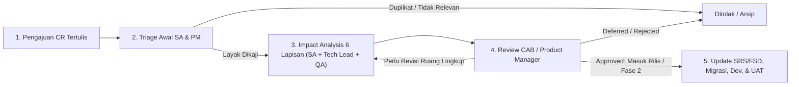
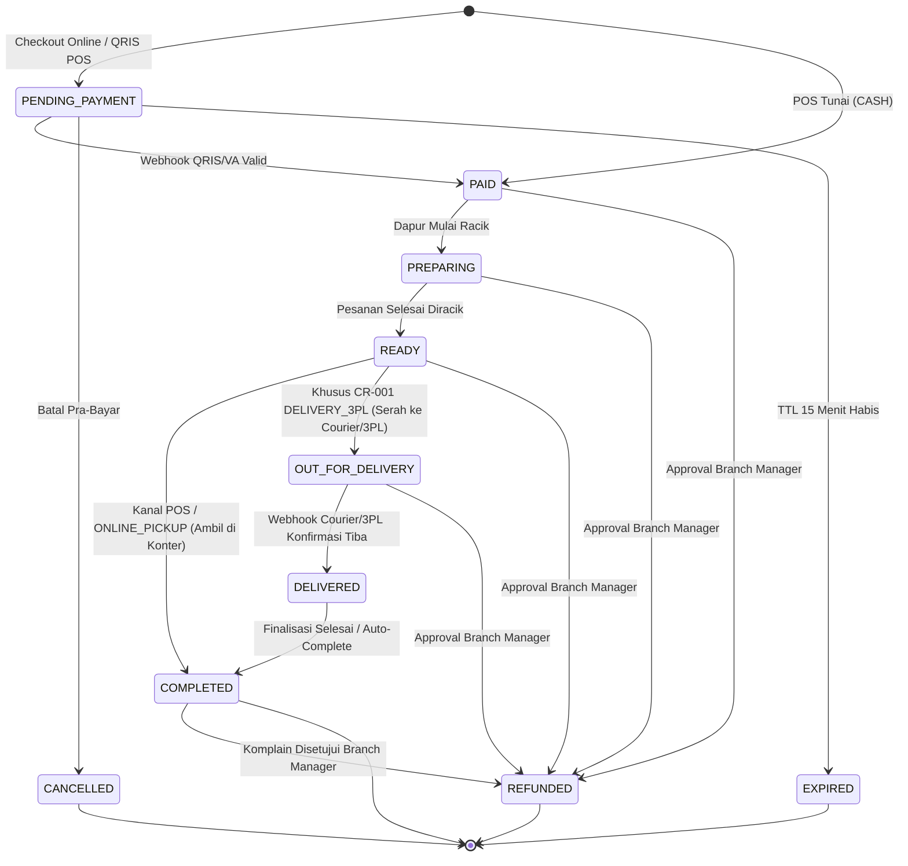

# Bab 11 — Impact Analysis, Change Request (CR), Migrasi Data, & Batch/Reporting

> **Ringkasan Posisi Bab:** Di dunia kerja nyata, lebih dari separuh pekerjaan System Analyst bukanlah membangun aplikasi dari nol (*greenfield*), melainkan **mengubah sistem yang sudah berjalan di produksi** tanpa merusak transaksi lama. Satu permintaan bisnis yang terdengar sederhana—*"Tolong tambahkan opsi antar kurir"*—bisa merembet ke antarmuka, state machine, kontrak API, skema database, batch job, hingga laporan pajak ERP. Bab ini melatih Anda mengendalikan perubahan lewat **Change Request (CR)**, **Impact Analysis 6 Lapisan**, **Strategi Migrasi & Rollback**, serta **Spesifikasi Batch/Scheduler & Reporting**.

---

## 1. Tujuan Belajar & Posisi di Alur Kerja SA

Setelah mempelajari bab ini, Anda diharapkan mampu:

1. Menjalankan prosedur formal **Change Request (CR)** dan mengendalikan ***scope creep*** (perluasan ruang lingkup liar di tengah sprint/proyek) sebelum disetujui masuk ke pengembangan.
2. Menyusun **Impact Analysis Matrix 6 Lapisan Sistem** menggunakan [`../templates/template-cr-impact-analysis.md`](../templates/template-cr-impact-analysis.md) dengan studi kasus nyata **CR-001: Penambahan Layanan Pengiriman Kurir 3PL (Fase 2)** secara ***backward-compatible*** terhadap kanal Fase 1 (`POS` dan `ONLINE_PICKUP`).
3. Merancang strategi **Migrasi Data, Zero-Downtime Cutover, & Rollback** agar data historis dan klien lama tetap berjalan aman selama masa transisi.
4. Menyusun spesifikasi teknis **Batch/Cron Job** berstandar produksi: job pelepasan reservasi stok TTL 15 menit (`FR-06`) dan job rekonsiliasi harian cabang (`FR-08`) yang mematuhi konversi waktu **UTC -> `Asia/Jakarta`** serta presisi pembulatan Rupiah **`HALF_UP`**.

Di dalam alur kerja SA, **Bab 11 adalah jembatan pemeliharaan dan evolusi sistem**. Setelah Fase 1 dirancang (Bab 01–10), Bab 11 memastikan setiap perubahan fase berikutnya (`Fase 2`) dan operasi latar belakang harian (*batch/reporting*) terdokumentasi rapi tanpa mengorbankan integritas Fase 1.

---

## 2. Konsep Inti & Mental Model

### 2.1 *Scope Creep* vs *Controlled Change Request (CR)*

Bayangkan Anda membangun rumah yang pondasinya dirancang untuk 1 lantai, lalu saat tembok hampir dicat, pemilik rumah berkata santai: *"Sekalian tambah lantai 2 dan kolam renang di atap ya, mumpung tukangnya masih di sini."* Jika tukang langsung mengiyakan tanpa menghitung ulang daya dukung pondasi, biaya, dan jadwal, bangunan itu bisa runtuh!

Dalam pengembangan perangkat lunak:
- ***Scope Creep*** adalah masuknya permintaan fitur atau perubahan aturan di tengah jalan **tanpa** evaluasi dampak, **tanpa** penyesuaian jadwal/biaya, dan **tanpa** persetujuan *Change Control Board (CAB) / Product Manager*.
- ***Change Request (CR)*** adalah jalur resmi untuk menampung perubahan. Setiap perubahan tidak langsung ditolak dan tidak langsung dikerjakan—melainkan **dianalisis dampaknya terlebih dahulu oleh SA**, dinilai biayanya (*man-days*) bersama *Tech Lead* dan *QA*, baru diputuskan apakah masuk rilis sekarang, masuk fase berikutnya, atau ditolak.

### 2.2 Model Dampak 6 Lapisan Sistem (*6-Layer Impact Analysis*)

Seorang Junior SA sering kali hanya melihat dampak di layar UI (*"cuma nambah 1 tombol kok"*). Padahal, satu perubahan bisnis dapat beriak ke **6 lapisan sistem**:
1. **Lapisan 1 — UI / UX & Client Apps:** Layar baru, input baru, validasi baru, dan perubahan tampilan status.
2. **Lapisan 2 — Business Logic & State Machine:** Aturan bisnis baru, perhitungan harga/ongkir baru, serta penyesuaian diagram transisi status.
3. **Lapisan 3 — API Contract & Versioning:** Endpoint baru, penambahan field opsional/wajib di JSON, kode error baru, dan dampak ke aplikasi versi lama.
4. **Lapisan 4 — Database Schema & Data Eksisting:** Tabel baru, kolom baru (`NULL` vs `DEFAULT`), perubahan `CHECK`/Enum, indeks baru, dan migrasi (*backfill*) baris data lama.
5. **Lapisan 5 — Integrasi Eksternal & Batch/Scheduler:** Mitra API baru, webhook baru, dan penyesuaian *cron job* yang sedang berjalan.
6. **Lapisan 6 — Reporting, Audit, & Rekonsiliasi:** Perubahan laporan harian cabang, pembukuan pajak, ekspor ERP, dan `audit_logs`.

### 2.3 Backward Compatibility & Zero-Downtime Migration (*Expand-Contract Pattern*)

Ketika sistem sudah melayani ratusan cabang *NusaPOS & OrderHub* setiap hari, kita tidak boleh mematikan aplikasi selama 4 jam untuk mengubah struktur database, dan tidak boleh memaksa semua pelanggan di App Store/Play Store memperbarui aplikasi di detik yang sama saat backend dirilis.

Prinsip emasnya adalah pola **Expand -> Migrate -> Contract**:
- **Expand:** Tambahkan tabel baru atau kolom baru yang bersifat *nullable* atau memiliki nilai `DEFAULT` (jangan pernah langsung `DROP` atau `RENAME` kolom yang masih dipakai kode versi lama!).
- **Migrate (*Backfill*):** Isi data historis secara bertahap per *batch* kecil (misal 5.000 baris per jeda) agar tabel produksi tidak terkunci (*table lock*).
- **Contract:** Baru hapus kolom/kode usang berminggu-minggu kemudian setelah 100% lalu lintas klien dipastikan sudah berpindah ke versi baru.

### 2.4 Spesifikasi Batch/Cron Job yang Tahan Banting

Tidak semua pekerjaan sistem dipicu oleh klik manusia. Pekerjaan terjadwal (*Batch/Scheduler*) seperti membatalkan order kedaluwarsa setiap menit atau menyusun laporan tutup buku tengah malam harus memenuhi **3 sifat wajib**:
1. **Idempotent:** Jika *cron job* tidak sengaja berjalan dua kali pada menit yang sama, hasilnya tidak boleh memotong atau melepas stok dua kali.
2. **Chunked & Lock-Safe:** Memproses data dalam potongan kecil (*batch size*, misal `100` baris per iterasi) memakai `FOR UPDATE SKIP LOCKED` agar tidak membuat database macet atau tumpang tindih dengan worker lain.
3. **Timezone-Aware:** Pengelompokan hari bisnis wajib mengonversi timestamp **UTC** di database ke zona waktu cabang (`Asia/Jakarta`), bukan memakai tanggal UTC mentah!

---

## 3. Standar Industri & Aturan Praktis

### 3.1 Alur Persetujuan Change Request (CR Workflow)



### 3.2 Aturan Emas Spesifikasi Batch & Rekonsiliasi Finansial

1. **Batas Hari Bisnis (`Asia/Jakarta` vs UTC):**
   Cabang *NusaKopi* di Jakarta beroperasi menggunakan WIB (`UTC+7`). Satu hari bisnis tanggal `2026-11-25` di Jakarta dimulai pada `2026-11-25 00:00:00 WIB` dan berakhir pada `2026-11-25 23:59:59 WIB`. Dalam penyimpanan **UTC**, rentang tersebut setara dengan **`2026-11-24T17:00:00Z` s.d. `2026-11-25T16:59:59Z`**. Jika *batch job* rekonsiliasi salah mengambil `DATE(created_at)` dalam UTC tanpa konversi `AT TIME ZONE 'Asia/Jakarta'`, seluruh transaksi malam pukul `07.00–23.59 WIB` akan masuk dengan benar, sedangkan transaksi pukul `00.00–06.59 WIB` pagi hari justru nyasar ke tanggal kemarin!
2. **Presisi Rupiah & Pembulatan `HALF_UP`:**
   Sesuai [`../README.md`](../README.md), seluruh nominal uang disimpan sebagai `BIGINT` Rupiah utuh. Pajak (misal PPN 11%) atau diskon persentase dihitung di **tingkat subtotal transaksi** menggunakan pembulatan eksplisit **`HALF_UP`** (`0,5` ke atas, misal `7.920,5` menjadi `7.921`), bukan dibulatkan per baris item lalu dijumlahkan, sehingga tidak pernah muncul selisih Rp 1–Rp 5 saat rekonsiliasi ke `Accounting/ERP`.

---

## 4. Praktik Studi Kasus *NusaPOS & OrderHub*

### 4.1 Studi Kasus CR-001: Penambahan Layanan Pengiriman Kurir 3PL (Fase 2)

> **Catatan Ruang Lingkup Penting:** Pada Fase 1, sistem *NusaPOS & OrderHub* hanya mendukung kanal `POS` dan `ONLINE_PICKUP` dengan 8 status pesanan (`PENDING_PAYMENT`, `PAID`, `PREPARING`, `READY`, `COMPLETED`, `CANCELLED`, `EXPIRED`, `REFUNDED`). Setelah Fase 1 stabil di produksi, manajemen mengajukan **CR-001** untuk membuka layanan **Delivery Kurir 3PL pada Fase 2**.

#### A. Identitas & Perbandingan *Before vs After* (`CR-001`)

| Atribut / Aspek | Kondisi Baseline Fase 1 (*Before*) | Kondisi Target Fase 2 (*After CR-001*) |
| :--- | :--- | :--- |
| **CR ID & Judul** | Baseline v1.0 (`POS` & `ONLINE_PICKUP`) | **`CR-001`: Penambahan Fitur Delivery 3PL (Fase 2)** |
| **Aktor** | 8 Aktor Kanonik Fase 1 | Tambahan aktor sistem/mitra eksternal: **`Courier/3PL`** |
| **Kanal (`orders.channel`)** | `'POS'`, `'ONLINE_PICKUP'` | Tambah nilai baru: **`'DELIVERY_3PL'`** |
| **Status Order (`orders.status`)** | 8 Status Fase 1 (`READY -> COMPLETED`) | Untuk kanal `'DELIVERY_3PL'`, setelah `READY` bertransisi ke **`OUT_FOR_DELIVERY`** lalu **`DELIVERED`** (sebelum/setara final `COMPLETED`). Kanal `POS` dan `ONLINE_PICKUP` **tetap 100% menggunakan alur Fase 1 tanpa status pengiriman**. |
| **Entitas Baru** | 14 Entitas Inti Kanonik | Tambahan 2 tabel baru: **`customer_addresses`** dan **`deliveries`** |
| **Komponen Harga** | `subtotal - discount + tax` | Tambahan **`delivery_fee`** (`BIGINT` Rupiah) khusus `DELIVERY_3PL`, dipisahkan dari pendapatan menu saat ekspor pajak ke `Accounting/ERP`. |

#### B. Perluasan State Machine secara *Backward-Compatible* (Mermaid `stateDiagram-v2`)

Perhatikan bagaimana alur kanal Fase 1 (`POS` & `ONLINE_PICKUP`) dijaga agar tidak rusak ketika jalur `DELIVERY_3PL` ditambahkan:



#### C. Impact Analysis Matrix 6 Lapisan (`CR-001`)

Mengacu penuh pada [`../templates/template-cr-impact-analysis.md`](../templates/template-cr-impact-analysis.md):

| Lapisan Sistem | Dampak Teridentifikasi pada `CR-001` | Komponen / Artefak Terdampak | Risiko |
| :--- | :--- | :--- | :---: |
| **1. UI / UX & Client Apps** | Tambah opsi pilih *"Antar Kurir (Delivery)"* di `SCR-ORD-001/002`, layar kelola alamat pin peta pelanggan, tampilan `delivery_fee`, dan pelacakan status `OUT_FOR_DELIVERY` / `DELIVERED` di `SCR-ORD-003` serta tab pickup kurir di `SCR-KDS-001`. | Web/Mobile `OrderHub` (`SCR-ORD-002`, `SCR-ORD-003`), `SCR-KDS-001` | Sedang |
| **2. Business Logic & State Machine** | State machine order kini bercabang berdasarkan `orders.channel`: `READY -> COMPLETED` hanya untuk `POS`/`ONLINE_PICKUP`, sedangkan `DELIVERY_3PL` wajib melewati `READY -> OUT_FOR_DELIVERY -> DELIVERED`. Aturan refund perlu menentukan apakah `delivery_fee` ikut dikembalikan jika kesalahan ada di toko vs kurir. | Order State Machine, Refund Calculator (`BIGINT` `HALF_UP`) | **Tinggi** |
| **3. API Contract & Versioning** | `POST /api/v1/orders` menerima field **opsional** `customer_address_id` dan `courier_service` saat `channel = 'DELIVERY_3PL'`. Tambah endpoint internal quote ongkir & endpoint baru **`POST /api/v1/webhooks/deliveries/3pl`** (ber-HMAC signature). Klien lama yang tidak mengirim field baru tetap berjalan normal dengan `channel = 'ONLINE_PICKUP'`. | `POST /api/v1/orders`, Webhook `Courier/3PL` baru | Sedang |
| **4. Database Schema & Data Eksisting** | Tambah 2 tabel baru: **`customer_addresses`** (FK `user_id`, koordinat, alamat) dan **`deliveries`** (FK `order_id`, `courier_provider`, `tracking_no`, `delivery_fee`, `status`, timestamps UTC). Tambah kolom nullable/default `delivery_fee BIGINT NOT NULL DEFAULT 0` pada `orders` dan perluas constraint `CHECK` pada `orders.status` dan `orders.channel`. Data lama tetap valid tanpa mutasi destruktif. | `orders`, `customer_addresses` (baru), `deliveries` (baru) | **Tinggi** |
| **5. Integrasi Eksternal & Batch/Scheduler** | Integrasi baru ke API **`Courier/3PL`** (booking pickup, cek ongkir, terima webhook status) dengan timeout 5s, retry backoff, dan *idempotency*. Tambah *fallback polling job* tiap 10 menit jika webhook `Courier/3PL` terlambat agar status tidak tersangkut di `OUT_FOR_DELIVERY`. | Adapter `Courier/3PL`, Polling Fallback Scheduler | **Tinggi** |
| **6. Reporting, Audit, & Rekonsiliasi** | `daily_reconciliations` wajib memisahkan `total_delivery_fee` dari `total_product_sales` karena ongkir bukan pendapatan kotor produk dan tidak dikenai PPN produk toko yang sama; format CSV/JSON ekspor ke `Accounting/ERP` ditambah kolom baru di posisi akhir (*backward-compatible*). | `daily_reconciliations`, Ekspor `Accounting/ERP`, `audit_logs` | Sedang |

#### D. Rencana Migrasi Data, Cutover, & Rollback `CR-001`

1. **Pra-Migrasi (Expand — Zero Downtime):** Buat tabel `customer_addresses` dan `deliveries`, lalu jalankan `ALTER TABLE orders ADD COLUMN delivery_fee BIGINT NOT NULL DEFAULT 0` dan perluas constraint status secara aman tanpa mengunci tabel lama.
2. **Backfill Data:** Pastikan seluruh baris `orders` historis memiliki `delivery_fee = 0` (otomatis oleh default) dan `channel` tetap `'POS'` atau `'ONLINE_PICKUP'`.
3. **Cutover Bertahap (Canary / Feature Flag):** Aktifkan feature flag `ENABLE_DELIVERY_3PL = true` hanya untuk **2 cabang pilot** (`STR-001` dan `STR-002`) selama 7 hari pertama sambil memantau error rate dan akurasi ongkir di `daily_reconciliations`.
4. **Kriteria & Prosedur Rollback:**
   - **Pemicu Rollback:** Tingkat kegagalan booking `Courier/3PL > 5%`, selisih rekonsiliasi ongkir `> 0`, atau *error 5xx* di `POST /api/v1/orders > 1%` dalam 30 menit pertama.
   - **Langkah Rollback:** Segera matikan feature flag `ENABLE_DELIVERY_3PL = false` sehingga UI & API kembali hanya menerima `POS` dan `ONLINE_PICKUP`; order `DELIVERY_3PL` yang sudah terlanjur berjalan diselesaikan hingga `DELIVERED`/`COMPLETED` atau ditangani manual oleh `Branch Manager`; **jangan melakukan `DROP TABLE deliveries`** sebelum masa stabilisasi selesai agar histori audit tidak hilang.

---

### 4.2 Spesifikasi Batch/Cron Job Wajib Fase 1

Berikut dua spesifikasi *scheduler/batch job* yang telah berjalan sejak Fase 1 (mengacu Bagian 6 [`../templates/template-fsd.md`](../templates/template-fsd.md)):

#### Job 1: `ReleaseExpiredReservationsJob` (`FR-06`, `NFR-02`)
- **Jadwal Eksekusi:** Setiap **1 menit** (`* * * * *`) menggunakan UTC.
- **Query Seleksi Data:**
  ```sql
  SELECT id, store_id
  FROM orders
  WHERE status = 'PENDING_PAYMENT'
    AND expires_at <= NOW()
  ORDER BY expires_at ASC
  LIMIT 100
  FOR UPDATE SKIP LOCKED;
  ```
- **Aksi Atomik per Order (dalam 1 transaksi DB):**
  1. Kunci baris `inventories` terkait secara terurut (`ORDER BY variant_id ASC`) dengan `SELECT ... FOR UPDATE`.
  2. Kurangi `inventories.reserved_qty` sebesar `order_items.qty` (pastikan `reserved_qty >= 0`).
  3. Tambahkan baris append-only ke `inventory_movements` dengan `movement_type = 'RELEASE'`, `order_id = order.id`.
  4. Perbarui `orders.status = 'EXPIRED'`, `updated_at = NOW()`.
- **Keamanan Konkurensi:** Penggunaan `LIMIT 100` dan `FOR UPDATE SKIP LOCKED` memastikan jika eksekusi menit ke-1 belum selesai saat menit ke-2 mulai berjalan, worker kedua tidak memproses ulang baris yang sama.

#### Job 2: `DailyStoreReconciliationJob` (`FR-08`, `NFR-04`)
- **Jadwal Eksekusi:** Setiap pukul **00:15 waktu lokal cabang** (`Asia/Jakarta`, setara `17:15 UTC` hari sebelumnya) untuk menghitung draf rekonsiliasi hari bisnis `H-1` sebelum ditinjau dan disetujui `Branch Manager` lewat `POST /api/v1/reconciliations/daily`.
- **Logika Rentang Waktu UTC -> `Asia/Jakarta`:**
  Untuk tanggal bisnis Jakarta `2026-11-25`, sistem menghitung rentang UTC eksak:
  - `start_utc = ('2026-11-25 00:00:00' AT TIME ZONE 'Asia/Jakarta')` -> `2026-11-24T17:00:00Z`
  - `end_utc = ('2026-11-26 00:00:00' AT TIME ZONE 'Asia/Jakarta')` -> `2026-11-25T17:00:00Z`
  - Filter: `created_at >= start_utc AND created_at < end_utc`.
- **Aturan Agregasi Finansial & Ekspor ERP:**
  - Semua penjumlahan memakai `BIGINT` Rupiah (`SUM(total_amount)`).
  - Status yang dihitung sebagai penjualan bruto lunas: `PAID`, `PREPARING`, `READY`, `COMPLETED` (dan untuk transparansi, total `REFUNDED` dihitung terpisah pada kolom `total_refund_amount` agar nilai penjualan bersih `net_sales` akurat).
  - Ekspor ke `Accounting/ERP` menggunakan retry *exponential backoff* (`1m, 5m, 15m, 1h`) dan menyimpan status sinkronisasi (`SYNCED` / `FAILED`) di `daily_reconciliations`.

---

## 5. Jebakan Umum (*Anti-Patterns*) Junior SA

1. **Mengizinkan Perubahan Langsung via Chat Tanpa Impact Analysis:** Menyetujui permintaan *"cuma tambah kolom alamat dan status kirim, gampang kan?"* di grup chat tanpa memetakan dampaknya ke state machine, webhook, migrasi tabel, dan laporan keuangan adalah sumber utama insiden produksi.
2. **Melakukan Migrasi Destruktif Saat Rilis (`DROP COLUMN` / `RENAME COLUMN`):** Mengubah nama `orders.store_id` atau mengubah aturan wajib di payload API tanpa menjaga kompatibilitas mundur akan langsung menjatuhkan aplikasi kasir atau mobile versi lama yang masih aktif digunakan pelanggan.
3. **Menjalankan Batch Job Tanpa Batas (`LIMIT`) dan Tanpa `SKIP LOCKED`:** Saat terjadi lonjakan ribuan pesanan kedaluwarsa setelah promo berakhir, kueri batch tanpa `LIMIT` dapat mengunci tabel `orders` dan `inventories` sekaligus sehingga transaksi kasir real-time ikut macet.
4. **Salah Mengelompokkan Tanggal Bisnis Menggunakan UTC Mentah:** Pada cabang Jakarta (`UTC+7`), transaksi antara pukul `00:00` hingga `06:59 WIB` berada pada tanggal kemarin di kalender UTC! Jika batch rekonsiliasi tidak mengonversi ke `Asia/Jakarta`, setoran uang tunai kasir pagi hari tidak akan pernah cocok dengan angka laporan sistem.

---

## 6. Checklist Verifikasi Mandiri

Pastikan setiap butir di bawah ini terjawab **"Ya"** sebelum melangkah ke Bab 12:

- [ ] Setiap Change Request (CR) telah melewati analisis dampak **6 Lapisan Sistem** lengkap menggunakan [`../templates/template-cr-impact-analysis.md`](../templates/template-cr-impact-analysis.md), tanpa ada lapisan yang dibiarkan kosong.
- [ ] Perubahan skema dan kontrak API menjaga **Backward Compatibility** (pola *Expand-Migrate-Contract*, field baru opsional/memiliki default) untuk data historis dan klien versi sebelumnya.
- [ ] Rencana migrasi memiliki strategi **Cutover Bertahap (*Feature Flag / Pilot Store*)**, metrik pemicu **Rollback**, dan prosedur rollback non-destruktif.
- [ ] Setiap *Batch/Cron Job* mendefinisikan jadwal (UTC vs lokal), ukuran *chunk* (`LIMIT`), strategi *locking* (`SKIP LOCKED`), *idempotency*, dan aturan pembulatan Rupiah `HALF_UP`.

---

## 7. Latihan Praktik

Kerjakan keempat skenario berikut menggunakan [`../templates/template-cr-impact-analysis.md`](../templates/template-cr-impact-analysis.md), lalu periksa pembahasan lengkapnya di [`../kunci-latihan/kunci-bab-09-13.md`](../kunci-latihan/kunci-bab-09-13.md).

1. **Skenario 1 (Menangani *Scope Creep* di Tengah Sprint):** Tiga hari sebelum UAT Fase 1 dimulai, Manajer Pemasaran meminta agar fitur **Voucher Diskon Persentase Maksimal Cap** (misal *"Diskon 20% hingga maksimal Rp 15.000"* di `promotions`) serta **CR-001 Delivery 3PL** langsung dimasukkan ke rilis Fase 1 tanpa menggeser tanggal Go-Live. Sebagai SA, pisahkan mana perubahan kecil yang masih bisa dievaluasi terukur vs mana yang wajib ditolak dari Fase 1 ke Fase 2, lalu jelaskan alasan teknis dari perspektif **6 Lapisan Impact Analysis**.
2. **Skenario 2 (Analisis Dampak Refund Ongkir pada `CR-001`):** Pada fitur Fase 2 `CR-001`, sebuah pesanan `DELIVERY_3PL` seharga menu `Rp 80.000` + `delivery_fee Rp 12.000` (total `Rp 92.000`) sudah berstatus `OUT_FOR_DELIVERY`. Ternyata kurir `Courier/3PL` menumpahkan minuman di jalan sehingga `Customer` mengajukan komplain. Jelaskan:
   - (a) Bagaimana aturan state transition dari `OUT_FOR_DELIVERY` ke `REFUNDED` (atau apakah harus melalui `COMPLETED` dulu)?
   - (b) Bagaimana dampaknya ke tabel `refunds`, `inventory_movements` (apakah `restock_items = true` atau `false`?), dan pencatatan di `daily_reconciliations` / `Accounting/ERP`?
3. **Skenario 3 (Merancang Strategi Migrasi & Rollback Tanpa Downtime):** Anda ingin menambahkan kolom wajib baru `order_channel_version` pada tabel `orders` yang sudah berisi `2.500.000` baris transaksi produksi, sekaligus merilis endpoint baru `POST /api/v1/webhooks/deliveries/3pl`. Jelaskan kesalahan jika DBA langsung menjalankan `ALTER TABLE orders ADD COLUMN order_channel_version VARCHAR(10) NOT NULL;` tanpa `DEFAULT` di jam operasional, dan tuliskan urutan langkah migrasi yang aman (*Expand-Migrate-Contract*) + pemicu *rollback*-nya.
4. **Skenario 4 (Debugging Logika Batch Job Rekonsiliasi & Pembulatan `HALF_UP`):**
   - (a) Terdapat transaksi `POS` di cabang `STR-001` (`Asia/Jakarta`) pada `2026-11-25 23:45:00 WIB` dan transaksi kedua pada `2026-11-26 00:10:00 WIB`. Konversikan kedua waktu tersebut ke format UTC (`Z`), dan tentukan ke tanggal bisnis `daily_reconciliations` mana masing-masing transaksi harus masuk.
   - (b) Sebuah pesanan memiliki `subtotal = Rp 45.000`, `discount_amount = Rp 4.500`, lalu dikenai pajak `11%` dari `(subtotal - discount)`. Hitung nilai `tax_amount` eksak lalu terapkan pembulatan **`HALF_UP`** ke `BIGINT` Rupiah utuh.

---

**Langkah Berikutnya:** Setelah memahami pengelolaan perubahan dan pekerjaan latar belakang sistem, lanjutkan ke [**Bab 12 — Dokumentasi Standar Industri: BRD, SRS, & FSD**](12-dokumentasi-brd-srs-fsd.md) untuk menguasai cara menyusun dokumen spesifikasi berstandar **ISO/IEC/IEEE 29148** yang bebas kata ambigu dan siap ditandatangani (*sign-off*).
