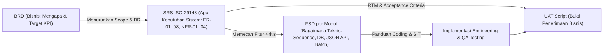

# Bab 12 — Dokumentasi Standar Industri: BRD, SRS, & FSD

> **Ringkasan Posisi Bab:** Di sepanjang Bab 01 hingga Bab 11, Anda telah menguasai cara menggali kebutuhan, menggambar diagram proses, merancang Use Case, layar UI, ERD, API, NFR, hingga Impact Analysis. Namun di perusahaan profesional, seluruh hasil pemikiran itu harus dibungkus dalam **dokumen spesifikasi resmi yang dapat diaudit, bebas tafsir ganda, dan siap ditandatangani (*sign-off*)**. Satu kalimat ambigu di dokumen kebutuhan bisa berubah menjadi kerugian ratusan juta rupiah dan pertengkaran panjang antara tim Bisnis, Engineering, dan QA.

---

## 1. Tujuan Belajar & Posisi di Alur Kerja SA

Setelah mempelajari bab ini, Anda diharapkan mampu:

1. Membedakan peran, audiens, tingkat kedalaman teknis, dan waktu penggunaan **BRD (*Business Requirements Document*)**, **SRS (*Software Requirements Specification*)**, dan **FSD/TDD (*Functional Specification Document / Technical Design Document*)**.
2. Memahami dan menerapkan struktur standar industri **ISO/IEC/IEEE 29148** dalam menyusun SRS menggunakan [`../templates/template-srs.md`](../templates/template-srs.md) dan menerjemahkan fitur rinci ke [`../templates/template-fsd.md`](../templates/template-fsd.md).
3. Menulis pernyataan requirement yang memenuhi **5 kriteria kualitas (*Atomic, Unambiguous, Complete, Verifiable, Traceable*)** serta mengeliminasi **daftar kata terlarang yang ambigu**.
4. Mengelola **Versioning Dokumen (`v0.1 -> v1.0 Baselined`)**, siklus *peer review*, dan mekanisme *Sign-Off* formal sebelum pengembangan atau UAT dijalankan.

Di dalam alur kerja SA, **Bab 12 adalah fase pengikatan kontrak tertulis**. Dokumen yang dihasilkan di bab ini menjadi sumber kebenaran tunggal (*Single Source of Truth*) bagi tim Engineering untuk membangun sistem dan bagi tim QA/Bisnis untuk memverifikasi kelulusan di **Bab 13 (UAT)**.

---

## 2. Konsep Inti & Mental Model

### 2.1 Peta Perbandingan: BRD vs SRS vs FSD/TDD

Analogi arsitektur bangunan sangat membantu membedakan ketiga dokumen ini:
- **BRD (*Mengapa & Apa Nilai Bisnisnya*):** Seperti **proposal bisnis pemilik gedung** (*"Saya butuh kedai kopi yang bisa melayani pesanan online dan kasir dalam satu stok agar kebocoran stok turun di bawah 0,5% dan antrean pagi lebih cepat"*). Pembacanya: Eksekutif, Product Owner, Finance, Operational Lead.
- **SRS (*Apa yang Harus Dilakukan Sistem Secara Formal*):** Seperti **spesifikasi syarat bangunan dan izin kelayakan teknis** (*"Sistem harus mereservasi stok selama 15 menit pada setiap checkout online dan mengeksekusi penolakan jika stok kurang"*). Pembacanya: System Analyst, Product Manager, QA Lead, Engineering Lead.
- **FSD / TDD (*Bagaimana Fitur Diterjemahkan ke Mekanisme Teknis*):** Seperti **cetak biru detail kelistrikan, pipa air, dan struktur kolom per lantai** (*"Endpoint `POST /api/v1/orders` mengunci baris `inventories` dengan `SELECT ... FOR UPDATE` dalam transaksi ACID dan mengembalikan `409 ERR_INSUFFICIENT_STOCK`"*). Pembacanya: Backend Engineer, Frontend Engineer, QA Automation, DBA.

| Aspek | BRD | SRS | FSD *(+ TDD oleh Tech Lead)* |
| :--- | :--- | :--- | :--- |
| **Fokus Utama** | Masalah bisnis, ROI, KPI, batasan scope bisnis. | Perilaku sistem fungsional (`FR`), terukur (`NFR`), antarmuka, dan aturan bisnis. | Rancangan detail per fitur/modul: *sequence flow*, skema kolom DB, kontrak JSON API, batch job. |
| **Bahasa** | Bahasa bisnis non-teknis. | Bahasa spesifikasi formal yang teruji (*"Sistem HARUS..."* + *Acceptance Criteria*). | Bahasa teknis sistem (HTTP status, tipe kolom, nama tabel, algoritma/query). |
| **Standar Acuan** | Praktik manajemen produk / BABOK. | **ISO/IEC/IEEE 29148**. | Standar arsitektur internal tim engineering / OpenAPI. |
| **Pemilik Dokumen** | BA / PM / SA bersama Sponsor Bisnis. | **System Analyst (SA)**. | **SA** (untuk FSD fungsional-teknis) & **Tech Lead** (untuk TDD infrastruktur/kode). |

> **Catatan Konteks Agile vs Enterprise:** Di startup Agile yang ramping, perusahaan sering tidak membuat 3 dokumen PDF tebal secara terpisah; mereka tetap memakai esensi **BRD** di *Product Brief*, **SRS** dalam bentuk *Epic + User Story + Acceptance Criteria Gherkin*, dan **FSD** di *Tech Spec / RFC* di Confluence/Notion. Namun di perusahaan perbankan, BUMN, telekomunikasi, maupun konsultan IT, ketiga dokumen formal ini wajib ada sebagai syarat audit dan *sign-off*.

### 2.2 Struktur Standar ISO/IEC/IEEE 29148 untuk SRS

Standar internasional **ISO/IEC/IEEE 29148** (*Systems and software engineering — Life cycle processes — Requirements engineering*) menetapkan kerangka agar tidak ada bagian sistem yang terlupakan:
1. **Pendahuluan (*Introduction*):** Tujuan dokumen, ruang lingkup (*in-scope* vs *out-of-scope*), definisi akronim (`TTL`, `Idempotency`, `RBAC`), serta dokumen referensi.
2. **Deskripsi Umum (*Overall Description*):** Posisi sistem di ekosistem perusahaan, ringkasan fungsi, kelas pengguna/aktor, batasan desain (*constraints* seperti UTC & `BIGINT` Rupiah), serta asumsi/dependensi.
3. **Requirement Spesifik (*Specific Requirements*):**
   - *Functional Requirements* (`FR-01..08`) lengkap dengan *Business Rules* dan *Acceptance Criteria*.
   - *Non-Functional Requirements* (`NFR-01..04`) dengan metrik angka dan cara verifikasi.
   - *External Interface Requirements* (UI Screens, API/Webhook, Hardware seperti printer thermal kasir).
4. **Supporting Models & Traceability:** Diagram proses, Use Case, State Machine, ERD, serta **Requirement Traceability Matrix (RTM)** yang mengaitkan `Business Objective -> FR -> UC -> Screen/API -> Entitas DB -> UAT`.

### 2.3 Lima Kriteria Requirement Berkualitas (*The 5 Quality Attributes*)

Setiap butir `FR` dan `NFR` yang ditulis SA wajib lolos pemeriksaan **5 kriteria berikut**:
1. **Atomic (Satu Fakta per Butir):** Jangan gabungkan 4 fitur berbeda (login, lihat menu, checkout, dan refund) ke dalam satu paragraf panjang. Pisahkan menjadi ID unik masing-masing (`FR-01`, `FR-02`, `FR-03`, `FR-07`).
2. **Unambiguous (Tunggal Tafsir):** Jika 3 programmer dan 2 QA membaca kalimat Anda, kelimanya harus memahaminya secara persis sama.
3. **Complete (Lengkap dengan Kasus Gagal):** Tidak hanya menjelaskan *happy path*, tetapi juga menjelaskan kondisi batas dan apa yang terjadi jika gagal (misal kode error `ERR_INSUFFICIENT_STOCK`).
4. **Verifiable (Dapat Diuji):** Memiliki kondisi awal, aksi, dan keluaran nyata yang dapat dibuktikan oleh QA melalui *test case* (ideal menggunakan format **Gherkin `Given-When-Then`**).
5. **Traceable (Terlacak):** Memiliki ID unik (`FR-03`) yang tertaut ke hulu (tujuan bisnis di BRD) dan ke hilir (API, tabel DB, dan `UAT-XX`).

---

## 3. Standar Industri & Aturan Praktis

### 3.1 Daftar Kata Terlarang (*Ambiguous Weasel Words*) & Cara Memperbaikinya

ISO/IEC/IEEE 29148 dan praktik rekayasa kebutuhan melarang keras penggunaan kata-kata kabur berikut tanpa ukuran atau definisi eksplisit di dalam SRS/FSD:

| Kata / Frasa Terlarang | Mengapa Berbahaya? | Contoh Perbaikan Profesional (*NusaPOS & OrderHub*) |
| :--- | :--- | :--- |
| **"Cepat" / "Instan" / "Real-time" tanpa angka** | Bagi bisnis "cepat" berarti `200 ms`, bagi programmer bisa berarti `3 detik`. | *"Endpoint `POST /api/v1/orders` **HARUS** merespons dengan latensi `p95 <= 500 ms` pada beban `150 RPS` (`NFR-01`)."* |
| **"Mudah" / "User-friendly" / "Intuitif"** | Subjektif; tidak bisa dibuat skrip uji lulus/gagal oleh QA. | *"Alur checkout `SCR-ORD-002` **HARUS** dapat diselesaikan pelanggan dalam maksimal 3 langkah setelah keranjang terisi, dengan pesan error validasi spesifik per field."* |
| **"Dll." / "Disesuaikan" / "Dan sebagainya"** | Membuka celah tak terbatas saat UAT (*"Lho, kan di SRS tulisannya 'pembayaran QRIS, VA, dll', berarti kartu kredit juga masuk dong!"*). | Sebutkan daftar tertutup (*closed list*): *"Metode pembayaran yang didukung pada Fase 1 terbatas pada **`CASH` (khusus `POS`), `QRIS`, dan `VA`**."* |
| **"Secara otomatis tanpa syarat" / "Selalu berhasil"** | Mengabaikan kegagalan jaringan, stok habis, atau batas waktu TTL. | *"Scheduler **HARUS** mengubah status pesanan `PENDING_PAYMENT` menjadi `EXPIRED` apabila `expires_at <= NOW() UTC`, kecuali pembayaran `PAID` telah lebih dulu terverifikasi."* |
| **"Aman" / "Fleksibel" / "Cukup"** | Tidak menentukan kontrol keamanan atau batas fleksibilitas yang jelas. | *"Endpoint `POST /api/v1/orders/{orderId}/refunds` **HARUS** menolak permintaan persetujuan dari selain `Branch Manager` pada `store_id` terkait dengan `403 ERR_UNAUTHORIZED_APPROVAL`."* |

### 3.2 Versioning Dokumen, Review Cycle, & Sign-Off Formal

Dokumen spesifikasi bukanlah catatan pribadi; ia memiliki siklus hidup versi yang disiplin:

| Status & Versi | Arti Operasional | Siapa yang Berwenang Mengubah? |
| :--- | :--- | :--- |
| `v0.1` – `v0.9` (`Draft`) | Dokumen sedang disusun SA melalui wawancara dan klarifikasi tim teknis. Belum boleh dijadikan dasar coding final. | System Analyst |
| `v0.9x` (`In Review`) | Dibagikan dalam rapat *SRS/FSD Walkthrough* ke Product Manager, Tech Lead, UI/UX, dan QA Lead untuk mencari celah logika dan error handling. | SA mencatat revisi hasil review |
| **`v1.0` (`Baselined / Approved`)** | Seluruh pemangku kepentingan utama menandatangani (*Sign-Off*). Kontrak resmi dimulai! | PM, Tech Lead, QA Lead, Business Owner |
| **`v1.1` / `v2.0` (Pasca-Baseline)** | **Tidak boleh diedit diam-diam!** Setiap perubahan setelah `v1.0 Baselined` wajib melalui **Change Request (Bab 11)** dan dicatat di tabel *Revision History*. | Melalui persetujuan CR / CAB |

---

## 4. Praktik Studi Kasus *NusaPOS & OrderHub*

### 4.1 Alur Dokumentasi End-to-End (BRD -> SRS -> FSD -> UAT)



### 4.2 Contoh Nyata Penulisan Standar ISO/IEC/IEEE 29148 (`FR-03` & `FR-07`)

Berikut contoh bagaimana teks dari [`../templates/template-srs.md`](../templates/template-srs.md) diisi dengan standar produksi *NusaPOS & OrderHub* yang anti-ambigu:

#### Contoh 1 — `FR-03`: Pembuatan Pesanan POS & Online Self-Pickup dengan Validasi/Reservasi Stok
- **Referensi Bisnis / Use Case:** `BR-01`, `UC-02`, `UC-03`
- **Prioritas (MoSCoW):** Must Have
- **Aktor Terlibat:** `Customer` (kanal `ONLINE_PICKUP`), `Cashier` (kanal `POS`)
- **Deskripsi Kebutuhan:**
  Sistem **HARUS** memvalidasi ketersediaan stok cabang (`inventories.on_hand_qty - inventories.reserved_qty`) di dalam transaksi basis data atomik setiap kali `POST /api/v1/orders` dipanggil, menghitung ulang seluruh nilai finansial di server dalam bilangan bulat Rupiah (`BIGINT`) dengan pembulatan `HALF_UP`, serta membuat reservasi stok selama **15 menit** (`expires_at = created_at + 15 menit` UTC) untuk metode pembayaran non-tunai (`QRIS`/`VA`) atau memotong stok seketika untuk pembayaran tunai (`CASH`) di kasir `POS`.
- **Aturan Bisnis (*Business Rules*):**
  1. `BR-03.1`: Jika `channel = 'ONLINE_PICKUP'`, sistem hanya boleh menerima metode bayar `QRIS` atau `VA` (menolak `CASH`).
  2. `BR-03.2`: Harga satuan (`unit_price_snapshot`) dan nama varian wajib diambil dari `product_variants` saat transaksi dibuat, mengabaikan angka harga apa pun yang mungkin dikirim oleh klien.
  3. `BR-03.3`: Jika salah satu item dalam pesanan memiliki `available_qty < requested_qty`, sistem wajib melakukan `ROLLBACK` penuh seluruh item dan mengembalikan `409 Conflict` (`ERR_INSUFFICIENT_STOCK`).
- **Acceptance Criteria (Gherkin):**
  ```gherkin
  Given stok VAR-001 di cabang STR-001 memiliki on_hand_qty = 10 dan reserved_qty = 2
  When Customer mengirim POST /api/v1/orders untuk VAR-001 sebanyak qty = 3 dengan channel ONLINE_PICKUP dan payment_method QRIS
  Then sistem mengembalikan HTTP 201 Created dengan status order PENDING_PAYMENT
  And reserved_qty pada inventories berubah menjadi 5
  And tercatat 1 baris mutasi RESERVE sebesar 3 pada inventory_movements
  And expires_at bernilai tepat 15 menit setelah created_at dalam UTC
  ```

#### Contoh 2 — Mengisi Cuplikan `FSD-ORD-001` (Jembatan ke Tim Teknis)

Jika `SRS` mengunci aturan `"Sistem HARUS menolak refund tanpa approval Branch Manager"`, maka di [`../templates/template-fsd.md`](../templates/template-fsd.md) SA merincikannya ke level eksekusi teknis untuk `FR-07` (`SCR-REF-001`):
- **Endpoint & Method:** `POST /api/v1/orders/{orderId}/refunds`
- **Validasi Server Wajib:**
  1. Verifikasi `jwt.role = 'Branch Manager'` dan `jwt.store_id = orders.store_id` saat `action = 'APPROVE'` atau `'REJECT'`. Jika melanggar, catat ke `audit_logs` (`action = 'UNAUTHORIZED_REFUND_APPROVAL'`) dan balas `403 ERR_UNAUTHORIZED_APPROVAL`.
  2. Verifikasi `orders.status IN ('PAID', 'PREPARING', 'READY', 'COMPLETED')`. Jika status adalah `PENDING_PAYMENT`, `CANCELLED`, `EXPIRED`, atau `REFUNDED`, tolak dengan `422 ERR_INVALID_STATE_TRANSITION`.
  3. Jika `restock_items = true`, tambahkan `inventories.on_hand_qty` dan tulis baris `REFUND_RETURN` ke `inventory_movements` di dalam satu transaksi atomik yang sama dengan pembaruan `refunds.status` dan `orders.status = 'REFUNDED'`.

### 4.3 Cuplikan Requirement Traceability Matrix (RTM) Lintas Dokumen

| BR / Obj Bisnis | SRS ID | Use Case | Layar UI & Endpoint API | Entitas Database | Target UAT |
| :--- | :--- | :--- | :--- | :--- | :--- |
| `BR-01` (Kendali Stok) | `FR-03`, `NFR-02` | `UC-02`, `UC-03` | `SCR-ORD-002`, `POST /api/v1/orders` | `orders`, `order_items`, `inventories`, `inventory_movements` | `UAT-02`, `UAT-03` |
| `BR-02` (Bayar QRIS Aman) | `FR-04`, `NFR-02` | `UC-04` | `SCR-ORD-003`, `POST /api/v1/webhooks/payments/qris` | `payments`, `orders`, `inventories`, `inventory_movements` | `UAT-04` |
| `BR-03` (Kendali Refund) | `FR-07`, `NFR-03` | `UC-06` | `SCR-REF-001`, `POST /api/v1/orders/{orderId}/refunds` | `refunds`, `orders`, `audit_logs`, `inventories` | `UAT-05` |
| `BR-04` (Akurasi Buku) | `FR-08`, `NFR-04` | `UC-06` | `SCR-REC-001`, `GET/POST /api/v1/reconciliations/daily` | `daily_reconciliations`, `orders`, `payments`, `refunds` | `UAT-06` |

---

## 5. Jebakan Umum (*Anti-Patterns*) Junior SA

1. **Mencampuradukkan Bahasa Bisnis dan Detail Implementasi Kode di BRD:** Menulis *"Gunakan PostgreSQL 16 dan Redis cluster"* di dalam BRD membuat pemilik bisnis bingung dan menutup ruang bagi *Tech Lead* memilih teknologi terbaik. Biarkan BRD fokus pada target bisnis, SRS fokus pada kontrak perilaku sistem, dan FSD/TDD pada rancangan teknis.
2. **Menulis Kalimat Requirement Penuh Kata Kabur:** Menulis *"Kasir bisa membatalkan pesanan dengan cepat dan mudah, dll."* adalah undangan terbuka bagi sengketa saat UAT. Pastikan setiap requirement bebas kata terlarang.
3. **Mengedit Dokumen `v1.0 Baselined` Secara Diam-Diam Setelah Sprint Berjalan:** Mengubah aturan diskon atau timeout di Google Docs tanpa mengubah nomor versi (`v1.1`) dan tanpa memberi tahu QA/Dev melalui mekanisme CR membuat tim membangun dan menguji dua spesifikasi yang berbeda.
4. **Requirement Yatim Piatu (*Orphan Requirements*) di RTM:** Ada fitur di FSD (misalnya halaman statistik tambahan) yang tidak terhubung ke `FR` mana pun di SRS dan tidak punya tujuan bisnis di BRD, atau ada `FR` di SRS yang tidak memiliki skenario uji di UAT.

---

## 6. Checklist Verifikasi Mandiri

Pastikan setiap butir di bawah ini terjawab **"Ya"** sebelum melangkah ke Bab 13:

- [ ] Saya memahami batas peran BRD (bisnis), SRS (kebutuhan formal sistem ISO/IEC/IEEE 29148), dan FSD (spesifikasi teknis rinci per modul).
- [ ] Seluruh pernyataan requirement yang saya tulis memenuhi 5 kriteria (**Atomic, Unambiguous, Complete, Verifiable, Traceable**) dan bebas dari kata-kata terlarang (*cepat, mudah, user-friendly, dll, secara otomatis tanpa syarat*).
- [ ] Setiap `FR` memiliki aturan bisnis eksplisit, penanganan kasus gagal (kode error standar), serta *Acceptance Criteria* dalam format **Gherkin (`Given-When-Then`)**.
- [ ] Dokumen memiliki tabel Kontrol Dokumen (*versi, status Draft/In Review/Baselined*), histori revisi, RTM yang utuh, serta daftar penanda tangan *sign-off* resmi.

---

## 7. Latihan Praktik

Kerjakan keempat skenario berikut menggunakan [`../templates/template-srs.md`](../templates/template-srs.md) dan [`../templates/template-fsd.md`](../templates/template-fsd.md), lalu periksa pembahasan lengkapnya di [`../kunci-latihan/kunci-bab-09-13.md`](../kunci-latihan/kunci-bab-09-13.md).

1. **Skenario 1 (Menyunting & Membersihkan Requirement Ambigu):** Berikut adalah draf paragraf SRS yang ditulis oleh seorang intern untuk modul *NusaPOS & OrderHub*:
   > *"FR-X: Sistem harus user-friendly saat pelanggan memesan kopi secara online dan memproses pembayaran QRIS secara otomatis tanpa syarat agar terasa sangat cepat, lalu jika ada masalah pembatalan, refund, dll, kasir bisa menanganinya dengan mudah."*
   Identifikasi seluruh kata/frasa terlarang dan pelanggaran prinsip *Atomic/Complete/Verifiable* pada kalimat di atas, lalu pecah dan tulis ulang menjadi pernyataan `FR` kanonik yang benar sesuai standar ISO/IEC/IEEE 29148.
2. **Skenario 2 (Menentukan Dokumen yang Tepat — BRD vs SRS vs FSD):** Untuk 4 situasi kerja berikut, tentukan dokumen mana yang harus dibuka atau dibuat SA (BRD, SRS, atau FSD) beserta alasannya:
   - (a) *Backend Engineer* bertanya: *"Untuk `POST /api/v1/orders`, apakah field promo bernama `promo_code` atau `voucher_id`, dan apa tipe data serta panjang maksimal `notes`?"*
   - (b) *Direktur Operasional* bertanya: *"Mengapa perusahaan harus berinvestasi membangun sistem baru, berapa target pengurangan selisih kasir harian, dan modul apa yang dikecualikan dari Fase 1?"*
   - (c) *QA Lead* bertanya: *"Saya butuh daftar seluruh Acceptance Criteria Gherkin untuk `FR-06` (pembatalan & `EXPIRED`) dan target angka performa `NFR-01` agar bisa menyusun rencana pengujian."*
   - (d) *Finance Lead* ingin melakukan *sign-off* sebelum proyek masuk ke fase pemrograman untuk memastikan aturan pembulatan pajak dan pembatasan akses void/refund sudah terkunci formal.
3. **Skenario 3 (Menulis Spesifikasi Lengkap `FR-06` dalam Format ISO/IEC/IEEE 29148):** Tuliskan spesifikasi lengkap untuk **`FR-06` (Pembatalan Pra-Bayar & Pelepasan Otomatis Reservasi Kedaluwarsa `EXPIRED`)** mengikuti struktur template SRS (`Referensi UC`, `Prioritas`, `Deskripsi Kebutuhan`, minimal `3 Business Rules`, dan minimal `2 skenario Acceptance Criteria Gherkin` — jalur batal manual `CANCELLED` dan jalur kedaluwarsa `EXPIRED` + penolakan jika sudah `PAID`).
4. **Skenario 4 (Audit RTM & Versioning Control):** Saat rapat *SRS Walkthrough* menuju `v1.0 Baselined`, ditemukan dua hal:
   - (a) Di FSD muncul tabel tambahan baru yang tidak ada di `FR-01..08` maupun di daftar 14 entitas kanonik.
   - (b) Di RTM, baris `FR-05` (`UC-05` antrean dapur `Kitchen/Barista`) belum memiliki kolom *Endpoint API* dan belum memiliki ID skenario *UAT*.
   Jelaskan tindakan perbaikan yang harus diambil SA untuk (a) dan (b) sebelum meminta tanda tangan *sign-off*.

---

**Langkah Berikutnya:** Dokumen kontrak spesifikasi Anda telah sah ditandatangani (`Baselined`) dan tim Engineering telah selesai membangunnya. Kini lanjutkan ke [**Bab 13 — UAT, Testing Collaboration, & Handover**](13-uat-testing-handover.md) untuk mengawal kualitas pengujian, menyusun skenario uji batas, memandu *User Acceptance Testing* bersama user bisnis, hingga serah terima produksi yang mulus.
