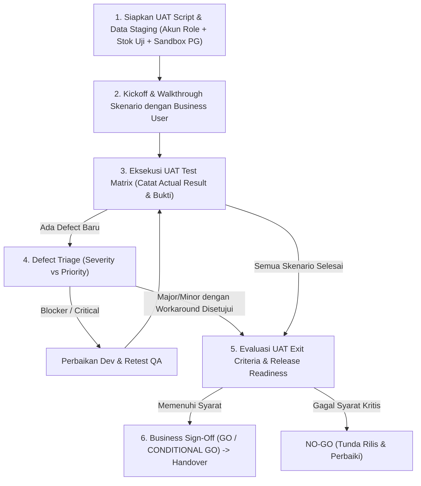

# Bab 13 — UAT, Testing Collaboration, & Handover

> **Ringkasan Posisi Bab:** Banyak Junior SA mengira pekerjaannya selesai begitu dokumen `SRS/FSD` selesai ditulis dan diserahkan ke developer. Padahal, momen paling menentukan reputasi seorang SA justru terjadi di ujung siklus SDLC: **saat mengawal pengujian, memimpin *User Acceptance Testing (UAT)* bersama pemilik bisnis, memutus status rilis (*Go / No-Go*), hingga menyerahkan sistem ke tim Operasional tanpa kepanikan di hari pertama *Go-Live***.

---

## 1. Tujuan Belajar & Posisi di Alur Kerja SA

Setelah mempelajari bab ini, Anda diharapkan mampu:

1. Menjelaskan pembagian peran strategis dalam **kolaborasi SA–QA–Business User** mulai dari tahap *SIT (System Integration Testing)* hingga *UAT (User Acceptance Testing)*.
2. Membedakan **Test Scenario** dan **Test Case**, serta merancang skenario uji batas presisi menggunakan teknik **Equivalence Partitioning (EP)** dan **Boundary Value Analysis (BVA)** (termasuk contoh nyata batas TTL reservasi 15 menit dan batas nominal/stok).
3. Menyusun dan memandu eksekusi **UAT Script & Business Sign-Off** secara terstruktur menggunakan [`../templates/template-uat.md`](../templates/template-uat.md).
4. Memimpin rapat **Defect Triage** dengan membedakan **Severity** vs **Priority** secara objektif, mengawal **Go/No-Go Release Readiness Checklist**, melakukan **Handover ke Tim Operasional/Support**, dan mengevaluasi hasil rilis melalui **Post-Implementation Review (PIR)**.

Di dalam alur kerja SA, **Bab 13 adalah garis finis sekaligus pembuktian akhir dari RTM (*Requirement Traceability Matrix*)**: setiap `FR` dan `NFR` yang dijanjikan di Bab 03–12 wajib terbukti berjalan nyata sebelum sistem dibuka ke pelanggan.

---

## 2. Konsep Inti & Mental Model

### 2.1 Kolaborasi SA vs QA: Berbeda Kacamata, Satu Tujuan

Mengapa QA tetap membutuhkan SA, padahal QA juga membaca dokumen `SRS`?
- **Fokus QA (*Technical & System Verification — SIT*):** Menguji apakah kode bebas *bug*, *API contract* sesuai JSON, *error handling* konsisten, *load test* `NFR-01` lulus 150 RPS, dan keamanan `NFR-03` rapat (*"Are we building the system right?"*).
- **Fokus SA & User Bisnis (*Business Validation — UAT*):** Memastikan sistem benar-benar menyelesaikan masalah operasional sehari-hari kasir, dapur, dan akuntansi (*"Are we building the right system?"*). SA bertindak sebagai **penerjemah dan fasilitator**: membantu QA memahami kasus tepi bisnis (*edge cases*), dan membantu *Business User* (Operational Lead, Finance Lead, Branch Manager) mengeksekusi UAT di lingkungan *Staging* tanpa bingung oleh istilah teknis.

### 2.2 *Test Scenario* vs *Test Case*

- **Test Scenario** adalah **judul garis besar perilaku apa yang ingin dibuktikan** (level bisnis/use case). Contoh: *"Uji validasi batas waktu reservasi stok 15 menit saat pembayaran QRIS."*
- **Test Case** adalah **resep langkah demi langkah yang rinci**, lengkap dengan prasyarat akun, data uji eksak, langkah klik/API, serta *expected result* yang terukur. Satu *Test Scenario* umumnya dipecah menjadi beberapa *Test Case* (jalur normal, jalur batas, dan jalur gagal).

### 2.3 Equivalence Partitioning (EP) & Boundary Value Analysis (BVA)

Menguji sistem secara acak (*"coba masukin angka 5, terus 8"*) membuang waktu dan sering melewatkan bug tersembunyi pada operator `<` vs `<=`!

1. **Equivalence Partitioning (EP):** Memecah seluruh kemungkinan input ke dalam **kelompok/partisi** yang perilakunya diharapkan seragam—cukup pilih 1 sampel per partisi:
   - Contoh kuantitas item (`qty`) di `POST /api/v1/orders` ketika `available_qty = 10`:
     - Partisi Tidak Valid Bawah: `qty <= 0` (misal `0` atau `-1`) -> ditolak `400 Bad Request`.
     - Partisi Valid: `1 <= qty <= 10` (misal `5`) -> diterima `201 Created`.
     - Partisi Tidak Valid Atas (Melebihi Stok): `qty > 10` (misal `15`) -> ditolak `409 ERR_INSUFFICIENT_STOCK`.
2. **Boundary Value Analysis (BVA):** Bug paling sering bersembunyi tepat di **garis perbatasan** (*edge*). BVA menguji titik tepat di batas bawah, tepat di dalam batas, tepat di batas atas, dan 1 unit di luar batas:
   - **Contoh Nyata 1 — Batas TTL Reservasi Stok 15 Menit (`FR-06`):**
     Misal `ORD-001` dibuat pada `10:00:00Z` dengan `expires_at = 10:15:00Z`. Jangan hanya menguji menit ke-2 dan menit ke-30! Uji 3 titik batas kritis:
     - `10:14:59Z` (1 detik sebelum habis) -> Webhook `PAID` **wajib berhasil** (`200 OK`, status menjadi `PAID`).
     - `10:15:00Z` (tepat di titik batas `expires_at <= NOW()`) -> Scheduler berhak menandai `EXPIRED`; jika webhook datang setelahnya, wajib ditolak `ERR_RESERVATION_EXPIRED`.
     - `10:15:01Z` (1 detik setelah habis) -> Status order sudah `EXPIRED`, `reserved_qty` sudah dilepas (`RELEASE`), pembayaran terlambat tidak boleh memotong stok.
   - **Contoh Nyata 2 — Batas Nominal & Alasan Void/Refund (`FR-07` & `SCR-REF-001`):**
     Jika `orders.total_amount = Rp 79.920` dan catatan alasan wajib `10–250 karakter`:
     - Uji panjang catatan `9 karakter` (ditolak validasi form), `10 karakter` (diterima), `250 karakter` (diterima), `251 karakter` (ditolak).
     - Uji status order di perbatasan transisi: `PENDING_PAYMENT` (harus ditolak `422 ERR_INVALID_STATE_TRANSITION` karena belum bayar), `PAID` (diterima), `COMPLETED` (diterima via alur komplain), `REFUNDED` (ditolak `422` agar tidak terjadi refund dua kali!).

### 2.4 Defect Triage: Membedakan *Severity* vs *Priority*

Saat UAT berlangsung, tidak semua temuan cacat (*defect*) harus menunda *Go-Live*. SA bersama QA Lead dan PM memimpin **Defect Triage** dengan membedakan dua sumbu yang sering tertukar:

| Dimensi | Makna | Contoh Konkret di *NusaPOS & OrderHub* |
| :--- | :--- | :--- |
| **Severity (Keparahan Teknis/Bisnis)** | Seberapa besar kerusakan fungsi atau keuangan yang ditimbulkan cacat tersebut. (`Blocker`, `Critical`, `Major`, `Minor`) | Stok bisa terpotong menjadi negatif saat race condition (`Blocker`), atau typo kata *"Kopi"* menjadi *"Kpoi"* di halaman Bantuan (`Minor`). |
| **Priority (Urutan Penanganan)** | Seberapa cepat tim harus memperbaikinya sebelum/sesudah rilis. (`P1 Urgent`, `P2 High`, `P3 Medium`, `P4 Low`) | Logo perusahaan di pojok struk salah warna atau salah tulis nama PT resmi (*Severity Minor* secara fungsi, tetapi **`Priority P1`** menjelang peluncuran nasional!). Sebaliknya, bug di fitur ekspor laporan khusus akhir tahun yang baru dipakai 6 bulan lagi bisa berstatus *Severity Major* namun *Priority P3*. |

---

## 3. Standar Industri & Aturan Praktis

### 3.1 Alur Eksekusi UAT & *Exit Criteria*

Mengacu [`../templates/template-uat.md`](../templates/template-uat.md), **syarat mutlak kelulusan UAT (*Exit Criteria*)** adalah:
1. **`100%` skenario Critical / Must Have** (pembayaran `POS`/`ONLINE_PICKUP`, pemotongan/pelepasan stok, approval refund, dan rekonsiliasi harian) berstatus `PASS`.
2. **Nol (`0`) Open Defect** dengan tingkat keparahan **Blocker** maupun **Critical**.
3. Setiap cacat **Major/Minor** yang ditunda perbaikannya pasca-rilis wajib memiliki *workaround* operasional tertulis dan persetujuan eksplisit dari *Business Owner*.

### 3.2 Go/No-Go Release Readiness, Handover Ops, & PIR

Setelah UAT lulus, SA memverifikasi **4 pilar kesiapan rilis**:
1. **Kesiapan Teknis & Data:** Skrip migrasi database sudah diuji di Staging, konfigurasi *timezone* UTC & secret HMAC produksi terpasang, serta skenario *rollback* (Bab 11) siap dijalankan.
2. **Kesiapan Monitoring & Alerting:** Dashboard *error rate 5xx*, *latency p95* (`NFR-01`), dan alert ketidakcocokan webhook pembayaran aktif.
3. **Handover ke Tim Operasional / L1–L2 Support:** Serahkan **Runbook Operasional** berisi cara membaca kode error kanonik (`ERR_INSUFFICIENT_STOCK`, `ERR_UNAUTHORIZED_APPROVAL`), SOP penanganan *late payment webhook* (`ERR_RESERVATION_EXPIRED`), dan panduan eskalasi ke tim Engineering jika terjadi insiden.
4. **Post-Implementation Review (PIR):** Dilaksanakan 1–2 minggu setelah *Go-Live* untuk membandingkan KPI awal di BRD vs realita di produksi, mengevaluasi jumlah insiden/tiket support, serta mencatat pelajaran berharga (*lessons learned*) bagi rilis fase berikutnya.

---

## 4. Praktik Studi Kasus *NusaPOS & OrderHub*

### 4.1 Contoh Rancangan UAT Test Execution Matrix (`UAT-01` s.d. `UAT-06`)

Tabel berikut menunjukkan penerapan langsung [`../templates/template-uat.md`](../templates/template-uat.md) untuk memvalidasi seluruh alur Fase 1 *NusaPOS & OrderHub* (8 status kanonik: `PENDING_PAYMENT`, `PAID`, `PREPARING`, `READY`, `COMPLETED`, `CANCELLED`, `EXPIRED`, `REFUNDED`):

| UAT ID | Ref FR / UC | Teknik Uji | Skenario & Data Uji (`STR-001`) | Langkah Eksekusi Singkat | Expected Result (Harus Terbukti di UI, API, & DB) |
| :--- | :--- | :--- | :--- | :--- | :--- |
| `UAT-01` | `FR-01`, `NFR-03` / `UC-01` | EP (Role Valid vs Invalid) | Login & batasan RBAC lintas cabang (`cashier_01` di `STR-001`). | 1. Login `cashier_01` (`POST /api/v1/auth/login`). 2. Akses halaman `SCR-REF-001` & coba setujui refund via API, serta coba akses rekon `STR-002`. | Login sukses; aksi approval & akses lintas `store_id` ditolak `403 ERR_UNAUTHORIZED_APPROVAL`; percobaan ilegal tercatat di `audit_logs`. |
| `UAT-02` | `FR-03`, `FR-06` / `UC-03` | BVA (Stok & TTL 15m) | Checkout online `VAR-001` (`on_hand=10`, `reserved=0`) qty `2`, lalu biarkan melewati TTL 15 menit. | 1. Login `cust_01`, checkout `VAR-001` qty `2` di `SCR-ORD-002` (`QRIS`). 2. Tunggu hingga melewati `expires_at` (`15m`). | Awalnya `201 Created`, `orders.status = PENDING_PAYMENT`, `reserved_qty = 2` (`RESERVE`). Setelah TTL lewat, scheduler mengubah ke `EXPIRED` & melepas `reserved_qty = 0` (`RELEASE`). |
| `UAT-03` | `FR-03`, `NFR-02` / `UC-02`, `UC-03` | BVA (Stok Batas `1`) | Uji batas stok (`VAR-002`, `available=1`): pesan `1` vs pesan `2`. | 1. Coba checkout `VAR-002` qty `2`. 2. Ubah qty menjadi `1` dan submit ulang (atau simulasi klik bersamaan kasir vs online). | Qty `2` ditolak `409 ERR_INSUFFICIENT_STOCK` (`available_qty = 1`). Pada persaingan paralel, hanya 1 transaksi berhasil dan stok akhir `>= 0` (`0% oversell`). |
| `UAT-04` | `FR-04`, `FR-05` / `UC-04`, `UC-05` | EP + Idempotency | Bayar QRIS sukses + replay webhook + alur dapur ke `COMPLETED`. | 1. Simulasikan callback QRIS valid dengan `external_tx_id = TX-UAT-04`. 2. Kirim ulang webhook identik 1x. 3. `barista_01` ubah `PAID -> PREPARING -> READY`, lalu `cashier_01` selesaikan ke `COMPLETED`. | Webhook pertama mengubah ke `PAID`, memotong `on_hand_qty` (`DEDUCT`), memicu `Notification Service`. Webhook kedua membalas `200 OK` tanpa potong stok ulang. Alur dapur sukses hingga `COMPLETED`. |
| `UAT-05` | `FR-07` / `UC-06` | BVA (Status & Approval) | Pengajuan refund oleh `cashier_01` & approval `mgr_01` pada `SCR-REF-001`. | 1. `cashier_01` ajukan refund order `PAID` (`restock_items = true`, alasan `>= 10` karakter). 2. `mgr_01` masukkan PIN & klik Setujui. | `orders.status` menjadi `REFUNDED`, record `refunds` berstatus `COMPLETED` dengan `approved_by = mgr_01`, mutasi `REFUND_RETURN` tercatat, dan `audit_logs` terekam. |
| `UAT-06` | `FR-08`, `NFR-04` / `UC-06` | BVA (Cut-off Waktu & `HALF_UP`) | Tutup buku harian `SCR-REC-001` pada hari bisnis `Asia/Jakarta` dengan transaksi pukul `23:55 WIB` vs `00:05 WIB`. | 1. Buat transaksi `23:55 WIB` (`16:55Z`) dan `00:05 WIB` (`17:05Z`). 2. `mgr_01` buka rekon tanggal hari pertama (`POST /api/v1/reconciliations/daily`). | Hanya transaksi `23:55 WIB` yang masuk hitungan hari pertama; total tunai/QRIS/refund cocok 100% tanpa selisih pembulatan dan terkirim ke `Accounting/ERP`. |

### 4.2 Contoh Defect Log & Keputusan Triage

| Defect ID | Ref UAT | Severity | Priority | Deskripsi Temuan saat UAT | Keputusan Triage SA & PM |
| :--- | :---: | :---: | :---: | :--- | :--- |
| `DEF-01` | `UAT-06` | **Critical** | **P1 (Wajib Fix Sebelum Go-Live)** | Timestamp pada struk cetak & filter `SCR-REC-001` masih memakai tanggal UTC mentah, sehingga transaksi pukul `06:15 WIB` masuk ke hari kemarin. | **Blocker Finansial.** Wajib diperbaiki Backend/FE dan di-retest ulang sebelum keputusan `GO`. |
| `DEF-02` | `UAT-04` | **Minor** | **P3 (Post-Go-Live Patch)** | Pesan toast notifikasi sukses di layar kasir muncul selama 1,5 detik (terlalu singkat, meski status order di daftar sudah berubah ke `COMPLETED`). | Disetujui **Conditional Go** dengan catatan *Known Issue*: tidak menghambat transaksi/keuangan; dijadwalkan perbaikan ke *patch v1.0.1*. |

### 4.3 Daftar Periksa Handover Operasional (*Support Runbook Ringkas*)

Sebelum menutup proyek Fase 1 dan menyerahkannya ke tim Operasional Cabang & Support IT:
1. **Buku Saku Kode Error untuk CS/Support:** Jika cabang melapor *"Kasir tidak bisa menyelesaikan transaksi kopi karena stok tiba-tiba habis"*, Support tahu bahwa itu perilaku normal `ERR_INSUFFICIENT_STOCK` (bukan bug mati) dan mengarahkan `Branch Manager` mengecek mutasi di `inventory_movements` atau pesanan `PENDING_PAYMENT` yang menahan `reserved_qty`.
2. **SOP Eskalasi Late Payment (`ERR_RESERVATION_EXPIRED`):** Jika pelanggan mengaku saldo e-wallet terpotong tepat di detik setelah timer 15 menit habis (`EXPIRED`), tim Support memeriksa flag rekonsiliasi pada tabel `payments`/`audit_logs` dan memproses pengembalian dana sesuai SOP Finance.
3. **Jadwal PIR (Post-Implementation Review):** Ditetapkan 14 hari pasca-*Go-Live* bersama Operational Lead, Finance Lead, Tech Lead, QA Lead, dan SA.

---

## 5. Jebakan Umum (*Anti-Patterns*) Junior SA

1. **Membiarkan Developer Menguji Kode Sendiri sebagai Pengganti UAT:** Pengembang cenderung menguji hanya jalur yang ia tahu bekerja (*happy path*), sedangkan user bisnis menekan tombol di luar urutan yang terduga. UAT wajib dieksekusi atau diverifikasi langsung oleh perwakilan bisnis (`Operational` & `Finance Lead`).
2. **Tidak Menyiapkan Data Uji (*Test Data*) Sebelum Sesi UAT:** Mengundang manajer operasional ke ruang rapat UAT, lalu menghabiskan 45 menit pertama hanya untuk membuat akun kasir dan mengisi stok produk di Staging. Seluruh akun peran (`cashier_01`, `barista_01`, `mgr_01`, `cust_01`) dan stok batas (`VAR-002 = 1`) harus sudah siap sebelum UAT dimulai.
3. **Menganggap Semua Bug Harus Menggagalkan Rilis (*Zero-Defect Obsession*) atau Sebaliknya Meloloskan Bug Finansial:** Menunda peluncuran hanya karena salah spasi di teks footer adalah tidak efisien, sebaliknya meloloskan bug konversi zona waktu `Asia/Jakarta` di laporan rekonsiliasi adalah bencana akuntansi. Gunakan matriks *Severity vs Priority* secara rasional.
4. **Menghilang Begitu *Go-Live* Tanpa Handover & PIR:** Ketika rilis selesai tetapi tim Customer Support tidak tahu cara membaca error code dan tidak ada sesi PIR, masalah kecil di minggu pertama akan menumpuk menjadi krisis kepercayaan dari tim bisnis.

---

## 6. Checklist Verifikasi Mandiri

Pastikan setiap butir di bawah ini terjawab **"Ya"** sebelum melangkah ke Bab 14 (Proyek Capstone):

- [ ] Saya dapat menyusun skenario uji terstruktur menggunakan teknik **Equivalence Partitioning** dan **Boundary Value Analysis** (terutama batas stok, TTL 15 menit, dan batas tanggal bisnis WIB/UTC).
- [ ] Dokumen UAT yang saya buat menggunakan [`../templates/template-uat.md`](../templates/template-uat.md) lengkap dengan prasyarat data uji, *Exit Criteria*, langkah eksekusi terukur, dan lembar *Sign-Off* bisnis.
- [ ] Saya mampu memfasilitasi **Defect Triage** dengan membedakan *Severity* dan *Priority* secara tepat untuk rekomendasi **GO / CONDITIONAL GO / NO-GO**.
- [ ] Saya telah menyusun paket **Handover Operasional** (Runbook kode error, kontak eskalasi) dan menjadwalkan **Post-Implementation Review (PIR)**.

---

## 7. Latihan Praktik

Kerjakan keempat skenario berikut menggunakan [`../templates/template-uat.md`](../templates/template-uat.md), lalu periksa pembahasan lengkapnya di [`../kunci-latihan/kunci-bab-09-13.md`](../kunci-latihan/kunci-bab-09-13.md).

1. **Skenario 1 (Merancang Test Cases dengan EP & BVA):** Untuk dua aturan bisnis di *NusaPOS & OrderHub* berikut, rancanglah daftar nilai uji **Boundary Value Analysis (BVA)** dan **Equivalence Partitioning (EP)** beserta *Expected Result* masing-masing:
   - (a) Batas waktu reservasi stok **TTL 15 menit** (`created_at = 2026-11-25T03:00:00Z`, `expires_at = 2026-11-25T03:15:00Z`) saat webhook pembayaran `SETTLED` masuk.
   - (b) Validasi input **Catatan Tambahan Void/Refund (`FLD-R02` di `SCR-REF-001`)** yang mensyaratkan panjang teks **10 hingga 250 karakter**.
2. **Skenario 2 (Menulis UAT Script End-to-End `UC-03`, `UC-05`, & `UC-06`):** Buatlah 2 baris skenario UAT lengkap (kolom: `UAT ID`, `Ref FR/UC`, `Langkah Eksekusi`, `Data Uji`, dan `Expected Result`) sesuai [`../templates/template-uat.md`](../templates/template-uat.md) untuk kasus:
   - (a) Pelanggan melakukan pembatalan manual pesanan `ONLINE_PICKUP` saat masih berstatus `PENDING_PAYMENT` (`FR-06`).
   - (b) Kasir mencoba melakukan refund langsung di layar `SCR-REF-001` tanpa persetujuan `Branch Manager` pada pesanan berstatus `PAID` (`FR-07`, `NFR-03`).
3. **Skenario 3 (Keputusan Defect Triage & Go/No-Go):** Menjelang rapat penentuan *Go-Live* besok pagi, tim QA melaporkan 3 temuan terbuka di lingkungan Staging:
   - **Temuan A:** Perhitungan diskon persentase `10%` pada subtotal `Rp 35.555` di API menghasilkan `3555` (pembulatan ke bawah/floor), sedangkan di database ERP memakai `HALF_UP` (`3556`), menyebabkan selisih Rp 1 di `daily_reconciliations`.
   - **Temuan B:** Pada layar `SCR-ORD-003`, teks label berbunyi `"Menunggu Pembayaran"` padahal di Figma tertulis `"Selesaikan Pembayaran Anda"`.
   - **Temuan C:** Saat `Kitchen/Barista` menekan tombol *"Mulai Racik (`PREPARING`)"* pada koneksi internet toko yang lambat, tidak muncul ikon *spinner* selama 1 detik, namun status tetap berubah dengan benar menjadi `PREPARING`.
   Tentukan **Severity**, **Priority**, keputusan **Go / Conditional Go / No-Go**, dan alasannya untuk masing-masing temuan.
4. **Skenario 4 (Menyusun Poin Runbook Handover & Agenda PIR):** Pada hari ke-3 setelah *Go-Live*, tim Operasional cabang mengeluh 2 hal melalui grup Support: (1) beberapa pesanan *online* berstatus `EXPIRED` padahal pelanggan merasa sudah mau membayar di menit ke-16, dan (2) kasir kaget karena saldo stok fisik tidak cocok sebab masih ada transaksi `PENDING_PAYMENT` yang sedang menahan `reserved_qty`. Tuliskan poin jawaban SOP untuk tim L1 Support (Handover Runbook) serta **3 agenda evaluasi** yang harus Anda bawa ke rapat **Post-Implementation Review (PIR)** minggu depan.

---

**Langkah Berikutnya:** Selamat! Anda telah menuntaskan seluruh 13 bab fondasi teori dan praktik terpadu *NusaPOS & OrderHub*. Uji seluruh kemampuan Anda secara mandiri pada domain baru di [**Bab 14 — Capstone Project Mandiri: MedikaLink**](14-capstone-project.md).
