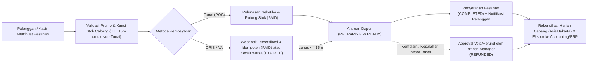

# Business Requirements Document (BRD) — NusaPOS & OrderHub (Fase 1)

> **Konteks Portofolio & Referensi Kurikulum:** Dokumen ini merupakan artefak BRD jadi berstandar produksi untuk inisiatif **NusaPOS & OrderHub (Fase 1)** milik **NusaKopi**, disusun mengacu pada struktur [`template-brd.md`](../templates/template-brd.md) dan dikunci terhadap Kamus Domain Kanonik pada [`README.md`](../README.md).

---

## 1. Kontrol Dokumen

| Atribut | Detail |
| :--- | :--- |
| **Nama Proyek / Inisiatif** | **NusaPOS & OrderHub — Fase 1 (POS In-Store Online-First & Online Self-Pickup)** |
| **ID Dokumen** | `BRD-NUSAPOS-001` |
| **Versi** | `v1.0 (Baselined)` |
| **Tanggal Dibuat** | `2026-11-05` |
| **Pembuat (Author)** | Tim System Analyst — NusaKopi Digital Transformation |
| **Pemilik Bisnis (Business Owner)** | Direktur Operasional & Direktur Keuangan PT NusaKopi Nusantara |
| **Status Dokumen** | `Approved / Baselined` |

### Riwayat Perubahan Dokumen

| Versi | Tanggal | Penulis | Ringkasan Perubahan |
| :--- | :--- | :--- | :--- |
| `v0.1` | `2026-11-05` | System Analyst | Inisiasi draf awal hasil workshop elisitasi dan *shadowing* di cabang pilot `STR-001`. |
| `v0.9` | `2026-11-11` | System Analyst | Finalisasi aturan promo terpusat, otorisasi void/refund, dan TTL reservasi 15 menit (`DEC-004`, `DEC-005`). |
| `v1.0` | `2026-11-14` | System Analyst | Dokumen *Baselined* setelah disetujui Business Sponsor, Operational Lead, dan Finance Lead sebagai dasar penyusunan [SRS](02-srs-nusapos.md). |

---

## 2. Konteks Bisnis & Latar Belakang Masalah

### 2.1 Kondisi Saat Ini (*As-Is*) & Masalah Bisnis

**NusaKopi**, jaringan kedai kopi dan ritel makanan cepat saji multi-cabang dengan 35 gerai aktif di Indonesia, saat ini masih mengoperasikan aplikasi kasir toko (*POS*) yang terpisah dari kanal pemesanan daring pelanggan. Data transaksi pembayaran digital (QRIS/Virtual Account), pencatatan stok harian, dan laporan penjualan cabang belum terintegrasi dalam satu basis data operasional secara *real-time*.

Dari hasil elisitasi dan pengamatan lapangan (*shadowing*), teridentifikasi **4 masalah bisnis utama**:

1. **Stok Tidak Sinkron & *Overselling* (8,2% Pembatalan Order Online):** Katalog pemesanan daring tidak membaca posisi stok aktual cabang secara *real-time*. Pelanggan kerap sudah membayar pesanan *self-pickup*, namun sesampainya di toko stok bahan baku/menu sudah habis terjual oleh kasir konter (*walk-in*), memicu keluhan pelanggan dan pengembalian dana manual.
2. **Rekonsiliasi Harian Memakan Waktu Rata-Rata 120 Menit/Cabang/Hari:** `Branch Manager` harus mencocokkan secara manual ekspor CSV kasir, mutasi settlement `Payment Gateway (QRIS/VA)`, dan catatan diskon/void kertas. Perbedaan metode pembulatan per item serta pencatatan batas tengah malam UTC vs WIB kerap menimbulkan selisih jurnal akuntansi ke `Accounting/ERP`.
3. **Kebocoran Pendapatan & Celah Fraud Void/Diskon Tanpa Otorisasi (Selisih Kas ~1,8% Omzet):** Sistem kasir lama mengizinkan `Cashier` melakukan pembatalan struk lunas atau mengetik potongan harga bebas tanpa persetujuan `Branch Manager` dan tanpa jejak audit yang tidak dapat diubah (*immutable*).
4. **Konfirmasi Pembayaran Digital Masih Manual di Konter:** Pada transaksi QRIS/VA, kasir harus melihat foto bukti bayar dari layar ponsel pelanggan dan menekan tombol "Lunas" secara manual, yang rentan terhadap bukti transfer palsu serta memperlambat antrean pada jam sibuk pagi dan makan siang.

### 2.2 Peluang & Nilai Bisnis (*Business Drivers*)

Penyatuan sistem kasir cabang dan pemesanan daring dalam platform **NusaPOS & OrderHub** memberikan dampak strategis langsung bagi NusaKopi:
- **Menjaga Kepercayaan Pelanggan & Pendapatan Omnichannel:** Menjamin setiap pesanan *Online Self-Pickup* yang terkonfirmasi bayar pasti mendapatkan alokasi stok cabang melalui mekanisme reservasi stok berbatas waktu.
- **Menutup Kebocoran Finansial & Memenuhi Standar Audit:** Menghilangkan selisih pembulatan akuntansi, mengunci persetujuan void/refund pasca-bayar pada peran `Branch Manager`, dan menyediakan jejak audit (*audit trail*) lengkap.
- **Efisiensi Operasional Cabang:** Memangkas waktu antrean konter dengan verifikasi pembayaran digital otomatis dan memangkas waktu tutup buku harian cabang sehingga `Branch Manager` dapat fokus pada kualitas layanan serta pengelolaan tim.

---

## 3. Objektif Bisnis Terukur & Indikator Keberhasilan (KPI)

Setiap objektif bisnis dirumuskan mengikuti prinsip *SMART* (*Specific, Measurable, Achievable, Relevant, Time-bound*) agar keberhasilan implementasi Fase 1 dapat dievaluasi pasca-*Go-Live*:

| ID Objektif | Pernyataan Objektif Bisnis | Indikator Keberhasilan (KPI) | Kondisi Awal (*Baseline*) | Target Pasca-Rilis | Waktu Pengukuran |
| :--- | :--- | :--- | :--- | :--- | :--- |
| `BO-01` | Menyatukan stok penjualan toko (`POS`) dan pemesanan daring (`ONLINE_PICKUP`) per cabang agar tidak terjadi penjualan melebihi stok fisik. | Tingkat pembatalan order akibat stok kosong (*oversell rate*). | `8,2%` dari total order online/bulan | `< 0,5%` (dan `0%` *overselling* sistemik setelah pembayaran terkonfirmasi) | 3 bulan pasca-*Go-Live* |
| `BO-02` | Mempercepat proses konfirmasi pembayaran digital dan penyerahan pesanan di cabang tanpa verifikasi foto bukti bayar manual. | Waktu tunggu konfirmasi bayar QRIS/VA hingga pesanan masuk antrean dapur. | `45–90 detik` (cek manual kasir) | `<= 5 detik` sejak callback gateway diterima sistem | 1 bulan pasca-*Go-Live* |
| `BO-03` | Menekan kebocoran kas dan selisih pembukuan akibat void/refund tidak sah serta kesalahan pembulatan pajak/diskon. | Tingkat selisih kas/pembukuan (*variance*) pada rekonsiliasi harian cabang & insiden void tanpa otorisasi. | `1,8%` selisih terhadap omzet tunai/void | `0%` void tanpa approval manajer; `Rp 0` selisih kalkulasi sistemik | 1 bulan pasca-*Go-Live* |
| `BO-04` | Mempersingkat waktu tutup buku harian cabang dan pengiriman data jurnal penjualan ke `Accounting/ERP`. | Rata-rata waktu penyelesaian rekonsiliasi harian oleh `Branch Manager`. | `120 menit/cabang/hari` | `<= 15 menit/cabang/hari` | 1 bulan pasca-*Go-Live* |

---

## 4. Ruang Lingkup Proyek (*Project Scope*)

### 4.1 Termasuk dalam Ruang Lingkup Fase 1 (*In-Scope*)

Fase 1 difokuskan secara ketat pada dua kanal transaksi utama dan fondasi pengendalian stok-keuangan:

1. **POS In-Store (*Online-First*):** Aplikasi kasir tablet di cabang yang terhubung *real-time* ke server pusat untuk transaksi *walk-in* dengan metode pembayaran `CASH`, `QRIS`, dan `VA`.
2. **Online Self-Pickup (*OrderHub*):** Kanal pemesanan web/mobile pelanggan untuk mengambil pesanan langsung di konter cabang pilihan (`ONLINE_PICKUP`) dengan metode pembayaran `QRIS` dan `VA`.
3. **Alur Transaksi Inti Terpadu:**
   - Autentikasi dan pengendalian akses berbasis peran (`RBAC`) yang terikat pada cabang penugasan (`store_id`).
   - Katalog menu cabang, harga, promo aktif, dan visibilitas ketersediaan stok *real-time* per pasangan cabang dan varian.
   - Pembuatan pesanan dengan validasi promo, *snapshot* harga, serta reservasi stok berbatas waktu (**TTL 15 menit** untuk pembayaran non-tunai) dan pelepasan otomatis saat kedaluwarsa (`EXPIRED`).
   - Integrasi pembayaran asinkron via `Payment Gateway (QRIS/VA)` berbasis *signed webhook* yang *idempotent*.
   - Antrean pengerjaan dapur (*Kitchen Display*) dari status `PAID -> PREPARING -> READY -> COMPLETED` disertai notifikasi status ke pelanggan melalui `Notification Service`.
   - Alur pengajuan dan persetujuan void/refund pasca-bayar oleh `Branch Manager` lengkap dengan jejak audit *immutable*.
   - Rekonsiliasi tutup buku harian cabang berbasis zona waktu cabang (misalnya `Asia/Jakarta`) dan ekspor ke `Accounting/ERP`.
4. **Modul Master & Administrasi Pendukung:** Pengelolaan data cabang, akun pengguna & peran, katalog produk & varian, stok cabang (*restock/adjustment*), serta master kode promosi terpusat oleh `HQ Admin` / `Branch Manager`.

### 4.2 Di Luar Ruang Lingkup Fase 1 (*Out-of-Scope*)

Kemampuan berikut secara eksplisit **tidak dibangun pada Fase 1** dan dipisahkan untuk menjaga ketepatan waktu rilis serta stabilitas inti transaksi:

1. **Pengiriman Kurir / Pihak Ketiga (3PL):** Pemesanan dengan pengantaran ke alamat pelanggan, manajemen alamat & pin lokasi pelanggan, perhitungan ongkos kirim dinamis, serta integrasi pelacakan kurir eksternal sengaja dikeluarkan dari Fase 1 dan dijadwalkan menjadi **Change Request Fase 2** setelah operasional *POS* dan *Self-Pickup* di seluruh cabang stabil.
2. **Mode POS Offline Penuh (*Full Offline Sync*):** Pada Fase 1, seluruh transaksi kasir di cabang beroperasi secara *online-first* dengan koneksi internet aktif. Mekanisme antrean transaksi lokal tanpa koneksi internet dan resolusi konflik stok *eventual consistency* dicatat sebagai kajian pengembangan arsitektur fase lanjutan.
3. **Program Loyalitas Poin & *Split Bill* Multi-Metode:** Penukaran poin keanggotaan bertingkat dan pembayaran satu struk menggunakan kombinasi dua metode (misal sebagian tunai + sebagian QRIS) tidak didukung di Fase 1.

---

## 5. Pemangku Kepentingan (*Stakeholders*) & Matriks RACI

### 5.1 Daftar Pemangku Kepentingan (*Power/Interest Grid*)

| Peran / Unit Bisnis | Perwakilan / PIC | Kuadran Grid | Kepentingan Utama (*Interests*) | Pengaruh (*Power*) |
| :--- | :--- | :--- | :--- | :---: |
| **Business Sponsor** | Direktur Operasional & Direktur Keuangan | *Manage Closely* | ROI investasi, pencapaian KPI `BO-01..04`, ketepatan jadwal rilis cabang pilot dan nasional. | Tinggi |
| **Operational / Store Lead** | Kepala Operasional & Perwakilan `Branch Manager` | *Manage Closely* | Kecepatan layanan konter & dapur pada jam puncak, kemudahan approval void/refund, akurasi tutup kas harian. | Tinggi |
| **Finance & Accounting Lead** | Manajer Keuangan & Akuntansi Pusat | *Manage Closely* | Presisi Rupiah bulat (`BIGINT`), aturan pembulatan konsisten, pencegahan void ilegal, dan integrasi akurat ke `Accounting/ERP`. | Tinggi |
| **IT / Engineering & QA Lead** | Tech Lead & QA Manager | *Manage Closely* | Atomisitas stok tanpa *overselling*, keandalan webhook asinkron, performa beban puncak, dan kejelasan kontrak API. | Tinggi |
| **HQ Marketing (`HQ Admin`)** | Manajer Pemasaran Pusat | *Keep Satisfied* | Pengelolaan katalog menu, variasi harga/ketersediaan cabang, dan kuota kode voucher promo terpusat. | Sedang |
| **Staf Gerai (`Cashier`, `Kitchen/Barista`)** | Perwakilan Kasir & Barista Cabang Pilot | *Keep Informed* | Layar POS dan layar dapur yang ringkas, jelas status pesanannya, serta bebas langkah ganda saat antrean ramai. | Rendah–Sedang |
| **Vendor Eksternal (`Payment Gateway`)** | Tim Integrasi Mitra QRIS/VA | *Keep Satisfied* | Kepatuhan standar keamanan tanda tangan webhook, format payload, dan jadwal uji coba *sandbox*. | Sedang |
| **Pelanggan (`Customer`)** | Sampel Pelanggan Uji *OrderHub* | *Keep Informed* | Kejelasan ketersediaan stok, batas waktu bayar 15 menit yang transparan, dan notifikasi pesanan siap ambil yang akurat. | Rendah |

### 5.2 Matriks RACI Pengambilan Keputusan

*(R = Responsible / Pelaksana, A = Accountable / Pemegang Keputusan Akhir, C = Consulted / Dimintai Masukan, I = Informed / Diberi Informasi)*

| Aktivitas / Deliverable | Sponsor | Operational Lead | Finance Lead | HQ Marketing | System Analyst | Engineering & QA Lead |
| :--- | :---: | :---: | :---: | :---: | :---: | :---: |
| Penetapan Ruang Lingkup & Prioritas Fase 1 | `A` | `C` | `C` | `C` | `R` | `I` |
| Penyusunan & Validasi Aturan Bisnis Operasional | `I` | `R` | `C` | `C` | `R` / `A` *(dokumen)* | `C` |
| Persetujuan Aturan Keuangan, Pajak, Pembulatan, & Refund | `I` | `C` | `A` | `I` | `R` | `I` |
| Persetujuan Kontrak Spesifikasi (`SRS` & `API Contract`) | `I` | `C` | `C` | `I` | `R` | `A` *(kelayakan teknis)* |
| Eksekusi *User Acceptance Testing* (UAT) | `I` | `R` | `R` | `I` | `C` | `C` |
| Keputusan *Go / No-Go* Rilis Produksi Fase 1 | `A` | `C` | `C` | `I` | `R` | `C` |

---

## 6. Kebutuhan Bisnis Tingkat Tinggi (*High-Level Business Requirements*)

Setiap kebutuhan bisnis tingkat tinggi menjadi jembatan langsung menuju spesifikasi fungsional dan non-fungsional di dalam [SRS](02-srs-nusapos.md):

| ID Kebutuhan | Kategori | Deskripsi Kebutuhan Bisnis | Prioritas (MoSCoW) | Referensi Objektif |
| :--- | :--- | :--- | :---: | :--- |
| `BR-01` | **Manajemen Stok & Order Terpadu** | Sistem harus menyatukan basis stok penjualan toko (`POS`) dan pemesanan daring (`ONLINE_PICKUP`) per cabang serta menyediakan mekanisme reservasi stok berbatas waktu 15 menit pada pemesanan digital agar tidak terjadi *overselling*. | `Must Have` | `BO-01` |
| `BR-02` | **Otomasi Pembayaran Digital** | Sistem harus menerima konfirmasi pembayaran `QRIS` dan `VA` secara otomatis, terverifikasi aman dari pemalsuan, dan tahan terhadap pengiriman ulang notifikasi gateway tanpa memotong stok lebih dari satu kali. | `Must Have` | `BO-01`, `BO-02` |
| `BR-03` | **Alur Pemenuhan Dapur & Status Tunggal** | Sistem harus menyediakan antrean dapur terstruktur untuk pesanan yang telah lunas, mengunci transisi status pesanan yang sah hingga selesai diambil pelanggan, dan mengirimkan pemberitahuan status secara otomatis. | `Must Have` | `BO-02` |
| `BR-04` | **Kontrol Akses, Promo, & Void/Refund** | Sistem harus membatasi akses transaksi sesuai peran dan cabang, memastikan seluruh diskon berasal dari master promosi pusat, serta mewajibkan persetujuan `Branch Manager` beserta jejak audit permanen untuk setiap void/refund pasca-bayar. | `Must Have` | `BO-03` |
| `BR-05` | **Rekonsiliasi Harian & Akurasi Finansial** | Sistem harus menghitung seluruh nilai penjualan, diskon, pajak, dan pengembalian dana dalam Rupiah bulat dengan aturan pembulatan tunggal, mengelompokkan hari bisnis sesuai zona waktu lokal cabang, dan mengekspor laporan tutup buku harian ke `Accounting/ERP`. | `Must Have` | `BO-03`, `BO-04` |
| `BR-06` | **Administrasi Master Data Terpusat** | `HQ Admin` dan `Branch Manager` harus dapat mengelola data cabang, pengguna/peran, katalog produk & varian, kuota promo, serta penyesuaian stok masuk/opname tanpa mengubah riwayat harga transaksi lampau. | `Should Have` | `BO-01`, `BO-03` |

---

## 7. Asumsi, Risiko, Dependensi, & Batasan (*RAID & Constraints*)

### 7.1 Asumsi (*Assumptions*)

- Setiap gerai NusaKopi memiliki koneksi internet utama yang stabil (minimal 20 Mbps) serta modem seluler cadangan (*backup tether*) selama jam operasional `06.00–23.00 WIB`.
- Struktur tarif pajak restoran/PPN (misal 11%) dan aturan pembulatan ke Rupiah terdekat (`HALF_UP`) pada tingkat subtotal transaksi telah disetujui oleh Divisi Keuangan sebelum tahap implementasi.
- Setiap `Branch Manager` memiliki kredensial akun terpisah dan PIN otorisasi cabang untuk persetujuan void/refund.

### 7.2 Batasan (*Constraints*)

- **Batasan Anggaran & Jadwal:** Peluncuran Fase 1 harus siap untuk pilot di 2 cabang utama (`STR-001`, `STR-002`) dalam siklus rilis Q4 tanpa menambah ruang lingkup fitur di luar Pasal 4.1.
- **Batasan Teknologi & Finansial:** Nilai transaksi disimpan dalam bilangan bulat Rupiah (`BIGINT`) tanpa pecahan sen; seluruh cap waktu transaksi wajib disimpan dalam format UTC di server dan dikonversi ke zona waktu cabang (`Asia/Jakarta`) pada tampilan serta pelaporan tutup buku.
- **Batasan Vendor:** Integrasi pembayaran digital wajib menggunakan `Payment Gateway (QRIS/VA)` yang telah memiliki perjanjian kerja sama resmi dengan perusahaan.

### 7.3 Risiko Bisnis & Mitigasi (*Risks*)

| ID Risiko | Deskripsi Risiko | Dampak | Kemungkinan | Rencana Mitigasi |
| :--- | :--- | :---: | :---: | :--- |
| `RISK-01` | Keterlambatan penandatanganan PKS dan pembukaan kredensial *sandbox* API dari `Payment Gateway (QRIS/VA)`. | Tinggi | Sedang | Ajukan dokumen legal dan akses *sandbox* sejak minggu ke-1; siapkan *mock webhook* internal untuk pengujian paralel tim Engineering/QA. |
| `RISK-02` | Terjadinya *late payment* (pelanggan membayar QRIS tepat setelah batas waktu reservasi 15 menit habis sehingga stok sudah dilepas). | Tinggi | Sedang | Terapkan status penolakan eksplisit saat webhook terlambat (`ERR_RESERVATION_EXPIRED`), tandai insiden ke log rekonsiliasi Finance, dan sediakan SOP pengembalian dana cepat di tim CS. |
| `RISK-03` | Penolakan atau kelambatan adaptasi `Cashier` dan `Kitchen/Barista` pada hari pertama peluncuran akibat perubahan SOP void dan antrean layar dapur. | Sedang | Sedang | Lakukan uji coba lapangan (*pilot*) di 2 cabang utama selama 7 hari, sediakan buku saku 1 halaman, dan siapkan tim pendampingan operasional di lokasi. |
| `RISK-04` | Selisih data tutup buku harian akibat perbedaan batas tanggal UTC vs waktu lokal cabang `Asia/Jakarta` pada transaksi mendekati tengah malam. | Tinggi | Rendah–Sedang | Kunci spesifikasi rentang waktu tutup buku berbasis `Asia/Jakarta` di SRS/API dan jadikan transaksi pukul `23:55` vs `00:05 WIB` sebagai skenario uji wajib pada UAT. |

### 7.4 Dependensi (*Dependencies*)

- Ketersediaan dokumentasi teknis dan kredensial *sandbox* dari mitra `Payment Gateway (QRIS/VA)` serta layanan pengirim pesan `Notification Service` (WhatsApp/Email).
- Kesepakatan skema format ekspor data harian (`JSON/CSV`) dan mekanisme *retry* dari tim pengelola `Accounting/ERP` sebelum pengembangan modul rekonsiliasi dimulai.
- Penetapan daftar master SKU produk, varian, dan cabang awal yang telah dibersihkan oleh tim `HQ Admin`.

---

## 8. Gambaran Alur Bisnis Target (*To-Be High-Level Flow*)

Diagram berikut merangkum alur nilai bisnis ujung-ke-ujung (*end-to-end*) pada Fase 1 **NusaPOS & OrderHub**, mulai dari pembuatan pesanan di kasir maupun aplikasi pelanggan hingga tutup buku harian ke sistem akuntansi:

---

## 9. Lembar Persetujuan (*Sign-Off*)

Dengan menandatangani dokumen ini, seluruh pemangku kepentingan menyetujui bahwa konteks bisnis, objektif terukur (`BO-01` s.d. `BO-04`), batasan ruang lingkup Fase 1, serta kebutuhan bisnis (`BR-01` s.d. `BR-06`) telah akurat dan menjadi dasar pengikatan spesifikasi sistem pada [02-srs-nusapos.md](02-srs-nusapos.md). Setiap penambahan kemampuan di luar Fase 1 (termasuk integrasi kurir 3PL dan mode kasir offline penuh) wajib melalui prosedur *Change Request (CR)* formal.

| Nama | Jabatan / Peran | Keputusan | Tanggal | Tanda Tangan |
| :--- | :--- | :---: | :--- | :--- |
| Hendra Wijaya | Business Sponsor (Direktur Operasional) | `Approved` | `2026-11-14` | `Ttd. Hendra W.` |
| Rina Kusumawati | Operational Lead (Kepala Operasional Cabang) | `Approved` | `2026-11-14` | `Ttd. Rina K.` |
| Budi Santoso, S.E., Ak. | Finance & Accounting Lead | `Approved` | `2026-11-14` | `Ttd. Budi S.` |
| Tim System Analyst | System Analyst (Author) | `Submitted & Baselined` | `2026-11-14` | `Ttd. SA Team` |
