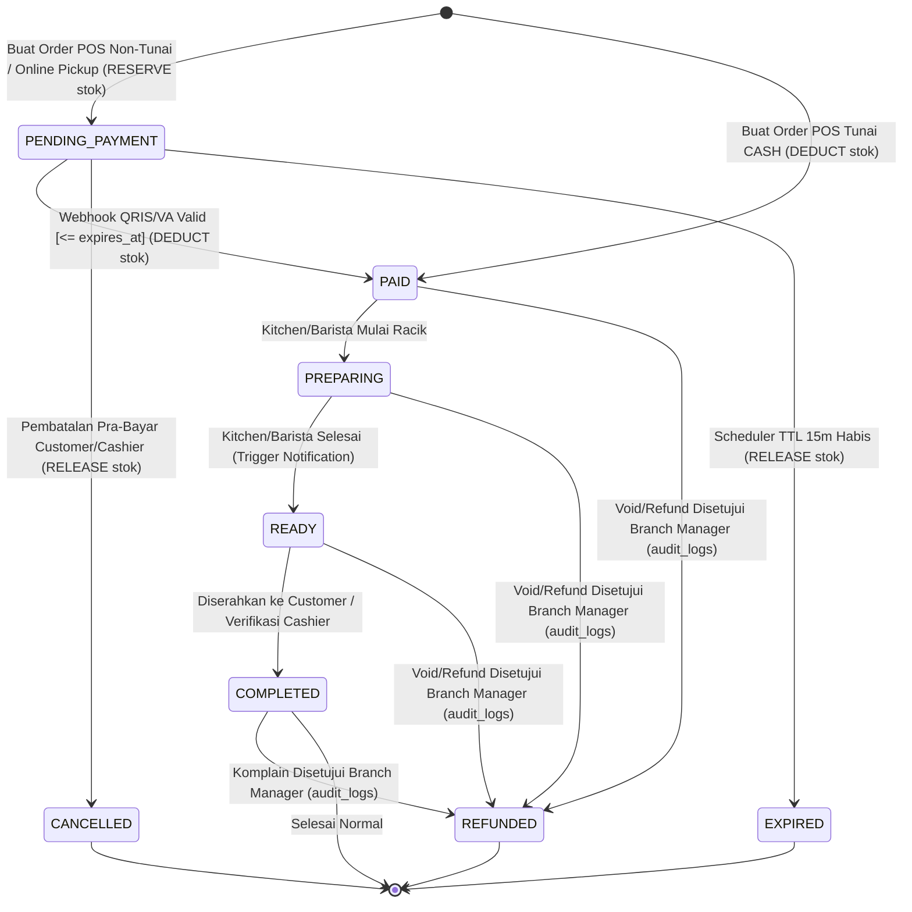
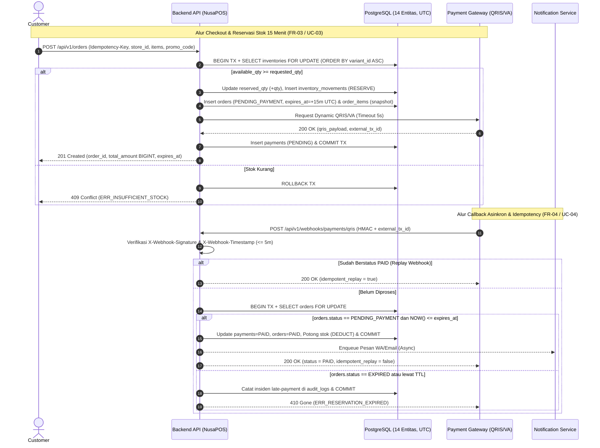
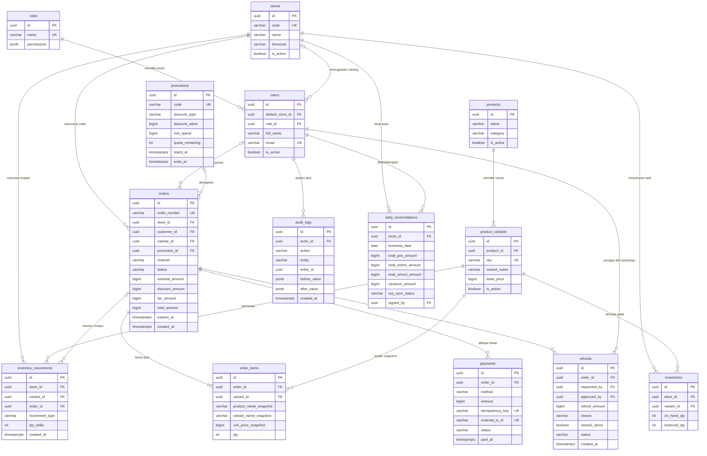

# Software Requirements Specification (SRS) — NusaPOS & OrderHub (Fase 1)
*(Mengacu pada struktur standar ISO/IEC/IEEE 29148)*

> **Konteks Portofolio & Referensi Kurikulum:** Dokumen ini menerjemahkan [01-brd-nusapos.md](01-brd-nusapos.md) (`BRD-NUSAPOS-001`) menjadi spesifikasi kebutuhan sistem yang atomik, tunggal tafsir, lengkap, dapat diuji (*verifiable*), dan terlacak penuh (*traceable*) ke [03-api-contract-nusapos.md](03-api-contract-nusapos.md) dan [04-uat-script-nusapos.md](04-uat-script-nusapos.md), mengacu pada [`template-srs.md`](../templates/template-srs.md) serta [`README.md`](../README.md).

---

## Kontrol Dokumen

| Atribut | Detail |
| :--- | :--- |
| **Nama Sistem** | **NusaPOS & OrderHub (Fase 1)** |
| **ID Dokumen** | `SRS-NUSAPOS-001` |
| **Versi** | `v1.0 (Baselined)` |
| **Tanggal** | `2026-11-18` |
| **Penulis (System Analyst)** | Tim System Analyst — NusaKopi Digital Transformation |
| **Referensi BRD** | [`BRD-NUSAPOS-001 v1.0`](01-brd-nusapos.md) |
| **Status** | `Baselined` |

### Riwayat Perubahan Dokumen

| Versi | Tanggal | Penulis | Ringkasan Perubahan |
| :--- | :--- | :--- | :--- |
| `v0.1` | `2026-11-15` | System Analyst | Penyusunan kebutuhan fungsional `FR-01` s.d. `FR-08`, `NFR-01` s.d. `NFR-04`, dan model sistem Fase 1. |
| `v0.9` | `2026-11-17` | System Analyst | Penyelarasan kontrak JSON API, skema 14 entitas kanonik, dan matriks transisi 8 status pasca-*SRS Walkthrough*. |
| `v1.0` | `2026-11-18` | System Analyst | Dokumen *Baselined* bersama Tech Lead, QA Lead, dan Product Manager. |

---

## 1. Pendahuluan

### 1.1 Tujuan Dokumen

Dokumen *Software Requirements Specification (SRS)* ini menetapkan spesifikasi perilaku fungsional, non-fungsional, antarmuka sistem, model data, dan keterlacakan kebutuhan untuk rilis **Fase 1 NusaPOS & OrderHub**. Dokumen ini menjadi acuan kontrak kerja resmi bagi tim **Backend Engineering**, **Frontend/Mobile Engineering**, **QA**, **UI/UX**, **DevOps**, dan **Product Management**.

### 1.2 Ruang Lingkup Sistem (*System Scope*)

Sistem perangkat lunak **NusaPOS & OrderHub Fase 1** mencakup:
- **Kanal Transaksi Aktif Fase 1:** Aplikasi kasir gerai berbasis web/tablet (*POS In-Store Online-First*, `channel = 'POS'`) dan portal pemesanan daring pelanggan ambil di tempat (*Online Self-Pickup*, `channel = 'ONLINE_PICKUP'`).
- **Tulang Punggung Operasional Inti:** Manajemen akses RBAC terikat cabang (`store_id`), katalog dan stok *real-time* cabang, pemesanan dengan reservasi stok berbatas waktu (**TTL 15 menit**), integrasi pembayaran tunai serta QRIS/VA asinkron via *signed webhook* yang *idempotent*, antrean dapur (*Kitchen Display*), pengajuan & persetujuan void/refund pasca-bayar, penjadwalan otomatis pesanan kedaluwarsa (`ReleaseExpiredReservationsJob`), serta rekonsiliasi harian cabang (`DailyStoreReconciliationJob`) ke `Accounting/ERP`.
- **Modul Master & Administrasi Ringkas:** Pengelolaan master cabang (`stores`), pengguna & peran (`users`, `roles`), produk & varian (`products`, `product_variants`), penyesuaian stok (`inventories`, `inventory_movements`), dan promosi (`promotions`).
- **Pengecualian Eksplisit Fase 1 (*Out-of-Scope*):** Layanan pengiriman kurir pihak ketiga (3PL) beserta pelacakan kurirnya serta mode kasir *offline* penuh tanpa koneksi internet tidak masuk dalam ruang lingkup implementasi kode Fase 1.

### 1.3 Definisi, Akronim, & Singkatan

| Istilah / Akronim | Definisi dalam Konteks Sistem Ini |
| :--- | :--- |
| **TTL** | *Time To Live* — durasi berlaku reservasi stok pesanan non-tunai selama tepat **15 menit** (`expires_at = created_at + 15 menit`) sebelum dilepas otomatis oleh scheduler. |
| **Idempotency** | Sifat operasi yang menjamin pemanggilan ulang dengan `Idempotency-Key` atau `external_tx_id` yang sama menghasilkan efek status dan stok tunggal tanpa duplikasi transaksi. |
| **RBAC** | *Role-Based Access Control* — pengendalian izin aksi dan akses data cabang (`store_id`) berdasarkan peran pengguna pada tabel `roles`. |
| **HALF_UP** | Metode pembulatan aritmetika ke bilangan bulat Rupiah (`BIGINT`) terdekat, di mana angka pecahan `>= 0,5` dibulatkan ke atas (misal `3.555,5` -> `3.556`). |
| **Snapshot Harga** | Penyimpanan nilai nama produk, nama varian, dan harga satuan saat transaksi dibuat pada tabel `order_items` agar perubahan harga master di masa depan tidak mengubah histori transaksi lama. |
| **UTC & `Asia/Jakarta`** | Standar penyimpanan waktu universal (*Coordinated Universal Time*) di basis data, yang dikonversi ke zona waktu lokal cabang (WIB / `UTC+7` untuk `Asia/Jakarta`) pada antarmuka pengguna dan agregasi hari bisnis `daily_reconciliations`. |

### 1.4 Referensi Dokumen

- [`01-brd-nusapos.md`](01-brd-nusapos.md) — *Business Requirements Document* (`BRD-NUSAPOS-001 v1.0`).
- [`03-api-contract-nusapos.md`](03-api-contract-nusapos.md) — *API & Webhook Integration Contract*.
- [`04-uat-script-nusapos.md`](04-uat-script-nusapos.md) — *User Acceptance Testing Script & Sign-Off*.
- [`README.md`](../README.md) — Kamus Domain Kanonik *NusaPOS & OrderHub*.

---

## 2. Deskripsi Umum (*Overall Description*)

### 2.1 Perspektif Produk & Konteks Sistem

**NusaPOS & OrderHub** dibangun sebagai platform *greenfield* berbasis arsitektur *Client-Server* terpusat (*online-first*) yang menggantikan aplikasi kasir lama dan menyatukan pemesanan pelanggan daring ke satu basis data relasional bersama. Sistem berkomunikasi secara sinkron (*REST/JSON*) dengan aplikasi klien internal maupun pelanggan, serta berintegrasi secara aman dengan tiga sistem eksternal: `Payment Gateway (QRIS/VA)`, `Notification Service`, dan `Accounting/ERP`.

### 2.2 Ringkasan Fungsi Produk

1. **Autentikasi, Otorisasi Cabang, & Master Data:** Login berbasis JWT (`roles`, `store_id`) serta pengelolaan terpusat cabang, katalog produk/varian, promo, dan penyesuaian stok.
2. **Katalog Menu & Stok Real-Time:** Penyajian menu aktif cabang lengkap dengan ketersediaan stok (`on_hand_qty - reserved_qty`) dan promo yang sedang berlaku.
3. **Mesin Pemesanan & Reservasi Stok Atomik:** Pembuatan pesanan `POS` dan `ONLINE_PICKUP`, kalkulasi promo/pajak di server, serta penguncian baris stok untuk mencegah *overselling*.
4. **Pembayaran Tunai & Webhook Digital Idempoten:** Pelunasan seketika untuk `CASH` pada `POS` dan pemrosesan asinkron ber-HMAC untuk pembayaran `QRIS`/`VA`.
5. **Pemenuhan Dapur, Pembatalan, Refund, & Rekonsiliasi:** Pengelolaan antrean dapur (`PAID -> PREPARING -> READY -> COMPLETED`), pembatalan pra-bayar & *expiry scheduler* (`CANCELLED`, `EXPIRED`), persetujuan void/refund oleh `Branch Manager` (`REFUNDED`), serta tutup buku harian cabang.

### 2.3 Karakteristik Pengguna (*Actors & User Classes*)

| Aktor | Tipe | Deskripsi Hak & Tanggung Jawab | Tingkat Keahlian Teknis |
| :--- | :--- | :--- | :--- |
| `Customer` | Manusia (Eksternal) | Melihat katalog cabang, membuat pesanan `ONLINE_PICKUP`, membatalkan pesanan `PENDING_PAYMENT`, membayar via QRIS/VA, memantau status, dan menerima notifikasi. | Rendah–Menengah |
| `Cashier` | Manusia (Internal Cabang) | Membuat pesanan `POS` pada `store_id` penugasannya, memproses tunai atau QRIS/VA, memverifikasi penyerahan pesanan `READY -> COMPLETED`, membatalkan order belum bayar, dan mengajukan permintaan void/refund. | Menengah |
| `Kitchen/Barista` | Manusia (Internal Cabang) | Memantau antrean pesanan berstatus `PAID` di cabang terkait dan memperbarui status pengerjaan `PAID -> PREPARING -> READY`. | Rendah–Menengah |
| `Branch Manager` | Manusia (Internal Cabang) | Mengelola penyesuaian stok cabang, memberikan persetujuan/penolakan void/refund pasca-bayar, memantau log operasional cabang, serta memverifikasi dan menandatangani `daily_reconciliations`. | Menengah |
| `HQ Admin` | Manusia (Internal Pusat) | Mengelola data master lintas cabang: `stores`, `products`, `product_variants`, `promotions`, serta akun & hak akses (`users`, `roles`). | Menengah–Tinggi |
| `Payment Gateway (QRIS/VA)` | Sistem Eksternal | Menerbitkan instruksi bayar dinamis QRIS/VA, mengirim webhook pelunasan bertanda tangan HMAC-SHA256, dan memproses instruksi refund. | `N/A (REST/Webhook)` |
| `Accounting/ERP` | Sistem Eksternal | Menerima ekspor ringkasan tutup buku harian (`daily_reconciliations`) per cabang dan tanggal bisnis lokal. | `N/A (Batch REST/CSV)` |
| `Notification Service` | Sistem Eksternal | Mengirimkan notifikasi WA/Email asinkron kepada `Customer` saat pembayaran `PAID` dan saat pesanan `READY` diambil. | `N/A (Async Queue/REST)` |

### 2.4 Batasan Desain & Implementasi (*Constraints*)

1. **Representasi Uang & Pembulatan:** Seluruh nominal uang disimpan sebagai bilangan bulat Rupiah (`BIGINT`, tanpa desimal sen). Perhitungan diskon dan pajak dilakukan di sisi server dengan pembulatan **`HALF_UP`** ke Rupiah terdekat di tingkat subtotal transaksi agar total item dan total transaksi selalu konsisten (`0 discrepancy`).
2. **Standar Waktu & Zona Waktu:** Seluruh kolom waktu di basis data menggunakan tipe `TIMESTAMPTZ` dalam zona **UTC**. Konversi ke zona waktu cabang (misalnya `Asia/Jakarta`) wajib diterapkan pada tampilan UI, struk, dan pengelompokan tanggal bisnis `daily_reconciliations`.
3. **Skema Data & Status Kanonik Terkunci:** Implementasi Fase 1 wajib memakai tepat **14 entitas inti kanonik** (`stores`, `users`, `roles`, `products`, `product_variants`, `inventories`, `inventory_movements`, `orders`, `order_items`, `payments`, `refunds`, `promotions`, `audit_logs`, `daily_reconciliations`) dengan kunci cabang `orders.store_id`, serta membatasi nilai `orders.status` hanya pada **8 status kanonik** (`PENDING_PAYMENT`, `PAID`, `PREPARING`, `READY`, `COMPLETED`, `CANCELLED`, `EXPIRED`, `REFUNDED`).
4. **Konektivitas Online-First:** Aplikasi kasir cabang pada Fase 1 wajib terhubung ke server pusat secara *real-time*; transaksi tidak diproses bila tidak memperoleh respons konfirmasi dari server.

### 2.5 Asumsi & Dependensi

- Mitra `Payment Gateway (QRIS/VA)` mendukung pengiriman `external_tx_id` unik per transaksi, menyertakan header tanda tangan `HMAC-SHA256`, dan melakukan *retry* jika tidak menerima HTTP `200 OK`.
- Jam server aplikasi dan basis data tersinkronisasi melalui NTP dalam zona UTC dengan selisih maksimal di bawah 1 detik.

---

## 3. Requirement Fungsional (*Functional Requirements*)

### 3.1 Spesifikasi Detail Kebutuhan Fungsional (`FR-01` s.d. `FR-08`)

#### `FR-01`: Autentikasi & Otorisasi Berbasis Peran (RBAC)
- **Referensi Bisnis / Use Case:** `BR-04` / `UC-01`
- **Prioritas (MoSCoW):** `Must Have`
- **Aktor Terlibat:** `Customer`, `Cashier`, `Kitchen/Barista`, `Branch Manager`, `HQ Admin`
- **Deskripsi Kebutuhan:**
  Sistem **HARUS** mengautentikasi kredensial pengguna pada `POST /api/v1/auth/login`, menerbitkan *Bearer JWT* yang memuat klaim `sub` (`user_id`), `role`, dan `store_id` penugasan (untuk aktor internal cabang), serta menegakkan validasi hak akses per peran dan per `store_id` pada setiap *endpoint* terproteksi.
- **Aturan Bisnis (*Business Rules*):**
  1. `BR-01.1`: Kata sandi dan PIN otorisasi wajib disimpan dalam bentuk *hash* satu arah (`Argon2id` atau `bcrypt`) dan tidak boleh muncul pada log atau respons API.
  2. `BR-01.2`: Aktor internal cabang (`Cashier`, `Kitchen/Barista`, `Branch Manager`) hanya boleh membaca dan memodifikasi data milik `store_id` yang tercantum pada JWT miliknya. Upaya mengakses data cabang lain atau fungsi di luar izin perannya wajib ditolak dengan `403 Forbidden` (`ERR_UNAUTHORIZED_APPROVAL`) dan dicatat ke `audit_logs`.
  3. `BR-01.3`: Endpoint login wajib dilindungi *rate limiting* maksimal `10` percobaan gagal per `5 menit` per IP/email dan mengembalikan pesan generik saat kredensial salah (`401 Unauthorized`).
- **Acceptance Criteria (Gherkin):**
  ```gherkin
  Feature: Autentikasi & Pembatasan Akses Cabang RBAC (FR-01 / UC-01)

    Scenario: Login berhasil dan menghasilkan JWT terikat role dan store_id
      Given akun Cashier "cashier_01" aktif dan ditugaskan pada store_id "STR-001"
      When pengguna mengirim POST /api/v1/auth/login dengan email dan kata sandi valid
      Then sistem mengembalikan HTTP 200 OK beserta access_token JWT berisi role "Cashier" dan store_id "STR-001"

    Scenario: Penolakan akses lintas cabang (IDOR) oleh aktor cabang
      Given Cashier "cashier_01" terautentikasi pada store_id "STR-001"
      When Cashier memanggil GET /api/v1/reconciliations/daily?store_id=STR-002&business_date=2026-11-25
      Then sistem menolak permintaan dengan HTTP 403 Forbidden dan kode error "ERR_UNAUTHORIZED_APPROVAL"
      And sistem mencatat peristiwa pelanggaran akses ke tabel audit_logs
  ```

---

#### `FR-02`: Pengelolaan & Tampilan Katalog Menu Cabang beserta Stok Real-Time
- **Referensi Bisnis / Use Case:** `BR-01`, `BR-06` / `UC-02`, `UC-03`
- **Prioritas (MoSCoW):** `Must Have`
- **Aktor Terlibat:** `HQ Admin`, `Branch Manager`, `Cashier`, `Customer`
- **Deskripsi Kebutuhan:**
  Sistem **HARUS** menyediakan antarmuka pengelolaan master produk, varian harga, cabang, promosi, serta stok per cabang, dan menyajikan daftar menu aktif cabang beserta ketersediaan stok aktual (`available_qty = on_hand_qty - reserved_qty`) melalui `GET /api/v1/stores/{storeId}/menu`.
- **Aturan Bisnis (*Business Rules*):**
  1. `BR-02.1`: Katalog menu hanya menampilkan produk dan varian dengan `is_active = true` dan `deleted_at IS NULL`; varian dengan `available_qty <= 0` tetap dapat ditampilkan sebagai habis (`in_stock = false`) dan tidak dapat ditambahkan ke keranjang checkout.
  2. `BR-02.2`: Perubahan harga master pada `product_variants` hanya berlaku untuk pesanan baru dan tidak boleh mengubah `unit_price_snapshot` pada pesanan yang sudah tercatat di `order_items`.
  3. `BR-02.3`: Penambahan stok masuk (`RESTOCK`) atau penyesuaian stok opname (`ADJUSTMENT`) oleh `Branch Manager` wajib mencatat entri *append-only* pada `inventory_movements` dan `audit_logs`.
- **Acceptance Criteria (Gherkin):**
  ```gherkin
  Feature: Katalog Menu Cabang & Ketersediaan Stok Real-Time (FR-02)

    Scenario: Mengambil daftar menu cabang dengan perhitungan stok tersedia akurat
      Given cabang "STR-001" berstatus aktif
      And varian "VAR-001" memiliki base_price = 28000, on_hand_qty = 10, dan reserved_qty = 3
      When Customer memanggil GET /api/v1/stores/STR-001/menu?page=1&limit=20
      Then sistem mengembalikan HTTP 200 OK dengan item "VAR-001" bernilai available_qty = 7 dan in_stock = true
      And respons menyertakan metadata pagination {page, limit, total_items, total_pages}
  ```

---

#### `FR-03`: Pembuatan Pesanan POS & Online Self-Pickup dengan Validasi/Reservasi Stok
- **Referensi Bisnis / Use Case:** `BR-01`, `BR-04` / `UC-02`, `UC-03`
- **Prioritas (MoSCoW):** `Must Have`
- **Aktor Terlibat:** `Cashier`, `Customer`
- **Deskripsi Kebutuhan:**
  Sistem **HARUS** memvalidasi ketersediaan stok cabang di dalam satu transaksi basis data atomik setiap kali `POST /api/v1/orders` dipanggil, menghitung seluruh nilai finansial di server dalam `BIGINT` Rupiah dengan pembulatan `HALF_UP`, serta membuat reservasi stok selama **15 menit** untuk pembayaran `QRIS`/`VA` atau memotong stok langsung untuk pembayaran `CASH` di kanal `POS`.
- **Aturan Bisnis (*Business Rules*):**
  1. `BR-03.1`: Kanal `ONLINE_PICKUP` hanya dapat diakses `Customer` dengan `payment_method` bernilai `QRIS` atau `VA` (menolak `CASH`). Kanal `POS` hanya dapat dibuat `Cashier` pada `store_id` penugasannya dan mendukung `CASH`, `QRIS`, dan `VA`.
  2. `BR-03.2`: Server wajib mengabaikan seluruh nilai harga/total dari klien, mengambil `base_price` dari `product_variants`, memvalidasi promo pada `promotions` (aktif terhadap waktu UTC server, memenuhi `min_spend`, dan `quota_remaining > 0`), lalu menghitung:
     - `subtotal_amount = SUM(unit_price_snapshot * qty)`
     - `discount_amount = ROUND_HALF_UP(diskon_sesuai_aturan_promo)`
     - `tax_amount = ROUND_HALF_UP((subtotal_amount - discount_amount) * 11 / 100)`
     - `total_amount = subtotal_amount - discount_amount + tax_amount`
  3. `BR-03.3`: Untuk mencegah *deadlock*, penguncian baris `inventories` menggunakan `SELECT ... FOR UPDATE` wajib dilakukan dalam urutan `variant_id` menaik (`ORDER BY variant_id ASC`). Jika satu item memiliki `available_qty < requested_qty`, seluruh transaksi wajib di-`ROLLBACK` dan mengembalikan `409 Conflict` (`ERR_INSUFFICIENT_STOCK`).
  4. `BR-03.4`: Pemesanan dengan `QRIS`/`VA` menyimpan `orders.status = 'PENDING_PAYMENT'`, `expires_at = created_at + 15 menit` (UTC), menambah `inventories.reserved_qty`, dan mencatat mutasi `RESERVE` di `inventory_movements`. Pemesanan `POS` dengan `CASH` langsung memotong `on_hand_qty`, mencatat `DEDUCT`, menyimpan `orders.status = 'PAID'`, dan `payments.status = 'PAID'`.
  5. `BR-03.5`: Header `Idempotency-Key` wajib disertakan; pemanggilan ulang dengan kunci dan payload identik mengembalikan respons awal tanpa membuat order ganda, sedangkan kunci sama dengan payload berbeda ditolak `409 Conflict` (`ERR_DUPLICATE_IDEMPOTENCY`).
- **Acceptance Criteria (Gherkin):**
  ```gherkin
  Feature: Pembuatan Pesanan & Reservasi Stok Atomik (FR-03 / UC-02, UC-03)

    Scenario: Checkout Online Self-Pickup berhasil mereservasi stok selama 15 menit
      Given cabang "STR-001" aktif dan varian "VAR-001" memiliki on_hand_qty = 10 dan reserved_qty = 0
      And kode promo "KOPIPAGI10" aktif dengan diskon 10% dengan minimum belanja Rp 50.000
      When Customer mengirim POST /api/v1/orders dengan Idempotency-Key unik untuk 2 unit "VAR-001" (harga 28000) dan 1 unit "VAR-005" (harga 24000) memakai QRIS
      Then sistem menghitung subtotal_amount = 80000, discount_amount = 8000, tax_amount = 7920, total_amount = 79920
      And reserved_qty untuk "VAR-001" naik menjadi 2 dan untuk "VAR-005" naik menjadi 1 dengan mutasi RESERVE pada inventory_movements
      And sistem mengembalikan HTTP 201 Created dengan status "PENDING_PAYMENT" dan expires_at = created_at + 15 menit (UTC)

    Scenario: Checkout ditolak ketika sisa stok tidak mencukupi (Boundary Test)
      Given varian "VAR-002" di cabang "STR-001" memiliki on_hand_qty = 1 dan reserved_qty = 0
      When Customer mengirim POST /api/v1/orders untuk 2 unit "VAR-002"
      Then transaksi database di-rollback tanpa mengubah reserved_qty
      And sistem mengembalikan HTTP 409 Conflict dengan kode error "ERR_INSUFFICIENT_STOCK"
  ```

---

#### `FR-04`: Pemrosesan Pembayaran Tunai (POS) & Pembayaran Asinkron QRIS/VA via Webhook
- **Referensi Bisnis / Use Case:** `BR-02` / `UC-02`, `UC-04`
- **Prioritas (MoSCoW):** `Must Have`
- **Aktor Terlibat:** `Cashier`, `Customer`, `Payment Gateway (QRIS/VA)`, `Notification Service`
- **Deskripsi Kebutuhan:**
  Sistem **HARUS** memproses konfirmasi pembayaran asinkron dari `Payment Gateway (QRIS/VA)` pada `POST /api/v1/webhooks/payments/qris` dengan verifikasi tanda tangan digital `HMAC-SHA256`, menjamin sifat *idempotent* berdasarkan `external_tx_id`, memotong stok tereservasi menjadi terpotong permanen (`DEDUCT`), dan memicu notifikasi ke pelanggan secara asinkron.
- **Aturan Bisnis (*Business Rules*):**
  1. `BR-04.1`: Sistem wajib memvalidasi header `X-Webhook-Signature` (`HMAC-SHA256(secret, timestamp + "." + raw_body)`) dan selisih `X-Webhook-Timestamp` maksimal `5 menit` terhadap waktu UTC server. Signature tidak valid atau kedaluwarsa ditolak dengan `401 Unauthorized` dan dicatat pada `audit_logs`.
  2. `BR-04.2`: Jika `external_tx_id` telah tercatat berstatus `PAID` di `payments`, sistem wajib membalas `200 OK` (`idempotent_replay: true`) tanpa mengubah stok atau status pesanan lagi.
  3. `BR-04.3`: Jika `orders.status = 'PENDING_PAYMENT'`, belum melewati `expires_at`, dan `paid_amount == orders.total_amount`, sistem dalam satu transaksi atomik mengubah `payments.status = 'PAID'`, `orders.status = 'PAID'`, mengurangi `inventories.on_hand_qty` dan `reserved_qty`, mencatat `DEDUCT` pada `inventory_movements`, lalu mengantrekan pesan ke `Notification Service` setelah transaksi *commit*.
  4. `BR-04.4`: Jika webhook `SETTLED` masuk ketika `orders.status = 'EXPIRED'` (atau `NOW() > expires_at`), sistem dilarang memotong stok, mencatat insiden *late-payment* di `audit_logs` untuk tindak lanjut pengembalian dana Finance, dan mengembalikan `410 Gone` (`ERR_RESERVATION_EXPIRED`). Jika status `CANCELLED`, kembalikan `422 Unprocessable Entity` (`ERR_INVALID_STATE_TRANSITION`).
- **Acceptance Criteria (Gherkin):**
  ```gherkin
  Feature: Pembayaran Asinkron QRIS/VA via Signed Webhook Idempoten (FR-04 / UC-04)

    Scenario: Webhook QRIS valid pertama kali melunasi pesanan dan memotong stok
      Given pesanan "ORD-20261125-0042" berstatus "PENDING_PAYMENT" dengan total_amount = 79920 dan belum melewati expires_at
      When Payment Gateway mengirim POST /api/v1/webhooks/payments/qris dengan X-Webhook-Signature valid, external_tx_id "PG-QRIS-20261125-9910", dan payment_status "SETTLED"
      Then sistem mengembalikan HTTP 200 OK dengan status "PAID" dan idempotent_replay = false
      And on_hand_qty serta reserved_qty pada inventories berkurang sesuai qty pesanan dengan entri DEDUCT di inventory_movements
      And sistem mengirim event notifikasi pelunasan ke Notification Service secara asinkron

    Scenario: Pengiriman ulang webhook identik diproses secara idempotent
      Given transaksi dengan external_tx_id "PG-QRIS-20261125-9910" sudah berstatus "PAID"
      When Payment Gateway mengirim ulang POST /api/v1/webhooks/payments/qris dengan external_tx_id yang sama
      Then sistem mengembalikan HTTP 200 OK dengan idempotent_replay = true
      And stok pada inventories tidak berkurang untuk kedua kalinya
  ```

---

#### `FR-05`: Pengelolaan Antrean Dapur & Transisi Status Pemenuhan Pesanan
- **Referensi Bisnis / Use Case:** `BR-03` / `UC-05`
- **Prioritas (MoSCoW):** `Must Have`
- **Aktor Terlibat:** `Kitchen/Barista`, `Cashier`, `Notification Service`
- **Deskripsi Kebutuhan:**
  Sistem **HARUS** menampilkan daftar pesanan berstatus `PAID`, `PREPARING`, dan `READY` pada layar dapur cabang (`SCR-KDS-001`) serta memvalidasi perubahan status pemenuhan melalui `PATCH /api/v1/orders/{orderId}/status` sesuai matriks transisi kanonik Fase 1.
- **Aturan Bisnis (*Business Rules*):**
  1. `BR-05.1`: Hanya `Kitchen/Barista` (atau `Branch Manager`) pada `store_id` yang sama yang berhak melakukan transisi `PAID -> PREPARING` dan `PREPARING -> READY`.
  2. `BR-05.2`: Saat status berubah menjadi `READY`, sistem wajib mengirim pemicu asinkron ke `Notification Service` agar pelanggan menerima pesan siap ambil beserta nomor pesanan.
  3. `BR-05.3`: Hanya `Cashier` (atau `Branch Manager`) pada `store_id` yang sama yang berhak menyelesaikan penyerahan pesanan `READY -> COMPLETED` setelah verifikasi nomor pesanan/kode ambil pelanggan.
  4. `BR-05.4`: Setiap transisi status yang tidak ada dalam tabel transisi sah (misal `PENDING_PAYMENT -> PREPARING` atau `COMPLETED -> PREPARING`) wajib ditolak dengan `422 Unprocessable Entity` (`ERR_INVALID_STATE_TRANSITION`).
- **Acceptance Criteria (Gherkin):**
  ```gherkin
  Feature: Antrean Dapur & Penyerahan Pesanan Fase 1 (FR-05 / UC-05)

    Scenario: Pemenuhan pesanan normal dari PAID hingga COMPLETED
      Given pesanan "ORD-20261125-0042" di "STR-001" berstatus "PAID"
      When Kitchen/Barista "barista_01" mengubah status ke "PREPARING" lalu ke "READY" melalui PATCH /api/v1/orders/ORD-20261125-0042/status
      Then status pesanan berubah bertahap ke "READY" dan Notification Service dipicu untuk mengirim info siap ambil
      When Cashier "cashier_01" mengonfirmasi penyerahan dengan mengubah status ke "COMPLETED"
      Then sistem mengembalikan HTTP 200 OK dengan status final "COMPLETED"

    Scenario: Penolakan transisi status ilegal langsung ke dapur sebelum lunas
      Given pesanan "ORD-20261125-0043" masih berstatus "PENDING_PAYMENT"
      When Kitchen/Barista mengirim PATCH /api/v1/orders/ORD-20261125-0043/status dengan target status "PREPARING"
      Then sistem menolak permintaan dengan HTTP 422 Unprocessable Entity dan kode error "ERR_INVALID_STATE_TRANSITION"
  ```

---

#### `FR-06`: Pembatalan Pra-Bayar & Pelepasan Otomatis Reservasi Kedaluwarsa (`EXPIRED`)
- **Referensi Bisnis / Use Case:** `BR-01` / `UC-03`
- **Prioritas (MoSCoW):** `Must Have`
- **Aktor Terlibat:** `Customer`, `Cashier`, Sistem Scheduler (`ReleaseExpiredReservationsJob`)
- **Deskripsi Kebutuhan:**
  Sistem **HARUS** mengizinkan pembatalan pesanan yang masih berstatus `PENDING_PAYMENT` oleh pemiliknya (`Customer` atau `Cashier`) ke status `CANCELLED` melalui `PATCH /api/v1/orders/{orderId}/status`, serta menjalankan penjadwal latar belakang setiap 1 menit untuk mengubah pesanan yang melewati `expires_at` menjadi `EXPIRED` dan melepaskan kembali stok tereservasi.
- **Aturan Bisnis (*Business Rules*):**
  1. `BR-06.1`: Pembatalan manual (`PENDING_PAYMENT -> CANCELLED`) hanya boleh dilakukan oleh `Customer` pemilik pesanan (untuk `ONLINE_PICKUP`) atau `Cashier` cabang terkait (untuk `POS`), dalam satu transaksi atomik yang mengurangi `inventories.reserved_qty` dan mencatat mutasi `RELEASE` pada `inventory_movements`.
  2. `BR-06.2`: Job terjadwal `ReleaseExpiredReservationsJob` berjalan setiap `1 menit` (UTC), memilih maksimal `100` pesanan per siklus dengan `WHERE status = 'PENDING_PAYMENT' AND expires_at <= NOW()` menggunakan `FOR UPDATE SKIP LOCKED`, mengunci baris `inventories` secara terurut (`ORDER BY variant_id ASC`), mengurangi `reserved_qty`, menulis `RELEASE` ke `inventory_movements`, dan mengubah status menjadi `EXPIRED`.
  3. `BR-06.3`: Pesanan yang sudah berstatus `PAID` atau status terminal (`CANCELLED`, `EXPIRED`, `REFUNDED`) tidak boleh dibatalkan lewat jalur pra-bayar dan harus ditolak dengan `422 Unprocessable Entity` (`ERR_INVALID_STATE_TRANSITION`).
- **Acceptance Criteria (Gherkin):**
  ```gherkin
  Feature: Pembatalan Pra-Bayar & Kedaluwarsa Otomatis TTL 15 Menit (FR-06 / UC-03)

    Scenario: Pembatalan manual sebelum pembayaran melepaskan reservasi stok
      Given pesanan "ORD-20261125-0044" milik "cust_01" berstatus "PENDING_PAYMENT" dengan reservasi 2 unit "VAR-001"
      When "cust_01" mengirim PATCH /api/v1/orders/ORD-20261125-0044/status dengan status "CANCELLED"
      Then status pesanan berubah ke "CANCELLED", reserved_qty berkurang 2, dan tercatat mutasi RELEASE di inventory_movements

    Scenario: Scheduler melepaskan stok pesanan yang melewati TTL 15 menit
      Given pesanan "ORD-20261125-0045" berstatus "PENDING_PAYMENT" dengan expires_at = "2026-11-25T05:45:00Z"
      When waktu UTC server mencapai "2026-11-25T05:45:01Z" dan ReleaseExpiredReservationsJob dieksekusi
      Then status pesanan berubah menjadi "EXPIRED", reserved_qty dilepas kembali, dan tercatat mutasi RELEASE pada inventory_movements
  ```

---

#### `FR-07`: Pengajuan & Approval Void/Refund Pasca-Bayar dengan Jejak Audit
- **Referensi Bisnis / Use Case:** `BR-04` / `UC-06`
- **Prioritas (MoSCoW):** `Must Have`
- **Aktor Terlibat:** `Cashier`, `Branch Manager`, `Payment Gateway (QRIS/VA)`
- **Deskripsi Kebutuhan:**
  Sistem **HARUS** menyediakan mekanisme pengajuan dan persetujuan pengembalian dana penuh (*full void/refund*) pasca-bayar melalui `POST /api/v1/orders/{orderId}/refunds` yang mewajibkan otorisasi `Branch Manager` pada cabang yang sama, memperbarui status pesanan menjadi `REFUNDED`, dan merekam jejak audit permanen di `audit_logs`.
- **Aturan Bisnis (*Business Rules*):**
  1. `BR-07.1`: Void/refund pasca-bayar hanya berlaku untuk pesanan berstatus `PAID`, `PREPARING`, `READY`, atau `COMPLETED`. Pengajuan pada status lain ditolak dengan `422 Unprocessable Entity` (`ERR_INVALID_STATE_TRANSITION`).
  2. `BR-07.2`: `Cashier` hanya dapat mengirim `action = "REQUEST"` dengan alasan wajib (`10` s.d. `250` karakter). Hanya `Branch Manager` dengan `jwt.store_id == orders.store_id` dan `manager_pin` valid yang boleh mengirim `action = "APPROVE"` atau `"REJECT"`. Upaya `APPROVE`/`REJECT` oleh selain `Branch Manager` atau lintas cabang wajib ditolak `403 Forbidden` (`ERR_UNAUTHORIZED_APPROVAL`) dan dicatat ke `audit_logs`.
  3. `BR-07.3`: Saat `action = "APPROVE"` disetujui, sistem dalam satu transaksi atomik mengubah `refunds.status` ke `APPROVED`/`COMPLETED`, mengubah `orders.status = 'REFUNDED'`, mengembalikan stok (`on_hand_qty += qty` dengan mutasi `REFUND_RETURN` di `inventory_movements`) **hanya apabila** `restock_items = true`, memicu pengembalian dana ke `Payment Gateway` jika metode awal `QRIS`/`VA`, serta mencatat detail sebelum-sesudah di `audit_logs`.
- **Acceptance Criteria (Gherkin):**
  ```gherkin
  Feature: Pengajuan & Approval Void/Refund Pasca-Bayar (FR-07 / UC-06)

    Scenario: Penolakan persetujuan refund oleh Cashier tanpa otorisasi Branch Manager
      Given pesanan "ORD-20261125-0042" berstatus "PAID" di cabang "STR-001"
      When Cashier "cashier_01" mengirim POST /api/v1/orders/ORD-20261125-0042/refunds dengan action "APPROVE"
      Then sistem menolak permintaan dengan HTTP 403 Forbidden dan kode error "ERR_UNAUTHORIZED_APPROVAL"
      And sistem merekam percobaan akses tidak sah ke tabel audit_logs

    Scenario: Persetujuan refund penuh oleh Branch Manager dengan pengembalian stok
      Given pengajuan refund aktif untuk pesanan "ORD-20261125-0042" (status "PAID")
      When Branch Manager "mgr_01" cabang "STR-001" mengirim POST /api/v1/orders/ORD-20261125-0042/refunds dengan action "APPROVE", restock_items = true, dan manager_pin valid
      Then status pesanan berubah menjadi "REFUNDED"
      And stok on_hand_qty dikembalikan dengan mutasi REFUND_RETURN pada inventory_movements
      And tabel refunds serta audit_logs mencatat ID "mgr_01" sebagai pihak penyetuju
  ```

---

#### `FR-08`: Rekonsiliasi Penjualan Harian Cabang & Ekspor ke Accounting/ERP
- **Referensi Bisnis / Use Case:** `BR-05` / `UC-06`
- **Prioritas (MoSCoW):** `Must Have`
- **Aktor Terlibat:** `Branch Manager`, `Accounting/ERP`, Sistem Scheduler (`DailyStoreReconciliationJob`)
- **Deskripsi Kebutuhan:**
  Sistem **HARUS** mengagregasi transaksi penjualan harian per cabang berdasarkan zona waktu lokal cabang (misal `Asia/Jakarta`) melalui penjadwal `DailyStoreReconciliationJob` dan endpoint `GET/POST /api/v1/reconciliations/daily`, menghitung selisih fisik kas vs sistem, menyimpan tanda tangan `Branch Manager`, dan mengekspor laporan ke `Accounting/ERP`.
- **Aturan Bisnis (*Business Rules*):**
  1. `BR-08.1`: Agregasi hari bisnis tanggal `D` di zona `Asia/Jakarta` wajib memakai rentang UTC tepat `[D 00:00:00 WIB, D+1 00:00:00 WIB)` (contoh: untuk tanggal bisnis `2026-11-25`, rentang UTC adalah `2026-11-24T17:00:00Z` s.d. `< 2026-11-25T17:00:00Z`).
  2. `BR-08.2`: Penjualan bruto mencakup pesanan dengan status pelunasan sah (`PAID`, `PREPARING`, `READY`, `COMPLETED`, serta riwayat asal pesanan `REFUNDED` yang dikurangkan secara eksplisit pada kolom `total_refund_amount`), dipisahkan antara kanal `POS` vs `ONLINE_PICKUP` dan metode `CASH` vs `QRIS`/`VA`.
  3. `BR-08.3`: Saat `Branch Manager` memfinalisasi rekonsiliasi (`POST /api/v1/reconciliations/daily`) dengan input kas fisik aktual (`actual_cash_amount`), sistem menghitung `variance_amount = actual_cash_amount - expected_cash_amount`, mengunci baris `daily_reconciliations`, mencatat ke `audit_logs`, dan mengekspor payload ke `Accounting/ERP` dengan kebijakan *retry exponential backoff* (`1m, 5m, 15m, 1h`).
- **Acceptance Criteria (Gherkin):**
  ```gherkin
  Feature: Rekonsiliasi Penjualan Harian Cabang & Ekspor ERP (FR-08 / UC-06)

    Scenario: Pengelompokan batas tanggal bisnis Asia/Jakarta dan finalisasi rekonsiliasi
      Given terdapat transaksi POS lunas pada "2026-11-25 23:55:00 WIB" (2026-11-25T16:55:00Z) dan transaksi kedua pada "2026-11-26 00:05:00 WIB" (2026-11-25T17:05:00Z) di "STR-001"
      When Branch Manager "mgr_01" memanggil GET /api/v1/reconciliations/daily?business_date=2026-11-25
      Then hanya transaksi pukul "23:55:00 WIB" yang terhitung pada tanggal bisnis "2026-11-25"
      When "mgr_01" mengirim POST /api/v1/reconciliations/daily dengan actual_cash_amount sesuai total tunai sistem
      Then variance_amount bernilai 0, record daily_reconciliations tersimpan dengan signed_by "mgr_01", dan ekspor ke Accounting/ERP dijadwalkan
  ```

---

### 3.2 Ringkasan Kebutuhan Modul Master & Administrasi (`FR-02` / `BR-06`)

Untuk menjaga kedalaman dokumen pada transaksi inti, aturan modul master/admin diringkas secara terstruktur sebagai berikut:

| Sub-Modul | Entitas Terlibat | Aktor Berhak | Aturan Inti Fase 1 |
| :--- | :--- | :--- | :--- |
| **Manajemen Cabang** | `stores` | `HQ Admin` | Kode cabang unik (`STR-xxx`), menyimpan zona waktu kanonik (misal `Asia/Jakarta`), status aktif/nonaktif untuk menonaktifkan penerimaan order baru. |
| **Manajemen Katalog & Harga** | `products`, `product_variants` | `HQ Admin` | SKU unik per varian, `base_price` dalam `BIGINT` Rupiah `>= 0`, penghapusan memakai *soft delete* (`deleted_at`) demi integritas laporan historis. |
| **Manajemen Stok Cabang** | `inventories`, `inventory_movements` | `Branch Manager`, `HQ Admin` | Satu baris stok unik per `(store_id, variant_id)`; mutasi masuk (`RESTOCK`) dan koreksi opname (`ADJUSTMENT`) wajib *append-only* dan tercatat di `audit_logs`. |
| **Manajemen Promosi** | `promotions` | `HQ Admin` | Kode voucher unik, tipe `PERCENTAGE` atau `FIXED_AMOUNT`, validasi periode `starts_at..ends_at` (UTC), `min_spend`, dan `quota_remaining >= 0` atomik. |
| **Manajemen Akun & RBAC** | `users`, `roles` | `HQ Admin` | Penetapan peran (`Customer`, `Cashier`, `Kitchen/Barista`, `Branch Manager`, `HQ Admin`) dan `default_store_id` untuk aktor gerai; perubahan hak akses dicatat di `audit_logs`. |

---

## 4. Requirement Non-Fungsional (*Non-Functional Requirements*)

| ID NFR | Kategori | Spesifikasi Requirement Terukur | Metode Verifikasi |
| :--- | :--- | :--- | :--- |
| `NFR-01` | **Performa & Latensi** | Waktu respons persentil ke-95 (*p95*) untuk `GET /api/v1/stores/{storeId}/menu` wajib `<= 300 ms` dan untuk `POST /api/v1/orders` wajib `<= 500 ms` pada beban puncak **150 *requests per second* (RPS)** nasional. | *Load Testing* (k6 / JMeter) simulasi 150 RPS selama 15 menit. |
| `NFR-02` | **Konkurensi & Konsistensi Data** | Seluruh operasi reservasi dan pemotongan stok (`inventories`) wajib berjalan dalam satu transaksi basis data ACID menggunakan *row-level locking* (`SELECT ... FOR UPDATE` dengan urutan `variant_id` menaik) disertai *constraint* DB (`on_hand_qty >= reserved_qty >= 0`) sehingga peluang *overselling* = **0%**; pemrosesan webhook pembayaran wajib **100% *idempotent***. | *Concurrency Test* (50 request paralel terhadap stok sisa 5) dan uji *replay webhook* berulang. |
| `NFR-03` | **Keamanan & Auditabilitas** | Seluruh komunikasi wajib menggunakan **HTTPS/TLS 1.2+**; setiap *endpoint* terproteksi memverifikasi JWT dan kepemilikan `store_id` (anti-IDOR); webhook eksternal wajib memverifikasi tanda tangan **HMAC-SHA256** + jendela waktu 5 menit; *endpoint* publik dilengkapi *rate limiting*; seluruh perubahan sensitif dan kegagalan otorisasi terekam pada `audit_logs` yang *immutable* dengan masa retensi minimal **5 tahun**. | *Security & Penetration Testing* (uji IDOR lintas cabang, uji pemalsuan signature `401`, uji brute-force `429`). |
| `NFR-04` | **Ketersediaan, Waktu, & Akurasi Finansial** | Ketersediaan (*availability*) layanan transaksi inti wajib **`>= 99,5%`** selama jam operasional toko **06.00–23.00 WIB** (`17 jam/hari` = `1.020 menit/hari`, sehingga batas maksimal *downtime* terencana/tak terencana adalah **`~5,1 menit/hari`** atau `~35,7 menit/minggu`); seluruh *timestamp* disimpan UTC dan direkonsiliasi dalam zona lokal cabang (`Asia/Jakarta`); kalkulasi nominal `BIGINT` Rupiah dengan pembulatan `HALF_UP` harus menghasilkan **0 selisih (*0 discrepancy*)**. | Pemantauan *uptime/healthcheck* produksi, uji batas tengah malam `23:55` vs `00:05 WIB`, dan rekonsiliasi uji terhadap `Accounting/ERP`. |

---

## 5. External Interface Requirements

### 5.1 Antarmuka Pengguna (*User Interfaces*)

| Screen ID | Nama Layar | Pengguna Utama | Referensi FR / Endpoint |
| :--- | :--- | :--- | :--- |
| `SCR-ORD-001` | Katalog Menu & Keranjang Online (`OrderHub`) | `Customer` | `FR-02` · `GET /api/v1/stores/{storeId}/menu` |
| `SCR-ORD-002` | Checkout Online Self-Pickup | `Customer` | `FR-03` · `POST /api/v1/orders` |
| `SCR-ORD-003` | Pembayaran QRIS/VA & Pelacakan Status Order (Timer 15m WIB) | `Customer` | `FR-04`, `FR-06` · `PATCH /api/v1/orders/{orderId}/status` |
| `SCR-POS-002` | Layar Kasir POS In-Store (*Online-First*) | `Cashier` | `FR-02`, `FR-03`, `FR-04` · `POST /api/v1/orders` |
| `SCR-POS-004` | Riwayat & Detail Pesanan Cabang | `Cashier`, `Branch Manager` | `FR-05`, `FR-06` · `PATCH /api/v1/orders/{orderId}/status` |
| `SCR-KDS-001` | Layar Antrean Dapur (*Kitchen Display*) | `Kitchen/Barista` | `FR-05` · `PATCH /api/v1/orders/{orderId}/status` |
| `SCR-REF-001` | Pengajuan & Approval Void/Refund Cabang | `Cashier`, `Branch Manager` | `FR-07` · `POST /api/v1/orders/{orderId}/refunds` |
| `SCR-REC-001` | Tutup Buku & Rekonsiliasi Harian Cabang | `Branch Manager` | `FR-08` · `GET/POST /api/v1/reconciliations/daily` |

### 5.2 Antarmuka Perangkat Lunak & API (*Software / API Interfaces*)

Spesifikasi detail seluruh payload JSON, header keamanan, dan amplop error terdapat pada [03-api-contract-nusapos.md](03-api-contract-nusapos.md).

| Sistem Eksternal | Arah Komunikasi | Protokol & Format | Mekanisme Keamanan & Keandalan |
| :--- | :--- | :--- | :--- |
| `Payment Gateway (QRIS/VA)` | Dua arah (Outbound Create QRIS/VA/Refund + Inbound Webhook) | HTTPS / JSON | HMAC-SHA256 (`X-Webhook-Signature` & `X-Webhook-Timestamp` maks 5 menit) + `external_tx_id` idempotent + timeout koneksi 3s / baca 5s. |
| `Notification Service` | Keluar (Async Queue / REST) | HTTPS / JSON | Bearer API Token + pemrosesan di luar transaksi DB + retry *exponential backoff* (`2s, 4s, 8s, 16s`) + *Dead Letter Queue (DLQ)*. |
| `Accounting/ERP` | Keluar (Scheduled Batch / REST) | HTTPS / JSON | OAuth2 / API Key + *idempotency* per `(store_id, business_date)` + retry *exponential backoff* (`1m, 5m, 15m, 1h`). |

### 5.3 Antarmuka Perangkat Keras (*Hardware Interfaces*)

- **Printer Struk Thermal (58mm/80mm):** Terhubung ke perangkat tablet/desktop kasir (`POS`) melalui USB atau Bluetooth untuk mencetak struk transaksi lunas beserta cap waktu konversi `Asia/Jakarta`.
- **Pemindai QR / Barcode (Opsional di Konter):** Digunakan kasir untuk memindai kode pengambilan pesanan `ONLINE_PICKUP` saat verifikasi penyerahan (`READY -> COMPLETED`).

---

## 6. Model & Diagram Sistem (*Supporting Models*)

### 6.1 Peta Use Case Fase 1 (`UC-01` s.d. `UC-06`)

| ID Use Case | Nama Use Case | Aktor Primer | Aktor Pendukung | Referensi FR |
| :--- | :--- | :--- | :--- | :--- |
| `UC-01` | Login Pengguna & Validasi Hak Akses Cabang | Semua Aktor Manusia | — | `FR-01` |
| `UC-02` | Pembuatan & Pembayaran Pesanan Kasir di Toko (`POS In-Store`) | `Cashier` | `Payment Gateway (QRIS/VA)` | `FR-02`, `FR-03`, `FR-04` |
| `UC-03` | Pemesanan *Online Self-Pickup* & Reservasi Stok (TTL 15 Menit) | `Customer` | `Payment Gateway (QRIS/VA)` | `FR-02`, `FR-03`, `FR-06` |
| `UC-04` | Konfirmasi Pembayaran Asinkron via Webhook QRIS/VA & Notifikasi | `Payment Gateway (QRIS/VA)` | `Notification Service` | `FR-04` |
| `UC-05` | Pemrosesan Pesanan oleh Dapur hingga Penyerahan Pelanggan | `Kitchen/Barista`, `Cashier` | `Notification Service` | `FR-05` |
| `UC-06` | Pengajuan Void/Refund dengan Approval Branch Manager & Rekonsiliasi Harian | `Cashier`, `Branch Manager` | `Payment Gateway (QRIS/VA)`, `Accounting/ERP` | `FR-07`, `FR-08` |

### 6.2 State Machine Diagram: 8 Status Order Fase 1 (`stateDiagram-v2`)

Siklus hidup `orders.status` pada Fase 1 dikunci ketat pada tepat **8 status kanonik**:



### 6.3 Sequence Diagram Alur Kritis: Checkout Online (`UC-03`) & Webhook Idempoten (`UC-04`)



### 6.4 Entity Relationship Diagram: 14 Entitas Inti Kanonik (`erDiagram`)



---

## 7. Requirement Traceability Matrix (RTM)

Matriks berikut menjamin keterlacakan penuh dua arah dari sasaran bisnis ([BRD](01-brd-nusapos.md)) hingga pengujian penerimaan bisnis ([UAT](04-uat-script-nusapos.md)):

| Business Obj / BR | System Req (`FR` / `NFR`) | Use Case ID | Layar UI / Endpoint API | Entitas Database Terkait | Test Case / UAT ID |
| :--- | :--- | :--- | :--- | :--- | :--- |
| `BO-03`, `BR-04` | `FR-01`, `NFR-03` | `UC-01` | `POST /api/v1/auth/login` | `users`, `roles`, `audit_logs` | `UAT-01` |
| `BO-01`, `BR-01`, `BR-06` | `FR-02`, `NFR-01` | `UC-02`, `UC-03` | `SCR-ORD-001`, `GET /api/v1/stores/{storeId}/menu` | `stores`, `products`, `product_variants`, `inventories`, `promotions` | `UAT-02` |
| `BO-01`, `BR-01`, `BR-04` | `FR-03`, `NFR-01`, `NFR-02`, `NFR-04` | `UC-02`, `UC-03` | `SCR-ORD-002`, `SCR-POS-002`, `POST /api/v1/orders` | `orders`, `order_items`, `inventories`, `inventory_movements`, `promotions`, `payments` | `UAT-03`, `UAT-04`, `UAT-05` |
| `BO-02`, `BR-02` | `FR-04`, `NFR-02`, `NFR-03` | `UC-02`, `UC-04` | `SCR-ORD-003`, `POST /api/v1/webhooks/payments/qris` | `payments`, `orders`, `inventories`, `inventory_movements`, `audit_logs` | `UAT-06`, `UAT-07` |
| `BO-02`, `BR-03` | `FR-05` | `UC-05` | `SCR-KDS-001`, `SCR-POS-004`, `PATCH /api/v1/orders/{orderId}/status` | `orders`, `audit_logs` | `UAT-08` |
| `BO-01`, `BR-01` | `FR-06`, `NFR-02` | `UC-03` | `SCR-ORD-003`, `PATCH /api/v1/orders/{orderId}/status` & `ReleaseExpiredReservationsJob` | `orders`, `inventories`, `inventory_movements` | `UAT-07`, `UAT-09` |
| `BO-03`, `BR-04` | `FR-07`, `NFR-03` | `UC-06` | `SCR-REF-001`, `POST /api/v1/orders/{orderId}/refunds` | `refunds`, `orders`, `payments`, `inventories`, `inventory_movements`, `audit_logs` | `UAT-10` |
| `BO-03`, `BO-04`, `BR-05` | `FR-08`, `NFR-03`, `NFR-04` | `UC-06` | `SCR-REC-001`, `GET/POST /api/v1/reconciliations/daily` & `DailyStoreReconciliationJob` | `daily_reconciliations`, `orders`, `payments`, `refunds`, `audit_logs` | `UAT-11` |
