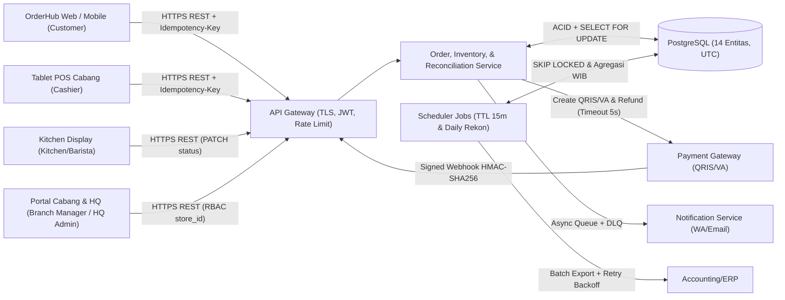

# API & Webhook Integration Contract — NusaPOS & OrderHub (Fase 1)

> **Konteks Portofolio & Referensi Kurikulum:** Dokumen ini mengunci kontrak antarmuka REST API dan Webhook untuk Fase 1 **NusaPOS & OrderHub**, mengacu pada [02-srs-nusapos.md](02-srs-nusapos.md), struktur integrasi pada Bab 09, dan Kamus Domain Kanonik di [`README.md`](../README.md).

---

## 1. Standar Umum API, Auth JWT/RBAC, & Error Envelope

### 1.1 Konvensi Dasar & Header Wajib

| Aspek | Standar Kanonik Fase 1 |
| :--- | :--- |
| **Base URL** | `https://api.nusakopi.internal` (Staging: `https://staging-api.nusakopi.internal`) |
| **Protokol & Format** | HTTPS / TLS 1.2+, `Content-Type: application/json`, encoding UTF-8 |
| **Konvensi Penamaan** | Body JSON dan kolom DB menggunakan `snake_case` (`store_id`, `variant_id`, `total_amount`); parameter path menggunakan `{storeId}`, `{orderId}`. |
| **Representasi Uang** | Bilangan bulat Rupiah (`BIGINT` / JSON integer) tanpa desimal sen; kalkulasi diskon & pajak menggunakan pembulatan `HALF_UP` di sisi server. |
| **Standar Timestamp** | ISO-8601 UTC (`YYYY-MM-DDTHH:mm:ssZ`, contoh `2026-11-25T05:30:00Z`). |
| **Header Wajib Klien** | `Authorization: Bearer <JWT>` (selain login/webhook); `Idempotency-Key: <uuid-v4>` (wajib pada `POST /api/v1/orders` dan `POST /api/v1/orders/{orderId}/refunds`). |

### 1.2 Struktur Klaim JWT & Penegakan RBAC per Cabang (`store_id`)

Token akses yang diterbitkan oleh `POST /api/v1/auth/login` berisi klaim minimal berikut:
```json
{
  "sub": "usr-cashier-01",
  "role": "Cashier",
  "store_id": "STR-001",
  "iat": 1795584600,
  "exp": 1795588200
}
```
- Aktor internal cabang (`Cashier`, `Kitchen/Barista`, `Branch Manager`) wajib memiliki `store_id` yang cocok dengan `orders.store_id` atau query cabang terkait (`Zero-Trust Client`).
- `HQ Admin` dapat mengakses master lintas cabang; `Customer` hanya dapat mengakses pesanan miliknya sendiri (`orders.customer_id == jwt.sub`) dan membuat pesanan dengan `channel = "ONLINE_PICKUP"`.

### 1.3 Standard Error Envelope & Kode Error Kanonik

Seluruh respons kegagalan (`4xx` dan `5xx`) wajib mengembalikan struktur JSON seragam berikut tanpa membocorkan *stack trace* internal:

```json
{
  "success": false,
  "error": {
    "code": "ERR_INSUFFICIENT_STOCK",
    "message": "Stok varian Kopi Susu Aren (Large) di cabang tidak mencukupi.",
    "details": {
      "store_id": "STR-001",
      "variant_id": "VAR-002",
      "requested_qty": 3,
      "available_qty": 1
    },
    "trace_id": "req-9f8e7d6c5b4a"
  }
}
```

| Kode Error Kanonik | HTTP Status | Kondisi Pengembalian |
| :--- | :---: | :--- |
| `ERR_INSUFFICIENT_STOCK` | `409 Conflict` | `requested_qty` melebihi `inventories.on_hand_qty - inventories.reserved_qty` pada cabang `store_id`. |
| `ERR_INVALID_STATE_TRANSITION` | `422 Unprocessable Entity` | Upaya perubahan `orders.status` yang melanggar matriks 8 status kanonik Fase 1 (misal `PENDING_PAYMENT -> PREPARING` atau `COMPLETED -> PREPARING`). |
| `ERR_DUPLICATE_IDEMPOTENCY` | `409 Conflict` / `200 OK` | Untuk mutasi klien dengan `Idempotency-Key` sama tetapi payload berbeda mengembalikan `409`; untuk replay webhook dengan `external_tx_id` yang sudah `PAID` mengembalikan `200 OK` (*idempotent acknowledgement*). |
| `ERR_UNAUTHORIZED_APPROVAL` | `403 Forbidden` | Pengguna bukan `Branch Manager` mencoba menyetujui/menolak void/refund, atau aktor cabang mengakses `store_id` di luar wewenangnya. |
| `ERR_RESERVATION_EXPIRED` | `410 Gone` | Pembayaran atau webhook masuk ketika pesanan sudah berstatus `EXPIRED` / melewati `expires_at` 15 menit. |

---

## 2. Peta Arsitektur Integrasi Fase 1



---

## 3. Kontrak Endpoint Kanonik Inti (`FR-01` s.d. `FR-08`)

### 3.1 `POST /api/v1/auth/login` — Autentikasi & Penerbitan Token (`FR-01`, `UC-01`)

- **Otorisasi:** Publik (dilindungi *rate limit* maks. 10 gagal/5 menit per IP/email).

**Request Body:**
```json
{
  "email": "cashier_01@nusakopi.id",
  "password": "PasswordKuat#2026"
}
```

**Response Sukses (`200 OK`):**
```json
{
  "success": true,
  "data": {
    "access_token": "eyJhbGciOiJIUzI1NiIsInR5cCI6IkpXVCJ9.sample.signature",
    "token_type": "Bearer",
    "expires_in_seconds": 3600,
    "user": {
      "user_id": "usr-cashier-01",
      "full_name": "Siti Rahma",
      "role": "Cashier",
      "store_id": "STR-001"
    }
  }
}
```

**Response Gagal Kredensial (`401 Unauthorized`):**
```json
{
  "success": false,
  "error": {
    "code": "ERR_INVALID_CREDENTIALS",
    "message": "Email atau kata sandi salah.",
    "details": {},
    "trace_id": "req-auth-1001"
  }
}
```

---

### 3.2 `GET /api/v1/stores/{storeId}/menu` — Katalog Menu & Stok Cabang Real-Time (`FR-02`, `UC-02`, `UC-03`)

- **Otorisasi:** `Customer`, `Cashier`, `Branch Manager`, `HQ Admin`.
- **Query Parameters:** `category` (opsional), `in_stock` (`true`/`false`), `page` (default `1`), `limit` (default `20`, maks `50`).

**Response Sukses (`200 OK`):**
```json
{
  "success": true,
  "data": {
    "store_id": "STR-001",
    "store_name": "NusaKopi Sudirman",
    "timezone": "Asia/Jakarta",
    "items": [
      {
        "product_id": "PRD-001",
        "product_name": "Kopi Susu Aren",
        "category": "COFFEE",
        "variant_id": "VAR-001",
        "sku": "KSA-REG-ICE",
        "variant_name": "Regular Iced",
        "base_price": 28000,
        "available_qty": 10,
        "in_stock": true
      },
      {
        "product_id": "PRD-001",
        "product_name": "Kopi Susu Aren",
        "category": "COFFEE",
        "variant_id": "VAR-002",
        "sku": "KSA-LRG-ICE",
        "variant_name": "Large Iced",
        "base_price": 34000,
        "available_qty": 1,
        "in_stock": true
      }
    ],
    "active_promotions": [
      {
        "code": "KOPIPAGI10",
        "discount_type": "PERCENTAGE",
        "discount_value": 10,
        "min_spend": 50000
      }
    ]
  },
  "meta": {
    "page": 1,
    "limit": 20,
    "total_items": 2,
    "total_pages": 1
  }
}
```

---

### 3.3 `POST /api/v1/orders` — Pembuatan Pesanan POS & Online Self-Pickup (`FR-03`, `UC-02`, `UC-03`)

- **Otorisasi:** `Authorization: Bearer <JWT>` (`Customer` hanya boleh `channel = "ONLINE_PICKUP"` dengan `QRIS`/`VA`; `Cashier` boleh `channel = "POS"` pada `store_id` penugasannya dengan `CASH`/`QRIS`/`VA`).
- **Header Wajib:** `Content-Type: application/json`, `Idempotency-Key: <uuid-v4>`.

**Request Body (`ONLINE_PICKUP` oleh `Customer` via `SCR-ORD-002`):**
```json
{
  "store_id": "STR-001",
  "channel": "ONLINE_PICKUP",
  "payment_method": "QRIS",
  "promo_code": "KOPIPAGI10",
  "items": [
    {
      "variant_id": "VAR-001",
      "qty": 2,
      "notes": "Less sugar, es sedikit"
    },
    {
      "variant_id": "VAR-005",
      "qty": 1,
      "notes": null
    }
  ]
}
```

**Response Sukses (`201 Created` — `ONLINE_PICKUP` `QRIS`):**
```json
{
  "success": true,
  "data": {
    "order_id": "ORD-20261125-0042",
    "store_id": "STR-001",
    "channel": "ONLINE_PICKUP",
    "status": "PENDING_PAYMENT",
    "currency": "IDR",
    "subtotal_amount": 80000,
    "discount_amount": 8000,
    "tax_amount": 7920,
    "total_amount": 79920,
    "expires_at": "2026-11-25T05:45:00Z",
    "payment": {
      "payment_id": "PAY-20261125-0042",
      "method": "QRIS",
      "status": "PENDING",
      "qris_payload": "00020101021226580016ID.CO.QRIS.WWW0118936005030000089824"
    }
  }
}
```

**Response Error Stok Kurang (`409 Conflict` — `ERR_INSUFFICIENT_STOCK`):**
```json
{
  "success": false,
  "error": {
    "code": "ERR_INSUFFICIENT_STOCK",
    "message": "Stok varian Kopi Susu Aren (Large) di cabang tidak mencukupi.",
    "details": {
      "store_id": "STR-001",
      "variant_id": "VAR-002",
      "requested_qty": 3,
      "available_qty": 1
    },
    "trace_id": "req-9f8e7d6c5b4a"
  }
}
```

**Response Error Idempotensi Konflik Payload (`409 Conflict` — `ERR_DUPLICATE_IDEMPOTENCY`):**
```json
{
  "success": false,
  "error": {
    "code": "ERR_DUPLICATE_IDEMPOTENCY",
    "message": "Idempotency-Key telah digunakan untuk payload transaksi yang berbeda.",
    "details": {
      "idempotency_key": "550e8400-e29b-41d4-a716-446655440000"
    },
    "trace_id": "req-7c6b5a4d3e2f"
  }
}
```

---

### 3.4 `POST /api/v1/webhooks/payments/qris` — Callback Asinkron Pembayaran (`FR-04`, `UC-04`)

- **Autentikasi:** Tanpa JWT pengguna; wajib verifikasi header `X-Webhook-Signature` (`HMAC-SHA256(secret, timestamp + "." + raw_body)`) dan `X-Webhook-Timestamp` (selisih maksimal 5 menit dari waktu UTC server).
- **Aturan Idempotency:** Berdasarkan `external_tx_id`.

**Request Payload dari `Payment Gateway (QRIS/VA)`:**
```json
{
  "event_id": "EVT-PG-88912",
  "external_tx_id": "PG-QRIS-20261125-9910",
  "order_id": "ORD-20261125-0042",
  "payment_status": "SETTLED",
  "paid_amount": 79920,
  "paid_at": "2026-11-25T05:32:10Z"
}
```

**Response Sukses Pertama Kali (`200 OK`):**
```json
{
  "success": true,
  "data": {
    "order_id": "ORD-20261125-0042",
    "status": "PAID",
    "idempotent_replay": false
  }
}
```

**Response Sukses Pengiriman Ulang / Duplikat (`200 OK` — *Idempotent Acknowledgement*):**
```json
{
  "success": true,
  "data": {
    "order_id": "ORD-20261125-0042",
    "status": "PAID",
    "idempotent_replay": true
  }
}
```

**Response Error Webhook Masuk Setelah TTL 15 Menit Kedaluwarsa (`410 Gone` — `ERR_RESERVATION_EXPIRED`):**
```json
{
  "success": false,
  "error": {
    "code": "ERR_RESERVATION_EXPIRED",
    "message": "Batas waktu reservasi stok 15 menit telah berakhir; pesanan berstatus EXPIRED dan insiden dicatat untuk rekonsiliasi dana.",
    "details": {
      "order_id": "ORD-20261125-0045",
      "external_tx_id": "PG-QRIS-20261125-9915",
      "current_status": "EXPIRED"
    },
    "trace_id": "req-wh-41001"
  }
}
```

---

### 3.5 `PATCH /api/v1/orders/{orderId}/status` — Transisi Status Dapur & Pembatalan Pra-Bayar (`FR-05`, `FR-06`, `UC-05`)

- **Otorisasi & Aturan Transisi:**
  - `PAID -> PREPARING` dan `PREPARING -> READY`: `Kitchen/Barista` atau `Branch Manager` pada `store_id` yang sama.
  - `READY -> COMPLETED`: `Cashier` atau `Branch Manager` pada `store_id` yang sama.
  - `PENDING_PAYMENT -> CANCELLED`: `Customer` pemilik order (`ONLINE_PICKUP`) atau `Cashier` cabang terkait (`POS`).

**Request Body:**
```json
{
  "status": "PREPARING",
  "notes": "Mulai diracik oleh barista shift pagi"
}
```

**Response Sukses (`200 OK`):**
```json
{
  "success": true,
  "data": {
    "order_id": "ORD-20261125-0042",
    "store_id": "STR-001",
    "previous_status": "PAID",
    "status": "PREPARING",
    "updated_at": "2026-11-25T05:33:00Z"
  }
}
```

**Response Error Transisi Ilegal (`422 Unprocessable Entity` — `ERR_INVALID_STATE_TRANSITION`):**
```json
{
  "success": false,
  "error": {
    "code": "ERR_INVALID_STATE_TRANSITION",
    "message": "Transisi status dari EXPIRED ke PREPARING tidak diizinkan.",
    "details": {
      "order_id": "ORD-20261125-0045",
      "from_status": "EXPIRED",
      "to_status": "PREPARING"
    },
    "trace_id": "req-st-42201"
  }
}
```

---

### 3.6 `POST /api/v1/orders/{orderId}/refunds` — Pengajuan & Approval Void/Refund (`FR-07`, `UC-06`)

- **Otorisasi:** `Cashier` pada `store_id` terkait hanya boleh mengirim `action = "REQUEST"`. Hanya `Branch Manager` dengan `jwt.store_id == orders.store_id` yang boleh mengirim `action = "APPROVE"` atau `"REJECT"`.
- **Header Wajib:** `Authorization: Bearer <JWT>`, `Idempotency-Key: <uuid-v4>`.

**Request Body (`APPROVE` oleh `Branch Manager` via `SCR-REF-001`):**
```json
{
  "action": "APPROVE",
  "reason_code": "CASHIER_ERROR",
  "reason_notes": "Pelanggan ingin ganti varian non-kopi karena alergi.",
  "restock_items": true,
  "manager_pin": "654321"
}
```

**Response Sukses Approval (`200 OK`):**
```json
{
  "success": true,
  "data": {
    "refund_id": "REF-20261125-0008",
    "order_id": "ORD-20261125-0042",
    "order_status": "REFUNDED",
    "refund_status": "COMPLETED",
    "refund_amount": 79920,
    "restock_items": true,
    "approved_by": "usr-mgr-01",
    "approved_at": "2026-11-25T05:40:00Z"
  }
}
```

**Response Error Jika `Cashier` Mencoba Mengirim `"action": "APPROVE"` (`403 Forbidden` — `ERR_UNAUTHORIZED_APPROVAL`):**
```json
{
  "success": false,
  "error": {
    "code": "ERR_UNAUTHORIZED_APPROVAL",
    "message": "Persetujuan void/refund pasca-bayar hanya dapat dilakukan oleh Branch Manager cabang terkait.",
    "details": {
      "order_id": "ORD-20261125-0042",
      "required_role": "Branch Manager",
      "actual_role": "Cashier"
    },
    "trace_id": "req-3a2b1c4d5e6f"
  }
}
```

---

### 3.7 `GET` & `POST /api/v1/reconciliations/daily` — Rekonsiliasi Harian Cabang (`FR-08`, `UC-06`)

- **Otorisasi:** `Branch Manager` (wajib terikat `jwt.store_id == store_id`) atau `HQ Admin` (baca lintas cabang).
- **Aturan Waktu:** Parameter `business_date` (`YYYY-MM-DD`) dikelompokkan berdasarkan zona waktu cabang (`Asia/Jakarta`), bukan tanggal UTC mentah.

**`GET /api/v1/reconciliations/daily?store_id=STR-001&business_date=2026-11-25` — Response (`200 OK`):**
```json
{
  "success": true,
  "data": {
    "reconciliation_id": "REC-STR001-20261125",
    "store_id": "STR-001",
    "timezone": "Asia/Jakarta",
    "business_date": "2026-11-25",
    "window_utc": {
      "start_utc": "2026-11-24T17:00:00Z",
      "end_utc": "2026-11-25T17:00:00Z"
    },
    "total_pos_amount": 4500000,
    "total_online_amount": 3250000,
    "expected_cash_amount": 1800000,
    "total_qris_va_amount": 5950000,
    "total_refund_amount": 79920,
    "net_sales_amount": 7670080,
    "erp_sync_status": "PENDING_SIGN_OFF"
  }
}
```

**`POST /api/v1/reconciliations/daily` — Request Body (Finalisasi oleh `Branch Manager` via `SCR-REC-001`):**
```json
{
  "store_id": "STR-001",
  "business_date": "2026-11-25",
  "actual_cash_amount": 1800000,
  "notes": "Setoran tunai laci kasir cocok dengan catatan sistem."
}
```

**`POST /api/v1/reconciliations/daily` — Response Sukses (`200 OK`):**
```json
{
  "success": true,
  "data": {
    "reconciliation_id": "REC-STR001-20261125",
    "store_id": "STR-001",
    "business_date": "2026-11-25",
    "expected_cash_amount": 1800000,
    "actual_cash_amount": 1800000,
    "variance_amount": 0,
    "erp_sync_status": "QUEUED_FOR_SYNC",
    "signed_by": "usr-mgr-01",
    "signed_at": "2026-11-25T16:30:00Z"
  }
}
```

---

## 4. Ringkasan Kontrak Endpoint Master & Administrasi (`BR-06`)

Endpoint berikut mendukung pengelolaan master data Fase 1 pada 14 entitas inti dengan otorisasi ketat RBAC:

| Endpoint | Method | Aktor Diizinkan | Entitas Utama | Fungsi & Aturan Ringkas |
| :--- | :--- | :--- | :--- | :--- |
| `/api/v1/admin/stores` | `GET`, `POST`, `PATCH` | `HQ Admin` | `stores` | Kelola daftar cabang, kode cabang, zona waktu (`Asia/Jakarta`), dan status operasional aktif. |
| `/api/v1/admin/products` | `GET`, `POST`, `PATCH`, `DELETE` | `HQ Admin` | `products`, `product_variants` | Kelola induk menu, varian SKU, harga `BIGINT`, dan *soft delete* (`deleted_at`). |
| `/api/v1/stores/{storeId}/inventories/adjust` | `POST` | `Branch Manager` (`store_id` sama), `HQ Admin` | `inventories`, `inventory_movements`, `audit_logs` | Input mutasi `RESTOCK` atau `ADJUSTMENT` stok opname dalam transaksi atomik. |
| `/api/v1/admin/promotions` | `GET`, `POST`, `PATCH` | `HQ Admin` | `promotions`, `audit_logs` | Terbitkan kode voucher promo, kuota, batas minimal belanja, dan masa berlaku UTC. |
| `/api/v1/admin/users` | `GET`, `POST`, `PATCH` | `HQ Admin` | `users`, `roles`, `audit_logs` | Buat akun staf gerai, tetapkan `role_id` dan `default_store_id`, atau nonaktifkan akun. |
