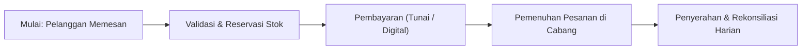

# Business Requirements Document (BRD)

> **Petunjuk Penggunaan Template:** Salin template ini untuk setiap inisiatif bisnis atau proyek baru. Hapus teks panduan di dalam tanda kurung siku `[...]` setelah Anda mengisinya dengan informasi proyek yang sesungguhnya. Fokus utama BRD adalah **"Apa masalah bisnisnya, apa tujuannya, dan apa batasannya"**, bukan detail teknis tabel database atau skema JSON.

---

## 1. Kontrol Dokumen

| Atribut | Detail |
| :--- | :--- |
| **Nama Proyek / Inisiatif** | `[Nama Sistem atau Inisiatif Proyek]` |
| **ID Dokumen** | `[misal: BRD-PROJ-001]` |
| **Versi** | `[misal: v1.0 (Final Draft)]` |
| **Tanggal Dibuat** | `[YYYY-MM-DD]` |
| **Pembuat (Author)** | `[Nama System Analyst / Business Analyst]` |
| **Pemilik Bisnis (Business Owner)** | `[Nama & Jabatan Sponsor Bisnis]` |
| **Status Dokumen** | `[Draft / In Review / Approved]` |

### Riwayat Perubahan Dokumen

| Versi | Tanggal | Penulis | Ringkasan Perubahan |
| :--- | :--- | :--- | :--- |
| `v0.1` | `[YYYY-MM-DD]` | `[Nama]` | Inisiasi draf awal hasil workshop elisitasi |
| `v1.0` | `[YYYY-MM-DD]` | `[Nama]` | Finalisasi pasca-review pemangku kepentingan untuk sign-off |

---

## 2. Konteks Bisnis & Latar Belakang Masalah

### 2.1 Kondisi Saat Ini (*As-Is*) & Masalah Bisnis
`[Jelaskan bagaimana proses bisnis berjalan saat ini, sistem apa yang dipakai atau apakah masih manual, serta rasa sakit (pain points) operasional atau kerugian finansial yang terjadi. Gunakan data kuantitatif jika ada.]`

- **Masalah 1:** `[Contoh: Rekonsiliasi penjualan harian memakan waktu 2 jam per cabang karena data POS dan pembayaran digital terpisah.]`
- **Masalah 2:** `[Contoh: Pelanggan sering kecewa karena pesanan ditolak setelah pembayaran akibat stok tidak sinkron.]`

### 2.2 Peluang & Nilai Bisnis (*Business Drivers*)
`[Jelaskan mengapa inisiatif ini harus dilakukan sekarang—apakah untuk meningkatkan pendapatan, menekan kebocoran biaya, kepatuhan regulasi, atau meningkatkan retensi pelanggan.]`

---

## 3. Objektif Bisnis Terukur & Indikator Keberhasilan (KPI)

Setiap objektif bisnis wajib dapat diukur (*SMART: Specific, Measurable, Achievable, Relevant, Time-bound*) agar keberhasilan proyek dapat dievaluasi setelah rilis.

| ID Objektif | Pernyataan Objektif Bisnis | Indikator Keberhasilan (KPI) | Kondisi Awal (*Baseline*) | Target Pasca-Rilis | Waktu Pengukuran |
| :--- | :--- | :--- | :--- | :--- | :--- |
| `OBJ-01` | `[Contoh: Mengurangi selisih stok dan pembatalan akibat stok kosong]` | `[Persentase order batal karena stok habis]` | `[misal: 8% per bulan]` | `[< 1% per bulan]` | `[3 bulan pasca-Go-Live]` |
| `OBJ-02` | `[Contoh: Mempercepat proses tutup buku harian cabang]` | `[Rata-rata waktu rekonsiliasi harian cabang]` | `[misal: 120 menit/hari]` | `[<= 15 menit/hari]` | `[1 bulan pasca-Go-Live]` |
| `OBJ-03` | `[Tambahkan sesuai kebutuhan]` | `[...]` | `[...]` | `[...]` | `[...]` |

---

## 4. Ruang Lingkup Proyek (*Project Scope*)

Batasan ruang lingkup yang tegas mencegah *scope creep* (penambahan fitur tak terkendali di tengah proyek).

### 4.1 Termasuk dalam Ruang Lingkup (*In-Scope*)
- `[Daftar kemampuan bisnis/modul yang wajib dibangun pada fase ini.]`
- `[Contoh: Integrasi kasir cabang (POS) dan pemesanan self-pickup online dalam satu inventori terpusat.]`
- `[Contoh: Persetujuan void/refund pasca-bayar secara digital oleh kepala cabang.]`

### 4.2 Di Luar Ruang Lingkup (*Out-of-Scope*)
- `[Daftar kemampuan yang secara eksplisit TIDAK dikerjakan di fase ini beserta alasannya.]`
- `[Contoh: Pengiriman menggunakan kurir pihak ketiga (3PL) — direncanakan untuk Fase 2 setelah alur cabang stabil.]`
- `[Contoh: Mode transaksi offline penuh tanpa koneksi internet.]`

---

## 5. Pemangku Kepentingan (*Stakeholders*) & Matriks RACI

### 5.1 Daftar Pemangku Kepentingan

| Peran / Unit Bisnis | Nama / PIC | Kepentingan Utama (*Interests*) | Pengaruh (*Power*) |
| :--- | :--- | :--- | :--- |
| **Project Sponsor** | `[Nama]` | ROI, ketepatan jadwal peluncuran, pengendalian anggaran | Tinggi |
| **Operational / Store Lead** | `[Nama]` | Kemudahan pakai kasir & dapur, kecepatan pelayanan | Tinggi |
| **Finance & Accounting** | `[Nama]` | Akurasi jurnal, pajak, pembulatan, jejak audit | Tinggi |
| **IT / Engineering Lead** | `[Nama]` | Kelayakan teknis, keamanan, keandalan integrasi | Sedang–Tinggi |

### 5.2 Matriks RACI Pengambilan Keputusan
*(R = Responsible / Pelaksana, A = Accountable / Pengambil Keputusan Akhir, C = Consulted / Dimintai Masukan, I = Informed / Diberi Informasi)*

| Aktivitas / Deliverable | Sponsor | Operational Lead | Finance | System Analyst | Engineering/QA |
| :--- | :---: | :---: | :---: | :---: | :---: |
| Penetapan Ruang Lingkup & Prioritas Bisnis | `A` | `C` | `C` | `R` | `I` |
| Penyusunan & Validasi Aturan Bisnis | `I` | `R` | `C` | `R` / `A` *(dokumen)* | `C` |
| Persetujuan Alur Keuangan, Pajak, & Refund | `I` | `C` | `A` | `R` | `I` |
| Eksekusi *User Acceptance Testing* (UAT) | `I` | `R` | `R` | `C` | `C` |
| Keputusan *Go / No-Go* Rilis Produksi | `A` | `C` | `C` | `R` | `C` |

---

## 6. Kebutuhan Bisnis Tingkat Tinggi (*High-Level Business Requirements*)

| ID Kebutuhan | Kategori | Deskripsi Kebutuhan Bisnis | Prioritas (MoSCoW) |
| :--- | :--- | :--- | :---: |
| `BR-01` | `[Transaksi]` | `[Contoh: Sistem harus menyatukan stok penjualan toko dan pesanan online secara real-time per cabang.]` | `Must Have` |
| `BR-02` | `[Pembayaran]` | `[Contoh: Sistem harus menerima pembayaran digital terverifikasi otomatis tanpa input manual kasir.]` | `Must Have` |
| `BR-03` | `[Kontrol & Audit]` | `[Contoh: Setiap pembatalan transaksi yang sudah dibayar wajib disetujui oleh kepala cabang dan tercatat.]` | `Must Have` |
| `BR-04` | `[Pelaporan]` | `[Contoh: Sistem harus menghasilkan ringkasan tutup buku harian per cabang siap ekspor ke tim akuntansi.]` | `Should Have` |

---

## 7. Asumsi, Risiko, Dependensi, & Batasan (*RAID & Constraints*)

### 7.1 Asumsi (*Assumptions*)
- `[Contoh: Setiap cabang sudah memiliki koneksi internet stabil minimal 20 Mbps selama jam operasional.]`
- `[Contoh: Struktur pajak dan tarif biaya transaksi sudah disepakati sebelum fase desain dimulai.]`

### 7.2 Batasan (*Constraints*)
- `[Contoh: Anggaran, batas waktu peluncuran (misal Q3), kepatuhan regulasi pajak/data pribadi, atau kewajiban memakai vendor Payment Gateway yang sudah dikontrak.]`

### 7.3 Risiko Bisnis & Mitigasi (*Risks*)

| ID Risiko | Deskripsi Risiko | Dampak | Kemungkinan | Rencana Mitigasi |
| :--- | :--- | :---: | :---: | :--- |
| `RISK-01` | `[Contoh: Keterlambatan persetujuan legal/API dari penyedia layanan pembayaran eksternal]` | Tinggi | Sedang | `[Mulai pendaftaran merchant dan akses sandbox di minggu ke-1 proyek]` |
| `RISK-02` | `[Contoh: Penolakan adaptasi oleh staf cabang saat hari pertama peluncuran]` | Sedang | Sedang | `[Siapkan pelatihan langsung, buku saku, dan pilot project di 2 cabang utama]` |

### 7.4 Dependensi (*Dependencies*)
- `[Contoh: Kesiapan dokumentasi API dari tim Accounting/ERP eksternal sebelum pengembangan modul rekonsiliasi.]`

---

## 8. Gambaran Alur Bisnis Target (*To-Be High-Level Flow*)

`[Sertakan ringkasan alur tingkat tinggi dari awal hingga akhir (dapat dilengkapi diagram Mermaid flowchart sederhana agar pembaca non-teknis langsung mendapat gambaran besar).]`

---

## 9. Lembar Persetujuan (*Sign-Off*)

Dengan menandatangani dokumen ini, seluruh pemangku kepentingan menyetujui bahwa konteks bisnis, objektif, dan batasan ruang lingkup yang tertulis telah akurat dan menjadi dasar penyusunan spesifikasi sistem (*SRS*). Perubahan ruang lingkup setelah dokumen ini disetujui harus melalui prosedur *Change Request (CR)*.

| Nama | Jabatan / Peran | Keputusan | Tanggal | Tanda Tangan |
| :--- | :--- | :---: | :--- | :--- |
| `[Nama Sponsor]` | Business Sponsor | `[Approved]` | `[YYYY-MM-DD]` | `[__________]` |
| `[Nama Ops Lead]` | Operational Lead | `[Approved]` | `[YYYY-MM-DD]` | `[__________]` |
| `[Nama Finance]` | Finance / Accounting Lead | `[Approved]` | `[YYYY-MM-DD]` | `[__________]` |
| `[Nama SA]` | System Analyst (Author) | `[Submitted]` | `[YYYY-MM-DD]` | `[__________]` |
