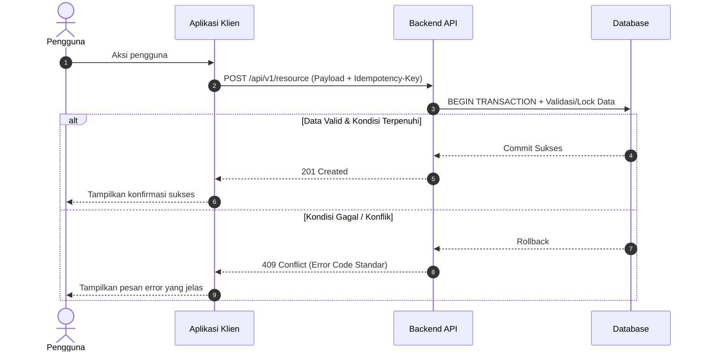

# Functional Specification Document (FSD)

> **Petunjuk Penggunaan Template:** Jika BRD menjelaskan *"mengapa & apa target bisnisnya"* dan SRS mengunci *"apa kebutuhan sistem secara formal"*, maka **FSD** menerjemahkan satu fitur atau modul tertentu menjadi panduan eksekusi teknis tingkat rinci bagi pengembang (*Backend*, *Frontend*) dan *QA*. FSD sangat umum digunakan di perusahaan perbankan, *fintech*, *e-commerce*, maupun *enterprise*.

---

## Kontrol Dokumen

| Atribut | Detail |
| :--- | :--- |
| **Nama Fitur / Modul** | `[misal: Modul Checkout & Reservasi Stok Online]` |
| **ID Dokumen** | `[misal: FSD-ORD-001]` |
| **Versi** | `[v1.0]` |
| **Referensi SRS / FR** | `[misal: SRS-PROJ-001 (FR-03, FR-04, NFR-02)]` |
| **Penulis (System Analyst)** | `[Nama SA]` |
| **Reviewer Teknis (Tech Lead / QA)** | `[Nama Reviewer]` |
| **Tanggal** | `[YYYY-MM-DD]` |

---

## 1. Ikhtisar Teknis Fitur

`[Jelaskan secara ringkas tujuan fungsional fitur ini, komponen sistem apa saja yang terlibat (misal: Web/Mobile Client, Order Service, Inventory Service, Payment Gateway, Scheduler), serta batasan teknis yang perlu diperhatikan.]`

- **Prasyarat (*Preconditions*):** `[Kondisi sistem/data yang harus terpenuhi sebelum fitur berjalan.]`
- **Asumsi Teknis:** `[Contoh: Operasi penulisan stok dilakukan di dalam satu transaksi database ACID.]`

---

## 2. Alur Sistem & Interaksi Komponen (*Sequence Flow*)

`[Gambarkan alur pesan sinkron dan asinkron antar aktor/komponen menggunakan Sequence Diagram, termasuk jalur sukses, jalur gagal, dan blok kondisi (alt/opt/loop).]`



---

## 3. Desain Data & Perubahan Skema (*Data Design*)

### 3.1 Daftar Tabel yang Terlibat / Dimodifikasi

| Nama Tabel | Jenis Operasi | Keterangan Perubahan / Penggunaan |
| :--- | :--- | :--- |
| `[nama_tabel_1]` | `[Baru / Alter / Read-Write]` | `[Jelaskan perannya pada fitur ini]` |
| `[nama_tabel_2]` | `[Read-Only / Append-Only]` | `[Jelaskan perannya pada fitur ini]` |

### 3.2 Spesifikasi Kolom, Tipe Data, & Constraint

| Tabel | Nama Kolom | Tipe Data | Nullable | Default / Constraint | Deskripsi & Aturan Bisnis |
| :--- | :--- | :--- | :---: | :--- | :--- |
| `[tabel]` | `id` | `UUID / BIGINT` | `NO` | `PRIMARY KEY` | Identitas unik baris data |
| `[tabel]` | `amount` | `BIGINT` | `NO` | `CHECK (amount >= 0)` | Nominal uang dalam bilangan bulat Rupiah |
| `[tabel]` | `status` | `VARCHAR(32)` | `NO` | `ENUM / CHECK (...)` | Status entitas sesuai state machine |
| `[tabel]` | `created_at` | `TIMESTAMPTZ` | `NO` | `UTC NOW()` | Disimpan UTC; ditampilkan lokal cabang (`Asia/Jakarta`) |

### 3.3 Kebutuhan Indexing & Concurrency Locking
- **Unique Index:** `[Contoh: UNIQUE (store_id, variant_id) pada inventories; UNIQUE (idempotency_key) pada payments.]`
- **Query Index:** `[Contoh: INDEX (status, expires_at) pada orders untuk mempercepat query scheduler.]`
- **Strategi Locking:** `[Contoh: Gunakan SELECT ... FOR UPDATE (Pessimistic Locking) saat memodifikasi stok atau optimistic lock via kolom version.]`

---

## 4. Kontrak API & Integrasi Eksternal

### 4.1 Spesifikasi Endpoint

| Atribut | Nilai |
| :--- | :--- |
| **Endpoint & Method** | `[POST /api/v1/orders]` |
| **Autentikasi & Otorisasi** | `[Bearer JWT; Role yang diizinkan: Customer, Cashier]` |
| **Header Wajib** | `Content-Type: application/json`, `Idempotency-Key: <uuid>` |

#### Request Body (Contoh Valid)
```json
{
  "store_id": "STR-001",
  "channel": "ONLINE_PICKUP",
  "items": [
    {
      "variant_id": "VAR-001",
      "qty": 2,
      "notes": "Less sugar"
    }
  ]
}
```

#### Response Sukses (`201 Created`)
```json
{
  "success": true,
  "data": {
    "order_id": "ORD-20261125-0001",
    "status": "PENDING_PAYMENT",
    "total_amount": 56000,
    "expires_at": "2026-11-25T05:15:00Z"
  }
}
```

### 4.2 Ketentuan Integrasi Pihak Ketiga / Webhook (Jika Ada)
- **Verifikasi Keamanan:** `[Contoh: Validasi header X-Signature menggunakan HMAC-SHA256 dengan secret key.]`
- **Timeout & Retry:** `[Contoh: HTTP timeout koneksi 3 detik, baca 5 detik; retry maksimal 3 kali dengan backoff.]`
- **Idempotency Handling:** `[Contoh: Jika external_tx_id sudah berstatus PAID di database, kembalikan HTTP 200 OK tanpa mengubah stok atau saldo lagi.]`

---

## 5. Validasi Input & Matriks Error Handling

| Skenario / Kondisi Gagal | HTTP Status | Kode Error Standar | Pesan ke Pengguna (UI) | Catatan Log / Teknis |
| :--- | :---: | :--- | :--- | :--- |
| `[Stok kurang dari qty]` | `409` | `ERR_INSUFFICIENT_STOCK` | `"Maaf, stok menu pilihan Anda baru saja berkurang."` | Sertakan `variant_id` & `available_qty` di `details` |
| `[Transisi status ilegal]` | `422` | `ERR_INVALID_STATE_TRANSITION` | `"Status pesanan tidak dapat diperbarui."` | Catat `from_status` dan `to_status` |
| `[Akses approval ditolak]` | `403` | `ERR_UNAUTHORIZED_APPROVAL` | `"Tindakan ini memerlukan otorisasi Kepala Cabang."` | Catat percobaan ilegal ke `audit_logs` |

---

## 6. Logika Batch / Scheduler & Penanganan Kasus Tepi (*Edge Cases*)

### 6.1 Spesifikasi Batch / Scheduler (Jika Relevan)
- **Nama Job:** `[misal: ReleaseExpiredReservationsJob]`
- **Jadwal Eksekusi:** `[misal: Setiap 1 menit via cron]`
- **Kriteria Data:** `[misal: orders WHERE status = 'PENDING_PAYMENT' AND expires_at <= NOW() UTC]`
- **Aksi Atomik:** `[Ubah status ke EXPIRED, kurangi reserved_qty, tulis log RELEASE pada inventory_movements.]`
- **Batas Batch / Idempotency:** `[Proses per 100 record dengan row lock SKIP LOCKED agar aman jika job tumpang tindih.]`

### 6.2 Daftar Kasus Tepi (*Edge Cases*)
1. **Webhook Pembayaran Tiba Tepat Setelah `EXPIRED`:** `[Jelaskan aturan penyelesaiannya: tolak perubahan ke PAID atau tandai untuk refund otomatis/manual agar tidak menjual barang tanpa stok.]`
2. **Pembulatan Diskon & Pajak:** `[Jelaskan rumus pembulatan eksplisit, misal HALF_UP ke Rupiah terdekat.]`
3. **Batas Hari Bisnis (*Cut-off*):** `[Jelaskan batas jam 23:59:59 waktu cabang Asia/Jakarta dikonversi ke rentang UTC.]`

---

## 7. Strategi Rollout, Konfigurasi, & Monitoring

- **Feature Flag / Konfigurasi:** `[Apakah fitur perlu diaktifkan bertahap per cabang menggunakan toggle?]`
- **Kompatibilitas Mundur (*Backward Compatibility*):** `[Apakah klien versi lama masih bisa berjalan saat backend ini dirilis lebih dulu?]`
- **Metrik & Alerting Wajib:**
  - `[Alert jika tingkat error 5xx > 1% selama 5 menit.]`
  - `[Alert jika jumlah mismatch webhook pembayaran vs status order > 0.]`
